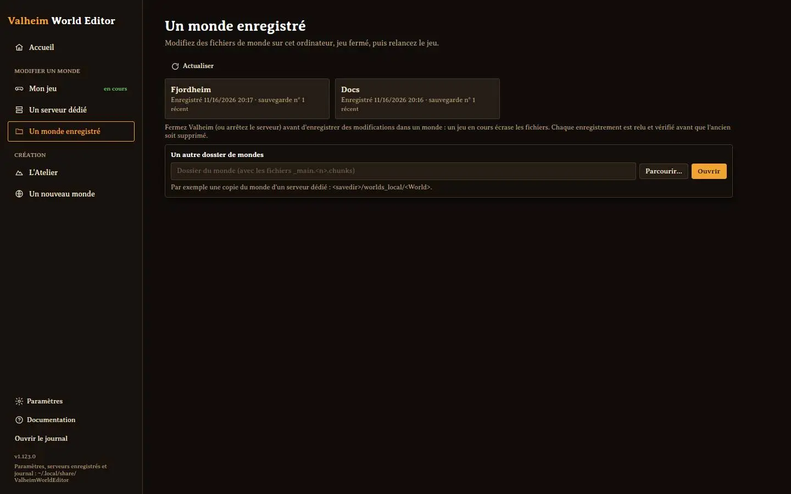

<!-- source: 289a125b -->
# Ouvrir un monde qui n'est pas dans la liste

Ouvrez un monde depuis n'importe quel dossier de cet ordinateur : une copie du monde d'un serveur, une sauvegarde, un
monde sur un autre disque.

**Il vous faut :** le dossier du monde (celui qui contient les fichiers `_main.<n>.chunks`), et aucun jeu ni serveur
qui l'utilise en cours d'exécution.

1. Fermez Valheim, ou arrêtez le serveur qui utilise le monde : un jeu en cours écrit par-dessus les fichiers que
   l'éditeur enregistre.
2. Pour le monde d'un serveur dédié, copiez son dossier, `<savedir>/worlds_local/<World>`, du serveur vers cet
   ordinateur.
3. Sur la page d'accueil, cliquez sur **Un monde enregistré**.
4. Sous **Un autre dossier de mondes**, cliquez sur **Parcourir…** et choisissez le dossier du monde, ou collez son
   chemin dans la case.
5. Cliquez sur **Ouvrir**. Le monde s'ouvre sur sa [carte](../map.md).
6. Facultatif : pour avoir le monde dans la liste à chaque fois, ouvrez **Paramètres**, cliquez sur **Ajouter un
   dossier** sous **Dossiers de mondes**, choisissez le dossier du monde (ou un dossier de mondes) avec **Parcourir…**,
   puis **Enregistrer**.

*Les mondes que l'éditeur a trouvés de lui-même, puis **Un autre dossier de mondes** avec **Parcourir…** et **Ouvrir**.*

## Vérifier le résultat

- La carte affiche le monde, avec son nom et sa graine en haut du panneau latéral.
- Dans **Accueil**, le monde figure sous **Récents** : la prochaine fois, il s'ouvre en un clic.
- Avec le dossier ajouté dans **Paramètres**, **Un monde enregistré** liste le monde avec *à vous* sous son nom.

## Annuler

Ouvrir un monde n'y change rien : seul **Enregistrer dans le monde** écrit. Pour retirer un dossier de la liste, ouvrez
**Paramètres**, cliquez sur **✕** à côté de lui sous **Dossiers de mondes**, puis sur **Enregistrer**.

## Astuces

- L'éditeur indique ce qui ne va pas avec un dossier : « That folder holds worlds; pick one of them » (ce dossier contient des
  mondes : vous avez choisi `worlds_local`, choisissez un monde à l'intérieur), ou « No Valheim world in that
  folder » (aucun monde Valheim dans ce dossier).
- Un monde dans l'ancien format à fichier unique (`<World>.db` et `.fwl`) apparaît grisé : chargez-le une fois dans
  Valheim, et le jeu le transforme en un dossier de monde que l'éditeur ouvre.
- Un monde créé avec un mod de génération de monde (Expand World, Riverheim) a besoin de son module complémentaire :
  voir [Modifier un monde créé avec Expand World, Riverheim ou Tunnelheim](use-mods-worlds.md).
- Après avoir modifié ici le monde d'un serveur, recopiez le dossier sur le serveur, serveur arrêté.

## Voir aussi

- [Sauvegarder un monde avant de le modifier](back-up-a-world.md)
- [Modifier un serveur dédié pendant que d'autres jouent](edit-a-server-live.md)
- [La fenêtre de l'éditeur](../editor-basics.md)
- [La carte du monde](../map.md)
