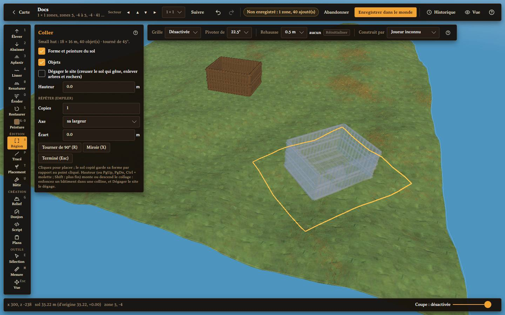

<!-- source: 45f0d395 -->
# Coller un plan dans un monde

Placez dans un monde une construction de votre bibliothèque de plans (faite dans l'Atelier, enregistrée depuis un monde
ou importée).

**Il vous faut :** un monde ouvert dans l'éditeur, avec le secteur où va la construction ouvert, et un plan dans la
bibliothèque (voir [Atelier](../workshop.md)). D'abord une sauvegarde : voir [Sauvegarder un monde](back-up-a-world.md).

## Étapes

1. Cliquez sur **Plans** dans la barre d'outils (section CRÉATION).
2. Facultatif : pour faire entrer un fichier que quelqu'un vous a envoyé, cliquez sur **Importer un fichier…** et
   choisissez le fichier `.blueprint` ou `.vbuild`.
3. Tapez un mot de son nom ou de ses étiquettes dans **Chercher des plans**.
4. Cliquez sur **Coller** à côté du plan. Le panneau se ferme et le plan suit le curseur, transparent.
5. Tournez-le avec `R` (un quart de tour) ou `,` `.` (selon **Pivoter de** dans la barre de construction) ; appuyez sur
   `X` pour le mettre en miroir.
6. Facultatif : pour l'enfoncer dans une pente, abaissez-le avec `PgDn` (ou `Ctrl` + molette). **Dégager le site** dans le
   panneau Coller (activé au départ) creuse le sol qui gêne et enlève les arbres et les rochers.
7. Cliquez là où il doit se dresser. Cliquez de nouveau ailleurs pour d'autres copies.
8. Appuyez sur `Esc` pour arrêter de coller.
9. Cliquez sur **Enregistrer dans le monde** (ou **Appliquer en direct**).

Les pièces collées contiennent ce que contient le plan : contenu des coffres, textes des panneaux, créatures. Leur
constructeur est le joueur choisi dans **Construit par** sur [la barre de construction](../build.md#la-barre-de-construction),
affichée pendant que vous collez ; les pièces d'une ruine restent sans constructeur. Les pièces de mods que ce monde n'a
pas sont laissées de côté, et le message les liste.

*Après **Coller** : la cabane suit le curseur en transparence, son emprise soulignée, tournée de 45° (`tourné de 45°` dans
le panneau **Coller**), **Dégager le site** désactivé. Derrière, la cabane d'où elle a été enregistrée.*

Un plan marqué **Un donjon** n'est pas posé au sol : son entrée va là où vous cliquez, et le bâtiment 5 000 m au-dessus.
Voir [Donjon](../dungeons.md).

## Vérifier le résultat

La construction se dresse, solide, là où vous avez cliqué, avec des points verts non enregistrés, et la barre d'état
indique combien d'objets ont été collés. Regardez sous ses bords : rien ne doit flotter. Après l'enregistrement,
rendez-vous-y en jeu.

## Annuler

- Avant l'enregistrement : `Ctrl+Z` annule chaque collage.
- Après l'enregistrement : voir [Annuler une étape, retirer une modification ou tout abandonner](undo-changes.md).

## Astuces

- Le collage doit tenir dans le secteur ouvert ; s'il indique *Non collé*, ouvrez un secteur plus grand autour de
  l'endroit.
- Les pièces que l'éditeur place lui-même (statues, accessoires, créatures) sont collées aussi, même si le marteau de
  Homestead les ignore.
- Pour modifier d'abord le plan, cliquez sur **Ouvrir** pour l'ouvrir dans l'Atelier.
- Pour garder quelque chose d'un monde comme plan : copiez-le (l'outil Région, ou `Ctrl+C` dans Sélection), puis cliquez
  sur **Enregistrer comme plan…** sur la ligne **Copie** du panneau.

## Voir aussi

- [Atelier](../workshop.md) · [Région](../area.md)
- [Déplacer ou copier un bâtiment](move-a-building.md)
- [Pièces bâties par des joueurs](../concepts/objects.md#pièces-bâties-par-un-joueur)
