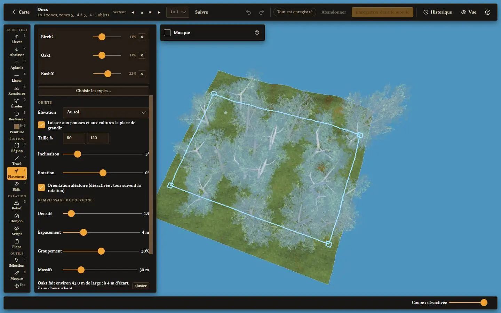

<!-- source: 78139bdb -->
# Planter une forêt, un champ ou une haie

Remplissez une étendue de terrain d'arbres en bosquets naturels, d'un champ de cultures en rangs, ou d'une haie le long
d'une ligne.

**Il vous faut :** un monde ouvert dans l'éditeur (une sauvegarde d'abord : voir
[Sauvegarder un monde](back-up-a-world.md)).

## Une forêt

1. Appuyez sur `T` pour ouvrir [Placement](../place.md).
2. Sous **Choisir un préréglage**, choisissez **Bois des Prairies** (ou **Bois de la Forêt noire**, **Marécages**).
3. En haut du panneau, choisissez **Polygone**.
4. Cliquez des points sur le sol autour du contour de la forêt, ou maintenez et faites glisser pour le dessiner à main
   levée.
5. Facultatif : sous **Remplissage de polygone**, montez **Groupement** à environ 50 % pour des bosquets séparés par
   des clairières, et réglez **Massifs** sur la taille voulue des bosquets.
6. Appuyez sur `N` (**Nouvelle disposition (N)**) jusqu'à ce que l'aperçu vous convienne.
7. Appuyez sur `Enter` pour planter.
8. Cliquez sur **Enregistrer dans le monde** (ou **Appliquer en direct**).

*Un polygone d'environ 58 × 40 m avec **Groupement** à 50 % et **Massifs** à 30 m (et **Densité** à 1.5) :
les arbres transparents se rassemblent en bosquets séparés par des clairières. Les lignes de
**Remplissage de polygone** sont en bas du panneau.*

## Un champ

1. Peignez le champ avec **Cultiver** (barre d'outils, **Peinture**, ou touche `7`) : les cultures ne poussent que sur
   un sol cultivé.
2. Dans Placement, cliquez sur **Choisir les types…**, cherchez `carrot`, cochez les cultures voulues, puis cliquez sur
   **Terminé**.
3. Choisissez **Grille**, et réglez **Espacement** sous **Grille** (1 m convient aux carottes).
4. Tracez un rectangle sur le sol cultivé, puis appuyez sur `Enter`.

Laissez **Laisser aux pousses et aux cultures la place de grandir** activé, pour que chaque culture ait la place dont
le jeu a besoin pour la faire pousser.

## Une haie

1. Dans Placement, cliquez sur **Choisir les types…**, cherchez `bush`, et cochez un ou deux buissons.
2. Choisissez **Ligne**, puis **Points**.
3. Cliquez des points le long de la haie ; réglez **Tous les** sur environ 1.5 m et **Ondulation** sur 0.25 m.
4. Appuyez sur `Enter`.

## Vérifier le résultat

L'aperçu transparent devient plein là où vous avez planté, avec un point vert « non enregistré » sur chaque objet. La
barre d'état dit combien d'objets ont été placés. En jeu, allez-y après l'enregistrement.

## Annuler

- Avant l'enregistrement : `Ctrl+Z` annule le dernier polygone, la dernière grille, ligne ou le dernier coup de
  pinceau.
- Pour en retirer quelques-uns : mode Pinceau avec les mêmes types cochés, `Shift` + glisser dessus.
- Après l'enregistrement : voir [Annuler une étape, retirer une modification ou tout abandonner](undo-changes.md).

## Voir aussi

- [Placement](../place.md)
- [Règles de pousse](../concepts/objects.md#règles-de-croissance)
- [Dégager arbres et rochers, aplanir un terrain à bâtir](clear-an-area.md)
