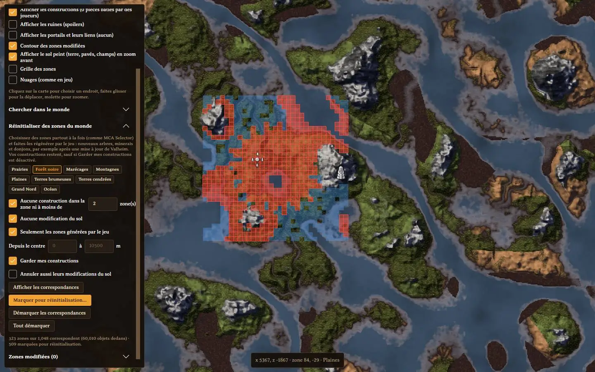

<!-- source: e87fa23c -->
# Générer à nouveau des zones

Faites recréer par le jeu des zones choisies à partir de la graine, avec de nouveaux arbres, rochers, minerais et donjons,
par exemple pour obtenir le nouveau contenu d'une mise à jour de Valheim là où personne n'a construit.

**Il vous faut :** le monde fermé dans le jeu (ou le serveur arrêté), ou le [mode direct](edit-a-server-live.md), et
une [sauvegarde du monde](back-up-a-world.md) : une réinitialisation enregistrée ne peut pas être annulée.

1. En jeu, éloignez les animaux apprivoisés des endroits que vous allez réinitialiser : tout ce qui se trouve dans une
   zone réinitialisée disparaît, sauf les pierres tombales et, avec **Garder mes constructions** activé, les pièces
   bâties par des joueurs. Fermez ensuite le jeu (ou arrêtez le serveur), sauf si vous modifiez en direct.
2. Sauvegardez le monde.
3. Ouvrez le monde. Sa [carte](../map.md) s'ouvre.
4. Dans le panneau latéral, ouvrez **Réinitialiser des zones du monde**.
5. Réglez le filtre : les biomes à réinitialiser, et laissez **Aucune construction dans la zone ni à moins de N zone(s)**
   et **Garder mes constructions** activés, afin que les bases et les terres qui les entourent restent intactes.
   Utilisez **Depuis le centre … à … m** pour ne réinitialiser qu'une partie du monde.
6. Appuyez sur **Afficher les correspondances**. La première fois, l'éditeur lit chaque zone. Les zones correspondantes
   deviennent bleues, et une ligne indique combien correspondent et combien d'objets elles contiennent.
7. Modifiez le filtre jusqu'à ce que les zones bleues soient celles que vous voulez.
8. Appuyez sur **Marquer pour réinitialisation…**. La question indique combien de zones, ce qui disparaît et si vos
   constructions sont gardées : lisez-la, puis acceptez. Les zones deviennent rouges.
9. Cliquez sur **Enregistrer dans le monde** (ou **Appliquer en direct**).

*Les zones bleues correspondent au filtre ; les zones rouges sont marquées pour réinitialisation.*

Pour ne réinitialiser que les zones sous un endroit précis, utilisez plutôt l'outil [Région](../area.md#réinitialiser-les-zones) :
tracez un cadre dessus, choisissez **Récupérer**, puis **Réinitialiser les zones** dans **Action**, et appuyez sur
**Réinitialiser les zones… (Enter)**. Il a les mêmes options **Garder mes constructions** et **Annuler aussi leurs
modifications du sol** que la carte.

## Vérifier le résultat

- Avant l'enregistrement, la ligne sous les boutons compte les zones marquées pour réinitialisation.
- En jeu, allez dans une zone réinitialisée : elle est recréée à votre approche, avec de nouveaux arbres, rochers et son
  lieu.

## Annuler

- **Avant l'enregistrement :** **Tout démarquer** (sur la carte ou dans l'outil Région) annule toutes les
  réinitialisations marquées, et **Démarquer les correspondances** seulement celles des zones que le filtre retient (une
  zone marquée avec **Réinitialiser les zones** de l'outil Région : `Ctrl+Z` aussi).
- **Après l'enregistrement :** cela ne peut pas être annulé dans l'éditeur. Remettez la sauvegarde du monde de l'étape 2
  (voir [Sauvegarder un monde avant de le modifier](back-up-a-world.md#annuler)).

## Voir aussi

- [Carte du monde](../map.md#réinitialiser-des-zones-dans-tout-le-monde)
- [Zones](../concepts/areas-and-zones.md#zones)
- [Sauvegarder un monde avant de le modifier](back-up-a-world.md)
