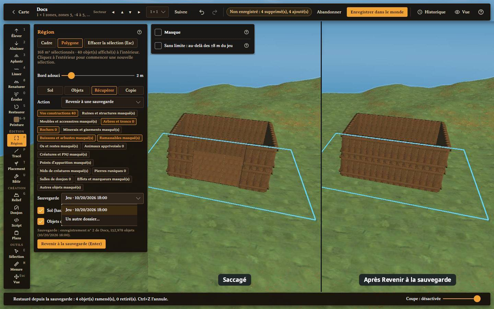

<!-- source: 0a333811 -->
# Restaurer un secteur depuis une sauvegarde

Remettez un endroit tel qu'il était dans une sauvegarde, après un saccage, un raid qui a mal tourné ou une modification
que vous regrettez, sans ramener en arrière le reste du monde.

**Il vous faut :** une sauvegarde du monde d'avant les dégâts : les sauvegardes du jeu à côté du dossier du monde
(`<World>_backup_auto-<date>`), ou une sauvegarde de serveur copiée sur cet ordinateur. Le jeu fermé, ou le
[mode direct](edit-a-server-live.md).

1. Ouvrez le monde et trouvez l'endroit sur la [carte](../map.md). Appuyez sur **Modifier en 3D**.
2. Appuyez sur `B` ([Région](../area.md)), choisissez **Polygone** et cliquez autour de l'endroit endommagé, un peu
   plus large que lui.
3. Choisissez **Récupérer**, puis **Revenir à une sauvegarde** dans **Action**.
4. Dans **Sauvegarde**, choisissez une date d'avant les dégâts (« Jeu · date »). Pour une sauvegarde de serveur ou
   une autre copie, choisissez **Un autre dossier…** et sélectionnez-la (en direct, c'est le seul moyen). La ligne en
   dessous indique de quel enregistrement il s'agit.
5. Choisissez les pastilles des types à ramener. Pour un bâtiment, activez **Vos constructions**.
6. Laissez **Sol (hauteur et peinture)** et **Objets des types choisis ci-dessus** cochés, ou décochez celui que vous
   ne voulez pas ramener.
7. Appuyez sur **Revenir à la sauvegarde (Enter)**.
8. Regardez le résultat. S'il est bon, **Enregistrer dans le monde** (ou **Appliquer en direct**).

*À gauche : un polygone autour d'une cabane dont une partie du mur avant a disparu, **Revenir à une sauvegarde**
choisi, la liste **Sauvegarde** ouverte sur la sauvegarde du jeu et **Vos constructions** activé. À droite : après
**Revenir à la sauvegarde (Enter)**, le mur est de nouveau entier ; la ligne au-dessus du bouton nomme l'enregistrement
de la sauvegarde, la barre d'état compte ce qui est revenu.*

## Vérifier le résultat

- La barre d'état indique « Restauré depuis la sauvegarde : le sol, N objet(s) ramené(s), M retiré(s). »
- « Rien à restaurer : la sélection est telle qu'elle était dans la sauvegarde » signifie que la sauvegarde a les mêmes
  objets et le même sol à cet endroit : choisissez une sauvegarde plus ancienne.
- Un coffre restauré retrouve son contenu : cliquez dessus avec [Sélection](../select.md) (`E`) et appuyez sur `I`
  pour regarder dedans.

## Annuler

`Ctrl+Z` annule la restauration : c'est une seule étape dans l'Historique. Après un enregistrement, annulez-la et
enregistrez à nouveau. Les objets des types choisis qui ne sont pas dans la sauvegarde sont retirés, donc restaurez à
nouveau depuis une sauvegarde plus récente si vous avez perdu quelque chose construit plus tard.

## Voir aussi

- [Région : Revenir à une sauvegarde](../area.md#revenir-à-une-sauvegarde)
- [Sauvegarder un monde avant de le modifier](back-up-a-world.md)
- [Sauvegardes](../concepts/saving-and-history.md#sauvegardes)
