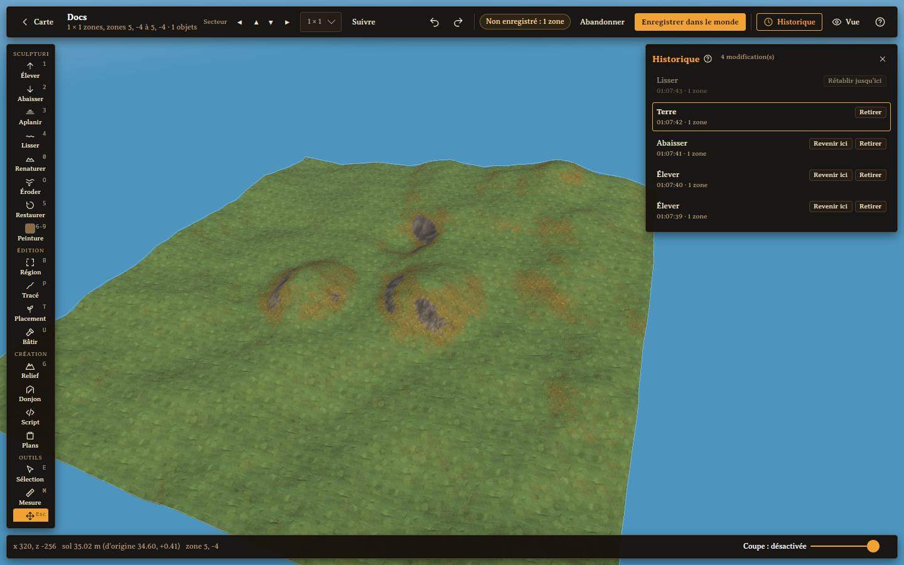

<!-- source: a0f30736 -->
# Annuler une étape, retirer une modification ou tout abandonner

Revenez sur ce que vous avez fait dans l'éditeur : les dernières étapes, une modification au milieu en gardant le
reste, ou tout ce qui n'est pas encore enregistré.

**Il vous faut :** un monde ouvert en 3D (enregistré ou en direct) ou l'Atelier, avec des modifications dans
**Historique**.

1. Pour annuler la dernière modification, appuyez sur `Ctrl+Z` (ou sur la flèche courbe de la barre du haut).
   Appuyez à nouveau pour l'étape d'avant. Le texte de survol de la flèche nomme l'étape qu'elle annule.
2. Pour rétablir ce que vous venez d'annuler, appuyez sur `Ctrl+Y` ou `Ctrl+Shift+Z`.
3. Pour revenir plusieurs étapes en arrière d'un coup, ouvrez **Historique** (`L`) et cliquez sur **Revenir ici** sur
   la dernière modification à garder. Les suivantes deviennent grises ; **Rétablir jusqu'ici** sur l'une d'elles les
   ramène.
4. Pour retirer une modification et garder tout ce qui a été fait après, cliquez sur **Retirer** sur cette
   modification dans **Historique**. Elle est barrée, et le retrait est une étape à part entière : `Ctrl+Z` ramène la
   modification.
5. Pour retirer tout ce qu'a fait Claude et garder vos propres modifications, cliquez sur
   **Annuler les modifications de Claude** dans **Historique** (affiché seulement quand Claude a fait des modifications
   dans le secteur ouvert). Faites-le dans chaque secteur que Claude a modifié : la barre d'état dit combien de
   modifications de Claude dans d'autres secteurs sont conservées.
6. Pour jeter tout ce qui n'est pas encore enregistré ou appliqué, cliquez sur **Abandonner** dans la barre du haut,
   puis confirmez. Les modifications enregistrées et appliquées restent : une étape enregistrée que vous aviez annulée
   revient, donc enregistrez après l'avoir annulée si vous voulez qu'elle disparaisse.
7. Pour revenir sur une modification déjà enregistrée, annulez-la (ou retirez-la avec **Retirer**), puis
   **Enregistrer dans le monde** à nouveau. En direct, annulez-la et **Appliquer en direct** à nouveau (ou laissez
   **Auto** l'envoyer).

*Historique : la dernière modification annulée avec **Revenir ici**, grisée avec **Rétablir jusqu'ici**.*

> [!WARNING]
> Une nouvelle modification faite après une annulation supprime les étapes grisées : elles ne peuvent plus être
> rétablies. Fermer l'éditeur perd toutes les modifications que vous n'avez ni enregistrées ni appliquées.

## Vérifier le résultat

- La vue montre le sol et les objets tels qu'ils étaient, et la ligne des modifications en attente de la barre du haut
  compte moins (ou indique « Tout est enregistré »).
- Dans **Historique**, la ligne encadrée est l'étape à laquelle vous êtes revenu ; les étapes annulées sont grises,
  celles retirées sont barrées.

## Annuler

Chacune de ces actions est réversible jusqu'à ce que vous fassiez une nouvelle modification : `Ctrl+Y` rétablit une
annulation, **Rétablir jusqu'ici** ramène les étapes grisées, et `Ctrl+Z` ramène une modification retirée.
**Abandonner** ne s'annule pas : c'est pour cela qu'il demande d'abord.

## Astuces

- L'Historique est conservé après chaque enregistrement ou application : rouvrez le monde, même après avoir fermé
  l'éditeur, et les étapes sont de retour, marquées **session précédente**. Si le monde a changé depuis, l'éditeur
  demande avant d'en annuler une. Voir [Historique](../concepts/saving-and-history.md#historique).
- Une étape faite dans un autre secteur attend que vous ouvriez un secteur qui la contient : le panneau dit combien.
- Pour remonter plus loin que l'Historique de l'éditeur, utilisez une copie du monde : voir
  [Sauvegarder un monde avant de le modifier](back-up-a-world.md) ou
  [Restaurer un secteur depuis une sauvegarde](restore-from-backup.md).

## Voir aussi

- [Restaurer un secteur depuis une sauvegarde](restore-from-backup.md)
- [Sauvegarder un monde avant de le modifier](back-up-a-world.md)
- [Enregistrement et historique](../concepts/saving-and-history.md)
- [La fenêtre de l'éditeur](../editor-basics.md#historique)
