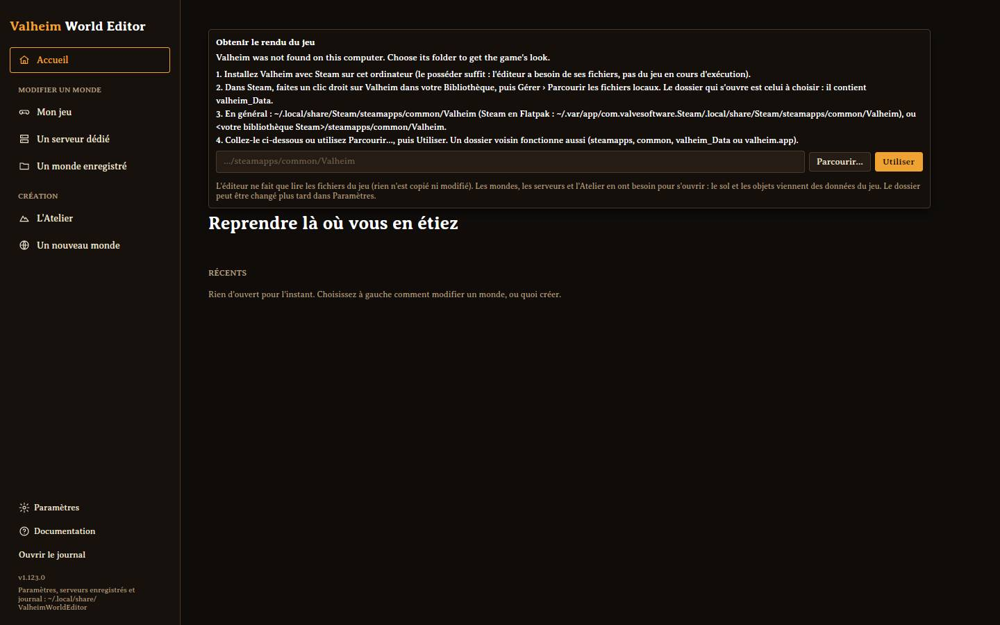
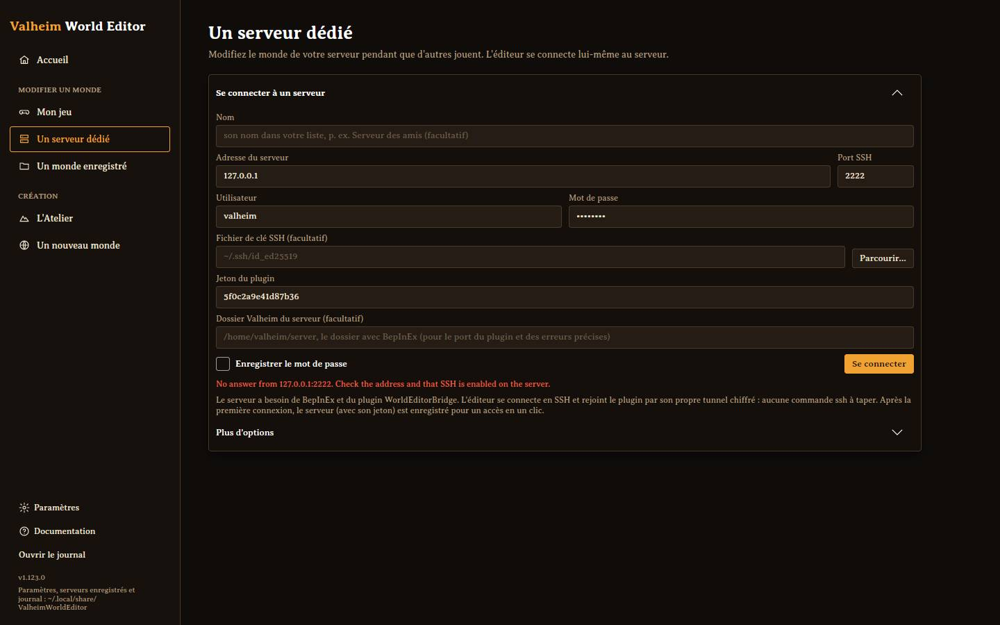
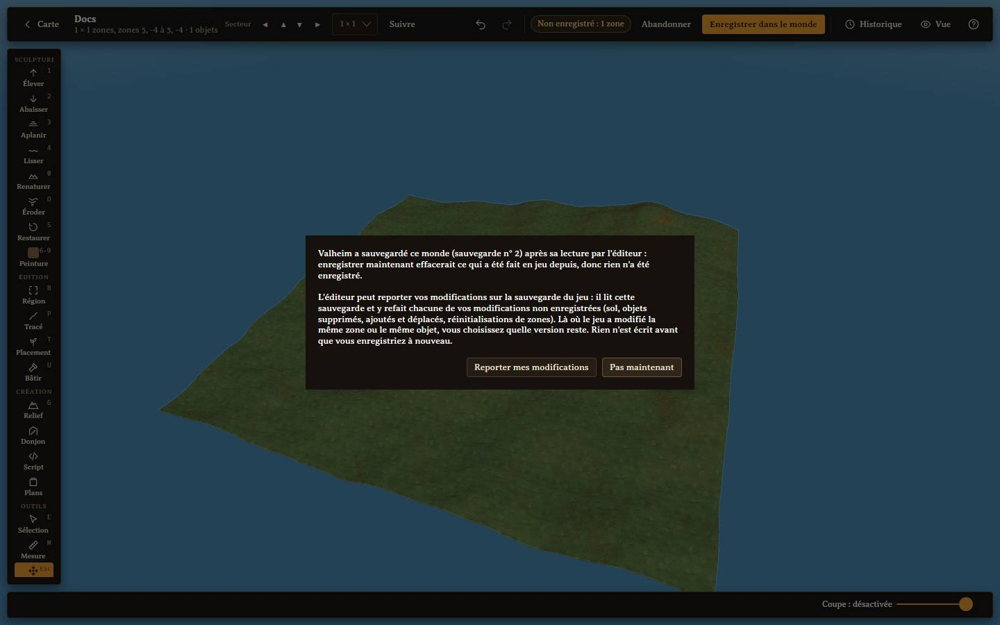

<!-- source: 5b752532 -->
# Dépannage

Trouvez ce que vous voyez dans le tableau, puis suivez sa section : chacune dit pourquoi cela arrive et quoi faire.

| Ce que vous voyez | Aller à |
|---|---|
| « Valheim est introuvable sur cet ordinateur », ou des boîtes à la place des modèles | [Valheim introuvable](#valheim-introuvable) |
| **Mon jeu** liste des étapes, ou le jeu en cours n'apparaît pas dans **Accueil** | [Mon jeu affiche des étapes à faire](#mon-jeu-affiche-des-étapes-à-faire) |
| Un message sous le formulaire du serveur après **Se connecter** | [Un serveur refuse de se connecter](#un-serveur-refuse-de-se-connecter) |
| La carte d'un monde est grisée, ou un monde refuse de s'ouvrir | [Un monde refuse de s'ouvrir ou est grisé](#un-monde-refuse-de-souvrir-ou-est-grisé) |
| L'enregistrement se termine par « Rien n'a changé » ou « Non enregistré » | [L'enregistrement dit que rien n'a changé](#lenregistrement-dit-que-rien-na-changé) |
| « Le jeu a sauvegardé ce monde » quand vous enregistrez | [Le jeu a sauvegardé pendant que vous modifiiez](#le-jeu-a-sauvegardé-pendant-que-vous-modifiiez) |
| En direct : les joueurs ne voient pas une modification, ou l'éditeur ne voit pas les leurs | [Une modification en direct n'apparaît pas](#une-modification-en-direct-napparaît-pas) |
| Scintillement, lignes ou vue 3D noire sous Windows | [Scintillement ou lignes sous Windows](#scintillement-ou-lignes-sous-windows) |
| « Windows a protégé votre ordinateur », ou macOS refuse d'ouvrir l'application | [Windows ou macOS bloque l'application](#windows-ou-macos-bloque-lapplication) |
| Claude dit qu'il ne peut pas joindre l'éditeur | [Claude ne peut pas se connecter](#claude-ne-peut-pas-se-connecter) |
| Un script dit « erreurs », « erreur » ou « sans rien changer » | [Un script échoue](#un-script-échoue) |
| Autre chose | [Le journal et les rapports de bug](#le-journal-et-les-rapports-de-bug) |

## Valheim introuvable

L'éditeur lit les textures, les modèles et le terrain du jeu dans votre installation de Valheim ; sans elle, aucun
monde ni l'Atelier ne s'ouvre. La page d'accueil affiche alors **Obtenir le rendu du jeu** avec « Valheim est
introuvable sur cet ordinateur. »

1. Installez Valheim avec Steam sur cet ordinateur. Le posséder suffit : le jeu n'a pas besoin de tourner.
2. Dans Steam, faites un clic droit sur Valheim dans votre Bibliothèque, puis **Gérer › Parcourir les fichiers
   locaux**. Le dossier qui s'ouvre (celui qui contient `valheim_Data`, ou `valheim.app` sur Mac) est celui à choisir.
3. Collez son chemin dans la carte, ou utilisez **Parcourir…**, puis **Utiliser**. Un dossier voisin fonctionne aussi
   (`steamapps`, `common`, `valheim_Data`, `valheim.app`).

Emplacements habituels :

- Windows : `C:\Program Files (x86)\Steam\steamapps\common\Valheim`
- Linux : `~/.local/share/Steam/steamapps/common/Valheim` (Steam en Flatpak :
  `~/.var/app/com.valvesoftware.Steam/.local/share/Steam/steamapps/common/Valheim`)
- macOS : `~/Library/Application Support/Steam/steamapps/common/Valheim`
- Une autre bibliothèque Steam : `<library>/steamapps/common/Valheim`

Le dossier peut être changé plus tard dans **Paramètres** → **Dossier du jeu Valheim** (**Automatique** parcourt à
nouveau les bibliothèques Steam). Si la carte indique **Le rendu du jeu n'a pas pu être lu**, appuyez sur **Réessayer**
ou vérifiez le dossier dans Paramètres ; si cela échoue encore, signalez-le avec le journal
([ci-dessous](#le-journal-et-les-rapports-de-bug)).

*« Valheim est introuvable sur cet ordinateur. » : choisissez le dossier qui contient `valheim_Data`, puis
**Utiliser**.*

## Mon jeu affiche des étapes à faire

**Mon jeu** indique ce dont votre Valheim a encore besoin avant que **Modifier en direct** apparaisse :

| Il indique | Faites ceci |
|---|---|
| « Votre jeu a besoin de BepInEx et du plugin WorldEditorBridge » | Installez les deux : voir [Modifier le monde dans lequel vous jouez](../guides/edit-your-game-live.md). |
| « BepInEx est installé : il ne reste que les étapes 2 et 3. » | Ajoutez le plugin dans `BepInEx/plugins`, puis lancez Valheim. |
| « Lancez Valheim une fois avec BepInEx » | Le plugin n'a jamais tourné. Lancez le jeu via BepInEx (le **Start modded** du gestionnaire de mods, ou le script de lancement du pack sous Linux), pas avec le simple bouton de Steam. |
| « Lancez Valheim et chargez votre monde » | Chargez un monde en jeu (en solo, ou en l'hébergeant). Un jeu qui a rejoint le serveur de quelqu'un d'autre ne peut pas être modifié. |

L'éditeur vérifie toutes les quelques secondes. Il cherche le fichier de réglages du plugin dans chaque dossier
BepInEx qu'il connaît : votre dossier Valheim, le profil de gestionnaire de mods dans lequel l'éditeur lui-même a été
installé, chaque profil r2modman et Thunderstore Mod Manager pour Valheim (sous Linux, aussi le r2modman en Flatpak),
et les dossiers sous **Paramètres** → **Dossiers BepInEx**. Si votre jeu ou votre profil se trouve ailleurs, ajoutez-y
son dossier `BepInEx`, son profil ou un dossier de profils.

**Toujours rien pendant que le jeu tourne ?** Le plugin écoute sur le port 5182. Si un autre programme utilise ce port
(un tunnel `ssh -L 5182:…` ouvert à la main, par exemple), le plugin ne peut pas démarrer, et le
`BepInEx/LogOutput.log` du jeu contient une ligne `WorldEditorBridge: caught at … while listening on 127.0.0.1:5182 (the bridge does
not answer)`. Fermez ce programme, ou changez `Port` dans les [réglages du plugin](../live-mode.md#réglages-du-plugin).

« Votre jeu n'a pas pu être vérifié : … » signifie que l'éditeur n'a pas pu lire un dossier BepInEx : la suite du
message dit pourquoi.

## Un serveur refuse de se connecter

Le message sous le formulaire dit ce qui n'a pas marché. Les messages qui commencent de la même façon ne sont listés
qu'une fois. Certains s'affichent en anglais : ils sont cités tels quels.

| Message | Quoi faire |
|---|---|
| « Saisissez l'adresse du serveur. » / « Saisissez le jeton du plugin : … » | Remplissez **Adresse du serveur** ou **Jeton du plugin**. |
| « The server refused the login: check the user name and the password or key. » | Vérifiez **Utilisateur**, et le **Mot de passe** ou le **Fichier de clé SSH**. Une clé protégée par une phrase secrète demande **Plus d'options** → **Phrase secrète de la clé**. |
| « No answer from <address>:<port>. Check the address and that SSH is enabled on the server. » | Vérifiez **Adresse du serveur** et **Port SSH** (22 sauf modification), et que le serveur accepte SSH. |
| « The server's identity changed (it was …, now …). » | Si vous avez réinstallé le serveur, videz la ligne `HostKey` que nomme le message dans `servers.cfg`, puis reconnectez-vous. Sinon, ne vous connectez pas : quelqu'un se fait peut-être passer pour votre serveur. |
| « The server answered but refused the token. » | Copiez à nouveau, en entier, la ligne `Token` de `BepInEx/config/Tie.WorldEditorBridge.cfg` sur le serveur. |
| « That token cannot be sent (…) » | Le jeton contient un retour à la ligne ou un autre caractère parasite : copiez-le à nouveau. |
| « Le tunnel est ouvert, mais le plugin ne répond pas sur le serveur : … » | Le serveur ne tourne pas, ou pas avec BepInEx et le plugin. Remplissez **Dossier Valheim du serveur (facultatif)** dans le formulaire et reconnectez-vous pour une réponse précise (ci-dessous). Un serveur dans un conteneur (un panneau de jeu comme Pterodactyl) ne répond jamais de cette façon : voir [Un serveur dans un conteneur](../guides/edit-a-rented-server.md#un-serveur-dans-un-conteneur). |
| « The plugin answered, but the game it runs in does not host the world » | Le plugin se trouve dans un jeu qui a rejoint un autre serveur. Installez-le sur le serveur qui héberge le monde. |
| « The server answered with an error (…). Is it the WorldEditorBridge plugin? » | Autre chose répond sur le port du plugin : vérifiez **Plus d'options** → **Port du plugin** et `Port` dans les réglages du plugin. Avec 400, via un tunnel vers une `BindAddress` autre que `127.0.0.1` : réglez `BindAddress = +` (voir [Un serveur dans un conteneur](../guides/edit-a-rented-server.md#un-serveur-dans-un-conteneur)). |
| « Could not connect: … » | Tout autre échec ; la suite du message dit lequel. |

Avec **Dossier Valheim du serveur** rempli, l'éditeur y regarde par SSH et dit exactement ce qui manque : « The
folder … does not exist on the server », « BepInEx is not installed in … », « The plugin is not in …/BepInEx/plugins »,
« The plugin is installed but has never run: restart the server with BepInEx », ou « The plugin is installed but does
not answer: is the server running, and started with BepInEx (not the plain start script)? ». Ce dernier, sur un
serveur qui tourne bien avec BepInEx, signifie en général qu'il tourne dans un conteneur (Pterodactyl, Pelican,
Docker) : voir [Un serveur dans un conteneur](../guides/edit-a-rented-server.md#un-serveur-dans-un-conteneur).

Un serveur de jeu loué chez un hébergeur, avec un panneau web et un accès FTP mais sans connexion SSH, ne peut pas être
joint en direct : modifiez plutôt les fichiers de son monde, comme dans
[Un serveur de jeu loué](../guides/edit-a-rented-server.md#un-serveur-de-jeu-loué).

Avec **J'ai créé mon propre tunnel**, « Nothing answers on 127.0.0.1:… » ou « No answer from 127.0.0.1:… within … s »
signifie que votre tunnel n'est pas ouvert, ou que le serveur ne tourne pas avec le plugin.

*Se connecter pressé alors que rien ne répond à l'adresse : « No answer from 127.0.0.1:2222. Check the address and that
SSH is enabled on the server. » Vérifiez **Adresse du serveur** et **Port SSH**.*

## Un monde refuse de s'ouvrir ou est grisé

Une carte grisée sous **Un monde enregistré** dit pourquoi en orange. Les raisons habituelles :

- « Old save format: load this world in Valheim once, then it can be edited here. » Le jeu convertit les anciens
  mondes à fichier unique quand il les charge.
- « Créé avec un mod de génération de monde (…) qu'aucun module complémentaire utilisé ne dessine », « … celui-ci est
  désactivé », ou « … dès que … est dans l'un des dossiers de plugins BepInEx » : installez le module complémentaire,
  activez-le dans **Paramètres → Modules complémentaires**, ou ajoutez le dossier BepInEx du mod dans Paramètres. Voir
  [Modifier un monde créé avec Expand World, Riverheim ou Tunnelheim](../guides/use-mods-worlds.md).
- Un monde Riverheim demande aussi un Riverheim qui connaît son préréglage (mettez à jour une version plus ancienne), et
  Riverheim 1.3 ou plus récent demande Worldhalla dans le même dossier BepInEx ; les mondes créés avec la bêta obsolète
  de Riverheim ne peuvent pas être ouverts.

Pour un dossier saisi sous **Un autre dossier de mondes** : « That folder holds worlds; pick one of them (…) » signifie
que vous avez choisi un dossier `worlds_local` au lieu d'un seul monde ; « No Valheim world in that folder » signifie
qu'il ne contient aucun fichier `_main.<n>.chunks`. Voir
[Ouvrir un monde qui n'est pas dans la liste](../guides/open-a-world.md).

« Impossible d'ouvrir le monde : … » donne la raison après les deux-points ; le journal contient les détails.

## L'enregistrement dit que rien n'a changé

L'éditeur vérifie chaque enregistrement en le relisant : si quelque chose ne va pas, il retire les nouveaux fichiers
et se termine par « Rien n'a changé ». Votre monde est tel qu'il était, et vos modifications sont toujours dans
l'éditeur.

| Message | Quoi faire |
|---|---|
| « Il n'y a aucune modification non enregistrée. » | Rien n'attend d'être enregistré. |
| « Valheim a sauvegardé ce monde (sauvegarde n° …) après sa lecture par l'éditeur » | Voir [Le jeu a sauvegardé pendant que vous modifiiez](#le-jeu-a-sauvegardé-pendant-que-vous-modifiiez). |
| « L'enregistrement a échoué (…). Rien n'a changé. » / « Le monde enregistré ne s'est pas relu correctement (…). Rien n'a changé. » | Vérifiez la raison entre parenthèses (un disque plein, un dossier où vous ne pouvez pas écrire). Fermez Valheim s'il utilise le monde, puis enregistrez à nouveau. |
| « Ce monde utilise le format de sauvegarde … ; l'éditeur n'enregistre que les formats … à …. » | Un format plus récent : mettez l'éditeur à jour. Un format plus ancien : chargez et sauvegardez le monde dans un Valheim à jour, puis rouvrez-le. |
| « Non enregistré : … zone …: not generated yet (…; visit it in game first) » | Aucun joueur n'est allé là : le monde n'a donc pas de données à modifier. Allez-y en jeu, puis modifiez à nouveau. |
| « Non enregistré : … the world has no terrain object to copy yet (edit the ground once in game first) » | Creusez ou aplanissez le sol une fois n'importe où en jeu, sauvegardez la partie, puis enregistrez à nouveau. |
| « Rien n'a pu être enregistré. » | Tout figurait dans la liste « Non enregistré » ci-dessus. |

Un coup de pinceau qui ne fait rien, avec « Rien n'a changé : le Masque exclut tout le sol sous le pinceau », c'est le
[Masque](../masks.md) à l'œuvre : vérifiez ses réglages de hauteur, de pente, de biome et de peinture.

## Le jeu a sauvegardé pendant que vous modifiiez

Un jeu en cours garde le monde en mémoire et écrase les fichiers. S'il a sauvegardé après que l'éditeur a lu le monde,
**Enregistrer dans le monde** n'enregistre rien et pose la question **Le jeu a sauvegardé ce monde** :

1. Appuyez sur **Reporter mes modifications**. L'éditeur lit la sauvegarde du jeu et y refait chacune de vos
   modifications.
2. Si le jeu a modifié les mêmes zones ou les mêmes objets, il demande une fois par catégorie (sol, objets modifiés,
   objets retirés) : **Garder la mienne** ou **Garder celle du jeu**.
3. Examinez le résultat : vos modifications sont maintenant en attente sur la sauvegarde du jeu. Rien n'est encore
   écrit.
4. Fermez Valheim (ou arrêtez le serveur), puis appuyez à nouveau sur **Enregistrer dans le monde**.

*Enregistrement refusé parce que le jeu a sauvegardé le monde après que l'éditeur l'a lu : **Reporter mes modifications** refait vos modifications sur la sauvegarde du jeu.*

**Pas maintenant** laisse tout tel quel. Reporter vos modifications peut abandonner certaines étapes de l'Historique
(le message indique combien).

Pour l'éviter, fermez le jeu avant d'enregistrer, ou modifiez en direct. Plus de détails dans
[Enregistrer un monde](../concepts/saving-and-history.md#enregistrer-un-monde).

## Une modification en direct n'apparaît pas

- **Les joueurs ne voient pas une modification appliquée.** Regardez le `BepInEx/LogOutput.log` du serveur : les
  lignes qui suivent chaque application disent ce qui a été détruit, créé et déplacé, et si quelque chose a recréé un
  objet détruit. Voir [Ce que le plugin journalise](../live-mode.md#ce-que-le-plugin-journalise).
- **« Impossible d'appliquer en direct : … » ou « Impossible de joindre le jeu : … »**. Le jeu n'a pas répondu dans
  les 30 secondes (il charge, ou il est occupé). Rien n'en a été fait : appuyez à nouveau sur **Appliquer en direct**.
- **« Non appliqué : le jeu a modifié le sol là où vous avez des modifications »**. Vous avez répondu **Pas
  maintenant** à **Appliquer par-dessus les modifications du jeu** : appliquez à nouveau et choisissez
  **Appliquer**, ou annulez vos modifications à cet endroit.
- **L'éditeur ne voit pas ce que modifient les joueurs** et indique « Le plugin WorldEditorBridge du serveur est plus
  ancien que cet éditeur ». Mettez le plugin à jour ; en attendant, **Recharger** relit le monde.

## Scintillement ou lignes sous Windows

Sous Windows, l'éditeur dessine avec Direct3D, comme les jeux. Si la vue 3D ou la carte scintille, montre des lignes,
dessine mal ou lentement, essayez l'OpenGL propre au pilote graphique :

1. Sur la page d'accueil, ouvrez **Paramètres**.
2. Sous **Affichage**, activez **Dessiner avec l'OpenGL du pilote graphique**, puis **Enregistrer**.
3. Fermez l'éditeur et relancez-le.

Désactivez-le de la même façon si c'est pire. Mettre à jour le pilote graphique aide aussi. La carte **Commandes**
(`F3` dans la vue 3D) indique sous **Cet ordinateur** quelle carte graphique et quelle version d'OpenGL dessinent la
vue.

## Windows ou macOS bloque l'application

**Windows : « Windows a protégé votre ordinateur ».** SmartScreen l'affiche la première fois, jusqu'à ce qu'il
connaisse la signature de l'éditeur. Cliquez sur **Informations complémentaires** (il affiche l'éditeur du logiciel),
puis sur **Exécuter quand même**.

**macOS : « impossible d'ouvrir ».** La version Mac est signée, mais pas avec un certificat Apple Developer : macOS ne
peut donc pas vérifier qui l'a créée.

1. Double-cliquez une fois sur **ValheimWorldEditor.app** et fermez le message.
2. Dans **Réglages Système › Confidentialité et sécurité**, cliquez sur **Ouvrir quand même** à côté de
   ValheimWorldEditor.
3. Ou, dans le Terminal : `xattr -dr com.apple.quarantine /Applications/ValheimWorldEditor.app`.

<!-- picture: os-blocked.jpg: two halves side by side: left, Windows SmartScreen "Windows protected your PC" after More info, showing the publisher and Run anyway; right, macOS System Settings › Privacy & Security scrolled to the "ValheimWorldEditor was blocked" line with Open Anyway -->

Ensuite, elle s'ouvre d'un double-clic. La version Mac est expérimentale (Apple silicon, macOS 12 ou plus récent).

## Claude ne peut pas se connecter

| Vérification | Quoi faire |
|---|---|
| L'éditeur tourne | Claude ne joint l'éditeur que pendant qu'il tourne. Lancez-le. |
| **Autoriser Claude à se connecter** est activé | Dans **Paramètres → Claude**, activez-le et appuyez sur **Enregistrer**. La section devrait indiquer « Listening on http://127.0.0.1:5731/mcp ». |
| « Could not listen on port … » | Un autre programme utilise le port. Choisissez un autre **Port**, **Enregistrer**, puis ajoutez à nouveau l'éditeur à Claude avec la nouvelle commande. |
| Vous avez appuyé sur **Nouveau jeton** | L'ancien jeton ne fonctionne plus : exécutez à nouveau la nouvelle commande Claude Code. |
| Claude Desktop | Redémarrez-le après avoir modifié sa configuration. Si vous avez déplacé le dossier de l'éditeur, copiez à nouveau les lignes depuis Paramètres : elles contiennent le chemin du programme. |
| Claude Code | `/mcp` devrait lister **valheim-editor** comme connecté. Sinon, exécutez à nouveau la commande depuis Paramètres. |

Claude est connecté mais ne modifie rien ? Tant qu'un monde en direct a **Auto** activé, Claude ne peut modifier que
le panneau Vue : désactivez Auto. Les scripts demandent **Claude peut exécuter des scripts**. Voir [Claude](../claude.md).

## Un script échoue

La zone de sortie sous le script dit ce qui s'est passé, et rien n'a changé dans tous les cas :

- « Le script contient des erreurs » : une faute de frappe ou une erreur C#, listée avec sa ligne
  (`line 4: The name 'Groud' does not exist
  in the current context`). Corrigez cette ligne. « Le script n'a aucune instruction à exécuter » en dessous signifie
  que la zone est vide ou ne contient que des commentaires : écrivez au moins une ligne de code, ou chargez un exemple.
- « Le script s'est arrêté sur une erreur » : il a échoué pendant son exécution, à la ligne indiquée (un nom d'objet
  que l'éditeur ne peut pas créer, un préréglage de peinture ou de montagne qu'il ne connaît pas, une taille de 0 ou
  moins, une division par zéro).
- « Le script s'est exécuté sans rien changer. » : utilisez `Print` pour vérifier que votre boucle trouve ce que vous
  attendez.
- « Le secteur a changé pendant l'exécution du script » : vous avez modifié, annulé ou enregistré entre-temps.
  Exécutez-le à nouveau et attendez.
- « Le script a été arrêté (ou a tourné 2 minutes) » : allégez-le, par exemple `Area.Points(step: 4)`.

Plus de détails dans [Script](../scripting.md#quand-quelque-chose-ne-va-pas).

## Le journal et les rapports de bug

Tout ce que dit l'éditeur va dans `ValheimWorldEditor.log`, recommencé à chaque lancement, dans le dossier de données
de l'éditeur :

- Windows : `%LOCALAPPDATA%\ValheimWorldEditor`
- Linux : `~/.local/share/ValheimWorldEditor`
- macOS : `~/Library/Application Support/ValheimWorldEditor`

**Ouvrir le journal**, en bas du menu latéral de la page d'accueil, l'ouvre ; le dossier y est aussi indiqué. Chaque
erreur que l'éditeur gère est une ligne qui commence par `Caught at`, avec l'endroit où elle s'est produite et ce que
faisait l'éditeur. Les données personnelles sont exclues : votre dossier personnel est écrit `~`, et les chemins,
adresses, noms de compte, mots de passe et jetons sont remplacés par des marques comme `<path>`.

Pour signaler un problème, [ouvrez un ticket](https://github.com/Shuiei/valheim-world-editor/issues) avec :

1. Ce que vous avez fait et ce que vous avez vu (une capture d'écran aide).
2. Le journal de l'éditeur, depuis **Ouvrir le journal**, juste après le problème (avant de relancer l'éditeur).
3. En direct : le `BepInEx/LogOutput.log` du jeu ou du serveur.
4. Pour une vue lente : activez **Enregistrer la fréquence d'images** sur la carte **Commandes** (`F3`), utilisez la
   vue, et joignez `perf-native.log` du même dossier de données.

Vous avez trouvé un problème de sécurité ? Signalez-le en privé : voir [SECURITY.md](../../../SECURITY.md).
