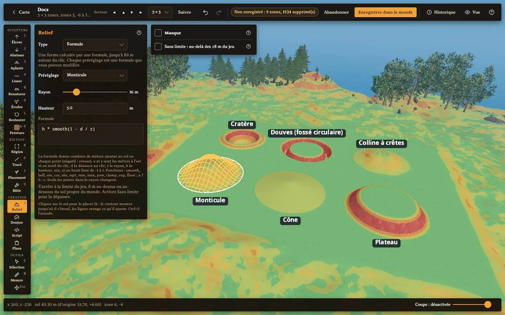
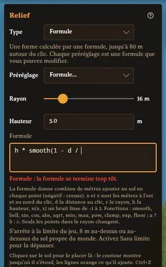
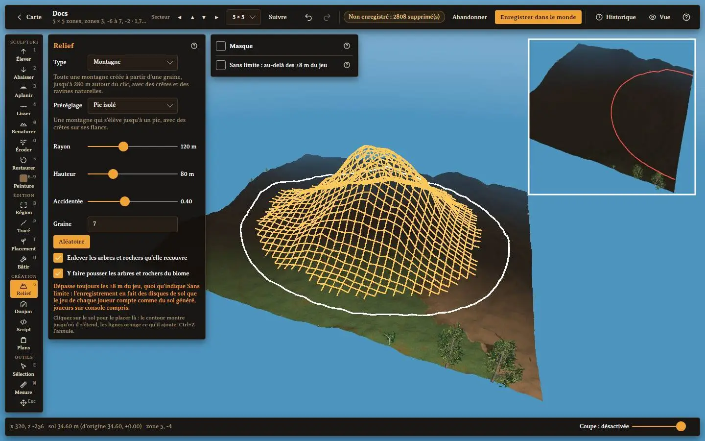
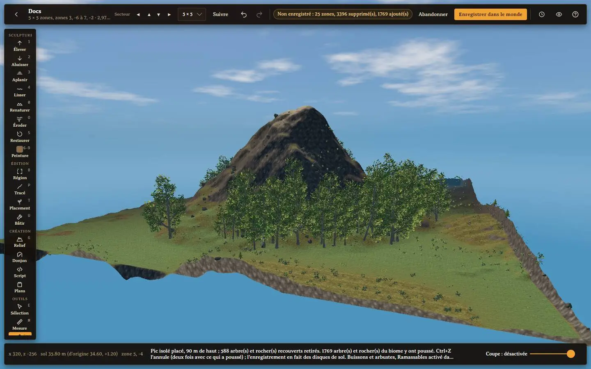
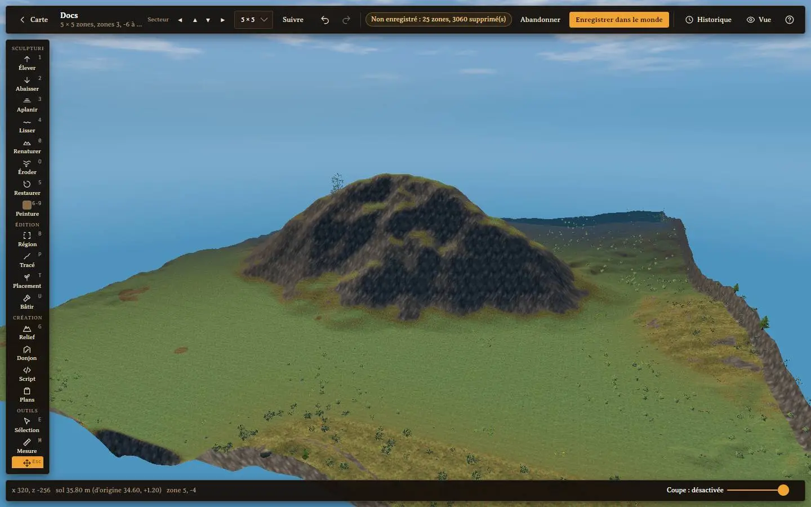
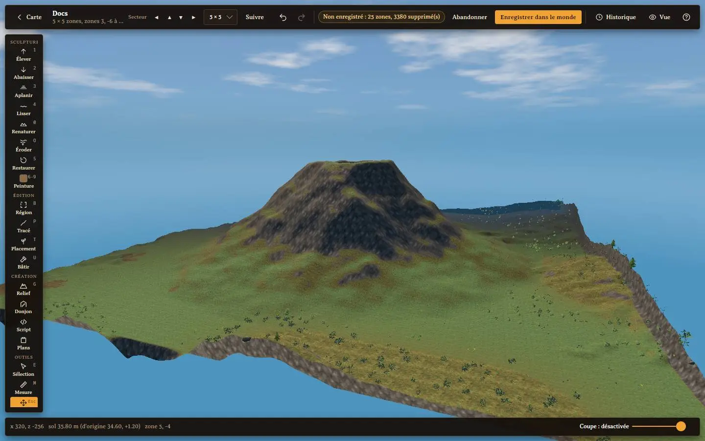
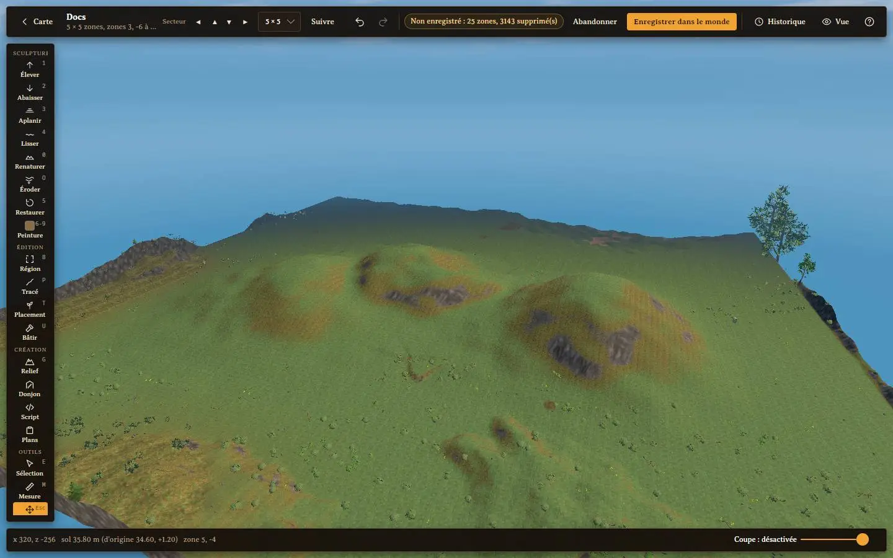
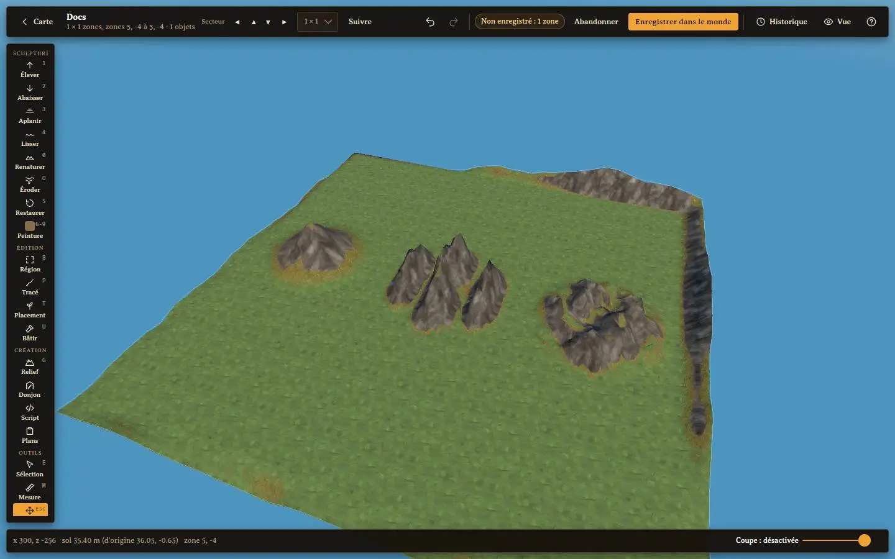
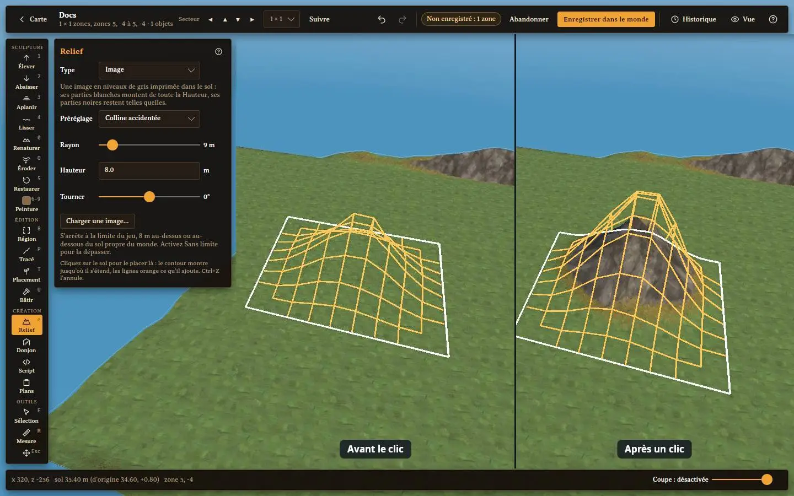

<!-- source: e6ef7a67 -->
# Relief

Placez tout un relief dans le sol en un clic : un monticule ou un cratère calculé par une formule, une montagne bien
au-delà des 8 m du jeu, ou une image à vous imprimée dans le sol.

**Où :** barre d'outils, section **CRÉATION** · **Touche :** `G` · **Fonctionne dans :** mondes enregistrés, en direct

*Le type **Formule**. Rangée de devant, de gauche à droite : Monticule, Cône, Plateau. Rangée du fond, de gauche à
droite : Cratère, Douves (fossé circulaire), Colline à crêtes, chacun au rayon par défaut de 16 m et à la hauteur de
5 m, avec **Couleurs de pente** activé dans Vue pour que leurs pentes se lisent. Le panneau montre le Monticule et sa
formule ; sur le monticule, le contour blanc est le rayon et les lignes orange ce qu'un autre clic ajouterait.*

## L'utiliser

1. Dans la barre d'outils, cliquez sur **Relief** (`G`).
2. Dans le panneau, choisissez un **Type** : **Formule**, **Montagne** ou **Image** (voir
   [Les trois types](#les-trois-types)).
3. Choisissez un **Préréglage**, puis réglez **Rayon** et **Hauteur**.
4. Déplacez le pointeur au-dessus du sol. Le contour blanc montre jusqu'où s'étend le relief, et les lignes orange
   montrent ce qu'il ajoute, aussi haut ou aussi profond qu'il le sera.
5. Cliquez. Le relief est placé aussitôt.
6. Ce n'est pas bon ? `Ctrl+Z` l'annule. Chaque clic est une étape d'annulation (« Relief : Monticule »).

## Les trois types

Chaque type a ses propres préréglages. Aucun préréglage ne porte le même nom dans deux types, donc le nom dit lequel
vous avez utilisé.

| Type | Crée | Rayon | La limite de ±8 m du jeu |
|---|---|---|---|
| **Formule** | Une forme lisse et exacte calculée par une formule que vous pouvez lire et modifier. | 2 à 80 m | La respecte, sauf si **Sans limite** est activé. |
| **Montagne** | Toute une montagne naturelle à partir d'une graine, avec des crêtes et des ravines, et des arbres qui y poussent. | 20 à 280 m | La dépasse toujours. |
| **Image** | Une image en niveaux de gris imprimée dans le sol : une image intégrée, ou n'importe quel fichier image. | 2 à 80 m | La respecte, sauf si **Sans limite** est activé. |

Une ligne vers le bas du panneau dit où en est le type choisi par rapport à la limite en ce moment. Elle passe en
ambre quand le relief va la dépasser. Voir [Sans limite](terrain.md#sans-limite) pour l'interrupteur et pour ce que fait
l'enregistrement du sol au-delà de la limite.

## Réglages communs à tous les types

Ils sont au même endroit, sous les mêmes noms, pour les trois types. Chaque type retient ses propres valeurs.

| Réglage | Ce qu'il fait |
|---|---|
| **Type** | Ce à partir de quoi le relief est fait. Retenu pour la prochaine fois. |
| **Préréglage** | Le relief : la liste propre au type. |
| **Rayon** | Jusqu'où il s'étend depuis le clic. |
| **Hauteur** | Jusqu'à quelle hauteur il monte (m). Pour **Formule** et **Image**, une hauteur négative le retourne : un monticule devient une fosse, des douves un mur circulaire. |
| **Tourner** | Son orientation, quand il en a une : une crête ou une chaîne de **Montagne**, et toute **Image**. |

## Formule

Une forme calculée point par point. Chaque préréglage est une formule affichée dans la case ; modifiez-la et la liste
passe à **Formule…**, la vôtre, qui est retenue pour la prochaine fois.

| Préréglage | Forme |
|---|---|
| **Monticule** | Une colline ronde et lisse. |
| **Cône** | Des pentes droites jusqu'à une pointe. |
| **Plateau** | Un sommet plat entouré d'une pente douce. |
| **Cratère** | Un creux avec un bord surélevé. |
| **Douves (fossé circulaire)** | Un fossé aux trois quarts du rayon. Avec une hauteur négative, un mur circulaire. |
| **Cuvette** | Un creux rond. |
| **Colline à crêtes** | Un monticule traversé de crêtes. |
| **Formule…** | La vôtre. |

| Réglage | Ce qu'il fait |
|---|---|
| **Rayon** | 2 à 80 m (16 m par défaut). Seul le sol à l'intérieur change. |
| **Hauteur** | 5 m par défaut. C'est `h` dans la formule. |
| **Formule** | Combien de mètres ajouter au sol en chaque point à l'intérieur du rayon ; un nombre négatif creuse. Une erreur s'affiche sous la case, et rien ne peut être placé tant qu'elle n'est pas corrigée. |

*Une formule inachevée : la liste est passée à **Formule…**, et la ligne sous la case dit ce qui ne va pas (« la
formule se termine trop tôt »).*

### Écrire une formule

La formule est calculée pour chaque point de sol à l'intérieur du rayon, et le résultat est ajouté au sol à cet
endroit.

| Nom | Signification |
|---|---|
| `x`, `z` | Mètres à l'est et au nord du clic. |
| `d`, `r`, `h` | Distance au clic, le rayon, la hauteur. |
| `n(x, z)` | Un bruit lisse d'environ -1 à 1, tiré du motif des pinceaux (**Nouveau motif** dans [Renaturer](terrain.md#renaturer) le change). Utilisez `n(x / 10, z / 10)` pour de larges bosses. |
| `pi` | 3,14159… |

Fonctions : `abs`, `atan2(y, x)`, `bell(t)` (1 en 0, s'estompant vers ±1 environ), `ceil`, `clamp(v, a, b)`, `cos`,
`exp`, `floor`, `log`, `max(…)` et `min(…)` (n'importe quel nombre de valeurs), `pow(a, b)`, `round`, `sign`, `sin`,
`smooth(t)` (0 sous 0, 1 au-dessus de 1, un S lisse entre les deux), `sqrt`, `tan`.

Opérateurs : `+ - * / %`, `^` (puissance), comparaisons `< > <= >= == !=` (1 ou 0), `&&`, `||`, `!`, et `a ? b : c`.

Les préréglages montrent comment cela fonctionne :

| Préréglage | Formule |
|---|---|
| **Monticule** | `h * smooth(1 - d / r)` |
| **Cône** | `h * max(0, 1 - d / r)` |
| **Plateau** | `h * smooth((r - d) / (0.35 * r))` |
| **Cuvette** | `-h * smooth(1 - (d / r) ^ 2)` |
| **Douves (fossé circulaire)** | `-h * bell((d - 0.75 * r) / (0.12 * r))` : un fossé aux trois quarts du rayon. |

Deux autres pour commencer : `h * smooth(1 - d / r) * (1 + 0.3 * n(x / 8, z / 8))` est une colline bosselée, et
`abs(x) < 3 ? -h : 0` creuse une tranchée de 6 m de large à travers le cercle.

## Montagne

Toute une montagne créée à partir d'une graine, ajoutée au sol qui est là, pour qu'elle garde l'allure propre du
terrain et s'y fonde à son bord. Son contour n'est jamais un cercle parfait, et **Accidentée** ajoute des bosses, des
crêtes et des ravines en proportion de sa taille.

*Pic isolé, 80 m de haut, rayon 120 m, avant le clic : les lignes orange le montrent aussi haut qu'il montera et
l'anneau blanc jusqu'où il s'étend. En médaillon, en haut à droite : avec le pointeur près du bord du secteur, l'anneau
devient rouge et aucun aperçu ne s'affiche, parce qu'il ne tiendrait pas.*

| Préréglage | Hauteur / rayon tirés au sort | Forme |
|---|---|---|
| **Pic isolé** | 50–110 m / 120–240 m | Une montagne qui monte jusqu'à un pic, avec des crêtes le long de ses flancs. |
| **Crête** | 35–80 m / 140–260 m | Une longue arête, deux fois moins large que longue. |
| **Chaîne de montagnes** | 40–90 m / 180–280 m | Trois à cinq pics alignés, reliés par des cols. |
| **Mesa** | 20–50 m / 70–150 m | Un sommet plat aux flancs raides et rocheux : de la place pour bâtir là-haut. Le relief accidenté ne touche que les flancs. |
| **Volcan** | 45–100 m / 130–240 m | Un cône avec un cratère au sommet. |
| **Collines ondulées** | 12–30 m / 100–220 m | Trois à six collines douces ensemble. |

| Pic isolé | Crête |
|---|---|
|  |  |
| **Volcan** | **Collines ondulées** |
|  |  |

*Quatre préréglages au milieu d'un secteur de 5 × 5 d'abord dégagé et aplani, pour que chacun ressorte. Le pic isolé a
les arbres du biome qui y poussent ; les autres sont laissés nus pour que leur forme se voie.*

| Réglage | Ce qu'il fait |
|---|---|
| **Préréglage** | Le genre de montagne. En choisir un tire au sort une nouvelle montagne de ce genre, comme **Aléatoire**. |
| **Rayon** | 20 à 280 m. Son contour est irrégulier, jusqu'à 15 % plus loin : l'anneau le montre. |
| **Hauteur** | Jusqu'où elle monte au-dessus du sol à cet endroit, de 5 à 300 m. |
| **Tourner** | **Crête** et **Chaîne de montagnes** seulement : la direction dans laquelle elle s'étend, de 0° à 179°. |
| **Accidentée** | 0 : pentes lisses. 1 : ravines et crêtes profondes. |
| **Graine** | Le nombre d'où vient son détail : le même préréglage, les mêmes valeurs et la même graine refont la même montagne. |
| **Aléatoire** | Une nouvelle montagne du préréglage : nouvelle taille, nouveau relief, nouvelle direction et nouvelle graine. Si elle ne tient pas dans le secteur ouvert, elle est réduite dans son ensemble, hauteur comprise, pour que les pentes restent aussi douces. |
| **Enlever les arbres et rochers qu'elle recouvre** | Activé au départ. Les arbres, rochers, minerais, buissons et ramassables là où elle élève le sol de plus de 2 m sont enlevés (l'enregistrement le ferait de toute façon). Les pièces de construction restent, de même que ce qui est dans un donjon très au-dessus. |
| **Y faire pousser les arbres et rochers du biome** | Activé au départ. Fait pousser les arbres et rochers propres au biome, selon les règles du jeu, sur les pentes qu'elle a élevées de plus d'un mètre, à l'écart de ce qui s'y trouve déjà. Une seconde étape d'annulation. |

Une montagne doit tenir entière dans le secteur ouvert, bord irrégulier compris : là où l'anneau est rouge, un clic ne
place rien.

## Image

Une image en niveaux de gris imprimée dans le sol : ses parties blanches montent de toute la **Hauteur**, les parties
grises d'une partie, les parties noires restent telles quelles. L'image couvre un carré deux fois plus large que
**Rayon** ; le contour le montre.

*Les images intégrées, 6 m de haut pour un rayon de 8 m. De gauche à droite : Colline accidentée, Dunes, Sol
rocailleux.*

*La **Colline accidentée**, **Rayon** 9 m et **Hauteur** 8 m. À gauche : son contour carré et son aperçu orange sur un
sol plat avant le clic. À droite : toute la colline, placée en un clic.*

| Préréglage | Forme |
|---|---|
| **Colline accidentée** | Un petit pic aux flancs accidentés. |
| **Dunes** | Des crêtes parallèles dans une zone ronde. |
| **Sol rocailleux** | Un sol bosselé et cassé. |
| Les vôtres | Chaque image que vous avez chargée, sous son nom de fichier. |

| Réglage | Ce qu'il fait |
|---|---|
| **Rayon** | La moitié du côté de l'image, de 2 à 80 m (16 m par défaut). |
| **Hauteur** | Jusqu'où montent les parties blanches (m, 4 par défaut). Négative : elles sont enfoncées à la place. |
| **Tourner** | Tourne l'image, de -180° à 180°. |
| **Charger une image…** | Utilise n'importe quelle image (PNG, JPEG…) : une carte de hauteur d'un autre outil, un logo, une forme dessinée à la main. Sa luminosité est la hauteur ; les parties transparentes comptent comme noires. Elle est mise à l'échelle sur un carré de 128 × 128 points, donc une image large est écrasée et les détails fins se perdent. Elle est gardée pour la prochaine fois sous son nom de fichier. |
| **Oublier l'image** | Retire l'image chargée choisie. Affiché seulement pour les images chargées : les images intégrées restent. |

Les images sont les [tampons](terrain.md#tampons) des pinceaux : une image chargée ici est aussi une forme de
pinceau, et une image chargée là-bas est proposée ici. Deux tampons intégrés, **Mesa (sommet plat)** et
**Bord de cratère**, ne sont que des formes de pinceau : comme reliefs, c'est le type **Formule** qui les fait
(**Plateau**, et **Douves** avec une hauteur négative).

## Raccourcis

| Touche ou souris | Ce qu'elle fait |
|---|---|
| `G` | Choisir Relief. |
| Clic sur le sol | Y placer le relief. |
| `Ctrl+Z` | Annuler le dernier (appuyez deux fois quand des arbres ont poussé sur une montagne). |
| `Esc` | Quitter l'outil (retour à Vue). |

## Astuces et limites

- **Formule et Image s'arrêtent à 8 m du sol généré**, et la barre d'état le dit. Pour plus haut, cochez
  **Sans limite : au-delà des ±8 m du jeu** sur la fiche **Masque** à côté du panneau (voir
  [Sans limite](terrain.md#sans-limite)) : il reste activé pour chaque outil de sol jusqu'à ce que vous le désactiviez.
- **Une montagne dépasse toujours les 8 m du jeu**, quoi qu'indique **Sans limite**. L'enregistrement la transforme en
  disques de sol et vide l'Historique du secteur, comme avec [Sans limite](terrain.md#sans-limite). Vérifiez-la avant
  d'enregistrer.
- **Pour les grandes montagnes, ouvrez d'abord un secteur plus grand** (la liste des tailles du secteur dans la barre
  du haut) : sur un secteur de 5 × 5, le rayon peut aller jusqu'à environ 137 m.
- **Le [Masque](masks.md) s'applique** : là où il exclut du sol, le relief s'arrête en marche, une montagne en falaise.
- **Une formule qui donne 0 partout** ne change rien, et la barre d'état le dit. Les points où elle ne donne pas de
  nombre (une division par zéro) sont laissés tels quels.
- **La ligne de points la plus extérieure du secteur ne change jamais** (voir
  [Le bord verrouillé](concepts/areas-and-zones.md#le-bord-verrouillé)).
- **Pour adoucir un bord** ensuite, repassez dessus avec le pinceau **Lisser** ou **Renaturer**.
- **Les pentes douces gardent l'herbe et les arbres ; les pentes raides montrent la roche nue**, comme le jeu les
  affiche.
- **Pour utiliser une image comme pinceau** pendant que vous faites glisser, choisissez-la plutôt comme **Forme** du
  pinceau (voir [Tampons](terrain.md#tampons)). Pour régler les hauteurs de tout un secteur à partir d'une image,
  voir [Carte de hauteur](area.md#carte-des-hauteurs).
- **Un [script](scripting.md)** peut aussi placer des formes de formule et des montagnes, selon des règles.

## Voir aussi

- [Élever ou creuser au-delà de la limite de 8 m du jeu](guides/raise-past-the-limit.md)
- [Sans limite](concepts/ground-limits.md#sans-limite) : comment le sol est enregistré au-delà de 8 m
- [Comment une montagne est créée](concepts/ground-limits.md#comment-une-montagne-est-créée)
- [Règles de pousse](concepts/objects.md#règles-de-croissance) : ce qui pousse sur une montagne
- [Sculpter et peindre](terrain.md) : pinceaux et tampons
