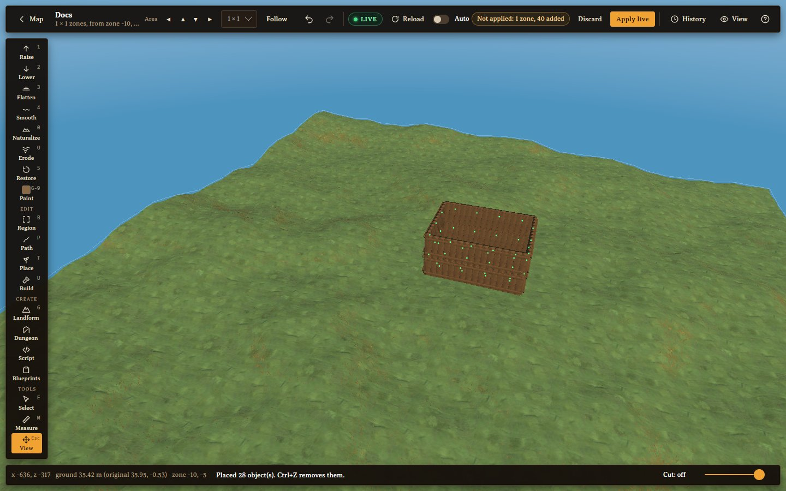

<!-- source: e9428d01 -->
# Mode direct

Modifiez le monde d'une partie en cours ou d'un serveur dédié pendant que d'autres jouent : ils voient chaque
modification dès que vous l'appliquez.

**Où :** page d'accueil, **Modifier en direct** dans **Accueil** ou **Mon jeu**, ou **Un serveur dédié** · **Touche :**
`Ctrl+S` applique · **Fonctionne dans :** votre propre partie (en solo ou le monde que vous hébergez), un serveur dédié


*Connecté à un serveur en cours : **EN DIRECT**, **Recharger** et **Auto** dans la barre du haut, et une cabane que le
jeu n'a pas encore (« Non appliqué : 1 zone, 40 ajouté(s) », des points verts sur les nouvelles pièces).*

Le mode direct a besoin de **BepInEx** et du plugin **WorldEditorBridge** dans le jeu qui héberge le monde. Les
joueurs qui rejoignent n'ont besoin ni de l'un ni de l'autre. Un serveur dédié doit aussi vous donner un **accès SSH** à
la machine sur laquelle il tourne (une connexion shell, pas seulement SFTP ou le gestionnaire de fichiers d'un panneau
web) : la plupart des serveurs de jeu loués chez un hébergeur ne le font pas, voir
[Modifier un serveur loué ou hébergé par un panneau](guides/edit-a-rented-server.md). Pour l'installer et vous
connecter, suivez [Modifier le monde dans lequel vous jouez](guides/edit-your-game-live.md) ou
[Modifier un serveur dédié pendant que d'autres jouent](guides/edit-a-server-live.md). La façon dont l'éditeur
communique avec le jeu est expliquée dans [Modification en direct](concepts/live-editing.md#comment-il-se-connecte).

## L'utiliser

1. Connectez-vous : sur la page d'accueil, cliquez sur **Modifier en direct** (votre jeu) ou sur **Se connecter** à côté
   d'un serveur enregistré.
2. Sur la carte du monde, cliquez sur un endroit et choisissez **Modifier en 3D**.
3. Modifiez avec n'importe quel outil, comme hors ligne. Les nouveaux objets portent un point vert ; la barre du haut
   compte ce qui n'est pas appliqué.
4. Appuyez sur **Appliquer en direct** (ou `Ctrl+S`). Les joueurs voient la modification aussitôt, et le jeu
   l'enregistre comme d'habitude.
5. Pour revenir sur une modification, annulez-la (`Ctrl+Z`) et appuyez de nouveau sur **Appliquer en direct**.

## Réglages

Le mode direct fonctionne comme hors ligne, avec ces contrôles dans la barre du haut :

| Contrôle | Ce qu'il fait |
|---|---|
| Badge **EN DIRECT** | Indique que l'éditeur est connecté au jeu en cours. |
| **Recharger** | Relit tout le monde depuis le jeu. Les modifications pas encore appliquées sont perdues, après confirmation. Vous restez où vous êtes. |
| **Auto** | Activé : chaque coup de pinceau, placement et annulation est appliqué aussitôt, sans appuyer sur **Appliquer en direct**. L'activer envoie ce qui attend déjà. Conservé d'une session à l'autre. |
| Compteur des modifications en attente | « Non appliqué : … » en orange, ou « Tout est appliqué ». La ligne de la carte indique « Pas encore appliqué : … ». |
| **Appliquer en direct** | Remplace **Enregistrer dans le monde**. Envoie au jeu toutes les modifications en attente. |
| Liste des joueurs, **Aller** | À côté de **EN DIRECT**, quand un joueur est connecté : les joueurs connectés, par nom. Choisissez-en un, puis **Aller** (voir [Joueurs](#joueurs)). |

## Appliquer en direct, Auto et Recharger

**Appliquer en direct** envoie le sol de chaque zone que vous avez modifiée, puis les objets que vous avez supprimés,
placés, déplacés ou modifiés, puis les réinitialisations de zones. Seul ce qui a changé depuis la dernière application
part. L'ordre et le rôle de chaque partie sont décrits dans
[Ce qui est envoyé et quand](concepts/live-editing.md#ce-qui-est-envoyé-et-quand).

La barre d'état indique ensuite ce qui a été fait, par exemple « Appliqué au jeu en cours : 2 zone(s) de sol ; … ». Si
le jeu ne répond pas, rien n'est marqué comme appliqué et l'application suivante le renvoie. Une seule application
tourne à la fois : un second appui attend et n'envoie que ce qui est encore en attente.


*Après **Appliquer en direct** : « Tout est appliqué », les points verts ont disparu, et la barre d'état indique
« Appliqué au jeu en cours : … ».*

**Auto** fait de chaque modification une application. Il attend la fin d'un coup de pinceau : un long coup de pinceau
part en une seule application. Tant qu'Auto est activé, [Claude](claude.md) ne modifie rien ; désactivez Auto pour le
laisser travailler.

**Recharger** est rarement nécessaire : le secteur ouvert suit le jeu de lui-même. Utilisez-le pour actualiser le reste
du monde (la carte), ou quand le plugin est trop ancien pour suivre.

Après chaque application, l'historique est conservé sur le disque, comme après un enregistrement : reconnectez-vous
plus tard au même jeu et les étapes sont là pour être annulées (voir [Historique](concepts/saving-and-history.md#historique)).

## Suivre le jeu

Tant qu'un secteur est ouvert, l'éditeur demande au jeu toutes les 2 secondes ce qui a changé dans les zones de ce
secteur. Ce que les joueurs y construisent, retirent, creusent ou pavent apparaît dans l'éditeur sans étape dans
l'Historique. La barre d'état indique ce qui est arrivé, par exemple « Depuis le jeu : 2 nouvel(s) objet(s), 1
retiré(s), le sol de 1 zone(s). » Un simple changement de données (un feu qui s'éteint, un coffre utilisé) arrive sans
un mot.

- **Les objets** que les joueurs modifient gardent leur place dans votre Historique et votre sélection.
- **Vos propres objets, une fois appliqués,** apparaissent là où le jeu les a réellement et tels qu'il les a (une pièce
  stabilisée par la physique, les points de vie d'une créature).
- **Le sol** modifié par les joueurs n'arrive que là où vous n'avez aucune modification en attente dans cette zone. Là
  où vous en avez, les vôtres sont conservées, et **Appliquer en direct** demande d'abord **Appliquer par-dessus les
  modifications du jeu** : **Appliquer** écrit votre sol sur cette zone (ce que les joueurs y ont fait entre-temps peut
  être effacé) ; **Pas maintenant** garde vos modifications en attente.
- Le suivi n'a lieu que dans la vue 3D, jamais pendant un coup de pinceau ni pendant une application. La carte montre
  le monde tel qu'il a été lu la dernière fois.

Les détails sont dans [Suivre le jeu](concepts/live-editing.md#suivre-le-jeu).

<!-- picture: live-apply-over.jpg: live world, a 3 × 3 area where you raised ground in one zone and a player then dug in the same zone; Apply live pressed: the "Apply over the game's changes" question with its text naming the zone, and the Apply and Not now buttons, over the 3D view -->

## Joueurs

Les joueurs connectés sont dessinés à leur place avec leur nom : des poteaux bleus dans la vue 3D, des points bleus sur
la carte. Ils bougent comme les joueurs (toutes les 2 secondes en 3D, toutes les 5 sur la carte). Dans la barre du haut,
à côté de **EN DIRECT**, choisissez un joueur dans la liste et appuyez sur **Aller** : la caméra va jusqu'à lui, et le
secteur se déplace vers lui s'il est en dehors.

<!-- picture: live-players.jpg: live world with two players connected, 3D view at about 60 m showing two blue posts with their names over a base, the top bar's player list beside LIVE with a name chosen and the Go button visible -->

## Déplacer des choses

Un objet déplacé (le déplacement ou la rotation de l'outil Sélection, ou **Couper** puis coller) se déplace dans le jeu
en tant que même objet, quand seules sa place et son orientation ont changé. Les mods qui suivent des objets (le
panneau d'étiquette d'un coffre, les coffres d'un entrepôt, une protection) le reconnaissent alors toujours, et un
coffre garde son contenu tel que le jeu l'a. L'annulation le ramène de la même façon.

Cela ne fonctionne que si aucun joueur n'a à la fois l'ancienne et la nouvelle place chargées (les zones autour de chaque
joueur, environ 160 m, davantage pour les grands objets). Sinon, l'objet est recréé à sa nouvelle place et retiré de
l'ancienne, et le message d'application indique combien : pour les autres mods, ce sont de nouveaux objets.
**Déplacez une construction quand personne n'est à proximité** pour tout en conserver.

Un objet dont vous modifiez les données (dans l'Inspecteur de l'outil [Sélection](select.md), ou avec l'outil d'un mod)
garde aussi son identité dans le jeu. Les parties d'un groupe lié d'un mod (comme un navire) et les créatures sont
toujours recréées.

## Annuler après une application

Les modifications appliquées peuvent toujours être annulées : annulez (ou **Retirer** dans l'Historique), puis
**Appliquer en direct** de nouveau.

- Un objet **supprimé** revient sous forme de copie de ce qu'il était quand le monde a été lu (un coffre avec son contenu
  d'alors). Pour le jeu, c'est un nouvel objet.
- Un objet **placé** est de nouveau retiré du jeu. Si un autre mod l'a recréé entre-temps sous un nouvel identifiant, le
  plugin le retrouve par son type et sa place (à 10 cm près) et retire celui-là.
- Un objet **déplacé** revient à sa place, en tant que même objet quand c'est possible.
- Les **réinitialisations de zones** ne peuvent pas être annulées une fois appliquées.

Les étapes d'une session précédente sont signalées comme telles dans l'Historique. Les joueurs ont pu modifier le monde
depuis : une confirmation vous est donc demandée une fois avant de les annuler ou de les rétablir.

## Jeux moddés

Les mods créent la plupart de leurs objets pendant que le jeu tourne : l'éditeur les apprend donc du jeu à l'ouverture
d'un monde en direct. Les objets d'un jeu moddé ont alors leurs noms, la liste de [Placement](place.md) les propose, le
panneau [Bâtir](build.md), dans un monde comme dans l'[Atelier](workshop.md), liste les pièces des mods dans son onglet
**Pièces de mods** avec leur coût (un mod à la fois, choisi dans la liste sur son côté ; au plus 300 pièces affichées,
cherchez les autres ; les mods installés sur cet ordinateur y sont listés même sans jeu en direct, avec un coût
inconnu), et l'Inspecteur indique de quel mod vient un objet (« Du mod … » quand Jötunn est installé, sinon « D'un
mod »).

Ce que l'éditeur apprend est conservé (`mod-catalogue.json` dans le dossier de données de l'éditeur) : le monde du même
serveur, ouvert plus tard depuis ses fichiers, montre aussi les objets des mods. Chaque connexion le complète.

Les modèles des mods sont affichés comme en jeu, à partir des propres fichiers des mods dans votre dossier Valheim et
vos profils de gestionnaire de mods (les mêmes mods doivent y être installés). La première fois, leurs bundles sont
copiés dans le dossier de données de l'éditeur (`mod-bundles`, quelques secondes). Les maillages qu'un mod construit
dans son code pendant que le jeu tourne (des voiles créées à la volée, par exemple) sont introuvables : ces pièces
apparaissent sans texture. Un mod peut aussi fournir un `worldeditor.json` pour ce que l'éditeur ne peut pas deviner :
voir [Pour les auteurs de mods](modding.md).

### Les plugins propres aux mods

Un mod dont le plugin s'est enregistré auprès de la passerelle est informé aussitôt de ce que vous avez appliqué (objets
créés, retirés et déplacés, zones dont le sol a changé ou qui ont été réinitialisées) : ce qu'il construit à partir de
ses objets (un navire à partir de ses pièces) est réassemblé aussitôt. Le journal de l'éditeur nomme les mods
enregistrés à l'ouverture d'un jeu ; un mod qui échoue lors d'une application est nommé dans le
`BepInEx/LogOutput.log` du jeu, et l'application aboutit quand même.

### Les mods Expand World

Avec le [module complémentaire Expand World](../../addons/ExpandWorld/README.md) installé et activé (**Paramètres →
Modules complémentaires**), un monde en direct suit les mods que le jeu lui-même fait tourner : leurs réglages et leurs
fichiers de données sont lus dans le propre dossier `BepInEx` du jeu par l'intermédiaire du plugin, si bien que le
monde d'un serveur est affiché tel que ce serveur le crée. Seule la bibliothèque YamlDotNet dont ont besoin les
fichiers de données vient d'un dossier BepInEx local. Les fichiers sont copiés sous `live-bepinex` dans le dossier de
données de l'éditeur ; le journal indique ce qui a été lu. Avec un plugin plus ancien, ce sont vos dossiers locaux qui
sont utilisés.

### Riverheim

Un monde Riverheim en direct est affiché avec votre propre copie de Riverheim : le
[module complémentaire Riverheim](../../addons/Riverheim/README.md) doit être installé et activé, et Riverheim installé
sur cet ordinateur (avec Worldhalla, pour Riverheim 1.3 et ultérieur). Votre Riverheim doit être la version dont a
besoin un joueur qui rejoint la partie : depuis Riverheim 1.3, la même version que celle du jeu ; avant, la même
release (les deux premiers nombres de la version). Sinon, l'éditeur nomme les deux versions et n'ouvre pas le monde.

## Réglages du plugin

Les réglages du plugin sont dans `BepInEx/config/Tie.WorldEditorBridge.cfg` du jeu ou du serveur, écrit à son premier
lancement. (Les plugins antérieurs à 0.41.0 le nommaient `local.worldeditorbridge.cfg` ; le plugin le renomme, et
l'éditeur lit l'un ou l'autre.)

| Réglage | Par défaut | Ce qu'il fait |
|---|---|---|
| `BindAddress` | `127.0.0.1` | L'adresse sur laquelle le plugin écoute. Gardez `127.0.0.1` : l'éditeur rejoint un serveur par son propre tunnel SSH. Une autre adresse expose le plugin aux réseaux locaux et aux VPN de la machine (jamais à Internet : les appels venus d'ailleurs sont refusés), avec le jeton non chiffré, et le journal en avertit ; voir [Sans SSH](#sans-ssh). `+` écoute sur toutes les adresses de la machine : pour un serveur dans un conteneur (un panneau de jeu comme Pterodactyl), voir [Modifier un serveur loué ou hébergé par un panneau](guides/edit-a-rented-server.md#un-serveur-dans-un-conteneur). `0.0.0.0` ne fonctionne pas : le plugin refuse alors toutes les requêtes. |
| `Port` | `5182` | Le port du plugin. Changez-le quand un autre programme utilise 5182. |
| `Token` | créé au premier lancement | Le secret que l'éditeur doit envoyer, dans un en-tête (jamais dans l'adresse) : 24 lettres et chiffres aléatoires. Quiconque le possède et a accès au port peut modifier le monde : gardez-le privé. Videz la ligne et redémarrez pour en obtenir un nouveau. |

## Sans SSH

L'éditeur n'a pas besoin de SSH quand le jeu tourne sur le même ordinateur : il y trouve le plugin de lui-même. Pour un
autre ordinateur, le plugin doit écouter sur une adresse que cet ordinateur peut joindre, au lieu de `127.0.0.1`.

**Un autre ordinateur de la même maison** (le même réseau domestique) :

1. Sur l'ordinateur qui fait tourner le jeu ou le serveur, trouvez son adresse locale : `ipconfig` sous Windows
   (« Adresse IPv4 »), `ip addr` sous Linux. Elle ressemble à `192.168.1.20`.
2. Dans son `BepInEx/config/Tie.WorldEditorBridge.cfg`, mettez `BindAddress = 192.168.1.20` (exactement cette adresse,
   pas `0.0.0.0`) et relancez le jeu ou le serveur. Son journal indique `listening on http://192.168.1.20:5182/`, puis un
   avertissement indiquant que le jeton circule sans chiffrement.
3. Laissez passer le port dans le pare-feu de cet ordinateur, sur les réseaux privés uniquement. Sous Windows, dans
   PowerShell en tant qu'administrateur (Windows ne l'applique que lorsque ce réseau est défini comme **Privé**) :

   ```powershell
   New-NetFirewallRule -DisplayName "WorldEditorBridge" -Direction Inbound -Protocol TCP -LocalPort 5182 -Action Allow -Profile Private
   ```

4. Copiez la ligne `Token` du même fichier.
5. Dans l'éditeur, sur la page d'accueil : **Un serveur dédié** → **Plus d'options** → **J'ai créé mon propre tunnel**.
   Tapez `192.168.1.20:5182` comme **Adresse de la passerelle**, collez le jeton, et appuyez sur **Se connecter**.

Le jeton et les modifications du monde traversent le réseau sans chiffrement : n'importe qui sur le même Wi-Fi pourrait
lire le jeton et modifier le monde. Sans problème à la maison ; pas sur un réseau partagé (une résidence étudiante, un
café). Le routeur peut aussi donner un jour une autre adresse à cet ordinateur : le plugin n'écoute alors plus tant que
`BindAddress` n'est pas changé, sauf si le routeur lui réserve l'adresse (une « réservation DHCP »).

**Un ordinateur hors de la maison** (celui d'un ami, une machine louée) : le plugin refuse les appels venus d'Internet,
puisque le jeton le traverserait en clair. Soit installez sur cet ordinateur un serveur SSH, qu'utilise alors le
propre tunnel chiffré de l'éditeur (Windows 10 et 11 en ont un : **Paramètres** → **Fonctionnalités facultatives** →
**Serveur OpenSSH**), soit mettez les deux ordinateurs sur un VPN (Tailscale, ZeroTier, WireGuard), qui chiffre le
trajet, et suivez les étapes ci-dessus avec l'adresse de l'ordinateur sur le VPN (le `100.x.y.z` de Tailscale).

**Un serveur de jeu loué chez un hébergeur, ou géré par un panneau de jeu** (Pterodactyl, Pelican, un conteneur
Docker) : voir [Modifier un serveur loué ou hébergé par un panneau](guides/edit-a-rented-server.md).

## Ce que le plugin journalise

Le `BepInEx/LogOutput.log` du jeu ou du serveur indique ce qu'a fait chaque application, pour le cas où une modification
n'apparaît pas pour tous les joueurs. Au lancement, il indique `WorldEditorBridge <version> listening on http://127.0.0.1:5182/ (token in
BepInEx/config/Tie.WorldEditorBridge.cfg)`. Puis, pour chaque application :

- `WorldEditorBridge: destroyed N object(s) (M found again at their place under a new id, K already gone), created C,
  moved I in place and F by making it again (…); A -> B object(s) known, P peer(s)` : les objets. *Found again* désigne
  des objets qu'un autre mod avait recréés, retrouvés par type et par place. A et B sont les objets que le jeu
  connaissait avant et après (les objets détruits partent à la mise à jour suivante du jeu, donc B les compte encore) ;
  P est le nombre de joueurs connectés.
- `WorldEditorBridge: 1 s after the apply: S of N destroyed object(s) still exist, R other object(s) of their prefab
  within 10 cm of their place (…)` : une seconde plus tard. S au-dessus de 0 signifie que quelque chose sur le serveur
  (un mod, très probablement) a recréé ou conservé un objet détruit. R compte les objets du même type qui se trouvent là
  où se trouvait un objet détruit : recréés par un mod, ou là depuis le début. Les deux à 0 signifie que le serveur a
  fait sa part, et que ce qu'un joueur voit encore relève du propre jeu de ce joueur.
- `WorldEditorBridge: applied terrain to N zone(s) (C new)` : le sol. *New* compte les zones qui n'avaient aucune
  modification du sol auparavant.
- `WorldEditorBridge: reset N zone(s): D object(s) removed, L location(s) to place again` : les réinitialisations de
  zones.
- `WorldEditorBridge: caught at <file>:<line> (<member>) while <doing>: <error type>: <message>` : une erreur que le
  plugin a gérée, avec sa trace d'appels sauf si elle est attendue. Le dossier personnel du serveur est écrit `~`.

## Raccourcis

| Touche | Action |
|---|---|
| `Ctrl+S` | **Appliquer en direct** |
| `Ctrl+Z`, `Ctrl+Y` | Annuler, rétablir (puis **Appliquer en direct** l'envoie, ou **Auto** le fait aussitôt) |

Toutes les autres touches fonctionnent comme hors ligne : voir [Raccourcis](help/shortcuts.md).

## Astuces et limites

- Le plugin ne fonctionne que dans un jeu qui **héberge** le monde (un serveur, en solo ou l'hôte). Dans un jeu qui a
  rejoint le serveur de quelqu'un d'autre, il refuse de modifier quoi que ce soit.
- Les **réinitialisations de zones** ont lieu aussitôt là où un joueur est à proximité, sinon la prochaine fois que
  quelqu'un vient. Elles ne peuvent pas être annulées une fois appliquées.
- Les objets placés en direct sont créés par le serveur ; les joueurs les voient comme des objets que quelqu'un vient de
  construire ou de planter.
- Des milliers d'objets à la fois sont appliqués en une fois et peuvent faire saccader le serveur un instant. Lire un
  grand monde à la connexion peut prendre quelques minutes.
- Si le jeu ne répond pas dans les 30 secondes (il charge, ou il est très occupé), rien de cette requête n'est fait :
  appliquez de nouveau.
- Utilisez le plugin de la même version que votre éditeur. Avec un plugin plus ancien, l'éditeur indique ce qui manque.
  Les fonctions qui demandent un plugin récent :

| Version du plugin | Nécessaire pour |
|---|---|
| 0.10.0 | Les réinitialisations de zones |
| 1.17.0 | Suivre le jeu |
| 1.26.0 | Les objets des mods et leurs noms |
| 1.27.0 | Les modèles des mods |
| 1.35.0 | Informer les plugins propres aux mods de ce qui a été appliqué |
| 1.40.0 | Les déplacements qui gardent le même objet |
| 1.45.3 | Une application dont la réponse a été perdue (un tunnel coupé) qui ne crée pas les objets en double quand elle est renvoyée |
| 1.54.0 | Les fichiers des mods Expand World et un monde Riverheim lus depuis le jeu |
| 1.57.3 | Les créatures, navires et autres choses mobiles suivis dans leurs déplacements |
| 1.97.0 | Les objets modifiés qui gardent leur identité |

## Voir aussi

- [Modifier le monde dans lequel vous jouez](guides/edit-your-game-live.md)
- [Modifier un serveur dédié pendant que d'autres jouent](guides/edit-a-server-live.md)
- [Modification en direct](concepts/live-editing.md) : comment elle se connecte, ce qui est envoyé, plusieurs éditeurs
  et joueurs
- [Dépannage](help/troubleshooting.md#un-serveur-refuse-de-se-connecter) : quand la connexion échoue
