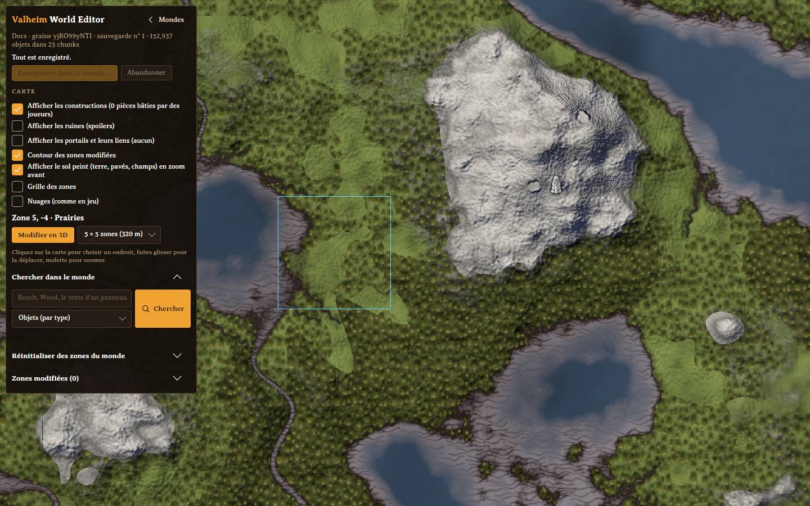
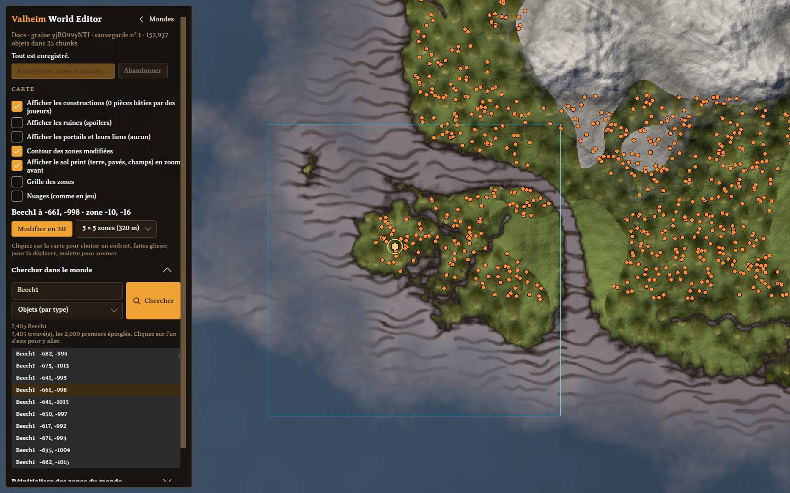
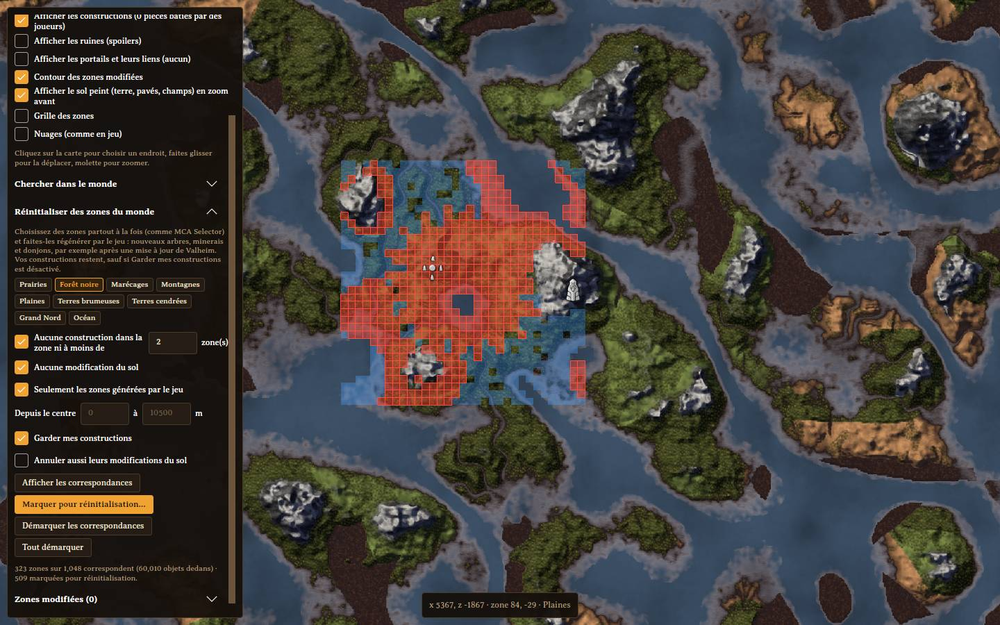
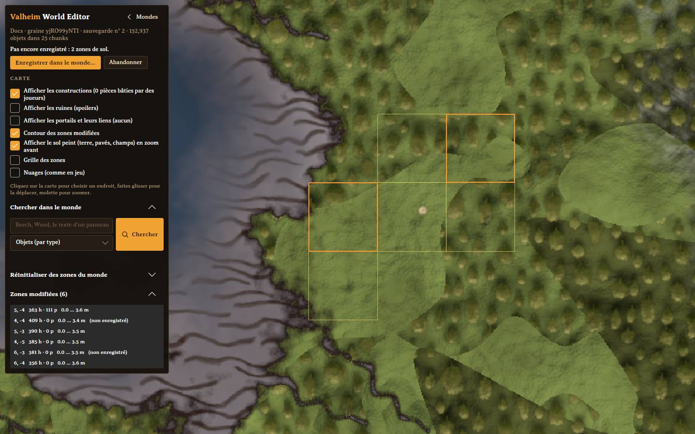

<!-- source: 2b176694 -->
# Carte du monde

Voyez tout le monde, choisissez l'endroit à modifier en 3D, cherchez chaque objet, coffre et panneau, réinitialisez
des zones n'importe où à la fois, et enregistrez ce qui est en attente.

**Où :** s'ouvre avec chaque monde ; **Carte** dans la barre du haut de l'éditeur y revient · **Touche :** aucune
(`F1` ouvre cette page) · **Fonctionne dans :**
mondes enregistrés, en direct

> [!WARNING]
> **Fermez le jeu ou arrêtez le serveur avant d'enregistrer un monde hors ligne.** Un jeu en cours écrase les fichiers
> du monde quand il sauvegarde, et vos modifications, réinitialisations de zones comprises, sont perdues. Pour modifier
> un monde pendant qu'il tourne, utilisez le [mode direct](live-mode.md).

*Une zone est choisie : le carré bleu clair est le secteur que **Modifier en 3D** ouvrira, à la taille choisie à côté
du bouton.*

La carte est dessinée comme le jeu dessine la sienne, à partir des données du monde : elle ressemble donc à la carte du
jeu entièrement révélée. Le départ et les marchands (une fois leur zone créée) affichent leurs icônes comme en jeu.

## L'utiliser

1. Faites glisser pour déplacer la carte ; tournez la molette pour zoomer vers le pointeur.
2. Cliquez sur un endroit. Le panneau latéral affiche sa zone et son biome (« Zone 12, -4 · Forêt noire »), et le
   secteur qui va s'ouvrir est entouré de bleu clair.
3. Dans le panneau latéral, choisissez la taille dans la liste à côté de **Modifier en 3D**.
4. Appuyez sur **Modifier en 3D**. L'[éditeur 3D](editor-basics.md) s'ouvre autour de la zone sur laquelle vous avez
   cliqué.

La carte retient où vous avez regardé en dernier, y compris au prochain démarrage de l'éditeur. La case du bas affiche
le point sous le pointeur : ses coordonnées, sa zone et son biome (« x 812, z -260 · zone 13, -4 · Prairies »), et le
biome alternatif de son secteur s'il en a un (« biome alt. Dark Meadows », affiché quelques secondes après l'ouverture
de la carte).

## Réglages

Le haut du panneau latéral donne le nom du monde, sa graine, son numéro de sauvegarde et le nombre d'objets qu'il
contient (en direct : la connexion au lieu du numéro de sauvegarde) ; après un enregistrement, il affiche le nouveau
numéro de sauvegarde. **Mondes** revient à la page d'accueil : s'il y a des modifications en attente, il demande
d'abord, et **Partir quand même** les perd.

| Réglage | Ce qu'il fait |
|---|---|
| **Recharger depuis le jeu** | En direct seulement : relit tout le monde depuis le jeu en cours. La ligne au-dessus liste les joueurs en ligne (« Monde en direct · 2 joueur(s) en ligne : Ragnar, Freya »). |
| **Enregistrer dans le monde…** / **Appliquer en direct** | Écrit chaque modification en attente dans les fichiers du monde (en direct : l'envoie au jeu en cours). La ligne au-dessus dit ce qui attend, par exemple « Pas encore enregistré : 3 zones de sol, 12 supprimé(s), 40 ajouté(s), 25 réinitialisation(s) de zone. » |
| **Abandonner** | Jette toutes les modifications pas encore enregistrées ni appliquées, après confirmation. |
| **Afficher les constructions (N pièces bâties par des joueurs)** | Dessine chaque pièce bâtie par un joueur : leur emprise de près, des points de plus loin, rien quand le zoom est très éloigné. Les ruines sur lesquelles des joueurs ont bâti sont dessinées avec la construction. Activé au départ. |
| **Afficher les ruines (spoilers)** | Dessine aussi les ruines du monde (tours de pierre, maisons en ruine, ruines des Terres brumeuses et des Terres cendrées), plus pâles. Désactivé au départ, parce que cela montre où elles se trouvent. |
| **Afficher les portails et leurs liens (N : P paire(s) liée(s), A seul(s))** | Dessine chaque portail sous forme de point violet, avec une ligne entre les deux qui partagent une étiquette (la paire que le jeu relie) ; un portail sans partenaire est creux. En zoom avant (8 m par pixel ou plus près), chaque étiquette est écrite à côté de son portail (« sans étiquette » pour une étiquette vide). N compte les portails, P les paires liées, A les portails sans partenaire. Les portails ajoutés ou supprimés dans l'éditeur comptent dès que la carte est réaffichée. Désactivé au départ, parce que cela montre où se trouve chaque portail. |
| **Contour des zones modifiées** | Entoure les zones dont le sol a été modifié : une fine ligne jaune pour les modifications déjà dans le monde, une ligne orange plus épaisse pour les modifications pas encore enregistrées ni appliquées. Activé au départ. |
| **Afficher le sol peint (terre, pavés, champs) en zoom avant** | De près, la carte est dessinée avec un détail de 1 m, avec vos modifications du sol en attente ; cela montre aussi la terre, les pavés et la terre cultivée. Activé au départ. |
| **Grille des zones** | Dessine les lignes entre les [zones](concepts/areas-and-zones.md#zones) de 64 m, quand le zoom est suffisant. |
| **Nuages (comme en jeu)** | Dessine les ombres de nuages qui dérivent sur la carte du jeu. |
| **Modifier en 3D** | Ouvre l'éditeur 3D sur le secteur autour de la zone choisie. |
| Liste de taille (à côté de **Modifier en 3D**) | La quantité de sol que charge l'éditeur : **3 × 3 zones (192 m)**, **5 × 5 zones (320 m)** (par défaut), **7 × 7**, **9 × 9**, **13 × 13** ou **17 × 17 zones (1088 m)**. Utilisez 5 × 5 pour la plupart des travaux, 9 × 9 ou plus pour coller une ville ou élever une grande montagne. Les secteurs plus grands sont plus lents. Vous pouvez la changer plus tard dans la barre du haut. |

En mode direct, les joueurs en ligne apparaissent sous forme de points bleus avec leur nom, mis à jour toutes les
5 secondes. Les modifications restent [en attente](concepts/saving-and-history.md#modifications-en-attente) d'un secteur à
l'autre : modifiez un secteur, revenez à la carte, ouvrez-en un autre, et enregistrez tout en une fois.

## Chercher dans le monde

*Chaque épingle orange est un objet trouvé. Le résultat choisi dans la liste est plus grand, avec un anneau doré, et la
carte est centrée dessus.*

1. Ouvrez **Chercher dans le monde**.
2. Tapez une partie d'un nom ou d'un texte, par exemple `Beech`, `Wood` ou les mots d'un panneau. Les majuscules ne
   comptent pas.
3. Choisissez ce que vous cherchez (ci-dessous).
4. Appuyez sur **Chercher** (ou `Enter`). Chaque résultat est épinglé sur la carte et listé.
5. Cliquez sur un résultat : la carte se centre dessus et choisit sa zone. **Modifier en 3D** s'ouvre alors avec cet
   objet sélectionné.

| Ce que vous cherchez | Ce qui est trouvé |
|---|---|
| **Objets (par type)** | Chaque objet dont le type contient le texte : `portal`, `Beech`, `chest`, `guard_stone`… |
| **Objets dans les conteneurs** | Chaque coffre, chariot, navire ou autre conteneur qui contient un objet dont le nom contient le texte : `Wood`, `Draugr`, `Silver`… Chaque résultat indique combien (« Wood ×50 »). |
| **Textes (panneaux, portails, protections…)** | Chaque objet dont un texte le contient : textes des panneaux, étiquettes des portails, noms des protections et des pierres tombales. Chaque résultat affiche le texte trouvé. |

Une ligne au-dessus des résultats compte ce qui a été trouvé par type (par objet pour les conteneurs) et au total. La
liste affiche les 300 premiers résultats ; jusqu'à 2 000 sont épinglés. Pour les objets et les textes, les
[données](select.md) de l'objet s'ouvrent aussi : vous pouvez changer tout de suite le contenu du coffre ou le texte du
panneau. Changer ce que vous cherchez relance aussitôt la recherche.

La recherche lit le monde tel qu'il est dans l'éditeur : les objets placés mais non enregistrés sont trouvés, les
objets supprimés mais non enregistrés ne le sont pas. Les objets de gestion interne du jeu (noms commençant par `_`,
comme `_ZoneCtrl`) ne sont trouvés que si votre texte commence aussi par `_`.

## Réinitialiser des zones dans tout le monde

*Les zones des Prairies ont été marquées pour réinitialisation (rouge), puis **Forêt noire** a été choisi et
**Afficher les correspondances** pressé (bleu). La ligne sous les boutons compte les deux.*

Choisissez des zones n'importe où dans le monde selon ce qu'elles sont, et faites-les régénérer par le jeu : nouveaux
arbres, rochers, minerais et donjons, par exemple après une mise à jour de Valheim, là où personne n'a construit. Pour
réinitialiser les zones sous une sélection, utilisez plutôt l'outil [Région](area.md#réinitialiser-les-zones), qui a les deux
mêmes interrupteurs et marque de la même façon ; pas à pas : [Générer à nouveau des zones](guides/reset-zones.md).

1. Ouvrez **Réinitialiser des zones du monde**.
2. Réglez le filtre (ci-dessous).
3. Appuyez sur **Afficher les correspondances**. La première fois, l'éditeur lit chaque zone (un instant). Les zones
   correspondantes deviennent bleues et une ligne indique « N zones sur M correspondent (K objets dedans) ». Ensuite,
   la carte suit le filtre au fil de vos changements.
4. Appuyez sur **Marquer pour réinitialisation…** et confirmez. Les zones correspondantes deviennent rouges.
5. **Enregistrer dans le monde** (hors ligne) ou **Appliquer en direct** effectue la réinitialisation. D'ici là,
   **Tout démarquer** l'annule, et **Démarquer les correspondances** l'annule pour les zones auxquelles correspond le
   filtre actuel.

> [!CAUTION]
> **Une réinitialisation ne peut pas être annulée une fois enregistrée ou appliquée.** Chaque objet de la zone est
> retiré sauf les pierres tombales des joueurs et, avec **Garder mes constructions** activé, les pièces bâties par des
> joueurs : arbres, rochers, minerais, ruines, entrées de donjon, objets au sol et créatures, animaux apprivoisés
> compris. Déplacez d'abord les animaux apprivoisés hors des zones, et
> [sauvegardez le monde](guides/back-up-a-world.md).

| Réglage | Ce qu'il fait |
|---|---|
| Boutons de biome (**Prairies** … **Océan**) | Seulement les zones dont le milieu est dans l'un des biomes activés. Aucun activé : tous les biomes. |
| **Aucune construction dans la zone ni à moins de N zone(s)** | Exclut les zones à moins de N zones de pièces bâties par des joueurs, diagonales comprises (de 0 à 50 ; 2 au départ). Activé au départ. Désactivé, une zone qui contient des pièces reste exclue tant que **Garder mes constructions** est activé. |
| **Aucune modification du sol** | Exclut les zones dont le sol a été modifié (en jeu ou dans l'éditeur). Activé au départ. |
| **Seulement les zones générées par le jeu** | Seulement les zones près desquelles un joueur est déjà passé. Désactivé : aussi les zones qui ne contiennent que des objets ou des modifications du sol venant de l'éditeur. Activé au départ. |
| **Depuis le centre … à … m** | Seulement les zones à cette distance du milieu du monde. Vide : aucune limite (le bord du monde est à 10 500 m). Par exemple, ne réinitialisez que les anneaux extérieurs. |
| **Garder mes constructions** | Activé au départ : les constructions ne sont jamais réinitialisées depuis la carte, et une zone qui contient des pièces bâties par des joueurs ne correspond jamais. Désactivé, et avec **Aucune construction…** désactivé aussi, les zones avec des constructions correspondent comme les autres et leurs constructions partent avec le reste ; la question avant le marquage le précise. |
| **Annuler aussi leurs modifications du sol** | La réinitialisation retire aussi les modifications du sol des zones, pour revenir au sol de la graine. Ne compte que quand **Aucune modification du sol** est désactivé. Désactivé au départ ici (celui de l'outil Région est activé au départ). |
| **Afficher les correspondances** | Colore en bleu les zones correspondantes et les compte, ainsi que les objets qu'elles contiennent. |
| **Marquer pour réinitialisation…** | Marque pour réinitialisation chaque zone correspondante (rouge), après confirmation. |
| **Démarquer les correspondances** | Annule la réinitialisation des zones correspondantes qui sont marquées ; les autres marques restent. |
| **Tout démarquer** | Annule chaque réinitialisation de zone marquée, y compris celles marquées avec l'outil Région. |

La prochaine fois qu'un joueur s'approche d'une zone réinitialisée, le jeu la régénère à partir de la graine, lieu
(ruine, donjon, autel) compris. En direct, cela se produit aussitôt là où se trouvent des joueurs ; après une
réinitialisation en direct, l'éditeur relit le monde, et l'historique suit, sans ce qu'il a fait dans les zones
réinitialisées.

## Zones modifiées

**Zones modifiées (N)** liste chaque zone dont le sol a été modifié, de la plus modifiée à la moins modifiée. Chaque
ligne donne la zone, le nombre de points de hauteur (`h`) et de points de peinture (`p`) modifiés, l'étendue des
changements de hauteur (`-2.4 … 6.0 m`), et « (non enregistré) » quand des modifications sont en attente (« (non
appliqué) » dans un monde en direct). Cliquez sur une ligne pour zoomer sur cette zone et la choisir, prête pour
**Modifier en 3D**.

*Quatre zones enregistrées (jaune fin) et deux modifiées depuis (orange plus épais) : la liste marque celles en attente
« (non enregistré) ».*

## Raccourcis

| Touche ou souris | Ce qu'elle fait |
|---|---|
| Glisser | Déplacer la carte. |
| Molette | Zoomer vers le pointeur. |
| Clic | Choisir la zone à cet endroit. |
| `Enter` dans la zone de recherche | Chercher. |

## Astuces et limites

- **La carte montre le monde tel qu'il a été lu.** En direct, l'éditeur 3D suit ce que les joueurs changent dans le
  secteur ouvert, mais le reste de la carte ne change qu'avec **Recharger depuis le jeu**.
- **En zoom plus proche qu'environ 6 m par pixel**, la partie visible est redessinée avec un détail de 1 m, avec vos
  modifications du sol en attente.
- **Seules les zones à l'intérieur du monde** sont listées pour réinitialisation. Un serveur dédié sans personne en
  ligne génère aussi des zones loin hors du monde : celles-ci sont exclues.
- **Pour annuler une modification**, **Tout démarquer** annule les réinitialisations marquées, et **Abandonner** jette
  tout ce qui est en attente. Pour annuler une seule modification, ouvrez son secteur en 3D et appuyez sur `Ctrl+Z` ou
  utilisez l'Historique : voir [Annuler une étape, retirer une modification ou tout abandonner](guides/undo-changes.md).
- **La recherche ne trouve rien ?** Vérifiez l'orthographe et le choix de ce que vous cherchez ; les objets de gestion
  interne demandent un `_` au début.
- **Mondes créés avec Expand World** : avec son module complémentaire installé et activé, un monde plus large
  s'affiche en entier, les icônes des lieux viennent de ses données, et la lecture du pointeur ajoute le territoire et
  les effets d'état qu'un joueur y subit (« territoire frost · effets Freezing (nuit) »). Voir
  [Modifier un monde créé avec Expand World, Riverheim ou Tunnelheim](guides/use-mods-worlds.md).

## Voir aussi

- [Trouver un objet, un objet dans un coffre ou un panneau](guides/find-things.md)
- [Générer à nouveau des zones](guides/reset-zones.md)
- [Sauvegarder un monde avant de le modifier](guides/back-up-a-world.md)
- [Secteurs et zones](concepts/areas-and-zones.md)
- [Les bases de l'éditeur](editor-basics.md), [Mode direct](live-mode.md)
