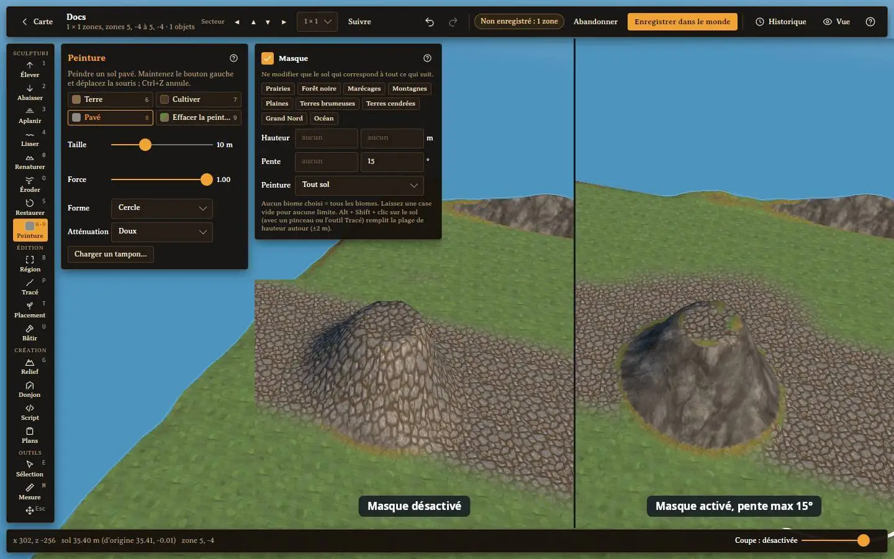
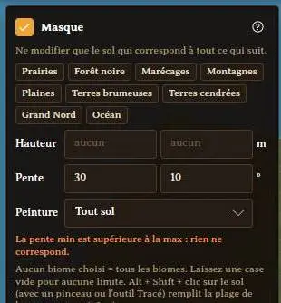

<!-- source: 1cb7e459 -->
# Masque

Faites qu'un outil ne modifie que le sol que vous choisissez, par biome, hauteur, pente ou peinture : pavez seulement
les parties planes d'une colline, aplanissez le fond d'une vallée sans toucher à ses flancs, plantez seulement sur un
sol non peint.

**Où :** la fiche **Masque** à côté du panneau de l'outil · **Touche :** aucune (`Alt`+`Shift`+clic règle une plage
de hauteur) · **Fonctionne dans :** mondes enregistrés, en direct

*Le même large coup de peinture Pavé sur un monticule. À gauche, Masque désactivé : tout est pavé. À droite, Masque
activé avec des pentes sous 15° : le sol plat est pavé, les flancs raides du monticule ne le sont pas. La fiche du
Masque est à côté du panneau de l'outil.*

Le Masque fonctionne avec les pinceaux de sculpture et le pinceau Peinture, [Relief](landform.md),
[Tracé](path.md), les actions de l'outil [Région](area.md), le collage et [Placement](place.md). Il ne retient pas
[Bâtir](build.md) : une pièce va là où vous pointez.

## L'utiliser

1. Choisissez un outil qui utilise le Masque. La fiche **Masque** s'affiche à côté de son panneau.
2. Sur la fiche, cochez **Masque**. Ses réglages s'ouvrent en dessous.
3. Réglez les biomes, la hauteur, la pente et la peinture voulus. Laissez un réglage vide pour ne pas limiter par lui.
4. Utilisez l'outil comme d'habitude : il ne modifie que le sol qui correspond à chaque réglage.
5. Quand vous avez fini, décochez **Masque**. Il reste activé, avec ses réglages, quand vous changez d'outil.

## Réglages

| Réglage | Ce qu'il fait |
|---|---|
| **Masque** | Activé : l'outil ne modifie que le sol qui correspond à tout ce qui suit. Désactivé : aucune limite. |
| Pastilles de biomes | **Prairies**, **Forêt noire**, **Marécages**, **Montagnes**, **Plaines**, **Terres brumeuses**, **Terres cendrées**, **Grand Nord**, **Océan** : seulement ces biomes. Aucun choisi : tous les biomes. |
| **Hauteur** min / max | Seulement le sol entre ces hauteurs (m ; la mer est à 30 m). Laissez une case vide (« aucun ») pour ne pas limiter de ce côté. |
| **Pente** min / max | Seulement le sol entre ces inclinaisons, de 0° à 90°. Un maximum de 0 ne laisse passer que le sol parfaitement plat. |
| **Peinture** | **Tout sol**, **Seulement non peint**, **Seulement peint**, **Seulement terre**, **Seulement cultivé** ou **Seulement pavé**. |

Un avertissement orange s'affiche sous les réglages quand ils ne laissent rien passer : une pente maximale de 0°, ou un
minimum au-dessus du maximum.

*La pente min de 30° est au-dessus de la max de 10°, donc la fiche avertit en orange : « La pente min est supérieure à
la max : rien ne correspond. »*

### Sans limite, sur la même fiche

Sous le Masque, la fiche contient l'autre réglage que partagent tous les outils de sol :

| Réglage | Ce qu'il fait |
|---|---|
| **Sans limite : au-delà des ±8 m du jeu** | Activé : les outils de sol vont jusqu'à 400 m du sol généré, et pas seulement aux 8 m du jeu. Un seul interrupteur pour les pinceaux de sculpture, [Relief](landform.md) (ses formules et ses images), [Tracé](path.md) et [Région](area.md) ; il reste activé jusqu'à ce que vous le désactiviez, et il est désactivé à chaque démarrage de l'éditeur. Voir [Sans limite](terrain.md#sans-limite). |

Il ne fait pas partie du Masque (il fonctionne Masque activé ou désactivé), et la fiche ne l'affiche qu'avec les outils
qu'il commande : pas avec le pinceau Peinture ni [Placement](place.md), qui ne déplacent pas de sol. Une montagne de
Relief dépasse toujours la limite, quoi que dise l'interrupteur.

## Raccourcis

| Touche ou souris | Ce qu'elle fait |
|---|---|
| `Alt`+`Shift`+clic sur le sol | Avec un pinceau de sculpture ou de peinture, ou l'outil Tracé : active le Masque et remplit **Hauteur** de 2 m sous ce point à 2 m au-dessus. Pratique pour travailler sur une seule terrasse ou un seul rivage. |

## Astuces et limites

- **Le Masque n'a pas de bord adouci.** Chaque point de sol (un par mètre) correspond ou non, donc sculpter avec lui
  peut laisser une marche là où le sol qui correspond rencontre le reste, surtout avec Élever, Abaisser et un
  [Relief](landform.md). Repassez sur la marche avec le pinceau **Lisser** ensuite, Masque désactivé.
- **Pendant un coup de pinceau, le Masque regarde le sol tel qu'il était quand vous avez appuyé sur le bouton.** Un
  coup d'Élever sous une limite de hauteur continue de monter au-delà jusqu'à ce que vous relâchiez. Les modifications
  en un clic (Relief, Tracé, Région, collage) regardent le sol juste avant elles.
- **Le biome est celui que le monde a généré** à cet endroit. Remodeler le sol ne le change pas.
- **Peinture :** le sol effacé avec **Effacer la peinture** compte comme non peint. **Seulement terre**,
  **Seulement cultivé** et **Seulement pavé** demandent que cette peinture fasse au moins la moitié de la couleur.
- **Rien n'a changé ?** La barre d'état indique « Rien n'a changé : le Masque exclut tout le sol sous le pinceau
  (vérifiez ses réglages de hauteur, de pente, de biome et de peinture). »
- **Un collage obéit aussi au Masque, même si la fiche n'est pas affichée pendant que vous collez.** Un Masque resté
  activé limite le sol que le collage façonne (ses objets entrent tous). Décochez **Masque** avant de copier et coller
  si vous voulez tout le sol.
- **Le Masque est un réglage, pas une modification** : il ne s'annule pas avec `Ctrl+Z` et n'est pas enregistré dans
  le monde. Il est désactivé, ses cases vides, à chaque démarrage de l'éditeur.

Idées :

- Pour paver un chemin seulement sur les parties planes d'un flanc de colline, réglez **Pente** max et utilisez
  **Peindre en pavés** de l'outil Tracé.
- Pour planter seulement sur un sol non peint ou seulement sur un sol cultivé, réglez **Peinture** et utilisez
  [Placement](place.md).
- Pour aplanir le fond d'une vallée sans toucher à ses flancs, réglez **Hauteur** max un peu au-dessus du fond de la
  vallée et utilisez **Aplanir** ou l'outil [Région](area.md).

## Voir aussi

- [Dégager arbres et rochers, aplanir un terrain à bâtir](guides/clear-an-area.md)
- [Planter une forêt, un champ ou une haie](guides/plant-a-forest.md)
- [Sculpter et peindre](terrain.md), [Tracé](path.md), [Région](area.md)
- [Comment le masque juge le sol](concepts/ground-limits.md#comment-le-masque-juge-le-sol)
