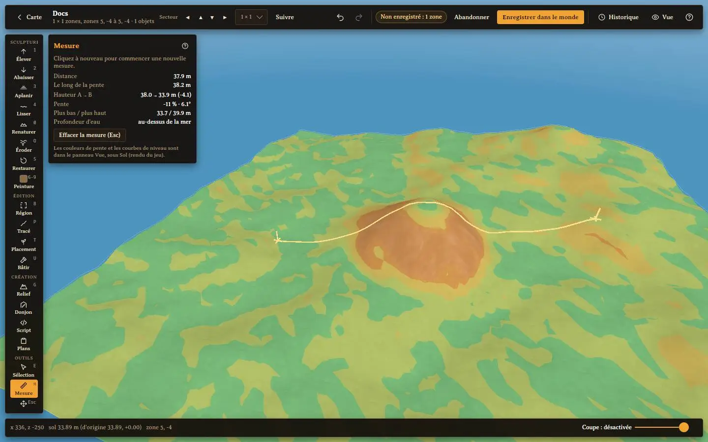
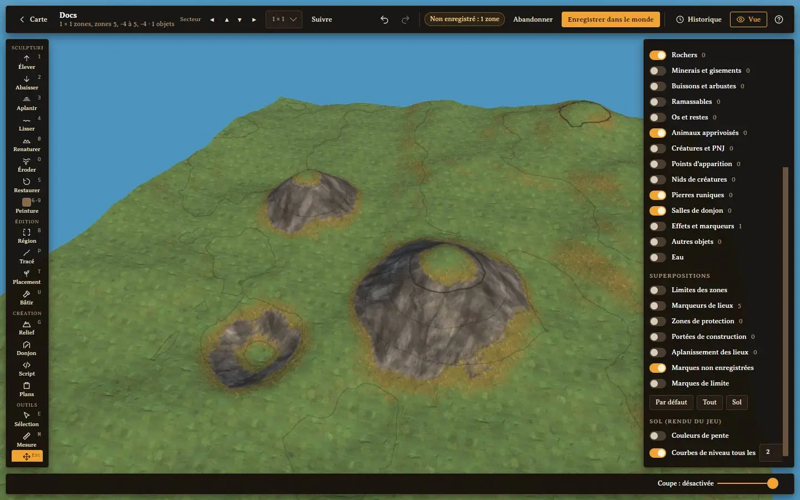
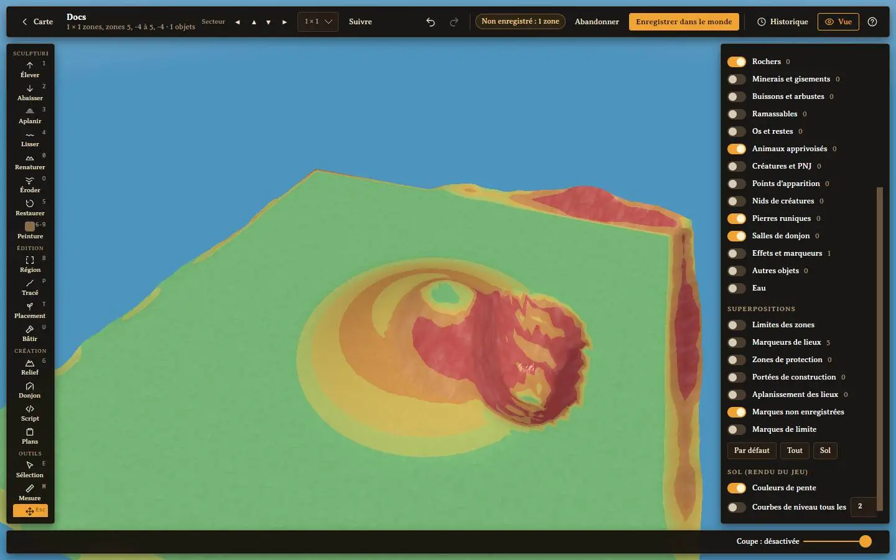

<!-- source: 164ad5c4 -->
# Mesure et superpositions

Cliquez sur deux points et lisez la distance, la différence de hauteur et la pente entre eux. Deux superpositions du
sol, les couleurs de pente et les courbes de niveau, montrent la raideur et la hauteur partout à la fois pendant que
vous utilisez n'importe quel outil.

**Où :** barre d'outils, section **OUTILS** ; les superpositions dans le panneau Vue · **Touche :** `M` ·
**Fonctionne dans :** mondes enregistrés, en direct

*Une mesure depuis le pied d'une butte par-dessus son sommet, avec les couleurs de pente activées. La ligne suit le
sol ; le panneau affiche la distance, les hauteurs et la pente.*

## L'utiliser

1. Dans la barre d'outils, cliquez sur **Mesure** (`M`).
2. Cliquez sur un premier point au sol. La ligne suit le curseur.
3. Cliquez sur un second point pour fixer la mesure. Le panneau affiche les valeurs.
4. Cliquez encore une fois pour commencer une nouvelle mesure, ou appuyez sur **Effacer la mesure (Esc)** pour la
   retirer.

La ligne est dessinée le long du sol : elle montre donc le profil entre les deux points. L'indication en haut du
panneau dit ce que fait le prochain clic.

## Valeurs

| Valeur | Ce qu'elle signifie |
|---|---|
| **Distance** | La distance en ligne droite vue de dessus, comme sur une carte (m). |
| **Le long de la pente** | La longueur d'une ligne droite de A à B, différence de hauteur comprise (m). |
| **Hauteur A → B** | La hauteur du sol aux deux points et la différence, par exemple `35.0 → 42.5 m (+7.5)`. |
| **Pente** | La pente moyenne de A à B, en % et en degrés. Une pente de 100 % fait 45°. |
| **Plus bas / plus haut** | Le sol le plus bas et le plus haut le long de la ligne, lu à chaque mètre : une bosse ou un creux apparaît ici même quand A et B sont au même niveau. |
| **Profondeur d'eau** | De combien le point le plus bas est sous la mer (la mer est à 30 m), ou « au-dessus de la mer ». |

Les hauteurs sont celles du jeu, comme dans la barre d'état. Vous pouvez sélectionner les valeurs dans le panneau et
les copier.

## Superpositions du sol

Dans le panneau Vue (`V`), sous **SOL (rendu du jeu)** :

| Réglage | Ce qu'il fait |
|---|---|
| **Couleurs de pente** | Colore le sol selon sa raideur, pour voir où une rampe ou un terrain à bâtir est trop raide : vert sous 10°, vert-jaune de 10 à 20°, jaune de 20 à 30°, orange de 30 à 45°, rouge au-delà de 45°. Les collines gardent leurs lumières et leurs ombres. |
| **Courbes de niveau tous les** *N* **m** | Dessine des courbes de niveau tous les **1**, **2** (par défaut), **5** ou **10** m. Une courbe sur cinq est plus foncée et plus épaisse. Des courbes rapprochées signalent un sol raide. |

Les deux demandent **Rendu du jeu** (l'aspect du sol dans le panneau Vue), restent actives pendant que vous utilisez
d'autres outils, et sont retenues. Les courbes de niveau tombent sur des multiples du pas : le niveau de la mer (30 m)
en a donc toujours une, et le trait de côte est facile à suivre.

*Des courbes de niveau tous les 2 m sur deux buttes et un creux, limites de zones désactivées. Le panneau Vue affiche
**Courbes de niveau tous les** 2 m sous **SOL (rendu du jeu)** ; une courbe sur cinq est plus foncée.*

*Les couleurs de pente sur une butte : vert sur le sol plat, puis vert-jaune, jaune et orange en remontant son flanc
doux, et rouge sur la falaise taillée dedans. Le panneau Vue montre **Couleurs de pente** coché sous **SOL (rendu du
jeu)**.*

## Raccourcis

| Touche ou souris | Ce qu'elle fait |
|---|---|
| `M` | Choisir Mesure. |
| Clic | Placer le point A, puis le point B, puis recommencer. |
| `Esc` | Effacer la mesure ; un second `Esc` quitte l'outil. |
| `V` | Afficher ou masquer le panneau Vue (les superpositions). |

## Astuces et limites

- **La mesure ne change rien** dans le monde et n'est pas enregistrée.
- **Les valeurs suivent le sol.** Modifiez le sol avec un autre outil et revenez à Mesure, ou annulez : les hauteurs,
  la pente et les points le plus bas et le plus haut sont relus aux mêmes A et B.
- **Préparez une rampe :** mesurez depuis son pied jusqu'à son sommet. La **Pente** est celle que donne la **Rampe
  (début → fin)** de l'outil [Tracé](path.md) le long d'une ligne droite entre les mêmes points.
- **Marques de limite**, dans le même panneau Vue, teinte en rouge le sol qui a atteint les ±8 m du jeu. Voir
  [Marques de limite](concepts/ground-limits.md#marques-de-limite).

## Voir aussi

- [Faire une route ou une rampe qui monte une colline](guides/make-a-road.md)
- [Dégager arbres et rochers, aplanir un terrain à bâtir](guides/clear-an-area.md)
- [Les bases de l'éditeur](editor-basics.md) : le panneau Vue
- [Tracé](path.md), [Sculpter et peindre](terrain.md)
