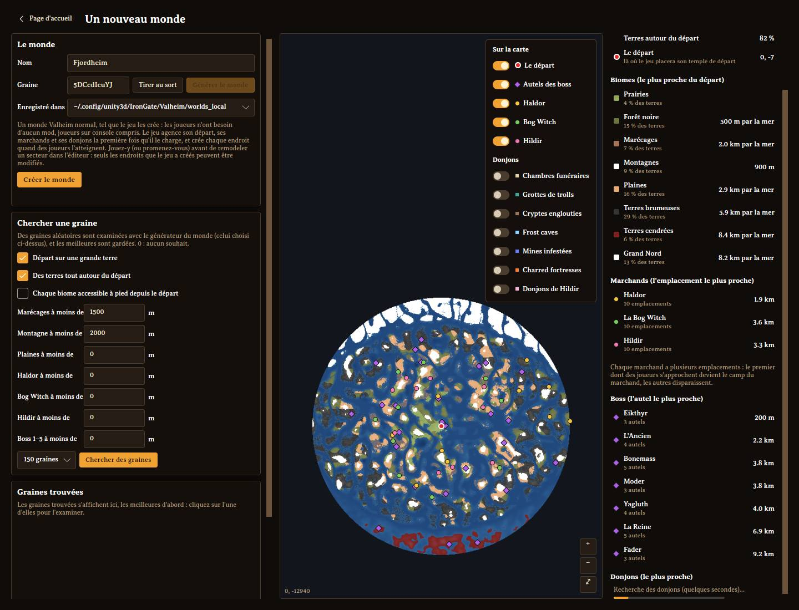
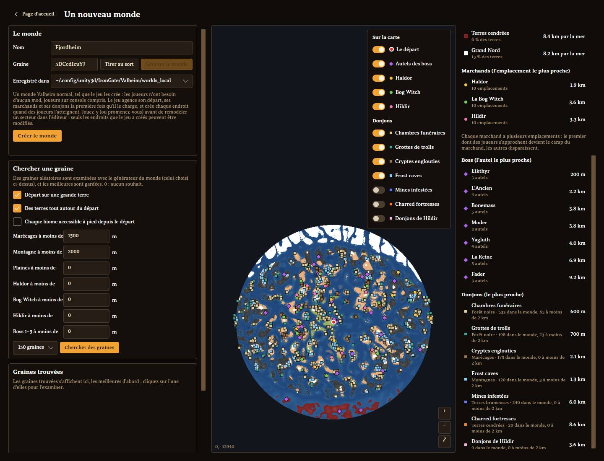
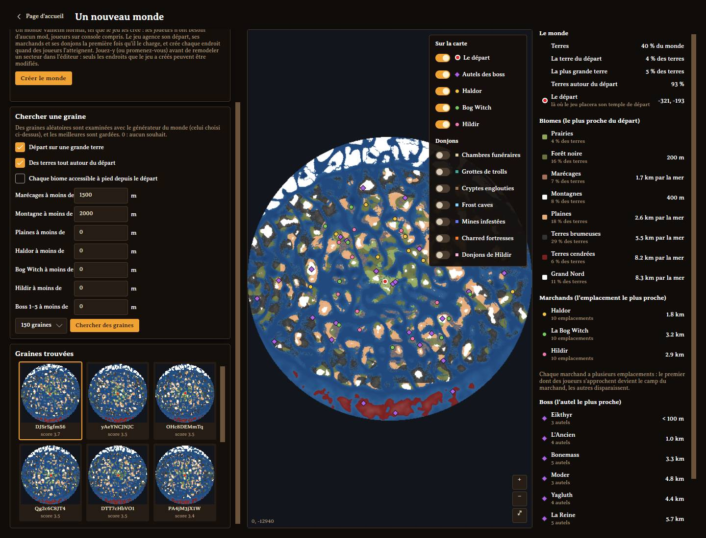
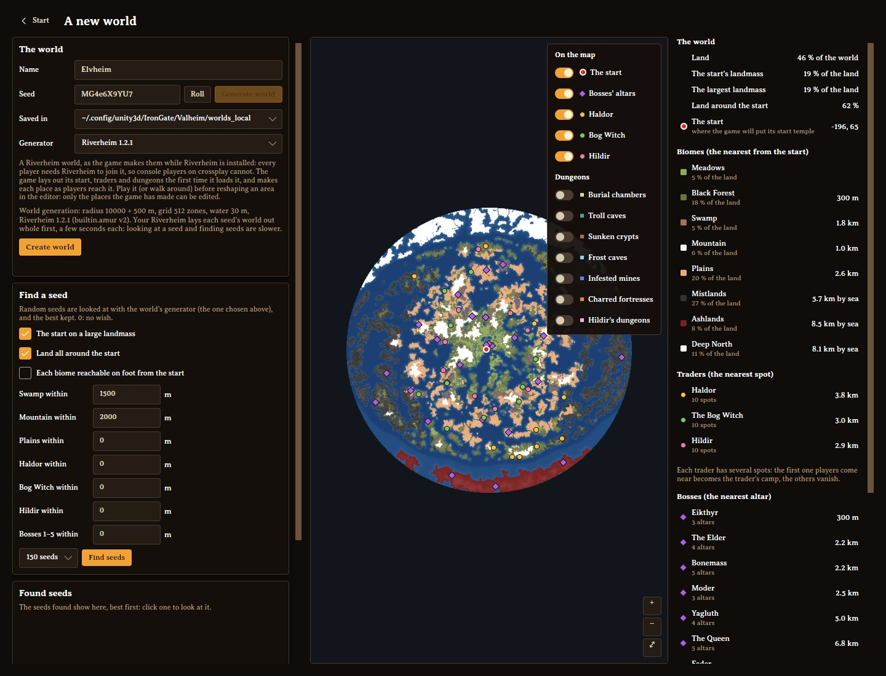

<!-- source: eca6c42a -->
# Un nouveau monde

Voyez le monde d'une graine avant qu'il existe, parcourez de nombreuses graines pour en trouver une qui vous convient,
et créez le monde.

**Où :** page d'accueil, **Création** → **Un nouveau monde** → **Créer un nouveau monde** · **Touche :** aucune ·
**Fonctionne dans :** la page d'accueil (aucun monde n'a besoin d'être ouvert)

*Le point rouge est le départ, les losanges violets sont les autels des boss, les points jaune, vert et rose sont les
emplacements des marchands. La colonne de droite liste les données de la graine, ici défilée jusqu'aux autels les
plus proches des boss.*

Le monde que vous créez est un monde Valheim normal, créé selon les règles du jeu à partir de sa graine : les joueurs
le rejoignent sans aucun mod, joueurs sur console en crossplay compris (sauf si vous choisissez le générateur d'un mod
de génération de monde, voir [Astuces et limites](#astuces-et-limites)).

## L'utiliser

1. Sur la page d'accueil, choisissez **Un nouveau monde** sous **Création**, puis **Créer un nouveau monde**. Le
   monde d'une graine aléatoire s'affiche.
2. Tapez une graine et appuyez sur **Générer le monde** (ou `Enter`), ou appuyez sur **Tirer au sort** pour en obtenir
   une autre au hasard. Pour laisser l'éditeur chercher, voir [Chercher une graine](#chercher-une-graine).
3. Regardez la carte et les données à côté. Facultatif : activez les types de donjon qui vous intéressent.
4. Tapez le **Nom** du monde, choisissez où il est **Enregistré dans**, et appuyez sur **Créer le monde**. L'éditeur
   écrit le monde et ouvre sa carte.
5. Lancez Valheim, chargez le nouveau monde et parcourez les parties que vous voulez modifier. Le jeu ne crée chaque
   endroit qu'à mesure que des joueurs s'en approchent.
6. Rouvrez le monde dans l'éditeur pour remodeler ce que le jeu a créé.

**Page d'accueil** (en haut à gauche) revient à la page d'accueil ; rien n'est créé.

## Réglages

| Réglage | Ce qu'il fait |
|---|---|
| **Graine** | Jusqu'à 10 lettres et chiffres, comme dans le jeu. La même graine crée toujours le même monde. La casse compte : `Valheim` et `valheim` sont deux mondes. |
| **Tirer au sort** | Met une autre graine aléatoire dans la case et affiche son monde. |
| **Générer le monde** | Affiche le monde de la graine (ou `Enter` dans la case de la graine). Grisé tant que la graine dans la case est celle affichée. |
| **Sur la carte** | Affiche ou masque **Le départ**, **Autels des boss**, **Haldor**, **Bog Witch** et **Hildir**. |
| **Donjons** | Affiche où se trouvera chaque type de donjon (désactivé au départ). Voir [Donjons](#donjons). |
| **Nom** | Le nom du monde, tel que le jeu le liste. C'est aussi le nom de son dossier : il ne peut donc pas contenir `/ \ : * ? " < > \|`. |
| **Enregistré dans** | Dans lequel des dossiers de mondes du jeu il va : vos mondes locaux (`worlds_local`) ou les mondes du cloud Steam (`worlds`), ceux qui existent sur cet ordinateur. Le dossier où enregistre le jeu installé vient en premier (sous Linux, la version Windows lancée via Proton garde ses mondes dans son préfixe Steam) : le jeu liste ainsi le monde. |
| **Générateur** | Affiché seulement quand un module complémentaire pour un mod de génération de monde est utilisé et que le mod est trouvé : le générateur du mod ou **Celui du jeu**. Voir [Astuces et limites](#astuces-et-limites). |
| **Créer le monde** | Crée le monde et ouvre sa carte. Un monde du même nom déjà présent dans ce dossier n'est jamais écrasé : un autre nom vous est demandé. |

## La carte

La carte montre le monde de la graine tel que le jeu le créera : terres colorées par biome (les terrains élevés plus
clairs), l'eau sur les terres teintée de bleu, la mer ombrée selon sa profondeur, le nord en haut. Cela prend quelques
secondes ; « Examen du monde de … » s'affiche pendant ce temps. En zoom avant, la vue est redessinée à un point par
pixel d'écran : les côtes et les rivières restent nettes. Le coin inférieur gauche affiche les coordonnées sous le
pointeur.

Sur la carte figurent les endroits que le jeu agence quand il charge le monde pour la première fois :

- le **départ** (point rouge cerclé de blanc) : le temple de départ, où arrivent les nouveaux joueurs ;
- les **autels des boss** (losanges violets) : Eikthyr, l'Ancien, Bonemass, Moder, Yagluth, la Reine et Fader ;
- les **emplacements des marchands** : Haldor (jaune), la Bog Witch (vert) et Hildir (rose). Chaque marchand a
  plusieurs emplacements : le premier dont des joueurs s'approchent devient le camp, et les autres disparaissent.

Survolez une marque pour voir ses coordonnées et sa distance au départ. Les emplacements sont exactement là où le jeu
les placera : l'éditeur rejoue les règles de placement du jeu, lues dans les fichiers de votre Valheim (quelques
secondes, la première fois).

## Donjons

*Quatre types activés : chaque petit carré est un donjon, sa couleur son type, comme dans les interrupteurs et dans
**Donjons (le plus proche)** (distance, biome, nombre dans le monde et à moins de 2 km).*

Les interrupteurs **Donjons** affichent **Chambres funéraires**, **Grottes de trolls**, **Cryptes englouties**,
**Frost caves**, **Mines infestées**, **Charred fortresses** et **Donjons de Hildir**. L'éditeur commence à les
chercher dès qu'une graine est affichée (quelques secondes) ; un type que vous activez s'affiche dès qu'il est trouvé.
Les donjons des 20 dernières graines examinées sont gardés : revenir à l'une d'elles les affiche aussitôt.

**Donjons (le plus proche)** donne, pour chaque type, la distance du plus proche au départ, son biome, combien il y en
a dans le monde et combien se trouvent à moins de 2 km. Cliquez sur une ligne pour activer ce type et voir le plus
proche sur la carte.

Ils comprennent les types qu'un **biome alternatif** (une variante comme Dark Meadows) ajoute ou exclut. Les villages,
les ruines et les autres petits endroits ne sont pas affichés.

## Les données de la graine

À côté de la carte, le monde de la graine sous forme de listes. Cliquez sur une ligne qui a une marque pour la voir,
ou la plus proche de son type, sur la carte.

- **Le monde** : **Terres** (la part du monde qui est de la terre), **La terre du départ** et **La plus grande terre**
  (chacune en part de toutes les terres), **Terres autour du départ** (les terres à moins de 400 m du départ), et les
  coordonnées du départ.
- **Biomes (le plus proche du départ)** : la part des terres de chaque biome et la distance de sa terre la plus
  proche, avec « par la mer » quand elle est sur une autre terre (il vous faut un bateau).
- **Marchands (l'emplacement le plus proche)** : la distance de l'emplacement le plus proche de chaque marchand, et
  combien d'emplacements il a.
- **Boss (l'autel le plus proche)** : la distance de l'autel le plus proche de chaque boss, et combien il y en a.
- **Donjons (le plus proche)** : voir [Donjons](#donjons).

Les terres, ici, sont le sol sur lequel vous pouvez tenir debout ou que vous pouvez traverser à gué : au plus 1 m sous
l'eau, ou 3 m dans les Marécages. Une terre est un ensemble de terres reliées sans traverser d'eau plus profonde.

## Chercher une graine

*Les souhaits (ici une grande terre avec des terres tout autour, des Marécages à moins de 1 500 m et des Montagnes à
moins de 2 000 m, 150 graines) ; les meilleures graines trouvées sous **Graines trouvées**, la meilleure d'abord. La
première a été cliquée : son cadre s'allume et son monde remplit la grande carte.*

**Chercher une graine** examine de nombreuses graines aléatoires en arrière-plan et garde les meilleures pour vos
souhaits. 0 dans une case de distance signifie « aucun souhait ». Pour une recherche pas à pas, voir
[Trouver une graine avec ce que vous voulez près du départ](guides/find-a-seed.md).

| Réglage | Ce qu'il fait |
|---|---|
| **Départ sur une grande terre** | Préfère les graines dont le départ est sur une grande terre (activé au départ). |
| **Des terres tout autour du départ** | Préfère les graines avec peu d'eau à moins de 400 m du départ (activé au départ). |
| **Chaque biome accessible à pied depuis le départ** | Préfère les graines où le plus proche de chaque biome est sur la terre même du départ. |
| **Marécages à moins de**, **Montagne à moins de**, **Plaines à moins de** | Préfère les graines où la terre la plus proche de ce biome est à moins de tant de mètres (de 0 à 8 000 m, par pas de 250 ; 1 500 pour les Marécages et 2 000 pour les Montagnes au départ). |
| **Haldor à moins de**, **Bog Witch à moins de**, **Hildir à moins de** | Préfère les graines où l'un des emplacements de ce marchand est à moins de tant de mètres. |
| **Boss 1–5 à moins de** | Préfère les graines où un autel de chacun d'Eikthyr, de l'Ancien, de Bonemass, de Moder et de Yagluth est à moins de tant de mètres. |
| Liste des graines | Combien de graines aléatoires examiner : **60 graines**, **150 graines** (par défaut) ou **400 graines**. |
| **Chercher des graines** | Lance la recherche ; la barre en dessous montre son avancement. |
| **Arrêter** | Arrête la recherche et affiche les meilleures trouvées jusque-là. |

Les 12 meilleures graines apparaissent sous **Graines trouvées**, chacune en petite carte avec sa graine et son score.
Survolez-en une pour voir ses données ; cliquez dessus pour la voir sur la grande carte (elle reçoit un cadre coloré).

### Comment les graines sont notées

- **Départ sur une grande terre** ajoute jusqu'à 3 (la part des terres de la terre du départ, fois 3) ; **Des terres
  tout autour du départ** ajoute jusqu'à 2 (la part de terres à moins de 400 m, fois 2).
- Un souhait de distance satisfait ajoute de 1 à 2, d'autant plus que c'est proche. Un souhait manqué retire des
  points, d'autant plus que c'est loin ; un biome ou un marchand que la graine n'a pas du tout retire 2. **Boss 1–5 à
  moins de** compte la moyenne des cinq boss.
- **Chaque biome accessible à pied** ajoute 0,25 pour chaque biome dont la terre la plus proche est sur la terre du
  départ.

Un score n'est jamais inférieur à 0. La recherche examine chaque graine plus grossièrement que la grande carte (des
points espacés d'environ 210 m au lieu d'environ 40 m) : elle peut donc manquer de petites îles et des détroits
étroits. Vérifiez une graine trouvée sur la grande carte avant de la choisir. Les souhaits concernant les marchands ou
les boss rendent la recherche quelques fois plus lente.

## Raccourcis

| Entrée | Action |
|---|---|
| `Enter` (dans la case de la graine) | Afficher le monde de la graine |
| Molette de la souris | Zoomer là où se trouve le pointeur |
| Glisser | Déplacer la carte (depuis n'importe où, une marque comprise) |
| Double-clic | Réafficher tout le monde |
| **+**, **−**, **⤢** (en bas à droite) | Plus près, plus loin, tout le monde |

## Astuces et limites

- **Jouez le monde avant de le modifier.** Un nouveau monde ne contient encore ni arbres, ni rochers, ni
  constructions, seulement son nom, sa graine et une liste de zones vide. Le jeu agence le départ, les marchands, les
  autels et les donjons la première fois qu'il charge le monde (là où cette page les montrait), et crée chaque zone à
  mesure que des joueurs s'en approchent. L'éditeur ne peut remodeler que les zones que le jeu a créées ; d'ici là, la
  carte montre les terres de la graine sans rien dessus.
- Le monde est écrit au format de sauvegarde de Valheim 1.0.20 et suivants, comme le jeu écrit un nouveau monde : un
  jeu ou un serveur plus ancien le refuse, mettez-le donc d'abord à jour. Un monde du même nom n'est jamais écrasé.
- Si les boss et les marchands ne peuvent pas être lus dans les fichiers de votre jeu, la page le dit : la carte
  montre quand même les biomes, mais les marques manquent et la recherche ne peut pas en tenir compte. Le journal
  (**Ouvrir le journal** sur la page d'accueil) dit pourquoi.
- Avec le [module complémentaire Expand World](../../addons/ExpandWorld/README.md) utilisé, les graines examinées et le
  monde créé suivent les réglages et les fichiers de données des mods (la page l'indique au-dessus de **Créer le
  monde**) : un monde plus large, d'autres biomes et endroits, le niveau de la mer des mods. Un biome qu'ajoutent les
  mods et un territoire s'affichent dans leurs propres couleurs de carte.
- Avec le [module complémentaire Riverheim](../../addons/Riverheim/README.md) utilisé et Riverheim installé,
  **Générateur** propose Riverheim (choisi au départ, car le jeu fait de chaque nouveau monde un monde Riverheim tant
  que le mod est installé) ou **Celui du jeu**. Un monde Riverheim demande Riverheim dans le jeu de chaque joueur : les
  joueurs sur console en crossplay ne peuvent donc pas le rejoindre. Chaque graine prend quelques secondes : Riverheim
  agence d'abord tout son monde.
- Rien n'est créé avant **Créer le monde** : **Page d'accueil** et la fermeture de la page ne laissent aucune trace.
  Pour retirer un monde que vous avez créé, supprimez son dossier du dossier de mondes où il a été enregistré.

*Avec le module complémentaire Riverheim utilisé, **Générateur** indique Riverheim et sa version, et la note en
dessous dit ce qu'un monde Riverheim demande à ses joueurs. La carte et les données sont le propre monde de Riverheim
pour cette graine.*

## Voir aussi

- [Trouver une graine avec ce que vous voulez près du départ](guides/find-a-seed.md)
- [Modifier un monde créé avec Expand World, Riverheim ou Tunnelheim](guides/use-mods-worlds.md)
- [Secteurs et zones](concepts/areas-and-zones.md#zones) : pourquoi le jeu doit créer une zone avant que vous puissiez
  la modifier
- [Donjons](dungeons.md) : modifier un donjon une fois que le jeu l'a créé
