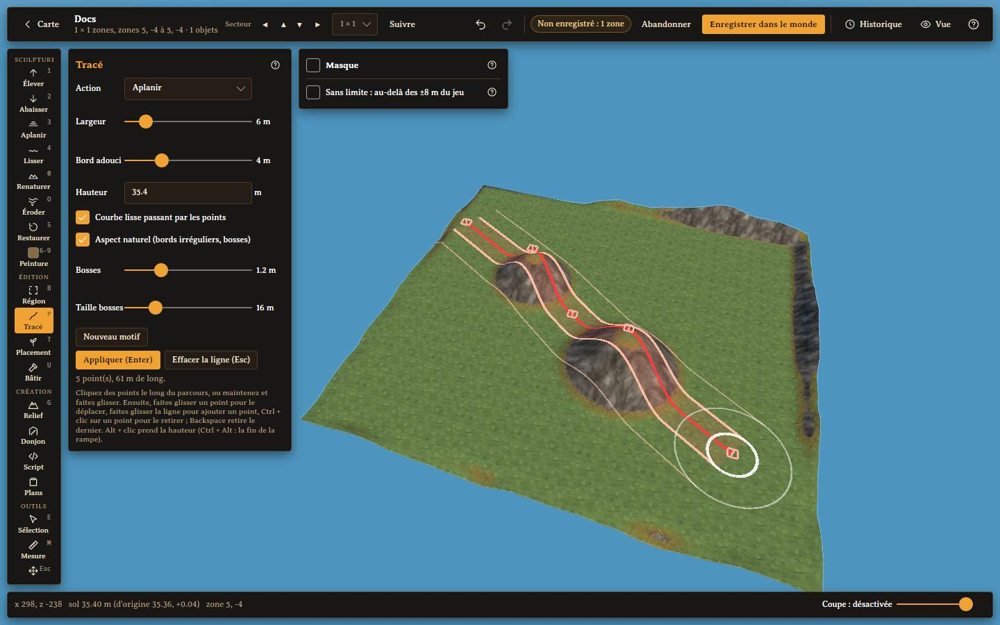
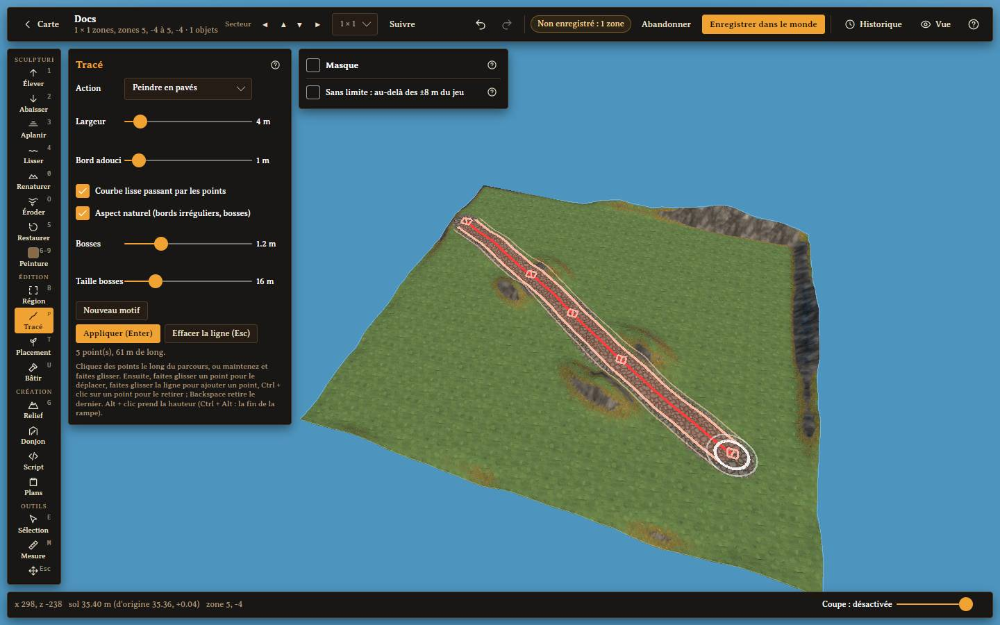
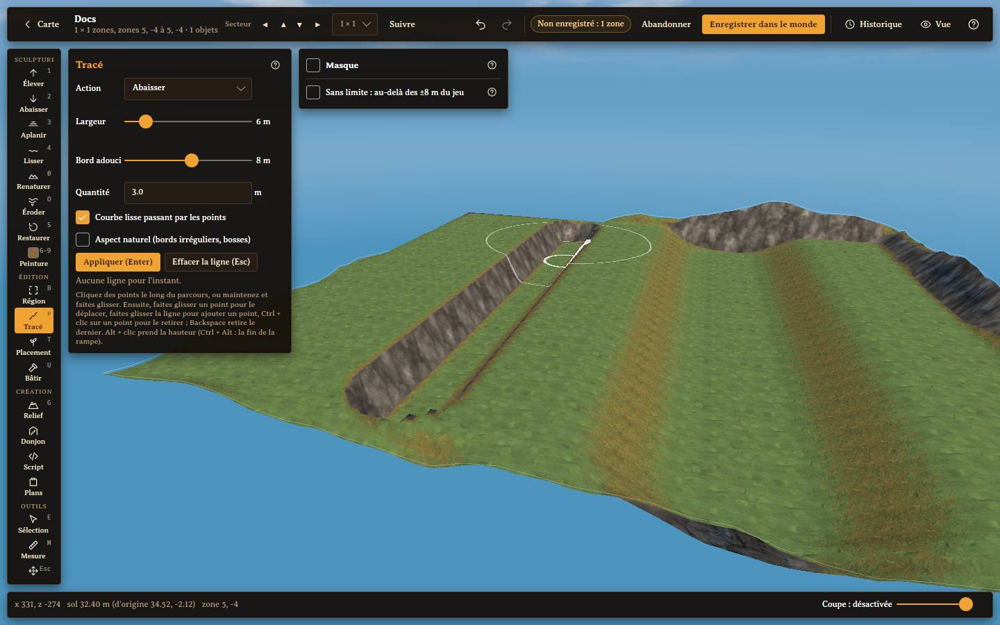
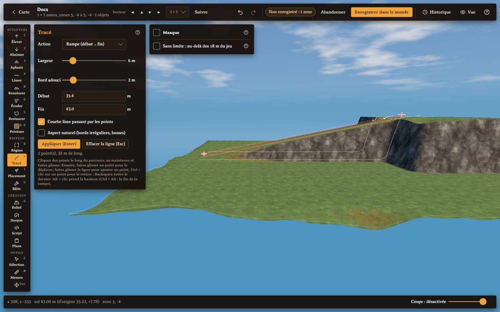
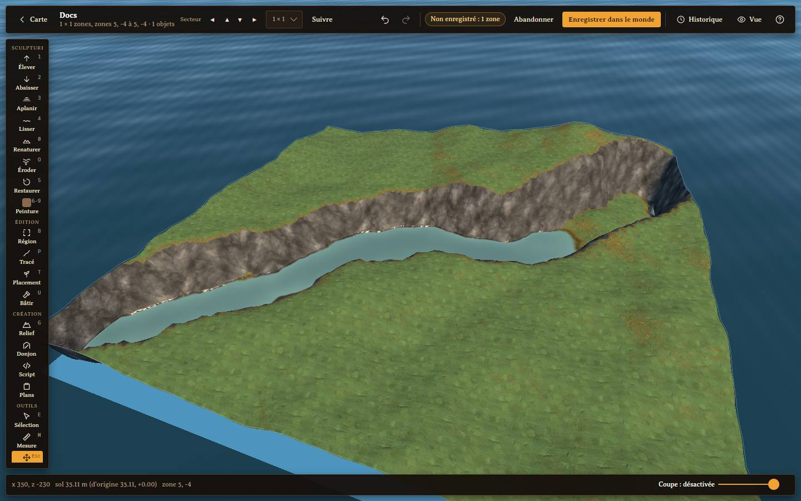

<!-- source: 2d41926b -->
# Tracé

Dessinez une ligne, puis aplanissez, créez une rampe, élevez, abaissez, lissez, creusez ou peignez le sol le long de
celle-ci : routes, rampes, chaussées, fossés et rivières.

**Où :** barre d'outils, section **ÉDITION** · **Touche :** `P` · **Fonctionne dans :** mondes enregistrés, en direct

*Une ligne de cinq points tracée sur deux buttes, avec **Aplanir** choisi, sa **Hauteur** prise sur le sol plat avec
`Alt`+clic, et **Aspect naturel** activé. Rien n'a encore changé : la bande montre la largeur et les bords adoucis du
tracé jusqu'à ce que vous appuyiez sur **Appliquer (Enter)** ; les cercles au dernier point sont ceux du pointeur.*

## L'utiliser

1. Dans la barre d'outils, cliquez sur **Tracé** (`P`).
2. Cliquez des points le long du parcours, ou maintenez et faites glisser pour le dessiner librement. Sous le pointeur,
   un cercle montre la largeur du tracé et un autre, plus pâle, son bord adouci ; dès qu'il y a des points, la bande
   montre les deux le long de la ligne.
3. Facultatif : ajustez la ligne. Faites glisser un point pour le déplacer, faites glisser la ligne entre deux points
   pour y ajouter un point, `Ctrl`+clic sur un point pour le retirer, `Backspace` pour retirer le dernier.
4. Dans le panneau, choisissez une **Action** et réglez ses paramètres.
5. Appuyez sur **Appliquer (Enter)**. La modification est une seule étape d'annulation, nommée d'après l'action
   (« Tracé : Aplanir »).
6. Facultatif : choisissez une autre action et appliquez-la à la même ligne (aplanir, puis paver), ou déplacez ses
   points et appliquez à nouveau. La ligne reste jusqu'à ce que vous appuyiez sur **Effacer la ligne (Esc)**.

Le panneau indique combien de points compte la ligne et sa longueur.

*La ligne de la première image, même caméra : **Aplanir** a taillé une route plane à travers les deux buttes, puis
**Peindre en pavés** avec **Largeur** 4 m et **Bord adouci** 1 m a pavé son milieu. La ligne reste pour l'action
suivante.*

## Réglages

| Réglage | Ce qu'il fait |
|---|---|
| **Action** | Ce qui se passe le long de la ligne (voir [Actions](#actions)). |
| **Largeur** | Largeur du tracé, de 1 à 40 m (8 m par défaut). L'action agit pleinement sur toute cette largeur. |
| **Bord adouci** | Sur quelle distance la modification s'estompe de chaque côté, de 0 à 15 m (4 m par défaut), pour que le tracé se fonde dans le sol. À **0**, le bord est net : une tranchée aux flancs droits et raides. |
| **Hauteur** | **Aplanir** : la hauteur du tracé (m). `Alt`+clic sur le sol la prélève. |
| **Quantité** | **Élever** / **Abaisser** : de combien (m, 2 par défaut). |
| **Début**, **Fin** | **Rampe** : la hauteur au premier et au dernier point (m). Voir [Rampe](#rampe). |
| **Profondeur** | **Rivière / canal** : profondeur du lit sous le niveau de la mer en son milieu (m, 2 par défaut). |
| **Courbe lisse passant par les points** | Activé (par défaut) : une courbe lisse passant par vos points. Désactivé : des lignes droites entre eux. |
| **Aspect naturel (bords irréguliers, bosses)** | Une largeur qui varie en chemin (jusqu'à 45 % dans un sens ou dans l'autre) et des bords irréguliers, pour toutes les actions ; aussi de petites bosses en surface pour **Aplanir**, **Rampe**, **Élever**, **Abaisser** et **Rivière / canal**. Le tracé a alors l'air usé plutôt que fait à l'outil. |
| **Bosses**, **Taille bosses**, **Nouveau motif** | **Renaturer** et **Aspect naturel** : la hauteur et la largeur des bosses, et un autre motif aléatoire pour elles. Ce sont ceux du pinceau [Renaturer](terrain.md#renaturer) : réglés ici, là-bas ou dans l'outil [Région](area.md), ce sont les mêmes valeurs. |
| **Angle de repos** | **Éroder** : la pente la plus raide qui reste en place, de 10° à 60° (33° par défaut). Celui du pinceau [Éroder](terrain.md#éroder), la même valeur. |

*Deux lignes droites sur un sol plat, chacune **Abaisser** de 3 m avec **Largeur** 6 m, vues dans leur axe. À gauche :
**Bord adouci** 0, une tranchée aux parois raides et droites. À droite : **Bord adouci** 8 m, les berges descendent en
pente douce dans le sol.*

## Actions

| Action | Ce qu'elle fait |
|---|---|
| **Aplanir** | Met le tracé de niveau à **Hauteur** : une route, une terrasse le long d'une pente, une chaussée au-dessus d'un creux. |
| **Rampe (début → fin)** | Une pente qui monte ou descend régulièrement de **Début** à **Fin**. |
| **Élever** | Soulève le tracé de **Quantité**, en gardant ses hauts et ses bas : un talus, une digue. |
| **Abaisser** | Creuse le tracé de **Quantité** : un fossé, un chemin creux. |
| **Lisser** | Atténue les irrégularités du sol le long du tracé : chaque point se rapproche de la moyenne du sol dans un rayon de 3 m. Appliquez-le à nouveau pour accentuer. |
| **Renaturer** | Des bosses d'aspect naturel le long du tracé, sur la forme générale du sol, avec **Bosses**, **Taille bosses** et le motif : ce qu'il faut à un tracé aplani ou élevé pour ressembler de nouveau à du sol. |
| **Éroder** | Use le sol le long du tracé en une fois : les pentes se stabilisent à **Angle de repos**, la pluie creuse des ravines et laisse des cônes de déjection, les pentes se stabilisent de nouveau. |
| **Restaurer** | Revient à l'état généré par le monde le long du tracé, peinture retirée, sol élevé ou creusé avec Sans limite compris : défait une route ou un fossé longtemps après la disparition de l'historique d'annulation. |
| **Rivière / canal (eau)** | Creuse un lit sous le niveau de la mer, qui se remplit donc d'eau (voir [Rivière ou canal](#rivière-ou-canal)). |
| **Peindre en terre**, **Peindre en pavés**, **Peindre en terre cultivée** | Peint le tracé, en couleur pleine sur toute la largeur, en s'estompant sur le bord adouci. |
| **Effacer la peinture** | Peint le sol nu du biome le long du tracé (voir [Pinceau Peinture](terrain.md#pinceau-peinture)). |

**Aplanir**, **Élever**, **Abaisser**, **Lisser**, **Renaturer**, **Éroder**, **Restaurer** et les peintures sont les
mêmes actions que celles des [pinceaux](terrain.md) et de l'outil [Région](area.md), sous les mêmes noms (Région liste
Restaurer sous le nom **Revenir au sol généré**, dans son groupe **Récupérer**) : un pinceau indique où par son coup de
pinceau, l'outil Région par une sélection, l'outil Tracé par une ligne, et le sol change de la même façon.

### Rampe

*Une rampe de deux points vue de côté, du sol à son pied (**Début** 35.2 m) au sommet d'une plateforme élevée de 8 m
(**Fin** 43 m). Elle monte régulièrement sur toute sa longueur.*

Tant que vous ne tapez ni ne prélevez de hauteur, **Début** et **Fin** suivent le sol sous le premier et le dernier
point : déplacer les extrémités les met à jour. `Alt`+clic sur le sol prélève la hauteur de début, `Ctrl`+`Alt`+clic
celle de fin. **Effacer la ligne (Esc)** les laisse de nouveau suivre le sol. Une rampe sinueuse a la même pente sur
toute sa longueur.

### Rivière ou canal

*Une rivière creusée à travers la zone avec **Rivière / canal (eau)** : la mer la remplit.*

Valheim n'a pas d'eau courante : l'eau des rivières est la mer, au même niveau (30 m) partout. Une rivière n'a donc de
l'eau que là où son lit est sous le niveau de la mer. L'action creuse un lit en U de **Profondeur** sous le niveau de la
mer en son milieu, qui remonte jusqu'à la ligne d'eau à la **Largeur** ; le **Bord adouci** forme les berges. Elle ne
fait que creuser : le sol déjà plus bas reste tel quel, si bien qu'une rivière peut se jeter dans un lac ou dans la mer.

À travers un terrain élevé, une rivière demande une tranchée profonde, et la limite de ±8 m du jeu l'arrête à 8 m de
profondeur (la barre d'état le signale). Abaissez d'abord le sol près de la mer, suivez les terrains bas, ou activez
[Sans limite](terrain.md#sans-limite).

## Raccourcis

| Touche ou souris | Ce qu'elle fait |
|---|---|
| `P` | Choisir Tracé. |
| Clic / maintenir et faire glisser | Ajouter des points / dessiner la ligne librement (un point tous les 2 m). |
| Faire glisser un point / la ligne | Déplacer le point / ajouter un point à cet endroit et le déplacer. |
| `Ctrl`+clic sur un point | Le retirer. |
| `Backspace` | Retirer le dernier point. |
| `Alt`+clic | Prélever la hauteur (Aplanir) ou le début de la rampe. |
| `Ctrl`+`Alt`+clic | Prélever la hauteur de fin de la rampe. |
| `Alt`+`Shift`+clic | Régler la plage de hauteur du [Masque](masks.md) à 2 m au-dessus et au-dessous de cet endroit, comme avec un pinceau. |
| `Enter` | Appliquer l'action. |
| `Esc` | Effacer la ligne ; un second `Esc` quitte l'outil. |
| `Ctrl+Z` | Annuler le dernier Appliquer. |

## Astuces et limites

- **Le [Masque](masks.md) s'applique à toutes les actions**, de même que la limite de ±8 m, sauf si
  [Sans limite](terrain.md#sans-limite) est activé. Là où le tracé atteint la limite, les points deviennent rouges et la
  barre d'état le signale. L'interrupteur Sans limite se trouve sur la fiche **Masque** à côté du panneau Tracé : un seul
  interrupteur pour tous les outils de sol.
- **Un angle vif** demande deux points rapprochés, ou **Courbe lisse passant par les points** désactivé : une courbe
  lisse passe par chaque point que vous cliquez.
- **Vérifiez d'abord la pente d'une rampe** avec [Mesure](measure.md) : mesurée du pied au sommet, la **Pente** est
  celle que donnera la rampe.
- **Effacer la ligne (Esc) ne retire que la ligne.** Ce que vous avez appliqué reste ; `Ctrl+Z` annule un Appliquer à
  la fois.
- **Le tracé ne fonctionne qu'à l'intérieur du secteur ouvert**, et ne déplace jamais sa ligne de points la plus
  extérieure (voir [Le bord verrouillé](concepts/areas-and-zones.md#le-bord-verrouillé)).

## Voir aussi

- [Faire une route ou une rampe qui monte une colline](guides/make-a-road.md)
- [Creuser une rivière ou un étang](guides/make-a-river.md)
- [Limites du sol](concepts/ground-limits.md)
- [Sculpter et peindre](terrain.md), [Mesure](measure.md)
- [Comment s'estompe le bord d'un tracé](concepts/ground-limits.md#comment-sestompe-le-bord-dun-tracé)
