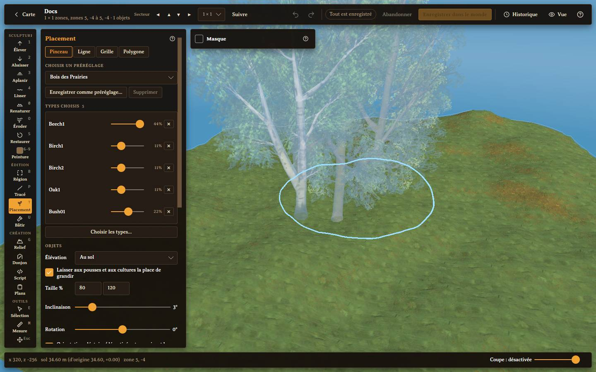
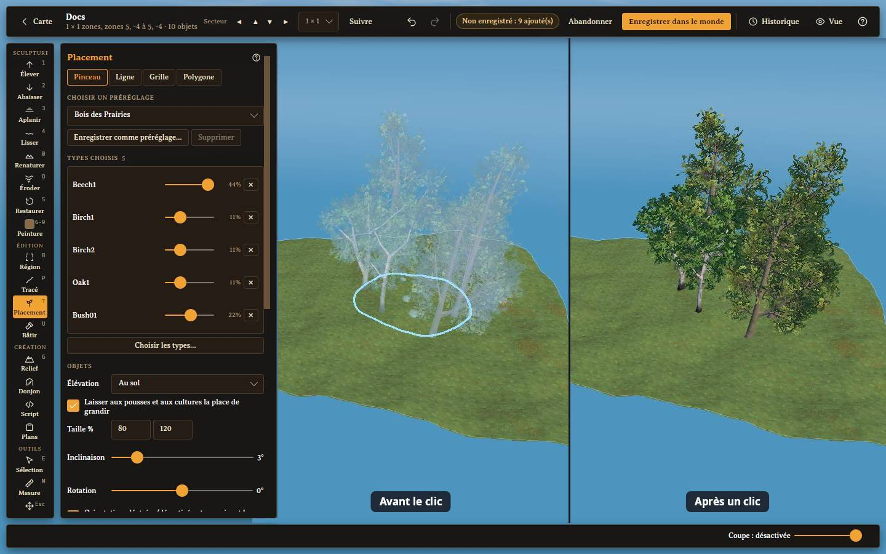
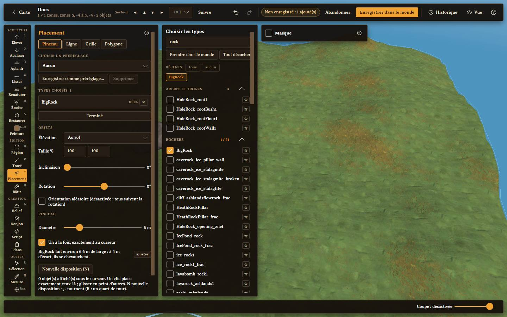
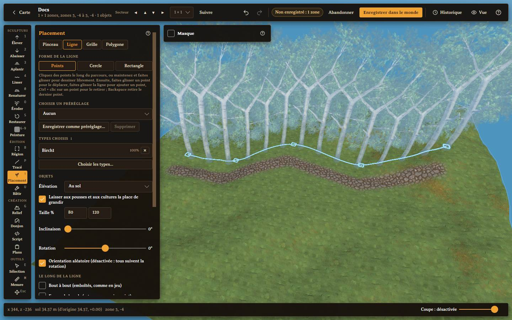
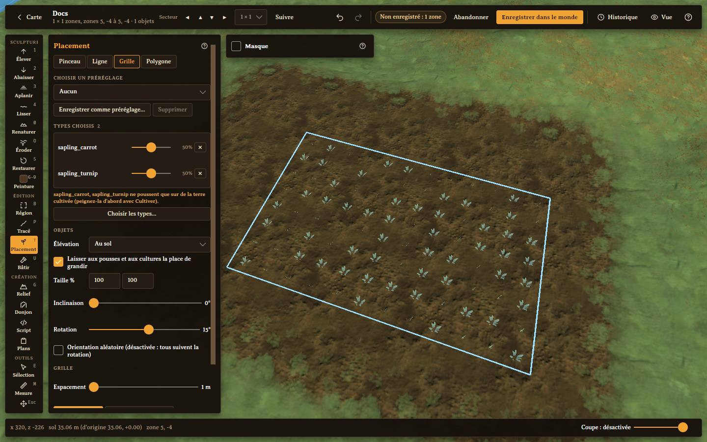
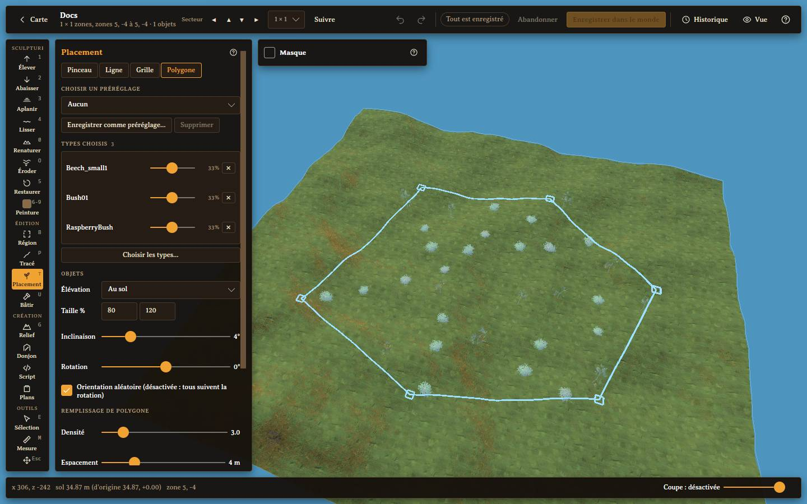
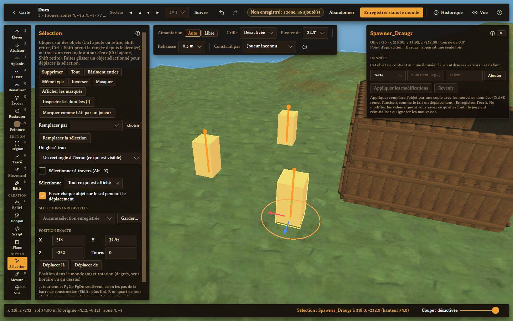

<!-- source: c6106c48 -->
# Placement

Mettez dans le monde des arbres, des rochers, des buissons, des cultures et des points d'apparition, un par un ou par
centaines. Les pièces que bâtissent les joueurs (murs, sols, clôtures, meubles) se posent avec [Bâtir](build.md),
l'outil juste en dessous dans la barre d'outils.

**Où :** barre d'outils, section **ÉDITION** · **Touche :** `T` · **Fonctionne dans :** mondes enregistrés, en direct
(l'Atelier n'a que [Bâtir](build.md))

*Les arbres et buissons transparents dans le cercle du pinceau sont exactement ce que place un clic ; le panneau montre
le préréglage Bois des Prairies et ses types.*

*À gauche : l'aperçu transparent dans le cercle du pinceau. À droite : le même endroit après un clic, les arbres et
buissons debout là où l'aperçu les montrait.*

## L'utiliser

Pour planter un petit bois :

1. Appuyez sur `T`.
2. Dans le panneau **Placement**, sous **Choisir un préréglage**, choisissez **Bois des Prairies**.
3. En haut du panneau, choisissez **Pinceau**.
4. Pointez le sol : l'aperçu transparent montre ce que place un clic.
5. Cliquez pour le placer, ou faites glisser pour continuer d'en ajouter.

Pour Ligne, Grille et Polygone, dessinez plutôt la forme, vérifiez l'aperçu, puis appuyez sur `Enter`
(**Placer (Enter)**). La forme reste après le placement, son aperçu désormais vide (ce qu'elle placerait est déjà là) :
appuyez sur **Effacer la forme (Esc)** pour dessiner la suivante.

Chaque clic, coup de pinceau ou `Enter` est une étape d'annulation (`Ctrl+Z`). Rien n'est écrit dans le monde tant que
vous ne faites pas **Enregistrer dans le monde** (ou **Appliquer en direct**). Pour déplacer ou supprimer ce que vous
avez placé, utilisez [Sélection](select.md).

## Réglages

Le panneau, de haut en bas. Les lignes qui ne concernent pas le mode ou les types choisis sont masquées. Les types
cochés avec leurs parts, le **Débit**, vos préréglages, favoris et types récents sont conservés d'une session à
l'autre ; les autres réglages repartent de leurs valeurs par défaut. Le [Masque](masks.md) est sur sa propre carte à
côté du panneau et s'applique à tous les modes.

| Réglage | Ce qu'il fait |
|---|---|
| **Pinceau**, **Ligne**, **Grille**, **Polygone** | Le mode : voir [Modes](#modes). |
| **Forme de la ligne** | Mode Ligne uniquement : **Points**, **Cercle** ou **Rectangle**. Voir [Ligne](#ligne). |
| **Choisir un préréglage** | Charge un mélange : ses types avec leurs parts, plus Densité, Espacement, Groupement, Massifs, Taille et Inclinaison, avec l'orientation aléatoire activée. Intégrés : **Bois des Prairies**, **Bois de la Forêt noire**, **Marécages**, **Massif de baies**, **Sol forestier**, **Rochers des Prairies** ; les vôtres suivent sous la forme **Le vôtre : *nom***. Les types que le monde ne peut pas placer sont laissés de côté (la barre d'état indique combien). **Aucun** ne charge rien ; le choisir après un préréglage décoche tous les types. |
| **Enregistrer comme préréglage…** / **Supprimer** | Enregistre sous un nom les types choisis, leurs parts et ces réglages. **Supprimer** retire l'un des vôtres, après confirmation. |
| **Types choisis** | Les types que vous avez choisis, chacun avec son curseur de part et un ✕ pour le retirer (« Aucun pour l'instant » tant qu'il n'y en a pas). Avec deux types ou plus, faites glisser un curseur pour régler la part de ce type : les autres suivent pour que les parts fassent 100 %, et chacun garde au moins 1 %. Beech à 75 % avec Birch donne trois hêtres pour un bouleau. |
| **Choisir les types…** | Ouvre la carte **Choisir les types** : voir [Choisir ce qu'il faut placer](#choisir-ce-quil-faut-placer). |
| **OBJETS : Élévation** | **Au sol** : chaque objet repose sur le sol (une partie de ruine par sa base). **Au-dessus du sol** : **Hauteur** mètres au-dessus du sol en dessous. **À une hauteur fixe** : la base de chaque objet à la même **Hauteur**, quoi que fasse le sol (un mur de niveau, une plateforme). |
| **Hauteur** | Les mètres pour Au-dessus du sol, ou la hauteur pour À une hauteur fixe. |
| **Aimanter aux pièces déjà présentes** | Affiché quand un type coché est une partie de ruine ou de donjon qui a des points d'aimantation (les pièces que bâtissent les joueurs relèvent de [Bâtir](build.md)). Activé : la partie s'accroche aux pièces qui l'entourent, comme avec le marteau. En mode Pinceau, **À côté** la met bout à bout avec la pièce voisine du curseur et **Dessus** la pose sur la pièce sous le curseur. La ligne en bas du panneau indique à quoi elle s'est aimantée (« Aimanté à côté de *nom*. »). Voir [Aimantation](concepts/objects.md#aimantation). |
| **Laisser aux pousses et aux cultures la place de grandir** | Affiché quand une pousse, une culture ou un arbre qui pousse à partir d'une pousse est coché. Activé : elles gardent la place dont le jeu a besoin pour les faire pousser. Désactivé : aussi serré que vous le voulez (elles risquent de ne pas pousser). Voir [Règles de croissance](concepts/objects.md#règles-de-croissance). |
| **Taille %** min / max | Chaque objet reçoit une taille aléatoire entre les deux, de 10 à 300 % (80 à 120 au départ). |
| **Inclinaison** | Inclinaison aléatoire, de 0 à 20°. |
| **Rotation** | Tourne le motif du pinceau et l'orientation de chaque objet, de -180 à 180°. |
| **Orientation aléatoire (désactivée : tous suivent la rotation)** | Activé : chaque objet est orienté au hasard. Désactivé : tous suivent la Rotation. |
| **PINCEAU : Diamètre** | Rayon du pinceau, de 1 à 30 m. C'est aussi la taille des pinceaux de sculpture : une seule valeur pour les deux. |
| **Débit** | Pinceau : à quelle vitesse un glisser plante, de 0.05 à 1. Plus haut remplit plus vite le cercle du pinceau jusqu'à sa Densité. C'est celui du pinceau de Placement : la **Force** des pinceaux de sculpture ne le change pas. Masqué avec Un à la fois. |
| **Un à la fois, exactement au curseur** | Pinceau : un objet exactement sous le curseur par clic ; un glisser n'en ajoute pas d'autres. Seul un objet pile à cet endroit l'en empêche. |
| **Densité** | Pinceau et Polygone : objets par 100 m², de 0.2 à 20. |
| **Espacement** | Pinceau et Polygone : la distance minimale entre objets, de 0.5 à 15 m, aussi par rapport aux objets déjà là. En Grille : la taille des cases, de 1 à 30 m. |
| **Groupement** | Pinceau et Polygone : rassemble les objets en bosquets séparés par des clairières, de 0 à 100 %. 0 donne une répartition uniforme. |
| **Massifs** | Avec Groupement : la taille des bosquets et des clairières, de 5 à 120 m. |
| **ajuster** | Affiché quand un type coché est plus large que l'espacement (« Beech1 fait environ 6.2 m de large : à 4 m d'écart, ils se chevauchent. »). Cliquez dessus pour régler l'espacement sur cette largeur. |
| **Placer (Enter)**, **Effacer la forme (Esc)**, **Retirer le dernier point (Backspace)** | Ligne, Grille et Polygone : placer ce que montre l'aperçu, retirer la forme, ou annuler le dernier point cliqué. |
| **Nouvelle disposition (N)** | De nouveaux emplacements, types, tailles et orientations aléatoires pour l'aperçu (et de nouveaux bosquets avec Groupement). |

La ligne du bas indique combien d'objets montre l'aperçu et quelles touches s'appliquent. Une ligne orange sous les
types choisis avertit quand quelque chose demande de l'attention : « Rien à placer pour l'instant », ou des cultures qui
« ne poussent que sur de la terre cultivée (peignez-la d'abord avec Cultiver) ».

## Choisir ce qu'il faut placer

**Choisir les types…** ouvre une carte à côté du panneau avec chaque type que le jeu enregistre dans un monde, y compris
les types dont votre monde n'a encore aucun exemplaire et ceux de vos mods. Les créatures, les objets tombés au sol et
les cadavres n'y sont pas, ni les pièces du marteau et du plateau de service : celles-ci sont dans le panneau
[Bâtir](build.md). Les pousses et cultures du cultivateur sont dans les deux. **Terminé** la ferme.

*La carte Choisir les types en train de chercher « rock », avec BigRock coché : la catégorie Rochers compte 1 type coché
à côté de son total, et BigRock est en tête de la ligne Récents.*

| Contrôle | Ce qu'il fait |
|---|---|
| **Chercher des types (oak, rock, bush…)** | Filtre la liste par nom et ouvre chaque catégorie qui a une correspondance. Les points d'apparition et les nids se trouvent aussi par leur créature (`boar` trouve `Spawner_Boar`). |
| Cases à cocher | Chaque type coché est placé ; chaque objet en prend un au hasard, selon sa part. Cliquez sur le nom d'une catégorie pour la replier ou l'ouvrir ; après le nom, le nombre de types qu'elle contient, ou « cochés / tous ». |
| **Prendre dans le monde** | Cliquez sur un objet du monde pour ne placer que son type ; `Shift` + clic l'ajoute aux types cochés (ou l'en retire). `Esc` annule. Une pièce de construction n'est pas prise : la barre d'état indique de la poser avec Bâtir. |
| **Tout décocher** | Décoche tous les types. |
| **Favoris** | Cliquez sur l'☆ après un type pour le mettre en favori ; les types favoris apparaissent comme boutons au-dessus de la liste. |
| **Récents** | Les huit derniers types que vous avez placés, du plus récent au plus ancien, après les types choisis maintenant. |
| Boutons Favoris et Récents | Clic : cocher ou décocher ce type. `Shift` + clic : ne placer que ce type. **tous** / **aucun** cochent ou décochent toute la ligne. |

Les catégories : **Arbres et troncs**, **Rochers**, **Buissons et arbustes**, **Ramassables**, **Minerais et
gisements**, **Ruines et structures**, **Meubles et accessoires**, **Os et restes**, **Points d'apparition**, **Nids de
créatures**, **Créatures et PNJ** (marchands, oiseaux), **Effets et marqueurs** (brume, musique, zones d'événement de
boss) et **Autres objets**. Les types sans modèle apparaissent comme des boîtes dans l'aperçu.

## Modes

| Mode | Comment il fonctionne |
|---|---|
| **Pinceau** | L'aperçu suit le curseur dans le cercle du pinceau. Un clic place exactement ce qu'il montre ; un glisser continue d'en ajouter (à une vitesse qui dépend de Densité et de **Débit**). `Shift` + glisser retire les types cochés sous le pinceau. Avec seulement des parties de ruines aimantables cochées, **Un à la fois** s'active de lui-même et chaque partie s'aimante. |
| **Ligne** | Cliquez des points le long d'un parcours, ou dessinez un cercle ou un rectangle. Les objets se placent à l'intervalle réglé dans **Tous les** (en mètres), ou bout à bout. |
| **Grille** | Tracez un rectangle. Un objet va au milieu de chaque case ; le rectangle reçoit autant de cases entières qu'il en tient. |
| **Polygone** | Cliquez des points autour d'une parcelle de sol, ou maintenez et faites glisser pour dessiner librement son contour. Les objets se placent à des endroits aléatoires à l'intérieur (Densité, Espacement). |

En Ligne et Polygone, faites glisser un point pour le déplacer, faites glisser le contour pour ajouter un point, et
`Ctrl` + clic sur un point pour le retirer. Double-cliquer sur le dernier point place la forme, comme `Enter`. En Grille
et Polygone, `,` `.` et `Alt` + molette tournent tout le rectangle ou le polygone, avec ses cases ; `R` le tourne d'un
quart de tour.

### Ligne

*Mode Ligne avec **Points** : des bouleaux tous les 4 m le long d'une courbe lisse passant par cinq points, à côté d'un
chemin pavé, avant **Placer (Enter)**. Les arbres pâles sont l'aperçu.*

| Contrôle | Ce qu'il fait |
|---|---|
| **Points** | Cliquez des points en chemin, ou maintenez et faites glisser pour dessiner librement. **Fermer la boucle (retour au premier point)** revient au premier point, pour fermer une clôture autour d'un endroit. **Courbe lisse passant par les points** dessine une courbe au lieu de segments droits. |
| **Cercle** | Appuyez au centre et faites glisser jusqu'à la taille ; relâchez pour le voir. |
| **Rectangle** | Appuyez à un coin et faites glisser jusqu'au coin opposé. |
| **Bout à bout (emboîtés, comme en jeu)** | Chaque partie commence là où finit la précédente, tournée selon la ligne, comme le marteau les aimante : le mur d'une ruine, une rangée de vieux planchers. Plusieurs types cochés alternent. Il s'active de lui-même quand chaque type coché est une partie que le jeu aimante. Avec lui, un cercle ajuste sa taille à des parties entières, et les côtés d'un rectangle se remplissent depuis les coins pour que les coins se rejoignent. Pour poser bout à bout les pièces du marteau (une clôture, un mur de pieux), utilisez la **Pose** de [Bâtir](build.md#poser-des-pièces-le-long-dune-ligne-ou-en-grille). |
| **Couches** | Avec Bout à bout : la ligne empilée sur 1 à 20 parties de haut. |
| **Tous les** | Sans Bout à bout : la distance entre objets, de 0.5 à 30 m. |
| **Ondulation** | Décalage latéral aléatoire par rapport à la ligne, de 0 à 5 m. |
| **Suivre la ligne (plus la rotation ; remplace l'orientation aléatoire)** | Activé (par défaut) : chaque objet est orienté selon la ligne, plus la Rotation. Désactivé : orientation aléatoire. Les cercles et rectangles suivent toujours leur contour. |

- Quand la ligne ne se termine pas sur une pièce entière, la ligne du bas indique ce qui reste (« 0.8 m de ligne
  restants au bout : déplacez un point pour combler »).
- Une ligne qui commence à moins de 1 m d'une pièce déjà là (avec **Aimanter aux pièces déjà présentes** activé) la
  prolonge, à son niveau.
- Sur une pente, les parties bout à bout restent de niveau et montent ou descendent par paliers avec le sol. Pour une
  rangée régulière, aplanissez d'abord le sol le long de la ligne ([Tracé](path.md), Aplanir), ou utilisez **À une
  hauteur fixe**.

### Grille

*Carottes et navets sur une grille tournée de 15°, vus de près et d'en haut pour que la culture de chaque case soit
visible. La ligne orange du panneau avertit que les cultures ont besoin de terre cultivée.*

### Polygone

*Un polygone dessiné point par point, avec des buissons et de jeunes arbres en aperçu à des endroits aléatoires à
l'intérieur.*

Les emplacements sont tirés une fois et conservés tant que le polygone ne change pas ; **Nouvelle disposition (N)** en
tire de nouveaux.

## Points d'apparition et nids

Les points d'apparition sont les marqueurs invisibles du jeu qui placent des créatures dans les camps, les villages et
les donjons. Trouvez-les dans **Choisir les types** sous **Points d'apparition** (cherchez la créature : `boar`), puis
placez-les comme n'importe quel type. Chaque type indique ce qu'il fait apparaître, lu dans votre jeu :

- la créature et ses étoiles (`Boar · 0–2 ★`) ;
- **apparaît une seule fois** (la première fois qu'un joueur s'approche, plus jamais une fois morte), ou **revient *N*
  min après sa mort** ;
- **de nuit seulement**, **de jour seulement**, ou **quand un événement le réveille** pour les rares qui attendent.

La créature, les étoiles et le délai de réapparition sont fixés par type : choisissez le type qui fait apparaître ce que
vous voulez. Les **Nids de créatures** (nids de greydwarfs, tas d'os…) continuent de faire apparaître des créatures
autour d'eux jusqu'à leur destruction ; leur ligne indique combien et à quelle distance (« Greydwarf, Greydwarf_Elite ·
jusqu'à 3 autour, dans un rayon de 5 m »). Voir [Points d'apparition](concepts/objects.md#points-dapparition).

*De près, deux points d'apparition de sanglier et un de draugr près d'une cabane. La ligne de l'Inspecteur du draugr
sélectionné indique ce qu'il fait apparaître et s'il revient.*

Dans la vue 3D, chaque point d'apparition et chaque nid apparaît comme une simple boîte surmontée d'un marqueur, visible
à travers tout ce qui se trouve devant, dans un rayon de 250 m : orange pour un point d'apparition (rouge quand sa
créature revient), violet pour un nid. Ils sont masqués au départ : activez **Points d'apparition** et **Nids de
créatures** dans le [panneau Vue](editor-basics.md).

## Raccourcis

| Touche ou souris | Ce qu'elle fait |
|---|---|
| `T` | Ouvre Placement. |
| Clic / glisser | Pinceau : placer / continuer d'ajouter. Ligne et Polygone : ajouter des points. Grille : tracer le rectangle. |
| `Shift` + glisser | Pinceau : retirer les types cochés sous le pinceau. |
| `Ctrl` + clic sur un point | Ligne et Polygone : retirer ce point. |
| `Enter` | Placer la ligne, la grille ou le polygone. |
| `Esc` | Annuler **Prendre dans le monde** ; sinon effacer la forme ; sans rien de dessiné, revenir à **Vue**. |
| `Backspace` | Retirer le dernier point. |
| `N` | Nouvelle disposition. |
| `,` `.` ou `Alt` + molette | Tourner de 15° (`Shift`, plus fin : 1°) : l'orientation, ou en Grille et Polygone tout le rectangle ou le polygone. |
| `R` | Tourner de même d'un quart de tour. |
| `[` `]` | Taille du pinceau. |
| `PgUp` / `PgDn` ou `Ctrl` + molette | Monter ou baisser l'élévation de 0,5 m (`Shift`, plus fin : 0,1 m). Depuis Au sol, cela commence à soulever au-dessus du sol. |
| `Alt` + clic | Passer à À une hauteur fixe, au sommet de la pièce cliquée (pour se poser dessus), ou du sol à cet endroit. |
| `Ctrl+Z` | Annuler le dernier placement. |

Toutes les touches de l'éditeur sont dans [Raccourcis](help/shortcuts.md).

## Astuces et limites

- **Annuler :** `Ctrl+Z` annule un clic, un coup de pinceau ou une forme, même après l'enregistrement (enregistrez
  alors de nouveau). Voir [Annuler des modifications](guides/undo-changes.md).
- Au plus 2 000 objets par ligne, grille ou polygone, et 400 par clic de pinceau.
- Les objets ne vont qu'à l'intérieur du secteur ouvert, pas sur sa ligne de points la plus extérieure, et là où le
  Masque le permet.
- Un objet au sol est laissé de côté là où le sol est à plus de 0,3 m sous l'eau (varech et algues exceptés). Au-dessus
  du sol ou À une hauteur fixe, il peut se dresser au-dessus de l'eau.
- Pinceau et Polygone respectent l'Espacement par rapport à ce qui est déjà debout. Ligne et Grille l'ignorent, sauf
  pour un objet pile au même endroit : placer deux fois la même forme ne la double pas.
- Les cultures ne poussent que sur de la terre cultivée : peignez-la d'abord avec **Cultiver** (ou la Peinture de
  l'outil Région).
- Les pousses et cultures que vous placez sont bâties par un joueur, celui choisi dans **Construit par** sur
  [la barre de construction](build.md#la-barre-de-construction) ; les arbres, rochers, points d'apparition et parties de ruines
  ne le sont pas. Voir [Pièces bâties par des joueurs](concepts/objects.md#pièces-bâties-par-un-joueur).
- Les nouveaux objets sont neufs : sans contenu, sans points de vie. Pour remplir un coffre, voir
  [Changer le contenu d'un coffre](guides/fill-a-chest.md).

## Voir aussi

- [Planter une forêt, un champ ou une haie](guides/plant-a-forest.md)
- [Dégager arbres et rochers, aplanir un terrain à bâtir](guides/clear-an-area.md)
- [Ce qu'est un objet](concepts/objects.md#ce-quest-un-objet)
- [Bâtir](build.md) · [Sélection](select.md) · [Masques](masks.md)
