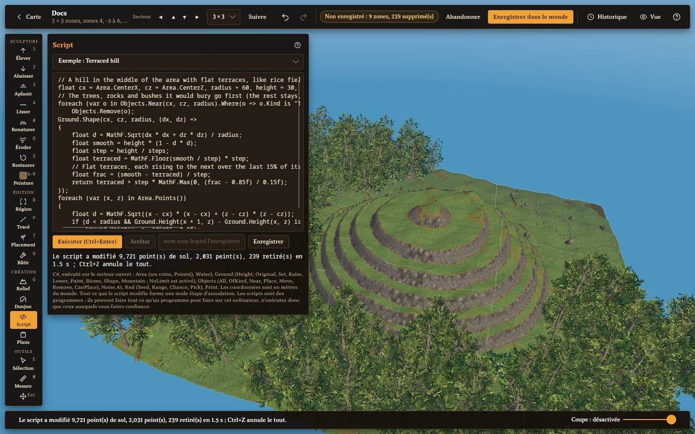
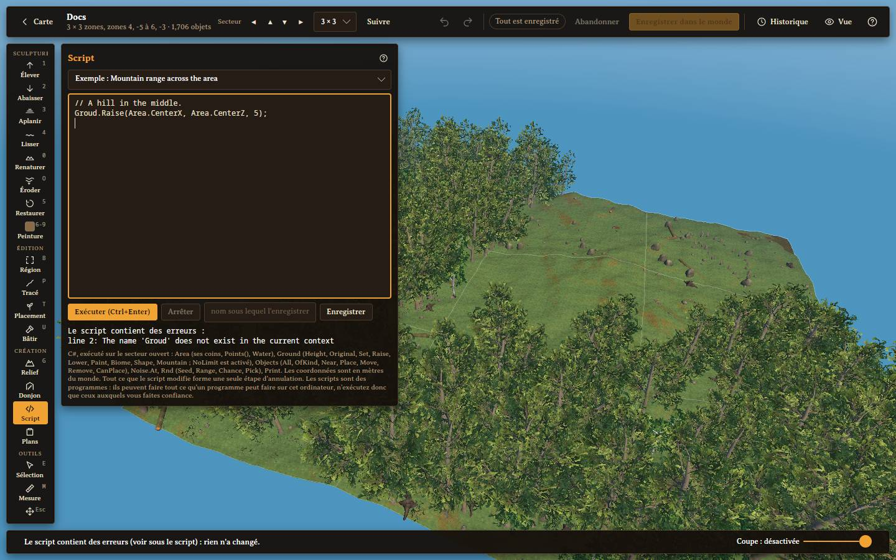

<!-- source: f2b8214d -->
# Script

Écrivez quelques lignes de C# qui façonnent, peignent et remplissent le secteur ouvert selon une règle : une chaîne de
montagnes, une forêt seulement sur les pentes douces, des terrasses, une place pavée exactement à la hauteur moyenne.

**Où :** barre d'outils, section **CRÉATION** · **Touche :** aucune (`Ctrl+Enter` exécute le script) · **Fonctionne
dans :** mondes enregistrés, en direct (pas l'Atelier)


*L'exemple Terraced hill exécuté sur un secteur de 3 × 3 : le code dans le panneau, et en dessous la ligne de résultat
qui dit ce que le script a modifié.*

Vous n'avez rien à installer : l'éditeur compile le script lui-même. Si vous n'avez jamais écrit de C#, partez d'un
[exemple](#les-exemples) et changez ses nombres, ou suivez [Votre premier script](#votre-premier-script).

## L'utiliser

1. Ouvrez un secteur dans l'éditeur 3D. Un script travaille sur le **secteur ouvert** (les zones que vous voyez).
2. Choisissez **Script** dans la section **CRÉATION** de la barre d'outils.
3. Choisissez un exemple ou un script enregistré dans la liste, ou écrivez le vôtre dans la zone de code.
4. Appuyez sur **Exécuter (Ctrl+Enter)**. La zone de sortie affiche « Compilation… », « Exécution… », puis ce que le
   script a affiché et ce qu'il a modifié, ou ce qui s'est mal passé.
5. Regardez le résultat. Annuler (la flèche de la barre du haut) retire toute l'exécution en une étape ; `Ctrl+Z`
   aussi, une fois que vous avez cliqué dans la vue 3D (dans la zone de code, il annule votre saisie). Changez les
   nombres et relancez jusqu'à ce que le résultat vous plaise.
6. Appuyez sur **Enregistrer dans le monde** (ou **Appliquer en direct**) pour le conserver, comme toute autre
   modification.

Rien ne change pendant que le script s'exécute : quand il a terminé, tout ce qu'il a modifié entre dans le secteur
d'un coup, en une étape d'annulation. S'il contient des erreurs, échoue, est arrêté ou tourne pendant 2 minutes, rien
ne change.

## Votre premier script

Cette leçon élève une butte au milieu du secteur, puis la rend plus haute.

1. Ouvrez un secteur et choisissez **Script**.
2. Sélectionnez tout le texte de la zone de code et remplacez-le par :

   ```csharp
   // Une butte de 10 m de haut et 30 m de large, au milieu du secteur.
   Ground.Shape(Area.CenterX, Area.CenterZ, 15, (dx, dz) =>
   {
       float d = MathF.Sqrt(dx * dx + dz * dz) / 15;   // 0 au milieu, 1 au bord
       return 10 * (1 - d);                            // mètres à ajouter
   });
   Print($"The top is at {Ground.Height(Area.CenterX, Area.CenterZ):0.0} m.");
   ```

3. Appuyez sur `Ctrl+Enter`. Une butte s'élève au milieu du secteur ; la sortie indique où est son sommet et combien de
   points de sol ont changé.
4. Cliquez dans la vue 3D, puis appuyez sur `Ctrl+Z`. La butte a disparu.
5. Cliquez dans la zone de code, remplacez `10 *` par `20 *` et appuyez à nouveau sur `Ctrl+Enter`. La butte est deux
   fois plus haute.
6. Facultatif : tapez un nom dans la zone de nom et appuyez sur **Enregistrer** pour retrouver le script dans la liste
   la prochaine fois.

`Ground.Shape` ajoute les mètres que renvoie votre fonction à chaque point situé à moins de 15 m du milieu ; `dx` et
`dz` sont les mètres depuis le milieu. Tous les autres appels sont dans la [référence de l'API](#référence-de-lapi).

## Réglages

| Réglage | Ce qu'il fait |
|---|---|
| **Liste** | Les sept exemples (« Exemple : … »), puis vos scripts enregistrés, du plus récent au plus ancien. En choisir un **remplace** le texte de la zone de code : enregistrez d'abord votre propre script. Un exemple vide la zone de nom ; un script enregistré y met son nom. |
| **Zone de code** | Le script. `Tab` indente ; `Ctrl+Enter` l'exécute ; `Ctrl+Z` annule votre saisie, pas l'exécution. |
| **Exécuter (Ctrl+Enter)** | Compile et exécute le script sur le secteur ouvert. Ses modifications forment **une seule étape d'annulation**, nommée « Script : » suivi du nom de l'entrée de la liste dans l'Historique. |
| **Arrêter** | Arrête un script en cours, quoi qu'il fasse : rien de ce qu'il a fait n'est conservé. |
| Zone de nom, **Enregistrer** | Enregistre le code sous le nom tapé et le sélectionne dans la liste. Les caractères qu'un nom de fichier ne peut pas contenir deviennent `_`. Enregistrer par-dessus un autre script enregistré demande d'abord confirmation. |
| **Sortie** | Ce que le script a affiché (`Print`), puis ce qu'il a modifié, ou ses erreurs avec leur ligne. |

Les scripts enregistrés sont des fichiers `<name>.csx` dans le dossier `scripts` du dossier de données de l'éditeur
(`~/.local/share/ValheimWorldEditor/scripts` sous Linux, `%LOCALAPPDATA%\ValheimWorldEditor\scripts` sous Windows,
`~/Library/Application Support/ValheimWorldEditor/scripts` sous macOS). Modifiez-les dans n'importe quel éditeur de
texte, ou partagez-les : un fichier `.csx` placé là apparaît dans la liste au prochain démarrage de l'éditeur, ou après
l'enregistrement d'un script.

## Les exemples

Chaque exemple est un script complet, prêt à exécuter sur n'importe quel secteur ouvert. Lisez-les pour voir comment
s'utilise l'API. Leurs noms restent en anglais dans la liste.

| Exemple | Ce qu'il fait |
|---|---|
| **Mountain range across the area** | Quatre montagnes Pic isolé en ligne du sud-ouest au nord-est, chacune de 35 à 60 m de haut. `Rnd.Seed = 7` : c'est donc la même chaîne à chaque exécution. L'enregistrement les transforme en disques de sol (au-delà de la limite de 8 m du jeu). |
| **Terraced hill** | Une colline de 30 m de haut et 60 m de rayon, taillée en six terrasses plates comme des rizières. Les arbres, rochers et buissons qu'elle enterrerait sont d'abord retirés (tout le reste demeure) ; les marches raides sont peintes en terre. |
| **Canyon with a river** | Un canyon sinueux d'ouest en est, 18 m de chaque côté de sa ligne, creusé jusqu'à 3 m sous le niveau de la mer pour que l'eau le remplisse, et qui s'estompe sur les 30 derniers mètres aux bords du secteur. |
| **Scatter boulders** | De gros blocs (`rock4_forest`, `rock4_coast`, `rock4_heath`) tous les 6 m là où le bruit est élevé, davantage sur les pentes, chacun tourné et dimensionné au hasard. Affiche leur nombre. |
| **Ring of trees** | Un anneau de 36 hêtres à 40 m du milieu ; les arbres à l'intérieur de l'anneau sont retirés. |
| **Flat paved base** | Un carré de 40 × 40 m mis à niveau à sa propre hauteur moyenne et pavé, avec une pente douce de 10 m vers le sol alentour. Reste dans la limite de 8 m (`Ground.NoLimit = false`). Affiche la hauteur. |
| **Noise landscape** | Un terrain vallonné sur tout le secteur : collines et vallées jusqu'à 25 m vers le haut ou le bas, avec de plus petites bosses par-dessus, qui rejoint le sol d'origine sur les 40 derniers mètres aux bords. |

## Comment un script voit le monde

- **Du C# ordinaire.** Un script est une liste d'instructions exécutées de haut en bas. Il peut déclarer des
  variables, des boucles, des fonctions et des classes, et utiliser .NET (`MathF`, `System.Linq`…). `using System`,
  `System.Linq` et `System.Collections.Generic` sont déjà là.
- **Des mètres du monde.** Chaque position est en mètres : **x** vers l'est, **z** vers le nord, les mêmes nombres
  que dans la barre d'état et la commande `pos` du jeu. Les hauteurs sont en mètres au-dessus du zéro du monde ; la mer
  est à `Area.Water` (30 m).
- **Un point par mètre.** `Ground.Set(x, z, …)` modifie le point le plus proche de (x, z) ; `Ground.Height` lit de
  façon continue entre les points, comme le sol est dessiné.
- **Ses propres modifications.** Un script voit ce qu'il a modifié jusque-là (élevez un point, et `Ground.Height`
  donne la nouvelle hauteur), mais `Objects.All` reste tel qu'était le secteur à son démarrage.
- **Le secteur ouvert seulement.** La rangée extérieure de points reste telle quelle, pour que le secteur se raccorde
  toujours à ses voisins ; les modifications à cet endroit ou hors du secteur sont ignorées sans erreur. Ouvrez un
  secteur plus grand (jusqu'à 17 × 17 zones) pour de plus grands travaux.
- **Au-delà de la limite de 8 m.** `Ground.NoLimit` est activé, comme l'interrupteur
  [Sans limite](concepts/ground-limits.md#sans-limite) : le sol peut aller jusqu'à 400 m au-dessus ou au-dessous du sol
  généré, et l'enregistrement le transforme en disques de sol que le jeu de chaque joueur compte comme du sol généré.
  `Ground.NoLimit = false;` reste dans les 8 m du jeu : les points qui la dépassent s'y arrêtent, et la ligne de
  résultat indique combien.
- **Pas de Masque.** Le [Masque](masks.md) limite les outils que vous utilisez à la main, pas les scripts. Testez ce
  dont vous avez besoin dans le script (`Ground.Biome`, la hauteur, la pente).
- **Un nouveau départ à chaque exécution.** Les variables, `Rnd` et `Objects.All` repartent de zéro. Un seul script
  s'exécute à la fois.

## Référence de l'API

### Area

Le secteur ouvert.

| Membre | Ce qu'il donne |
|---|---|
| `Area.MinX`, `Area.MinZ`, `Area.MaxX`, `Area.MaxZ` | Ses coins (en mètres du monde). Un secteur de 3 × 3 fait 192 m de large. |
| `Area.CenterX`, `Area.CenterZ` | Son milieu. |
| `Area.Points()` | Chaque point de sol que le script peut modifier (sans la rangée extérieure), sous la forme `(x, z)`, rangée par rangée depuis le sud : `foreach (var (x, z) in Area.Points()) { … }`. `Area.Points(step: 4)` prend un mètre sur 4, pour disperser. Un pas de 0 ou moins, ou trop petit pour avancer dans le secteur, arrête le script avec une erreur. |
| `Area.Inside(x, z)` | Si un point est dans le secteur (pas sur son bord). |
| `Area.Water` | Le niveau de la mer (30 m, ou là où le placent les réglages Expand World Rivers du monde). |
| `Area.WorldSeed`, `Area.World` | La graine du monde (un nombre) et son nom. |

### Ground

| Membre | Ce qu'il fait |
|---|---|
| `Ground.Height(x, z)` | La hauteur actuelle du sol à cet endroit (avec les modifications du script jusque-là). |
| `Ground.Original(x, z)` | Le sol avant toute modification, tel que le monde l'a généré (avec les disques de sol déjà enregistrés). La différence avec `Height` est ce qui a été creusé ou rehaussé. |
| `Ground.Set(x, z, height)` | Met le point de sol à cet endroit à cette hauteur. |
| `Ground.Raise(x, z, metres)`, `Ground.Lower(x, z, metres)` | Le monte ou le descend d'autant. |
| `Ground.Shape(x, z, radius, (dx, dz) => metres)` | Ajoute les mètres que donne votre fonction à chaque point dans le rayon autour de (x, z). `dx`, `dz` : les mètres depuis le milieu ; `MathF.Sqrt(dx * dx + dz * dz)` est la distance. Une valeur négative creuse. |
| `Ground.Mountain(x, z, "Lone peak", height:, radius:, rough:, turn:, seed:)` | Une montagne de l'outil [Relief](landform.md#montagne), son milieu en (x, z) : `"Lone peak"`, `"Ridge"`, `"Mountain range"`, `"Mesa"`, `"Volcano"` ou `"Rolling hills"`. `height` et `radius` en mètres, `rough` de 0 à 1, `turn` en degrés (la direction d'une crête). Omettez une valeur pour en avoir une au hasard dans la plage du préréglage ; la même `seed` donne la même montagne. Elle s'étend à environ 1,15 × son rayon. Les arbres, rochers, minerais, buissons et ramassables qu'elle enterre de plus de 2 m sont retirés ; contrairement à l'outil, elle ne fait pas pousser d'arbres dessus ensuite. |
| `Ground.Paint(x, z, "dirt")` | Peint le point : `"dirt"`, `"cultivated"`, `"paved"` ou `"clear"` (retour au sol propre au biome). Un dernier nombre de 0 à 1 ne peint qu'en partie (`0.5f`), en se mélangeant à la peinture déjà là. |
| `Ground.Biome(x, z)` | Le biome à cet endroit : `"Meadows"`, `"BlackForest"`, `"Swamp"`, `"Mountain"`, `"Plains"`, `"Ocean"`, `"Mistlands"`, `"AshLands"` ou `"DeepNorth"` (`"None"` hors du secteur). |
| `Ground.NoLimit` | `true` par défaut : les modifications dépassent les 8 m du jeu. `false` : elles s'y arrêtent. C'est sa valeur à la fin du script qui compte. |

### Objects

Ce qui se trouve dans le secteur, tel que c'était au démarrage du script. Chaque objet (`Obj`) a son nom de prefab
`Prefab`, sa position `X`, `Y`, `Z`, sa rotation `Yaw` et ses inclinaisons `Pitch` et `Roll` (en degrés), sa taille
`Scale` (1 : celle du jeu), son type `Kind`, et `Building` (une pièce bâtie par un joueur). `Objects.All` ne change pas
pendant l'exécution du script : les objets que vous placez n'y sont pas, et ceux que vous retirez y sont toujours
listés.

| Membre | Ce qu'il fait |
|---|---|
| `Objects.All` | Chaque objet du secteur. |
| `Objects.OfKind("Trees")` | Ceux d'un type (majuscules indifférentes) : `Buildings`, `Ruins`, `Furniture`, `Trees`, `Rocks`, `Ore`, `Bushes`, `Pickables`, `Remains`, `Animals` (apprivoisés), `Creatures` (sauvages, marchands, oiseaux), `SpawnPoints`, `Nests`, `Runestones`, `Dungeons`, `Effects`, `Other` : les types du panneau Vue. |
| `Objects.Near(x, z, radius)` | Ceux qui sont dans le rayon autour d'un point, mesuré à plat. |
| `Objects.Remove(o)` | Le retire. |
| `Objects.Place("Beech1", x, z, yaw:, scale:, y:, pitch:, roll:, snap:)` | Un nouvel objet, par son nom de prefab (`Beech1`, `Pinetree_01`, `rock4_forest`, `piece_chest_wood`… : les noms que liste l'outil [Placement](place.md) ; pour une pièce de construction, pointez sa vignette dans [Bâtir](build.md)). Sans `y`, il repose sur le sol **tel que le script le laisse** (creusez d'abord, puis placez : il repose dans le trou). `yaw` le tourne (0 : son avant face au nord, 90 : à l'est), `pitch` et `roll` l'inclinent, `scale` le dimensionne (`0.5f` moitié, `2` double). Avec `snap: true`, une pièce de construction se déplace pour rejoindre les points d'aimantation des pièces à moins de 0,5 m, comme avec le marteau. Une créature placée à l'intérieur d'une pièce de construction est posée dessus (le message indique combien). Les pièces de construction sont bâties par un joueur, celui choisi dans **Construit par** sur [la barre de construction](build.md#la-barre-de-construction) (voir [Pièces bâties par les joueurs](concepts/objects.md#pièces-bâties-par-un-joueur)). Un point hors du secteur (son bord compris dans le secteur), une valeur qui n'est pas un nombre ou une taille inférieure à 0 arrête le script. |
| `Objects.Move(o, x:, z:, y:, yaw:, pitch:, roll:, scale:)` | Déplace, tourne ou redimensionne un objet ; ce que vous omettez reste tel quel (ou tel qu'un `Move` précédent l'a laissé). Il garde ce qu'il contient (contenu d'un coffre, bâtisseur…). La taille doit être supérieure à 0, l'emplacement dans le secteur, et chaque valeur un nombre. |
| `Objects.CanPlace("Beech1")` | Si l'éditeur sait créer cet objet. Utilisez-le avant `Place` quand un nom risque d'être faux : `Place` avec un nom qu'il ne sait pas créer arrête le script. |

### Bruit et nombres aléatoires

| Membre | Ce qu'il donne |
|---|---|
| `Noise.At(x, z, scale, seed)` | Un bruit naturel et continu, d'environ -1 à 1, du genre dont sont faits le terrain de Valheim et les montagnes de l'outil Relief. `scale` est la taille de ses bosses en mètres (32 par défaut) ; une autre `seed` (0 par défaut) donne un autre motif. Il se répète tous les 256 × `scale` mètres. |
| `Rnd.Seed = 42;` | Rend les nombres aléatoires ci-dessous identiques à chaque exécution (sans cela, chaque exécution diffère). |
| `Rnd.Next()` | Un nombre aléatoire de 0 à 1. |
| `Rnd.Range(min, max)` | Un nombre aléatoire entre `min` et `max`. |
| `Rnd.Int(min, max)` | Un nombre entier aléatoire de `min` jusqu'à `max`, `max` exclu. |
| `Rnd.Chance(0.3f)` | `true` 30 % du temps. |
| `Rnd.Pick("Beech1", "Oak1", "Birch1")` | Une des valeurs, au hasard. |

### Afficher

`Print(anything)` écrit une ligne dans la zone de sortie : des valeurs, des comptes, ce que fait le script (2 000 lignes
au plus). Pour vérifier des nombres avant de modifier quoi que ce soit, mettez en commentaire les lignes qui modifient
(`//`) et affichez à la place.

## Recettes

Chaque recette est un script complet : collez-la dans la zone de code et exécutez-la sur n'importe quel secteur ouvert.

**Une colline ronde au milieu du secteur**, de 25 m de haut et 40 m de large :

```csharp
Ground.Shape(Area.CenterX, Area.CenterZ, 40, (dx, dz) =>
{
    float d = MathF.Sqrt(dx * dx + dz * dz) / 40;   // 0 au milieu, 1 au bord
    return 25 * (1 - d * d) * (1 - d * d);           // une cloche douce
});
```

**Un lac** : creusez un creux rond sous le niveau de la mer ; la mer le remplit (le sol sous 30 m est sous l'eau) :

```csharp
float cx = Area.CenterX, cz = Area.CenterZ, radius = 35;
Ground.Shape(cx, cz, radius, (dx, dz) =>
{
    float d = MathF.Sqrt(dx * dx + dz * dz) / radius;
    float bed = Area.Water - 4 * (1 - d * d);         // 4 m de profondeur au milieu
    float now = Ground.Height(cx + dx, cz + dz);
    return d < 0.8f ? bed - now : (bed - now) * (1 - d) / 0.2f;   // une rive douce
});
```

**Une forêt de pins seulement sur les pentes douces**, plus dense là où le bruit est élevé, aucun arbre dans l'eau :

```csharp
Rnd.Seed = 1;
int planted = 0;
foreach (var (x, z) in Area.Points(step: 5))
{
    float slope = MathF.Abs(Ground.Height(x + 1, z) - Ground.Height(x - 1, z)) / 2;   // montée par mètre
    if (slope > 0.45f || Ground.Height(x, z) < Area.Water + 1) continue;             // environ 25°, et terre sèche
    if (Noise.At(x, z, 50, seed: 2) < 0 || !Rnd.Chance(0.6f)) continue;
    string tree = Rnd.Pick("Pinetree_01", "FirTree");
    float px = x + Rnd.Range(-2, 2), pz = z + Rnd.Range(-2, 2);   // un peu hors de la grille
    if (!Area.Inside(px, pz)) continue;
    Objects.Place(tree, px, pz, yaw: Rnd.Range(0, 360));
    planted++;
}
Print($"{planted} trees planted.");
```

**Débroussailler** : retirez chaque buisson et ramassable du secteur (les arbres et les constructions restent) :

```csharp
int n = 0;
foreach (var o in Objects.OfKind("Bushes").Concat(Objects.OfKind("Pickables")))
{
    Objects.Remove(o);
    n++;
}
Print($"{n} removed.");
```

**Une route pavée** entre deux points, de 6 m de large, mise à niveau de la hauteur d'une extrémité à celle de l'autre :

```csharp
float x1 = Area.MinX + 20, z1 = Area.CenterZ, x2 = Area.MaxX - 20, z2 = Area.CenterZ + 30;
float h1 = Ground.Height(x1, z1), h2 = Ground.Height(x2, z2);
float length = MathF.Sqrt((x2 - x1) * (x2 - x1) + (z2 - z1) * (z2 - z1));
for (float s = 0; s <= length; s += 0.5f)
{
    float t = s / length, x = x1 + (x2 - x1) * t, z = z1 + (z2 - z1) * t;
    // En travers de la route : 3 m de chaque côté de la ligne.
    float ax = -(z2 - z1) / length, az = (x2 - x1) / length;
    for (float w = -3; w <= 3; w += 0.5f)
    {
        Ground.Set(x + ax * w, z + az * w, h1 + (h2 - h1) * t);
        Ground.Paint(x + ax * w, z + az * w, "paved");
    }
}
```

**Des montagnes selon le biome** : une mesa dans les Plaines, un pic isolé partout ailleurs, au milieu du secteur :

```csharp
float cx = Area.CenterX, cz = Area.CenterZ;
string preset = Ground.Biome(cx, cz) == "Plains" ? "Mesa" : "Lone peak";
Ground.Mountain(cx, cz, preset, height: 40, radius: 70, seed: 123);
Print($"{preset} in the {Ground.Biome(cx, cz)}.");
```

**Votre propre fonction** : les fonctions rendent les gros scripts lisibles. Ici, un cercle de pierres levées :

```csharp
void Stone(float x, float z) =>
    Objects.Place("highstone", x, z, yaw: Rnd.Range(0, 360), scale: Rnd.Range(0.7f, 1.1f));

Rnd.Seed = 5;
for (int i = 0; i < 12; i++)
{
    float a = i * MathF.Tau / 12;
    Stone(Area.CenterX + MathF.Cos(a) * 18, Area.CenterZ + MathF.Sin(a) * 18);
}
```

**Redresser les rochers** : chaque rocher incliné du secteur remis droit, en gardant sa rotation :

```csharp
int n = 0;
foreach (var o in Objects.OfKind("Rocks"))
{
    if (o.Pitch == 0 && o.Roll == 0) continue;
    Objects.Move(o, pitch: 0, roll: 0);
    n++;
}
Print($"{n} rocks stood up.");
```

**Un plancher en bois** fait de pièces de plancher de 2 m, aimantées entre elles comme avec le marteau, sur une
plateforme mise à niveau en dessous :

```csharp
float cx = Area.CenterX, cz = Area.CenterZ, level = Ground.Height(cx, cz);
for (float z = cz - 6; z <= cz + 6; z++)
    for (float x = cx - 6; x <= cx + 6; x++)
        Ground.Set(x, z, level);
for (int i = -2; i <= 2; i++)
    for (int j = -2; j <= 2; j++)
        Objects.Place("wood_floor", cx + i * 2, cz + j * 2, y: level, snap: true);
```

## Quand quelque chose ne va pas

La zone de sortie dit ce qui s'est passé ; la barre d'état le dit en bref. Dans tous les cas ci-dessous, rien n'a
changé.

- **Erreurs de code** : le script ne peut pas être compilé. Elles sont listées avec leur ligne, 20 au plus :
  `line 4: The name 'Groud' does not exist in the current context` est une faute de frappe à la ligne 4.
- **Erreurs d'exécution** : elles arrêtent le script, avec leur ligne : un nom d'objet que l'éditeur ne sait pas créer
  (`the editor cannot make a “Beech” (a prefab name, like Beech1 or rock4_forest)`), une peinture ou un préréglage de
  montagne inconnu (le message liste les bons), une taille de 0 ou moins dans `Move`, une division par zéro…
- « **Le script n'a aucune instruction à exécuter** » : la zone de code est vide ou ne contient que des commentaires.
  Écrivez au moins une ligne de code, ou choisissez un exemple dans la liste.
- « **Le script s'est exécuté sans rien changer.** » Vérifiez avec `Print` que votre boucle trouve ce que vous
  attendez : un nom de type mal orthographié, des points hors du secteur ou sur son bord.
- « **Le secteur a changé pendant l'exécution du script : rien n'a changé. Exécutez-le à nouveau.** » Vous avez
  modifié, annulé ou enregistré pendant son exécution (ou un autre secteur s'est ouvert). Relancez-le et attendez qu'il
  se termine.


*Un nom mal orthographié : la sortie nomme la ligne et l'erreur ; la barre d'état indique que rien n'a changé.*

### Arrêter un script

**Arrêter**, et la limite de 2 minutes, fonctionnent toujours. Un script s'arrête au prochain tour de n'importe laquelle
de ses propres boucles, au prochain point d'`Area.Points()`, ou à la prochaine rangée de `Ground.Shape` ou de
`Ground.Mountain`. Un appel unique qui dure longtemps à lui seul (une énorme requête LINQ, `Thread.Sleep`, une
récursion sans fin) est interrompu une seconde plus tard avec le processus dans lequel tourne le script. Dans tous les
cas, rien de ce qu'il a fait n'est conservé.

Une boucle sur tout un secteur de 17 × 17 représente environ 1,2 million de points, quelques secondes de travail.
Utilisez `Area.Points(step: 4)` quand chaque point n'est pas nécessaire.

## Raccourcis

| Touche | Action |
|---|---|
| `Ctrl+Enter` (dans la zone de code) | Exécuter le script |
| `Tab` (dans la zone de code) | Indenter |
| `Ctrl+Z` (hors de la zone de code) | Annuler toute l'exécution |

## Astuces et limites

- **Les scripts sont des programmes.** Un script s'exécute avec vos droits et peut lire et écrire vos fichiers, comme
  tout programme ; le processus dans lequel il tourne n'est pas un bac à sable. N'exécutez que des scripts que vous
  avez écrits ou en qui vous avez confiance. Voir [Scripts et Claude](concepts/safety.md#scripts-et-claude).
- `Rnd.Seed` rend une exécution reproductible : le même script et la même graine donnent le même résultat sur le même
  secteur. Changez la graine pour une autre variante.
- Les modifications d'un script sont des modifications ordinaires : **Abandonner** les supprime, l'Historique liste
  l'exécution comme une seule étape, et en direct, **Appliquer en direct** les envoie comme les autres.
- Les objets que vous retirez disparaissent à l'enregistrement. Retirer une pierre runique retire son lieu pour de
  bon, comme avec l'outil [Sélection](select.md).
- Un objet déplacé garde toutes ses données ; en direct, il se déplace dans le jeu en tant que même objet quand c'est
  possible (voir [Déplacer des choses](live-mode.md#déplacer-des-choses)).
- Une partie du groupe lié d'un mod (un navire et ses pièces) ne part ni ne bouge jamais seule : `Objects.Remove` ou
  `Objects.Move` d'une partie retire ou déplace tout son groupe, en gardant sa forme, comme le fait l'outil Sélection.
- Les scripts sont en C# 12. [Claude](claude.md) exécute les scripts avec le même moteur, et peut faire un essai à
  blanc qui indique seulement ce qu'un script modifierait.

## Voir aussi

- [Laisser Claude façonner ou construire](guides/connect-claude.md)
- [Limites du sol](concepts/ground-limits.md#sans-limite) : ce que devient le sol au-delà de 8 m à l'enregistrement
- [Sécurité](concepts/safety.md#scripts-et-claude) : ce qu'un script peut atteindre sur votre ordinateur
- [Relief](landform.md), [Placement](place.md) et [Bâtir](build.md) : les outils que suivent les appels d'un script
