<!-- source: 24266405 -->
# Sélection

Choisissez des objets pour les déplacer, les tourner, les soulever, les copier, les remplacer ou les supprimer, ou
ouvrez-en un dans l'Inspecteur pour voir et modifier ce qu'il contient.

**Où :** barre d'outils, section **OUTILS** · **Touche :** `E` · **Fonctionne dans :** mondes enregistrés, en direct,
l'Atelier

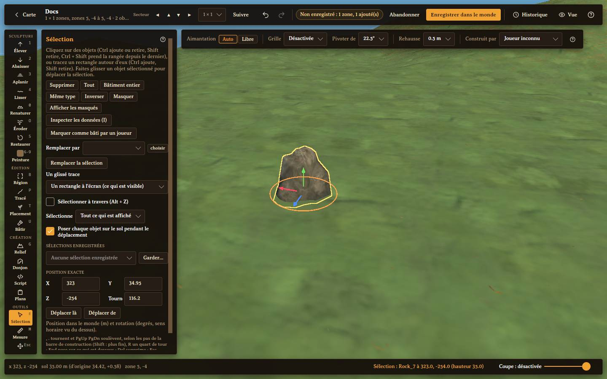
*De près, un rocher sélectionné : son contour orange, les flèches X rouge, Y verte et Z bleue qui le déplacent le long
d'un axe, et l'anneau orange qui le tourne. Le panneau Sélection est à gauche.*

## L'utiliser

Pour déplacer quelques objets :

1. Appuyez sur `E`.
2. Cliquez sur un objet. `Ctrl` + cliquez sur d'autres, ou tracez un rectangle à l'écran autour d'eux.
3. Faites glisser un objet sélectionné pour les déplacer tous, ou faites glisser une flèche pour déplacer le long d'un
   axe, ou l'anneau pour tourner.
4. Facultatif : tapez des valeurs exactes sous **POSITION EXACTE**, puis cliquez sur **Déplacer là**.

Depuis l'outil **Vue**, un double-clic sur un objet passe à Sélection avec cet objet sélectionné. Seuls les objets
affichés peuvent être choisis : activez d'abord leurs types dans le [panneau Vue](editor-basics.md). L'objet sous le
curseur a une boîte discrète : c'est celui qu'un clic choisit.

Chaque déplacement, rotation, suppression ou modification est une étape d'annulation (`Ctrl+Z`). Rien n'est écrit dans
le monde tant que vous ne faites pas **Enregistrer dans le monde** (ou **Appliquer en direct**).

## Réglages

Le panneau Sélection, de haut en bas.

| Réglage | Ce qu'il fait |
|---|---|
| **Supprimer** | Retire les objets sélectionnés (`Del`). `Ctrl+Z` les ramène. |
| **Tout** | Sélectionne chaque objet affiché du secteur (`Ctrl+A`). |
| **Bâtiment entier** | Ajoute chaque pièce de construction reliée aux pièces sélectionnées par des pièces qui se touchent : murs, planchers, toits, poutres. Les pièces isolées ne sont pas prises. |
| **Même type** | Sélectionne chaque objet affiché des types sélectionnés maintenant : sélectionnez un hêtre, obtenez tous les hêtres. |
| **Inverser** | Sélectionne chaque objet affiché qui n'est pas sélectionné maintenant, et seulement ceux-là (`Ctrl+I`). |
| **Masquer** / **Afficher les masqués** | Masque les objets sélectionnés dans la vue, pour atteindre ce qu'ils couvrent (`Ctrl+H`), et les affiche à nouveau (`Alt+H`). Les objets masqués ne sont ni affichés ni choisis ; rien ne change dans le monde. Ouvrir un autre secteur oublie ce qui était masqué. |
| **Inspecter les données (I)** | Ouvre l'[Inspecteur](#inspecteur) sur l'unique objet sélectionné. |
| **Marquer comme bâti par un joueur** | Donne aux pièces sélectionnées sans constructeur le joueur choisi dans **Construit par** sur [la barre de construction](build.md#la-barre-de-construction), pour que le jeu les traite comme bâties par un joueur. Utilisez-le sur une ruine que vous voulez réparer et garder. Voir [Pièces bâties par les joueurs](concepts/objects.md#pièces-bâties-par-un-joueur). |
| **Remplacer par** + **choisir** + **Remplacer la sélection** | Choisissez un type (ou cliquez sur **choisir**, puis sur un objet du monde), puis remplacez chaque objet sélectionné par lui, à la même position et dans la même orientation. Les nouveaux objets ne gardent rien des données des anciens. |
| **Un glissé trace** | **Un rectangle à l'écran (ce qui est visible)** ou **Un contour au sol (tout ce qui est au-dessus)** : voir [Sélectionner beaucoup d'objets d'un coup](#sélectionner-beaucoup-dobjets-dun-coup). |
| **Sélectionner à travers (Alt + Z)** | Un rectangle prend aussi ce qui est caché derrière d'autres objets à l'intérieur : les meubles dans une maison, le mur derrière un autre. |
| **Sélectionne** | Ce que prennent les clics, les rectangles et les contours : **Tout ce qui est affiché**, **Pièces construites uniquement** (ce qu'ont construit les joueurs) ou **Nature uniquement** (arbres, rochers, minerais, buissons, ramassables, restes). Ce qui est exclu est toujours affiché mais ne gêne pas : avec Pièces construites uniquement, un rectangle prend le mur derrière un arbre. Cela s'applique aussi aux clics de l'outil Vue ; **Dessus** de l'outil Placement et les pipettes choisissent tous les types. |
| **Poser chaque objet sur le sol pendant le déplacement** | Activé : chaque objet se pose sur le plancher, la table ou le rocher qui se trouve dessous là où il arrive, sinon sur le sol (les arbres, buissons et créatures ne portent rien : un arbre déplacé dans un bois se dresse sur le sol) ; un bâtiment se déplace d'un bloc et repose sur ce qui est dessous. Désactivé : toute la sélection se déplace d'un bloc à sa hauteur au-dessus du sol. Activé au départ. |
| **SÉLECTIONS ENREGISTRÉES** : **Garder…** | Garde la sélection sous un nom, pour ce monde. Choisissez-en une dans la liste pour ses boutons : **Sélection** (à la place de la sélection actuelle), **Ajouter** (à celle-ci) et **Oublier** (après avoir demandé). Les objets déplacés ou supprimés depuis comptent comme manquants ; la barre d'état dit combien. |
| **POSITION EXACTE** : **X**, **Y**, **Z**, **Tourner** | Affiché quand il y a une sélection. X (est–ouest) et Z (nord–sud) sont le milieu de la sélection, Y la hauteur de son objet le plus bas, Tourner l'orientation du premier objet en degrés, dans le sens horaire vu d'en haut. |
| **Déplacer là** | Déplace et tourne la sélection jusqu'aux valeurs tapées, en une étape d'annulation. Les valeurs tapées sont exactes : rien ne s'aimante par-dessus. |
| **Déplacer de** | Fait passer les champs en quantités : mètres vers l'est, vers le haut et vers le nord, et degrés de rotation. **Déplacer de ces valeurs** l'effectue. |

## Sélectionner un objet à la fois

| Action | Ce qu'elle fait |
|---|---|
| Clic | Sélectionne l'objet, et seulement lui. |
| Nouveau clic au même endroit | Sélectionne l'objet suivant derrière, puis le suivant : un coffre sur un plancher, le plancher, la poutre en dessous. |
| `Ctrl` + clic | Ajoute l'objet, ou le retire quand il est déjà sélectionné. |
| `Shift` + clic | Retire l'objet. |
| `Ctrl` + `Shift` + clic | Ajoute la rangée allant du dernier objet cliqué à celui-ci : cliquez sur le mur 1, puis sur le mur 3, et les murs 1 à 3 sont sélectionnés. |
| Double-clic sur une pièce de construction | Sélectionne le bâtiment entier. Un coffre (tout conteneur) fait exception : il est sélectionné seul et s'ouvre dans l'Inspecteur. |
| Double-clic sur une partie d'un bateau | Sélectionne le bateau entier : voir [Bateaux et autres objets liés](#bateaux-et-autres-objets-liés). |
| Clic sur un sol vide, ou `Alt+A` | Vide la sélection. |

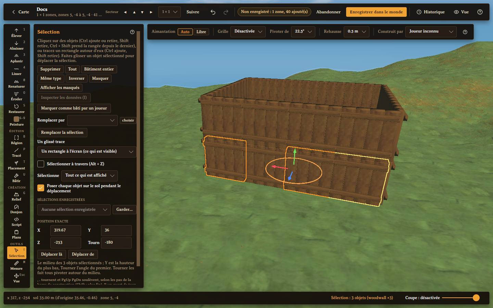
*Un clic sur une pièce de mur, puis `Ctrl` + clic sur deux autres : la dernière cliquée est entourée d'un jaune plus
clair, les autres d'orange, et la barre d'état compte les trois.*

## Sélectionner beaucoup d'objets d'un coup

Un glissé sur un sol vide trace un rectangle à l'écran. Quand vous relâchez, les objets **visibles** à l'intérieur sont
sélectionnés, pas ceux cachés derrière d'autres. Tournez la caméra pour choisir : d'en haut, le plancher d'un bâtiment
et le haut des murs ; de côté, un mur.

| Action | Ce qu'elle fait |
|---|---|
| Glisser sur un sol vide | Trace le rectangle ; ce qui est visible à l'intérieur devient la sélection. |
| `Alt` + glisser | Trace le rectangle même quand vous partez d'un objet (un bâtiment, un bois). |
| `Ctrl` + glisser | Ajoute ce que prend le rectangle. |
| `Shift` + glisser | Le retire. |

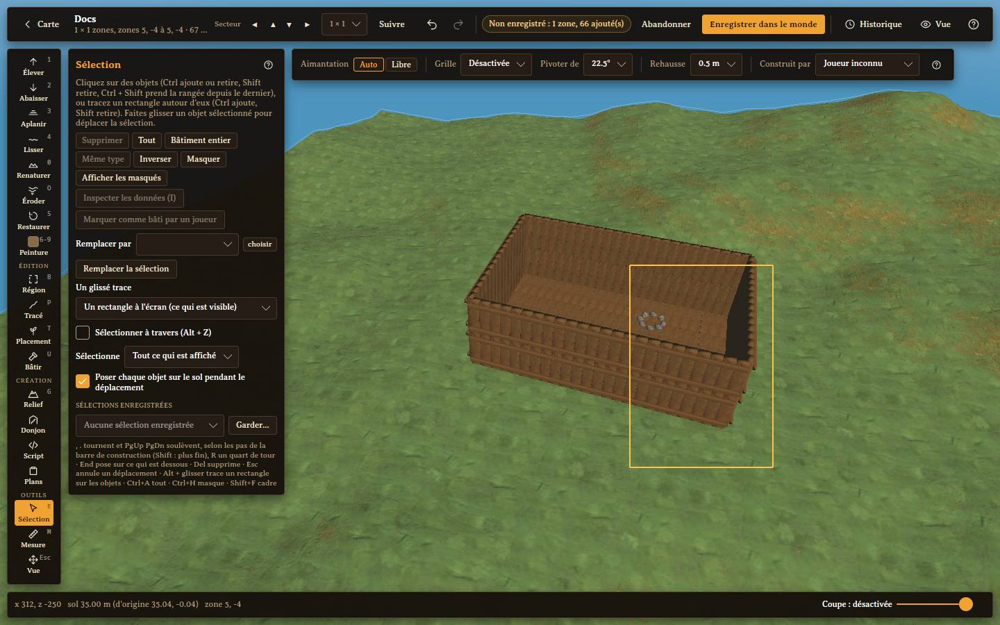
*`Alt` + glisser depuis le milieu d'une cabane sur sa moitié droite : le rectangle est tracé à l'écran.*

*Après avoir relâché : 27 pièces entourées, les murs, le plancher visible entre eux et le foyer ; le plancher et le
coffre cachés derrière le mur de devant sont exclus. La barre d'état compte les objets.*

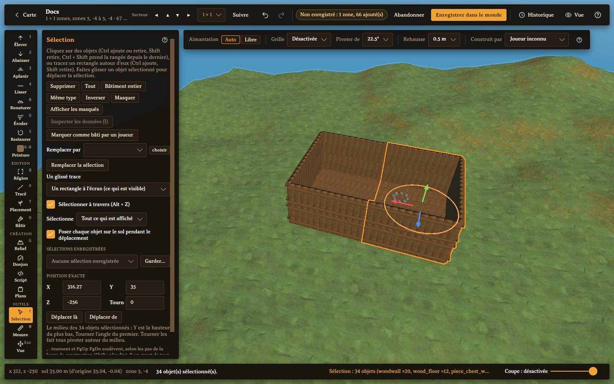
*Le même rectangle avec **Sélectionner à travers** activé : 34 pièces, le plancher et le coffre derrière le mur de
devant aussi.*

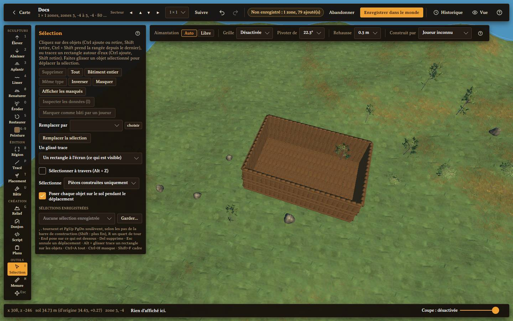
***Sélectionne : Pièces construites uniquement** et un rectangle sur toute la cabane au milieu des rochers et des
buissons : les 58 pièces de la cabane seules.*

Avec **Un glissé trace : Un contour au sol (tout ce qui est au-dessus)**, un glissé trace à la place un contour au sol,
et chaque objet affiché qui se trouve à l'intérieur est sélectionné, caché ou non. `Alt`, `Ctrl` et `Shift` fonctionnent
comme pour le rectangle.

Pour sélectionner par type dans un rectangle ou un polygone exact (chaque arbre, ou seulement les hêtres, et seulement
là où le [Masque](masks.md) laisse passer le sol), utilisez l'outil [Région](area.md#actions-sur-les-objets) : sous
**Objets**, son **Sélectionner les objets (Enter)** les sélectionne et passe à Sélection, où **Supprimer** et
**Remplacer la sélection** agissent sur eux.

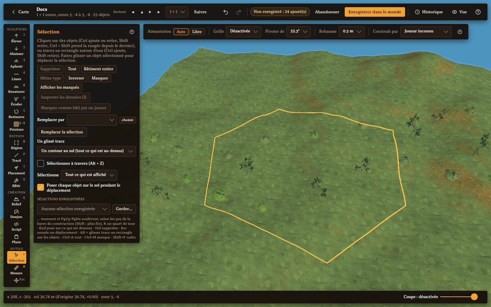
*`Alt` + glisser autour de rochers et de buissons : le contour est tracé même si le glissé a commencé sur un buisson.*

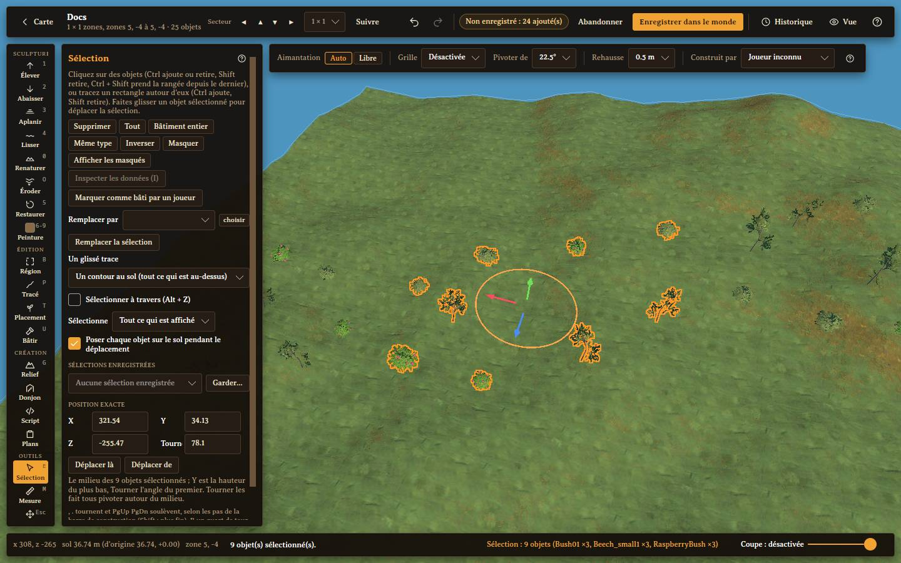
*Tout ce qui est affiché à l'intérieur est sélectionné, et **POSITION EXACTE** montre où se trouve la sélection.*

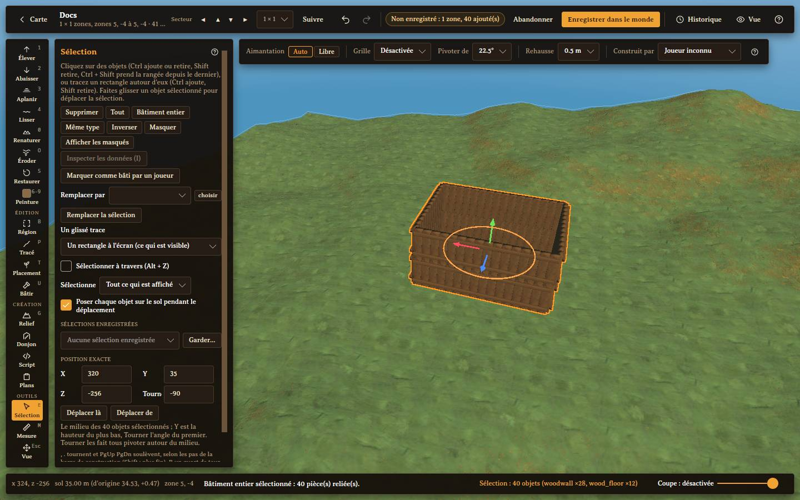
*Un clic sur un mur, puis **Bâtiment entier** : chaque pièce reliée de la cabane est sélectionnée.*

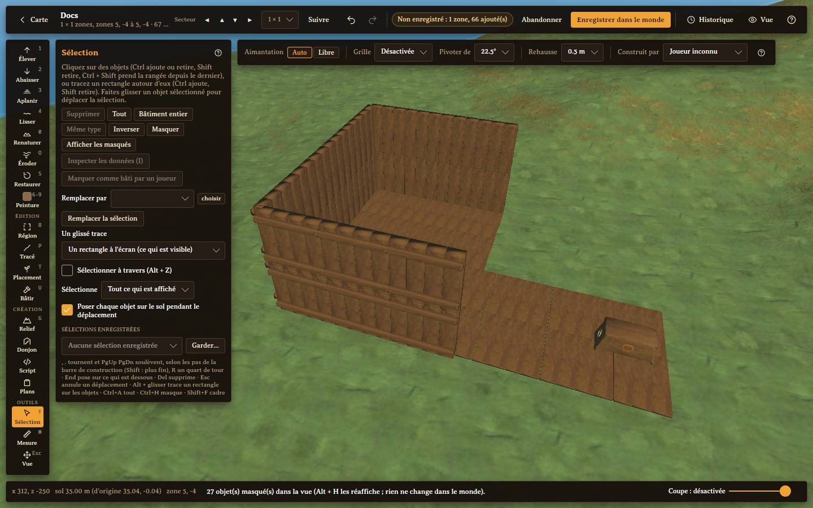
*De près, la cabane après que `Ctrl+H` a masqué sa moitié droite encadrée : le coffre posé sur le plancher à
l'intérieur est bien visible. `Alt+H` ramène les murs.*

## Déplacer et tourner

| Action | Ce qu'elle fait |
|---|---|
| Faire glisser un objet sélectionné | Déplace toute la sélection, en suivant le curseur sur le sol. Les pièces s'aimantent aux pièces autour, ou suivent la grille, selon le réglage de [la barre de construction](build.md#la-barre-de-construction). |
| Faire glisser une flèche | Déplace le long d'un axe : **X rouge** est–ouest, **Y vert** haut–bas, **Z bleu** nord–sud. Maintenez `Ctrl` pour des pas de 0,5 m. |
| Faire glisser l'anneau orange | Tourne la sélection autour de son milieu ; maintenez `Ctrl` pour des pas de 15°. |
| `End` | Fait tomber chaque objet tout droit sur ce qui est dessous (un plancher, une table, un rocher), sinon sur le sol. |

La barre de construction à côté du panneau est celle qu'utilisent [Bâtir](build.md) et Coller : **Aimantation**
(**Auto** : les pièces déplacées s'accrochent aux points d'aimantation les plus proches à moins de 0,75 m, comme avec
le marteau ; **Libre** : elles restent là où vous les faites glisser), **Grille** (les pièces qui ne s'aimantent pas
la suivent), **Pivoter de** et **Rehausse** (les pas des touches ci-dessous) et **Construit par**.

La barre d'état suit le déplacement : « Déplacement de 12 objet(s) : 4.5 m, tourné(s) de 15°, +0.25 m · aimanté(s) à
woodwall ». Un objet déplacé garde ses données : un coffre son contenu, un panneau son texte, une pièce son
constructeur. Voir [Aimantation](concepts/objects.md#aimantation) pour savoir où atterrit un déplacement.

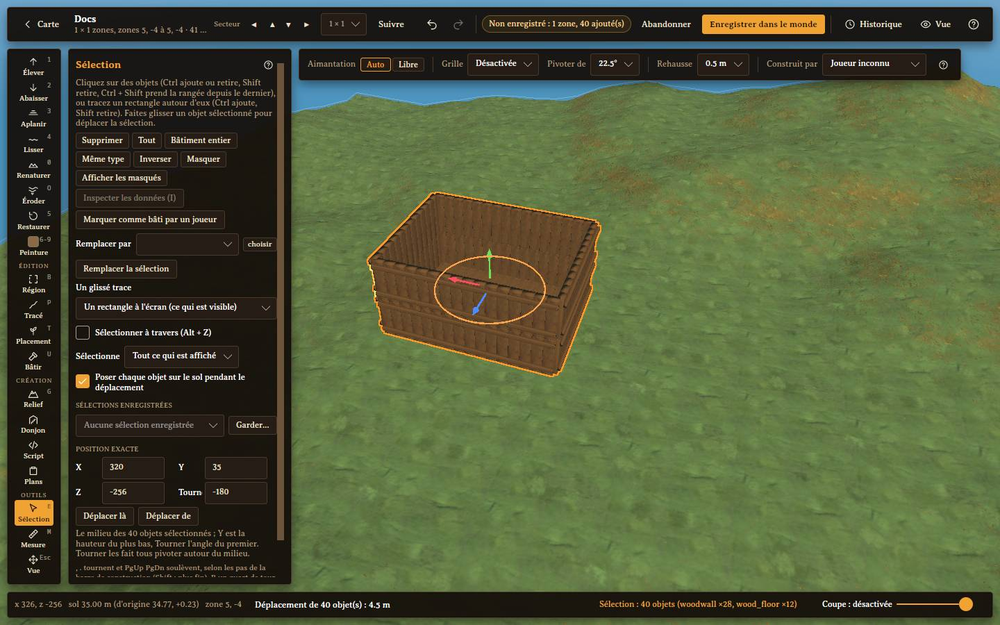
*En faisant glisser la flèche X rouge d'une cabane sélectionnée entière : la barre d'état suit le déplacement,
« Déplacement de 40 objet(s) : 4.5 m ».*

## Copier, couper et coller

`Ctrl+C` copie la sélection ; `Ctrl+V` la colle avec l'outil de collage (`R` tourne, `X` fait un miroir), ici ou dans
un autre secteur : voir [Région](area.md). Les copies gardent tout ce que contiennent les originaux. Les arbres et
autres gardent leur hauteur au-dessus du sol là où ils arrivent ; les pièces de construction gardent la forme du
bâtiment et emportent le sol qui est dessous (sans la peinture). `Ctrl+X` coupe : la même copie, puis les objets
quittent le monde, donc les coller les déplace.

Pour garder une copie comme plan, ouvrez **Plans** dans la barre d'outils et cliquez sur **Enregistrer comme plan…**
sur sa ligne **Copie** : voir [le panneau Plans](workshop.md#panneau-plans).

## Inspecteur

L'Inspecteur montre tout ce qu'un objet contient dans la sauvegarde et vous permet de le modifier. Ouvrez-le avec
**Inspecter les données (I)**, ou double-cliquez sur un coffre (ou tout objet qui n'est pas une pièce de construction).

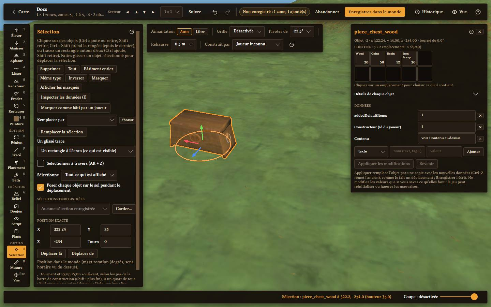
*De près, un coffre contenant quatre objets, ouvert dans l'Inspecteur : ses emplacements comme en jeu, chacun avec le
nom de l'objet et le nombre, puis chaque valeur sous DONNÉES.*

En haut : le nom de l'objet, son identifiant, sa position et sa rotation. Pour un point d'apparition ou un nid, ce
qu'il fait apparaître (`Spawn point: Boar · 0–2 ★ · spawns once`) ; pour l'objet d'un mod, le mod dont il vient.

| Partie | Ce qu'elle fait |
|---|---|
| **CONTENU** | Coffres et autres conteneurs : les emplacements comme en jeu (« 5 × 2 emplacements · 4 objet(s) »). Cliquez sur un emplacement, puis **Chercher un objet…** (tapez quelques lettres), **Nombre** et **Qualité**. **Vider** retire l'objet ; **Déplacer**, puis un autre emplacement, le déplace (deux objets s'échangent). Le nombre est ramené à la plus grande pile du jeu. |
| **Détails de chaque objet** | Chaque objet avec sa pile, sa qualité, sa durabilité et son emplacement. **Ajouter un objet** en met un nouveau dans le premier emplacement libre ; **✕** en retire un ; **Ranger** déplace chaque objet vers les premiers emplacements libres, rangée par rangée. |
| **TIENT** / **PORTE** | Présentoirs et supports d'armure. La liste ne propose que ce que le jeu laisse prendre à ce support (un présentoir plat prend aussi de la nourriture, pour dresser une table). **Qual.** est sa qualité, **Style** son apparence, **Suspendu** la façon dont il pend, **Posture** la posture d'un support d'armure ; **✕** l'enlève. |
| **DONNÉES** | Chaque valeur, sous le nom du jeu, avec une étiquette pour les plus courantes : Texte (panneau), Étiquette (portail), Constructeur (identifiant du joueur), Santé, Combustible, Niveau (étoiles)... Modifiez les nombres et les textes sur place ; **✕** retire une valeur (le jeu utilise alors sa valeur par défaut). Les autres données binaires sont listées mais pas modifiées. |
| **Ajouter** | Ajoute une valeur que l'objet n'a pas : choisissez son type, tapez son nom tel que le jeu l'appelle (`text` pour un panneau, `tag` pour un portail) et la valeur. |
| **Appliquer les modifications** | Remplace l'objet par une copie avec les nouvelles données, à la même position : une étape d'annulation. **Enregistrer dans le monde** ou **Appliquer en direct** l'écrit. |
| **Revenir** | Oublie les modifications faites dans la fiche. |

- La taille d'un conteneur vient du jeu. Les chariots et les bateaux gardent leur conteneur sur une partie, donc leur
  taille est inconnue.
- Les objets hors des emplacements seraient cachés en jeu : l'éditeur demande avant d'appliquer cela.
- Le contenu modifié devient celui du coffre : un coffre jamais ouvert ne se remplit pas du butin du jeu par-dessus.
- Un objet posé sur un support est neuf et à pleine durabilité pour sa qualité. En **Rendu du jeu**, la vue 3D
  l'affiche sur le support.
- Les noms des valeurs viennent du code du jeu et de vos mods (lu, jamais exécuté). Un nom inconnu s'affiche comme un
  nombre.

> [!WARNING]
> Ne modifiez une valeur que si vous savez ce qu'elle fait : le jeu peut réinitialiser ou ignorer des valeurs qu'il
> n'attend pas. `Ctrl+Z` remet l'ancien objet en place tant que vous n'avez pas enregistré.

## Bateaux et autres objets liés

Certains mods construisent des objets à partir d'autres : le navire d'un mod de bateaux est une racine et les pièces
construites dessus, la locomotive d'un mod de trains et les wagons qu'elle tire. Quand le mod les décrit (son
`worldeditor.json`, voir [Modding](modding.md), ou un module complémentaire comme celui pour
[ValheimRAFT](../../addons/ValheimRAFT/README.md) ou [Railroads](../../addons/Railroads/README.md)), l'éditeur affiche
le groupe tel que le mod le construit et le garde uni :

- **Déplacé en entier.** Sélectionner n'importe quelle partie puis la déplacer, la tourner ou la supprimer prend tout
  le groupe (la barre d'état le dit, avec les mots du mod : « a whole vehicle »). Un groupe déplacé garde sa hauteur
  (un bateau reste à flot), ne s'aimante pas et ne tombe pas avec `End`.
- **Copié en entier.** `Ctrl+C` sur n'importe quelle partie copie tout le groupe, sans le sol. Chaque collage est un
  groupe à part avec de nouveaux identifiants. Une partie copiée sans sa racine est collée comme une pièce ordinaire.
- **Retiré en entier.** Supprimer n'importe quelle partie supprime tout le groupe, même quand l'outil
  [Région](area.md#actions-sur-les-objets) l'a sélectionné.

Les outils de Claude font de même. Voir [Ce qu'est un objet](concepts/objects.md#ce-quest-un-objet).

## Raccourcis

| Touche ou souris | Ce qu'elle fait |
|---|---|
| `E` | Ouvre Sélection. |
| `Ctrl+A` / `Alt+A` | Tout sélectionner parmi ce qui est affiché / vider la sélection. |
| `Ctrl+I` | Inverser la sélection. |
| `Ctrl+H` / `Alt+H` | Masquer les objets sélectionnés / les afficher à nouveau. |
| `Alt+Z` | Activer ou désactiver **Sélectionner à travers**. |
| `Shift+F` ou `.` du pavé numérique | Cadrer la sélection (`F` seul change la vue). |
| `Del` | Supprimer la sélection. |
| `I` | Ouvrir l'Inspecteur sur l'unique objet sélectionné. |
| `,` `.` ou `Alt` + molette | Tourner du pas **Pivoter de** de la barre de construction, 22.5° au départ (`Shift`, plus fin : 1°). |
| `R` | Tourner d'un quart de tour. |
| `PgUp` / `PgDn` ou `Ctrl` + molette | Soulever ou abaisser du pas **Rehausse** de la barre de construction, 0.5 m au départ (`Shift`, plus fin : un cinquième). |
| `End` | Faire tomber chaque objet sur ce qui est dessous. |
| `Esc` | Fermer l'Inspecteur ; sinon annuler un rectangle, un contour ou un déplacement en cours ; sinon revenir à l'outil Vue (la sélection reste). |
| `Ctrl+C` / `Ctrl+X` / `Ctrl+V` | Copier, couper, coller. |
| `Ctrl+Z` | Annuler. Des touches pressées à un instant d'intervalle forment une seule étape. |

Toutes les touches de l'éditeur sont dans [Raccourcis](help/shortcuts.md).

## Astuces et limites

> [!CAUTION]
> Les pierres runiques peuvent être sélectionnées et supprimées, mais pas déplacées, tournées, copiées ni inspectées :
> le jeu construit chacune à partir de son lieu à chaque chargement de la zone, donc en supprimer une retire ce lieu
> pour de bon (avec le petit aplanissement du sol autour). Enregistrer dans le monde le rend définitif ; d'ici là,
> `Ctrl+Z` la ramène.

- **Récupérer :** supprimé ou déplacé par erreur : `Ctrl+Z`, après un enregistrement aussi (puis enregistrez à
  nouveau). Quelque chose masqué : `Alt+H`. Voir [Annuler des modifications](guides/undo-changes.md).
- Les rectangles, les contours, **Tout**, **Même type**, **Inverser** et **Bâtiment entier** excluent tout ce qui est à
  plus de 10 m sous le sol (des objets qu'un mod y cache, comme des stations d'artisanat sous une maison).
- Un clic choisit un objet par sa forme affichée, pas par sa boîte : une pierre sous les branches d'un arbre peut être
  cliquée entre les branches. Les feuilles et l'herbe ne comptent que là où rien de solide n'est derrière. Voir
  [Ce qu'est un objet](concepts/objects.md#ce-quest-un-objet).
- Les objets sélectionnés perdent leur point vert « non enregistré » tant qu'ils sont sélectionnés.
- En mode direct, un objet déplacé garde son identifiant dans le jeu en cours quand rien d'autre n'a changé en lui.
  Voir [Ce qui est envoyé, et quand](concepts/live-editing.md#ce-qui-est-envoyé-et-quand).

## Voir aussi

- [Déplacer ou copier un bâtiment](guides/move-a-building.md)
- [Changer le contenu d'un coffre ou le texte d'un panneau](guides/fill-a-chest.md)
- [Trouver un objet, un objet dans un coffre ou un panneau](guides/find-things.md)
- [Objets](concepts/objects.md#ce-quest-un-objet) · [Aimantation](concepts/objects.md#aimantation)
- [Bâtir](build.md) · [Placement](place.md) · [Région](area.md)
