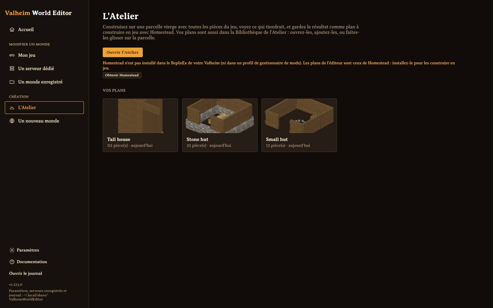
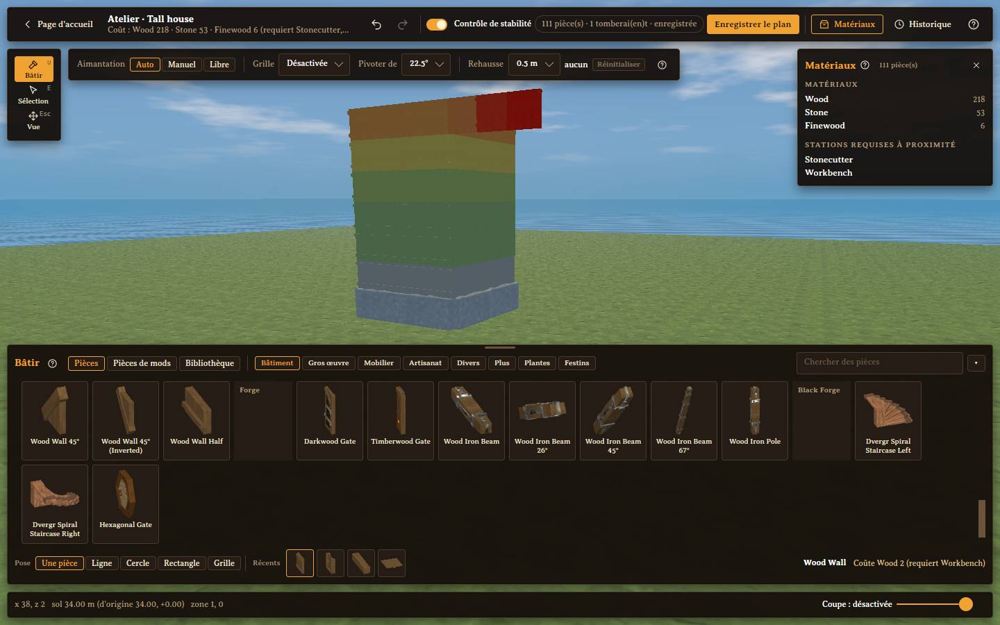
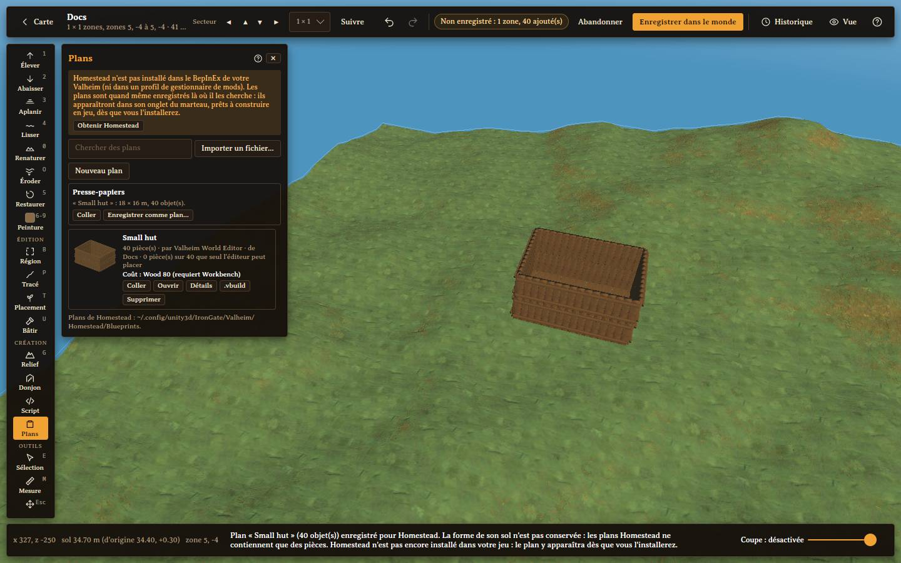

<!-- source: 491b2a7c -->
# Votre première construction

En une quinzaine de minutes, vous construisez une petite cabane en bois dans l'Atelier, regardez le contrôle de
stabilité la colorer, la gardez comme plan et la collez dans un monde. Vous n'avez besoin d'aucun monde pour la
première partie : l'Atelier est une parcelle vierge.

**Il vous faut :** l'éditeur installé ([Installer l'éditeur](install.md)). Pour la dernière partie, un monde avec une
copie de sauvegarde à côté, comme dans [Votre première modification](first-edit.md).

## 1. Ouvrir l'Atelier

1. Sur la page d'accueil, cliquez sur **L'Atelier**, puis sur **Ouvrir l'Atelier**.

*Sur la page d'accueil, **L'Atelier** : **Ouvrir l'Atelier**, si Homestead est installé, et vos plans (trois ici ; la
liste est vide la première fois).*

**Ce que vous devriez voir :** une parcelle de prairie plate et vide, le panneau **Bâtir** en bas sur son onglet
**Pièces**, et la barre du haut qui indique « Aucune pièce pour l'instant ». La barre d'outils ne contient que
**Bâtir**, **Sélection** et **Vue**, avec la barre de construction à côté.

## 2. Poser un sol

1. Dans le panneau **Bâtir**, tapez `wood floor` dans **Chercher des pièces**.
2. Cliquez sur la vignette du sol en bois. Son nom et son coût s'affichent au pied du panneau, et il rejoint
   **Récents** à cet endroit.
3. Cliquez au milieu de la parcelle. Le sol se pose.
4. Visez à côté du bord du sol et cliquez à nouveau. Le nouveau sol s'aimante au premier, bord à bord, comme avec le
   marteau du jeu. Posez quatre sols en carré.

**Ce que vous devriez voir :** un sol carré, chaque pièce colorée en bleu clair : elle repose sur le sol, elle a donc
une stabilité totale. La barre du haut compte « 4 pièce(s) · non enregistrée comme plan », et sous le titre s'affiche
le coût de la cabane.

## 3. Monter les murs

1. Cherchez `wood wall` et cliquez sur la vignette du mur en bois.
2. Visez le bord extérieur d'un sol et cliquez : le mur s'aimante sur le bord. Appuyez d'abord sur `,` ou `.` pour le
   tourner s'il est dans le mauvais sens.
3. Posez des murs tout autour du sol. Laissez un espace pour une porte.
4. Cherchez `wood door`, cliquez sur sa vignette, et posez la porte dans l'espace.
5. Posez une deuxième rangée de murs sur la première.

*Le contrôle de stabilité sur une haute maison : la base en pierre en bleu clair, les murs au-dessus en vert, puis en
jaune et en orange à mesure que leur stabilité s'épuise, et un surplomb en rouge : il tomberait.*

**Ce que vous devriez voir :** les murs sur le sol sont verts (solides) ; la deuxième rangée est vert plus clair ou
jaune, avec moins de stabilité. Une pièce qui tomberait en jeu devient rouge, et la barre du haut indique combien
tomberaient. Pourquoi : voir [Le contrôle de stabilité](../concepts/objects.md#le-contrôle-de-stabilité).

Une pièce au mauvais endroit ? Appuyez sur `Ctrl+Z` pour l'annuler, ou appuyez sur `E` (**Sélection**), cliquez sur la
pièce, appuyez sur `Del`, puis sur `U` pour reprendre la construction.

## 4. Enregistrer le plan

1. Cliquez sur **Enregistrer le plan** dans la barre du haut (ou appuyez sur `Ctrl+S`).
2. Tapez `My first hut` comme **Nom**, quelques mots comme **Description**, et `hut, wood` comme **Étiquettes**.
3. Cliquez sur **Enregistrer**. Si certaines pièces tomberaient en jeu, l'éditeur demande d'abord : **Continuer à
   construire** pour les corriger (elles sont rouges), ou **Enregistrer quand même**.

**Ce que vous devriez voir :** le message « Plan « My first hut » (… pièce(s)) enregistré pour Homestead. », et la
barre du haut indique « enregistrée ». Le plan est maintenant dans votre bibliothèque, avec une image de la cabane.
Avec le mod [Homestead](https://thunderstore.io/c/valheim/p/sighsorry/Homestead/) dans votre jeu, il apparaît aussi
dans l'onglet du marteau de Homestead, prêt à construire en jeu.

## 5. Le coller dans un monde

1. Cliquez sur **Page d'accueil** en haut à gauche pour revenir à la page d'accueil.
2. Cliquez sur **Un monde enregistré**, puis sur votre monde (pas sur sa copie de sauvegarde). Sur sa carte, cliquez
   sur un endroit de terrain dégagé que vous avez visité, puis sur **Modifier en 3D**.
3. Dans la barre d'outils, sous **CRÉATION**, cliquez sur **Plans**. Dans une fenêtre basse, faites défiler la barre
   d'outils avec la molette de la souris pour l'atteindre.
4. Trouvez **My first hut** dans la liste et cliquez sur son bouton **Coller**.
5. Déplacez la souris sur un terrain dégagé : la cabane la suit, transparente. Appuyez sur `R` pour la tourner d'un
   quart de tour.
6. Cliquez pour la poser, puis appuyez sur `Esc` pour arrêter de coller.

*Le panneau **Plans** à côté de la barre d'outils : une cabane enregistrée avec son image, son coût et son bouton
**Coller**.*

**Ce que vous devriez voir :** la cabane debout sur le sol. Avec **Dégager le site** activé dans le panneau Coller
(c'est le cas au départ), le sol qui la gêne est creusé et les arbres et les rochers de son emplacement ont disparu.
La barre du haut indique « Non enregistré : … ajouté(s) ».

Un contour rouge avant le clic signifie que la cabane ne tient pas dans le secteur ouvert : ouvrez-en un plus grand
depuis la carte.

## 6. Enregistrer le monde

1. Fermez Valheim s'il tourne.
2. Cliquez sur **Enregistrer dans le monde**, vérifiez le **Dossier du monde** dans la question, puis cliquez sur
   **Enregistrer**.
3. Lancez Valheim, chargez le monde et rendez-vous à l'endroit.

**Ce que vous devriez voir :** votre cabane, debout là où vous l'avez collée. Ses pièces sont bâties par un joueur :
le jeu la traite donc comme votre base (voir [Pièces bâties par un joueur](../concepts/objects.md#pièces-bâties-par-un-joueur)).

## Si cela n'a pas fonctionné

- **Une pièce ne s'aimante pas** : visez plus près du bord ou du haut de la pièce déjà présente ; l'aimantation prend
  les points d'aimantation les plus proches à moins d'un demi-mètre.
- **L'Atelier indique que Homestead n'est pas installé** : ce n'est pas grave. Les plans sont enregistrés là où
  Homestead les cherche, et le collage dans un monde fonctionne sans lui.
- **Le contour du collage est rouge** : la cabane est trop près du bord du secteur. Déplacez la souris vers
  l'intérieur, ou ouvrez un secteur plus grand.
- **Le résultat ne vous plaît pas** : `Ctrl+Z` reprend le collage avant l'enregistrement. Après l'enregistrement,
  annulez-le et faites à nouveau **Enregistrer dans le monde** : voir
  [Annuler une étape, retirer une modification ou tout abandonner](../guides/undo-changes.md).

## Et ensuite

- [L'Atelier](../workshop.md) : chaque onglet de pièces, la bibliothèque, la Coupe et l'aimantation des pièces.
- [Coller un plan dans un monde](../guides/paste-a-blueprint.md)
- [Déplacer ou copier un bâtiment](../guides/move-a-building.md)
