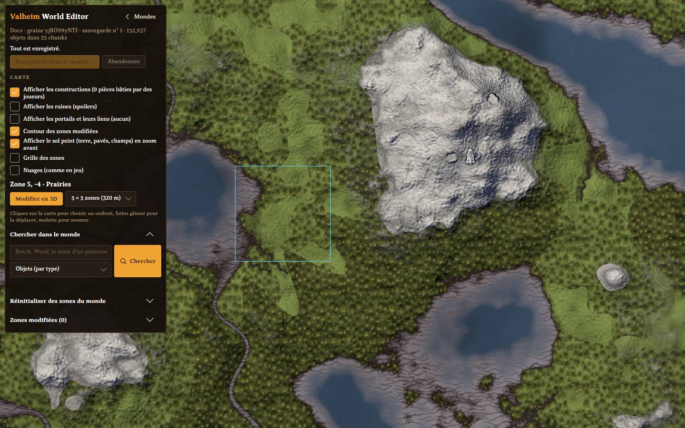
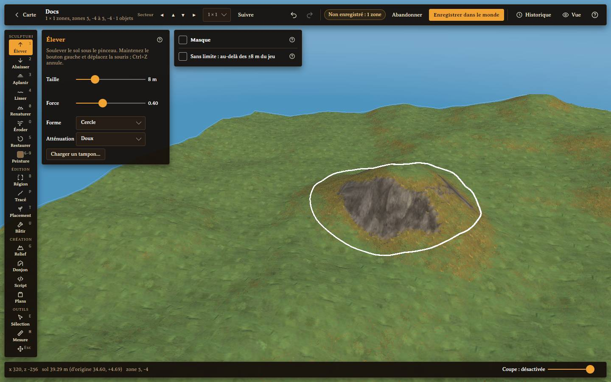
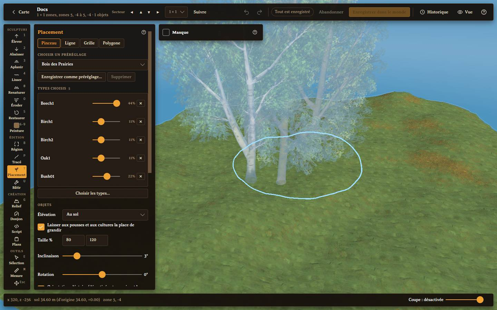
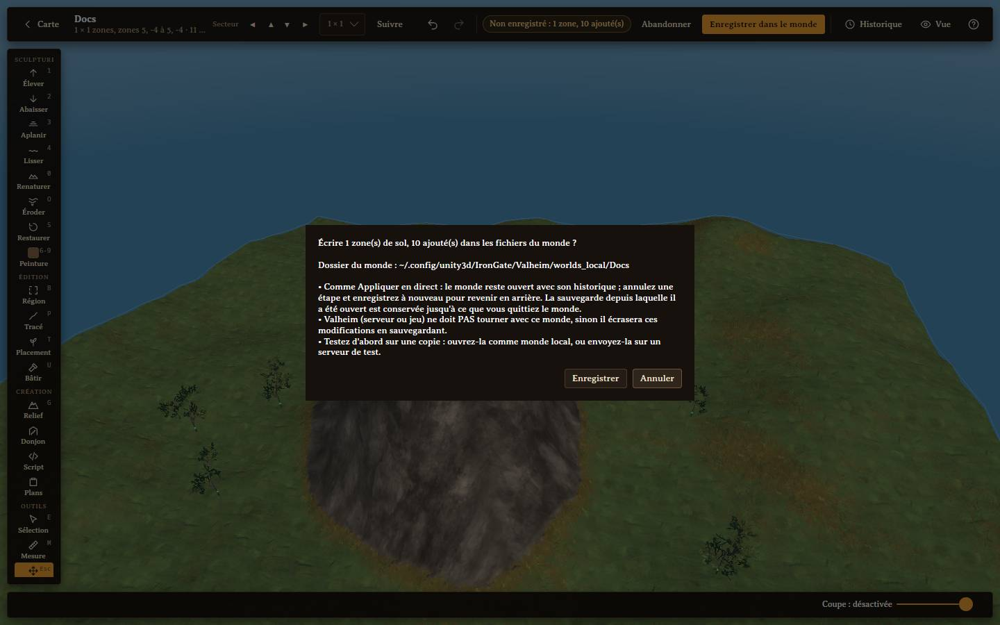

<!-- source: b94e61af -->
# Votre première modification

En une dizaine de minutes, vous copiez un monde, élevez une petite colline et plantez quelques arbres à côté de votre
base, annulez et rétablissez, enregistrez, puis allez voir le résultat dans Valheim. La copie garde le monde tel qu'il
était, donc rien ne peut être perdu.

**Il vous faut :** l'éditeur installé ([Installer l'éditeur](install.md)), et un monde solo dans lequel vous avez joué :
un monde où vous avez construit une base et utilisé la houe ou la pioche au moins une fois. Valheim doit être fermé.

## 1. Copier le monde

La copie est votre chemin de retour : quoi que vous fassiez ensuite, vous pouvez remettre le monde exactement tel qu'il
est maintenant.

1. Fermez Valheim.
2. Dans l'éditeur, sur la page d'accueil, cliquez sur **Un monde enregistré** et survolez la carte de votre monde.
   L'info-bulle se termine par le dossier du monde, par exemple `…/IronGate/Valheim/worlds_local/Midgard`.
3. Dans votre gestionnaire de fichiers, ouvrez le dossier `worlds_local` qui le contient.
4. Copiez le dossier du monde et collez la copie dans le même dossier `worlds_local`.
5. Renommez la copie `<World>_backup_<date>`, par exemple `Midgard_backup_2026-10-22`.

**Ce que vous devriez voir :** après quelques secondes, **Un monde enregistré** liste les deux : votre monde et
`Midgard_backup_2026-10-22`. Vous modifiez le monde lui-même ; la copie reste intacte à côté. Plus sur les copies :
[Sauvegarder un monde avant de le modifier](../guides/back-up-a-world.md).

## 2. Ouvrir le monde

1. Sur **Un monde enregistré**, cliquez sur votre monde (pas sur la copie). Il s'ouvre sur sa carte.
2. Sur la carte, cliquez sur un endroit dégagé près de votre base.
3. Dans le panneau latéral, choisissez **3 × 3 zones (192 m)** dans la liste des tailles à côté de **Modifier en 3D**,
   puis cliquez sur **Modifier en 3D**.

*La carte : un clic a choisi une zone (le carré bleu) ; **Modifier en 3D** l'ouvre avec la taille choisie à côté.*

**Ce que vous devriez voir :** la vue 3D de votre base et du terrain autour, la barre d'outils à gauche, et la barre du
haut qui indique « Tout est enregistré ». Si la vue est trop loin, tournez la molette pour vous rapprocher ; un clic
droit glissé tourne la vue.

## 3. Élever une colline

1. Appuyez sur `1`, ou cliquez sur **Élever** dans la barre d'outils. Son panneau s'ouvre à côté.
2. Dans le panneau, faites glisser **Taille** jusqu'à environ 10 m.
3. Sur un sol dégagé à côté de votre base, maintenez le bouton gauche de la souris et décrivez de petits cercles
   pendant quelques secondes.

*Élever : le contour du pinceau sur le sol, un monticule élevé à côté, et le panneau avec **Taille** et **Force**.*

**Ce que vous devriez voir :** le sol monte sous le pinceau, et la barre du haut indique « Non enregistré : 1 zone » en
ambre. Rien n'est encore écrit dans le monde : la modification est
[en attente](../concepts/saving-and-history.md#modifications-en-attente).

## 4. Planter des arbres

1. Appuyez sur `T`, ou cliquez sur **Placement** dans la barre d'outils.
2. Dans le panneau **Placement**, cliquez sur **Pinceau**, puis choisissez **Bois des Prairies** sous
   **Choisir un préréglage**.
3. Faites glisser la souris le long du pied de votre colline.

*Placement avec **Pinceau** et le préréglage **Bois des Prairies** : le pinceau montre les prochains arbres en
transparence ; ceux déjà plantés se dressent autour.*

**Ce que vous devriez voir :** des hêtres, des bouleaux, des chênes et des buissons apparaissent là où vous faites
glisser, chacun avec un petit point vert (pas encore enregistré), et la barre du haut ajoute « … ajouté(s) ».

## 5. Annuler et rétablir

1. Appuyez sur `Ctrl+Z` (`Cmd+Z` sur Mac). Les derniers arbres plantés disparaissent.
2. Appuyez sur `Ctrl+Y`. Ils reviennent.
3. Appuyez sur `L` pour ouvrir **Historique**.

**Ce que vous devriez voir :** l'Historique liste vos étapes, de la plus récente à la plus ancienne : « … placé(s) … »,
puis Élever. **Revenir ici** sur une ligne y revient ; **Retirer** retire seulement cette modification. Appuyez à
nouveau sur `L` pour le fermer.

Plus : [Annuler une étape, retirer une modification ou tout abandonner](../guides/undo-changes.md).

## 6. Enregistrer

1. Cliquez sur **Enregistrer dans le monde** dans la barre du haut (ou appuyez sur `Ctrl+S`).
2. Lisez la question : elle dit ce qu'elle écrit et le **Dossier de monde**. Vérifiez que le dossier est bien votre
   monde, pas la copie, puis cliquez sur **Enregistrer**.

*La question avant l'enregistrement : vérifiez la ligne **Dossier de monde**, puis cliquez sur **Enregistrer**.*

**Ce que vous devriez voir :** la barre d'état indique « 1 zone(s), … nouvel(s) objet(s) enregistré(s) dans la
sauvegarde n° … », la barre du haut indique « Tout est enregistré », et les points verts ont disparu. L'éditeur a écrit
une nouvelle sauvegarde à côté de l'ancienne et l'a relue pour la vérifier.

Le monde reste ouvert avec son Historique : vous pouvez encore annuler une étape et enregistrer à nouveau pour revenir
dessus.

## 7. Le voir en jeu

1. Cliquez sur **Carte** en haut à gauche, puis sur **Mondes**, pour quitter le monde.
2. Lancez Valheim et chargez le monde.
3. Marchez jusqu'à l'endroit à côté de votre base.

**Ce que vous devriez voir :** votre colline et vos arbres, comme dans l'éditeur. Le jeu les sauvegarde désormais comme
d'habitude.

## Si cela n'a pas fonctionné

- **« Non enregistré : … not generated yet »** (pas encore générée) : vous avez modifié une zone qu'aucun joueur n'a visitée, donc le
  monde n'y a pas de données. Choisissez un endroit par lequel vous êtes passé, ou visitez-le d'abord en jeu.
- **« … the world has no terrain object to copy yet »** (le monde n'a encore
  aucun objet de terrain à copier) : personne n'a jamais creusé ni aplani le sol dans ce
  monde. En jeu, utilisez une fois la houe ou la pioche n'importe où, sauvegardez, quittez, et enregistrez à nouveau
  dans l'éditeur.
- **« Valheim a sauvegardé ce monde … après sa lecture par l'éditeur »** : le jeu tournait, ou a sauvegardé le monde,
  pendant que vous le modifiiez. Voir [Enregistrer dans le monde](../editor-basics.md#enregistrer-dans-le-monde).
- **Le résultat ne vous plaît pas** : rouvrez le monde, annulez (ou retirez les étapes avec **Retirer** dans
  l'Historique), puis **Enregistrer dans le monde**. Ou remettez la copie en place : voir
  [Sauvegarder un monde avant de le modifier](../guides/back-up-a-world.md#annuler).

## Et ensuite

- [Votre première construction](first-build.md) : construisez une cabane dans l'Atelier et collez-la dans ce monde.
- [La fenêtre de l'éditeur](../editor-basics.md) : chaque partie de la fenêtre.
- [Raccourcis](../help/shortcuts.md) : toutes les touches et actions de la souris.

Dans l'éditeur, `F1` (ou le petit **?** en haut d'un panneau) ouvre cette aide à l'outil que vous utilisez.
