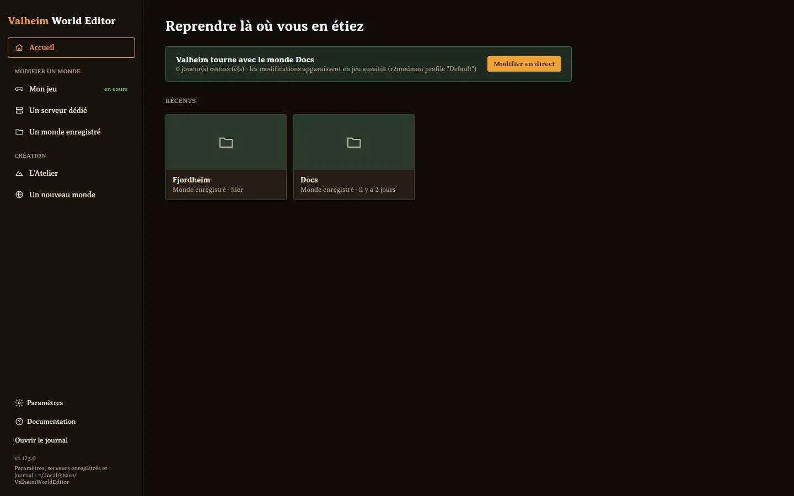
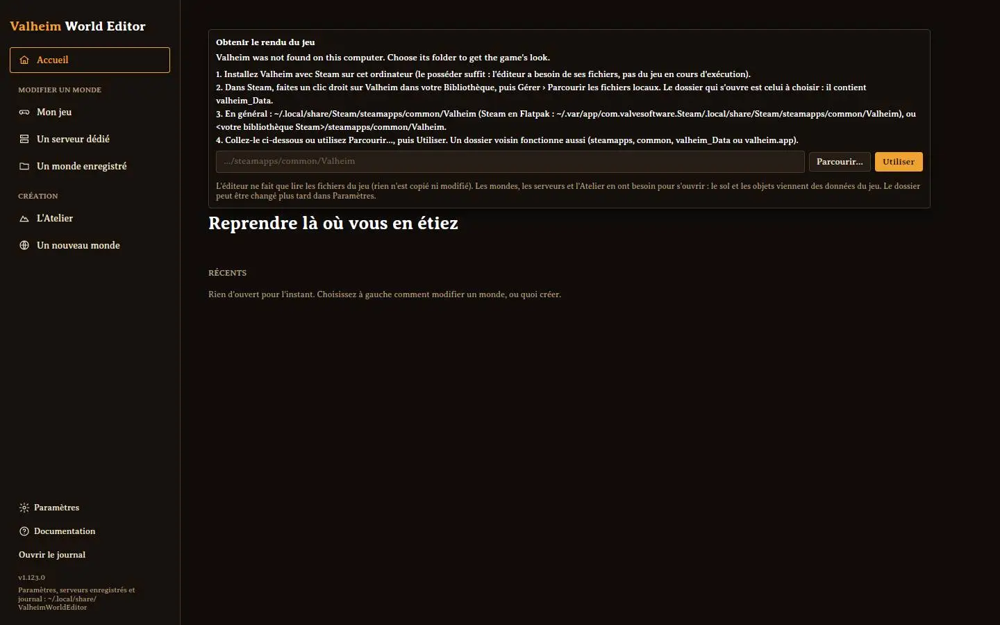
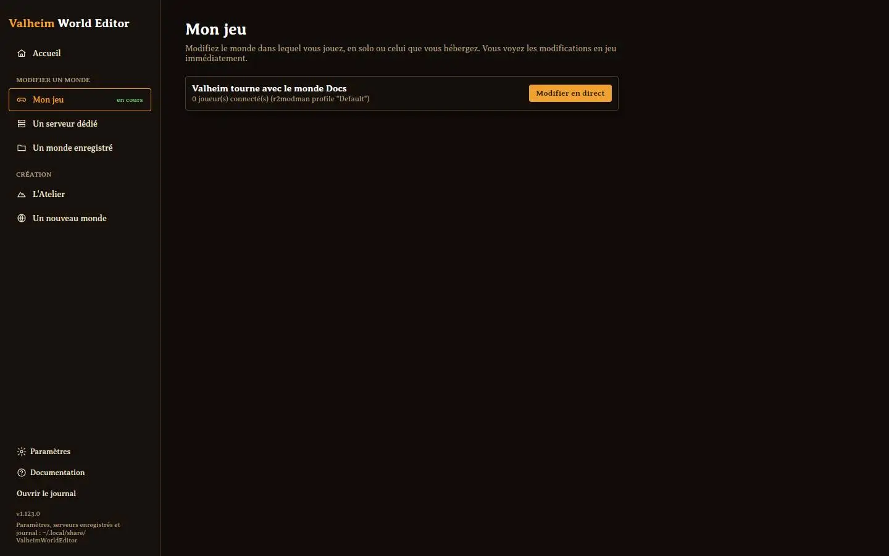
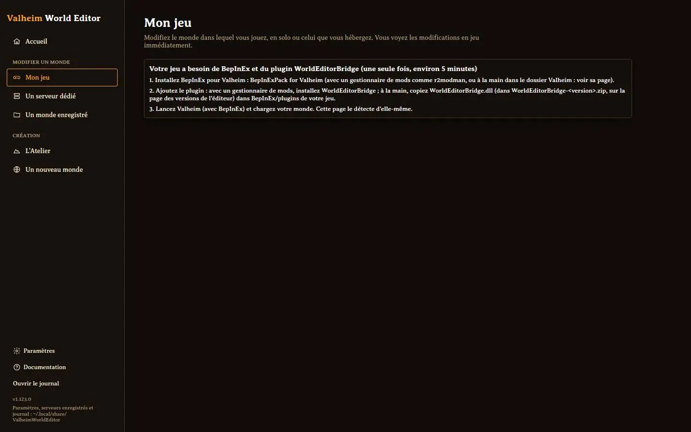

<!-- source: 68ffaeda -->
# Installer l'éditeur

Téléchargez l'éditeur, lancez-le et laissez-le trouver votre Valheim. À la fin, l'éditeur est ouvert sur sa page
d'accueil et a lu les fichiers du jeu, prêt pour [votre première modification](first-edit.md).

## Ce qu'il vous faut

- **Windows 10 ou 11**, ou **Linux**, 64 bits ; ou **macOS 12 ou plus récent sur un Mac à puce Apple** (M1 et
  suivants). La version Mac est expérimentale : elle n'a encore jamais été essayée sur un Mac, et les Mac Intel ne sont
  pas pris en charge.
- **Valheim**, installé via Steam sur le même ordinateur. Le posséder suffit : l'éditeur lit les fichiers du jeu (ses
  textures, modèles, terrain et carte), il n'a pas besoin que le jeu tourne. Rien n'est copié ni modifié.

Vous n'avez rien d'autre à installer. Tout ce dont l'éditeur a besoin est dans le téléchargement.

## Télécharger

1. Ouvrez la [page des versions](https://github.com/Shuiei/valheim-world-editor/releases/latest).
2. Téléchargez le fichier pour votre ordinateur :
   - Windows : `ValheimWorldEditor-v<version>-win-x64.zip`
   - Linux : `ValheimWorldEditor-v<version>-linux-x64.tar.gz`
   - macOS : `ValheimWorldEditor-v<version>-macos-arm64-experimental.zip`

L'éditeur est aussi sur [Nexus Mods](https://www.nexusmods.com/valheim/mods/4348). L'éditeur est un programme, pas un
mod : Thunderstore et Hexium ne proposent que son plugin (voir
[Le plugin pour la modification en direct](#le-plugin-pour-la-modification-en-direct)).

## Le lancer sous Windows

1. Décompressez le téléchargement n'importe où, par exemple sur le Bureau. Gardez ses fichiers ensemble :
   `ValheimWorldEditor.exe` a besoin des fichiers `.dll` posés à côté. Ne le lancez pas depuis l'intérieur du zip.
2. Double-cliquez sur `ValheimWorldEditor.exe`.
3. Si Windows affiche « Windows a protégé votre ordinateur », cliquez sur **Informations complémentaires** (cela
   nomme l'éditeur du logiciel), puis sur **Exécuter quand même**. Windows le demande tant que SmartScreen ne connaît
   pas la signature de l'éditeur.

<!-- picture: install-smartscreen.jpg: Windows 11, the blue "Windows protected your PC" dialog after More info was clicked, the publisher line and the Run anyway button visible, nothing else on screen -->

## Le lancer sous Linux

1. Décompressez le téléchargement n'importe où, par exemple dans votre dossier personnel.
2. Double-cliquez sur `ValheimWorldEditor` dans le dossier. Si votre gestionnaire de fichiers l'ouvre comme du texte ou
   demande quoi faire, choisissez **Exécuter** (ou clic droit, **Exécuter comme un programme**). Depuis un terminal :
   `./ValheimWorldEditor`.

L'éditeur dessine avec OpenGL 3.3, que gère tout pilote graphique des dix dernières années (Mesa, AMD, NVIDIA, Intel).

## Le lancer sous macOS (expérimental)

1. Décompressez le téléchargement et déplacez **ValheimWorldEditor.app** où vous voulez, par exemple dans
   Applications.
2. Double-cliquez dessus une fois. macOS refuse de l'ouvrir, parce que l'éditeur n'est pas signé avec un certificat
   Apple Developer. Fermez le message.
3. Ouvrez **Réglages Système › Confidentialité et sécurité**, faites défiler jusqu'à **Sécurité**, cliquez sur
   **Ouvrir quand même** à côté de ValheimWorldEditor, et confirmez avec votre mot de passe.
4. Double-cliquez à nouveau sur l'application. Désormais, elle s'ouvre d'un double-clic.

Au lieu des étapes 2 et 3, vous pouvez exécuter dans le Terminal :
`xattr -dr com.apple.quarantine /Applications/ValheimWorldEditor.app` (avec le chemin où vous l'avez placée).

Sur Mac, `Cmd` fonctionne partout où la documentation indique `Ctrl` : `Cmd+Z` annule, `Cmd`+clic ajoute à une
sélection. Le terrain du jeu est dessiné avec le shader propre au jeu quand la version Mac du jeu en fournit un que
l'éditeur sait lire, sinon en couleurs simples. Si quelque chose ne fonctionne pas,
[ouvrez un ticket](https://github.com/Shuiei/valheim-world-editor/issues) avec le journal de l'éditeur (**Ouvrir le
journal** sur la page d'accueil).

## Le premier lancement

L'éditeur s'ouvre dans sa propre fenêtre, sur **Accueil** de la page d'accueil. La première fois, et après chaque mise
à jour de Valheim, une carte indique **Préparation du rendu du jeu** pendant que l'éditeur lit les fichiers du jeu
quelques secondes. Les mondes, les serveurs et l'Atelier s'ouvrent dès qu'elle indique **Le rendu du jeu est prêt.**

*La page d'accueil : le menu latéral à gauche, Accueil à droite. Une fois un monde ouvert, il apparaît sous Récents.*

## Quand Valheim est introuvable

L'éditeur cherche de lui-même dans chaque bibliothèque Steam (Steam en Flatpak aussi). S'il ne trouve pas le jeu, la
carte indique **Obtenir le rendu du jeu** et « Valheim est introuvable sur cet ordinateur. »

*Les étapes de la carte disent où trouver le dossier ; collez-le dans la case (ou **Parcourir…**), puis **Utiliser**.*

1. Dans Steam, faites un clic droit sur Valheim dans votre Bibliothèque, puis **Gérer › Parcourir les fichiers
   locaux**. Le dossier qui s'ouvre est celui à choisir : il contient `valheim_Data` (`valheim.app` sur Mac).
2. Copiez son chemin, collez-le dans la case de la carte (ou cliquez sur **Parcourir…** et choisissez-le), puis cliquez
   sur **Utiliser**.

Les emplacements habituels sont :

- Windows : `C:\Program Files (x86)\Steam\steamapps\common\Valheim`
- Linux : `~/.local/share/Steam/steamapps/common/Valheim` (Steam en Flatpak :
  `~/.var/app/com.valvesoftware.Steam/.local/share/Steam/steamapps/common/Valheim`)
- macOS : `~/Library/Application Support/Steam/steamapps/common/Valheim`
- Une autre bibliothèque Steam : `<library>/steamapps/common/Valheim`

Un dossier voisin fonctionne aussi (`steamapps`, `common`, `valheim_Data` ou `valheim.app`) : l'éditeur en déduit le
dossier du jeu. Vous pouvez le changer plus tard dans **Paramètres** (**Dossier du jeu Valheim**), voir
[Paramètres](../editor-basics.md#paramètres).

## Le plugin pour la modification en direct

Pour modifier un monde pendant que le jeu tourne (votre propre partie, ou un serveur dédié pendant que d'autres
jouent), le jeu qui héberge le monde a besoin de **BepInEx** et du plugin **WorldEditorBridge** de l'éditeur. Les
joueurs qui rejoignent n'ont besoin ni de l'un ni de l'autre, joueurs sur console compris. Pour modifier des mondes
enregistrés jeu fermé, ou pour construire dans l'Atelier, vous n'avez besoin ni de l'un ni de l'autre.

Pour votre propre partie :

1. Installez BepInEx une fois : [BepInExPack for Valheim](https://thunderstore.io/c/valheim/p/denikson/BepInExPack_Valheim/),
   avec un gestionnaire de mods (r2modman, Thunderstore Mod Manager) ou à la main dans le dossier de Valheim, en suivant
   sa page.
2. Ajoutez le plugin. Avec un gestionnaire de mods, installez WorldEditorBridge depuis
   [Thunderstore](https://thunderstore.io/c/valheim/p/Tie/WorldEditorBridge/) ou
   [Hexium](https://valheim.hexium.gg/mods/Tie/WorldEditorBridge) (BepInEx vient avec). À la main, copiez
   `WorldEditorBridge.dll` depuis `WorldEditorBridge-<version>.zip` (sur la
   [page des versions](https://github.com/Shuiei/valheim-world-editor/releases/latest) ou
   [Nexus Mods](https://www.nexusmods.com/valheim/mods/4348)) dans `BepInEx/plugins` de votre Valheim. Utilisez la
   même version que l'éditeur.
3. Lancez Valheim avec BepInEx et chargez votre monde (en solo, ou un serveur que vous lancez depuis le jeu). À ce
   premier lancement, le plugin écrit ses réglages, `BepInEx/config/Tie.WorldEditorBridge.cfg`, avec un **jeton**
   aléatoire.
4. Sur la page d'accueil de l'éditeur, **Accueil** indique maintenant « Valheim tourne avec le monde … » et **Mon jeu**
   affiche *en cours*. L'éditeur trouve le plugin et son jeton de lui-même, profils de gestionnaire de mods compris.
   Cliquez sur **Modifier en direct**.

***Mon jeu** avec le jeu en cours : la carte nomme le monde, les joueurs connectés et l'endroit où le plugin a été
trouvé (ici un profil r2modman), avec **Modifier en direct**.*

Tant que le jeu ne tourne pas, **Mon jeu** dit ce qui manque, étape par étape.

***Mon jeu** avant l'installation de BepInEx : les trois étapes, à faire une seule fois. La page détecte le jeu
d'elle-même dès qu'il tourne.*

Suivez ensuite [Modifier le monde dans lequel vous jouez](../guides/edit-your-game-live.md).

Pour un **serveur dédié**, installez BepInEx (en suivant les instructions de BepInExPack pour les serveurs dédiés) et
copiez `WorldEditorBridge.dll` dans `BepInEx/plugins` du serveur (ou installez le plugin dans le profil serveur d'un
gestionnaire de mods), puis lancez le serveur une fois pour qu'il écrive son jeton. L'éditeur s'y connecte en SSH, par
son propre tunnel chiffré : le serveur doit donc vous donner un accès SSH à sa machine. Voir
[Modifier un serveur dédié pendant que d'autres jouent](../guides/edit-a-server-live.md). Un serveur de jeu loué chez
un hébergeur n'a souvent pas d'accès SSH : voir
[Modifier un serveur loué ou hébergé par un panneau](../guides/edit-a-rented-server.md).

## Modules complémentaires pour les mods

Certains mods de génération de monde et de construction ont besoin d'un **module complémentaire** pour que l'éditeur
dessine ou modifie ce qu'ils créent. Chacun se télécharge à part sur la
[page des versions](https://github.com/Shuiei/valheim-world-editor/releases/latest) :
`ValheimWorldEditor-addon-<Name>-<version>.zip`.

1. Décompressez le module complémentaire dans le dossier `addons` à côté de l'éditeur (sous macOS, à côté de
   `ValheimWorldEditor.app`).
2. Ouvrez **Paramètres** : sous **Modules complémentaires**, il liste le module et indique s'il est utilisé. Un module
   complémentaire est utilisé tant que son mod est dans vos dossiers de plugins BepInEx ; son interrupteur le désactive
   sans le retirer.

| Module complémentaire | Pour |
|---|---|
| [Expand World](../../../addons/ExpandWorld/README.md) | Les mondes créés avec les mods Expand World (Size, Rivers, Data). |
| [Riverheim](../../../addons/Riverheim/README.md) | Les mondes créés avec Riverheim. |
| [Tunnelheim](../../../addons/Tunnelheim/README.md) | Les tunnels que creuse Tunnelheim, et un outil Tunnel. |
| [Railroads](../../../addons/Railroads/README.md) | Les voies, gares et trains de Railroads. |
| [ValheimRAFT](../../../addons/ValheimRAFT/README.md) | Les navires et véhicules terrestres de ValheimRAFT, chacun déplacé, copié et supprimé d'un seul bloc. |

Un module complémentaire est du code qui s'exécute dans l'éditeur : n'installez que ceux en qui vous avez confiance.
Voir [Modifier un monde créé avec Expand World, Riverheim ou Tunnelheim](../guides/use-mods-worlds.md).

## Où l'éditeur range ses fichiers

Ses réglages, ses serveurs enregistrés (`servers.cfg`), ce qu'il retient d'une session à l'autre, l'index des fichiers
du jeu (`game-index.json`) et son journal (`ValheimWorldEditor.log`, un nouveau à chaque lancement) se trouvent dans :

- Windows : `%LOCALAPPDATA%\ValheimWorldEditor`
- Linux : `~/.local/share/ValheimWorldEditor`
- macOS : `~/Library/Application Support/ValheimWorldEditor`

Le bas du menu de la page d'accueil affiche ce dossier, et **Ouvrir le journal** ouvre le journal. Vos plans sont dans
le dossier de Homestead, voir [l'Atelier](../workshop.md).

## Et ensuite

[Votre première modification](first-edit.md) : sauvegardez un monde, élevez une colline, plantez des arbres,
enregistrez, et voyez le résultat en jeu.
