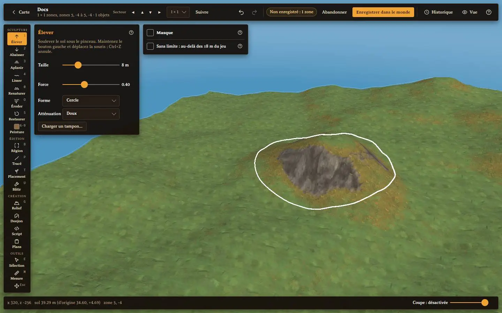
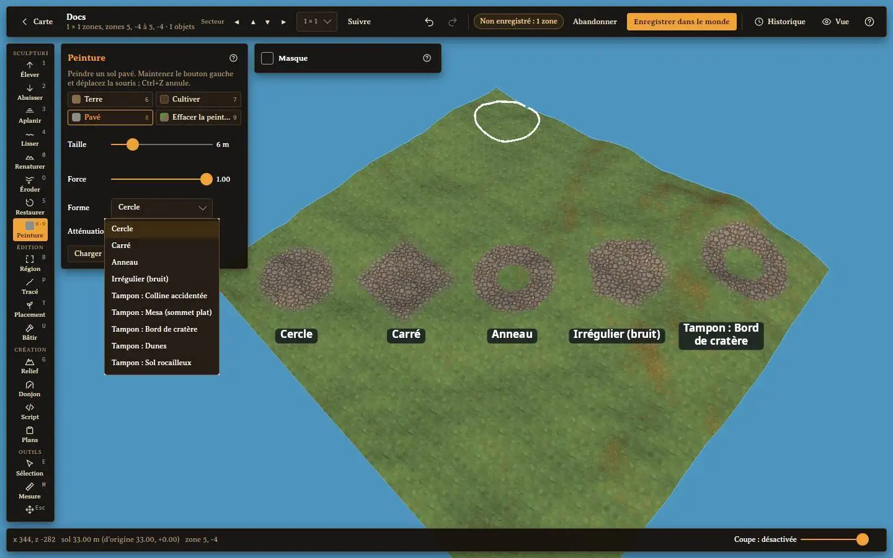
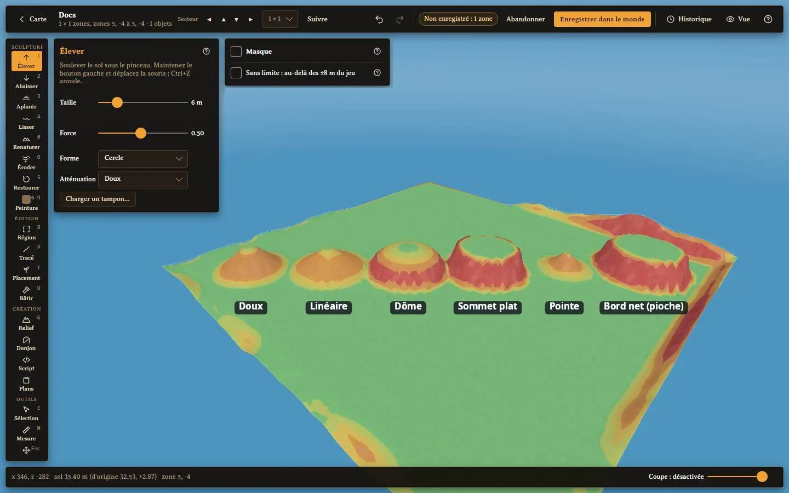
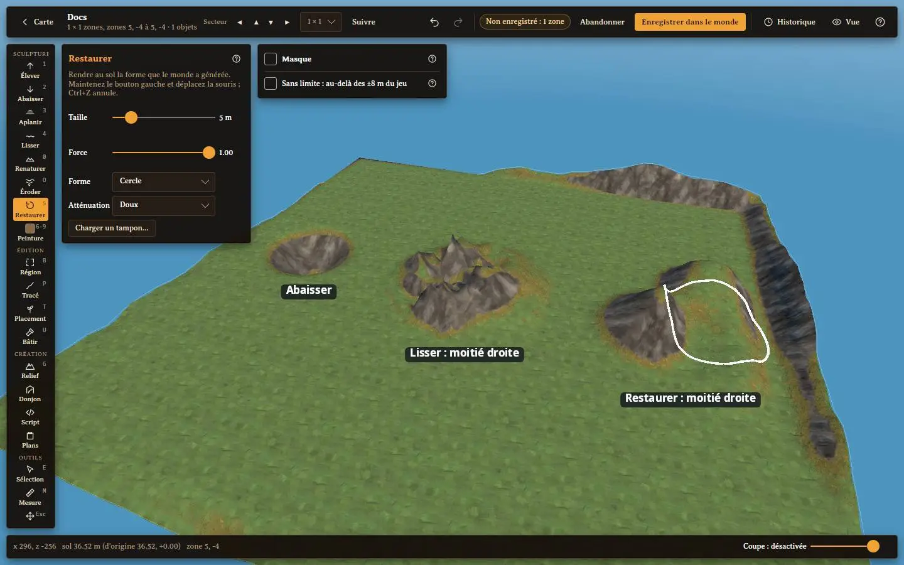
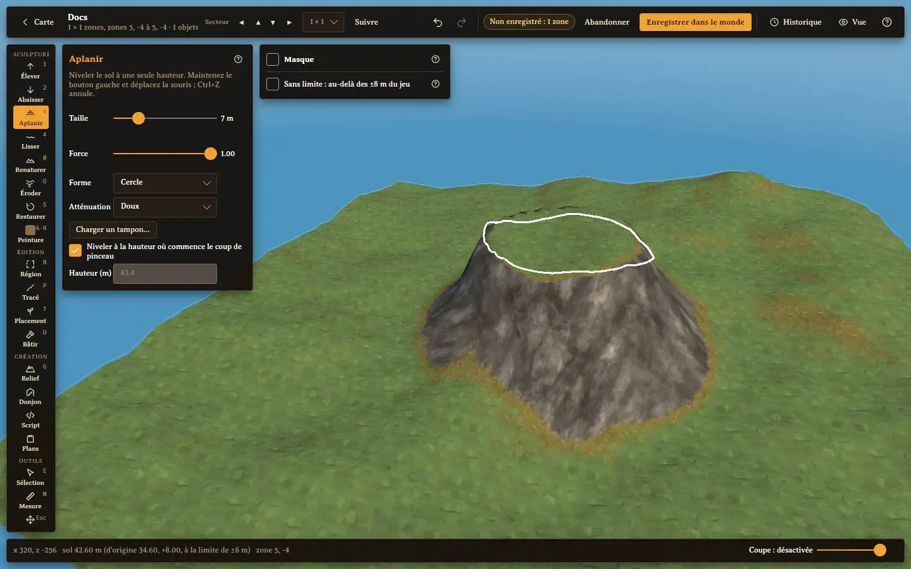
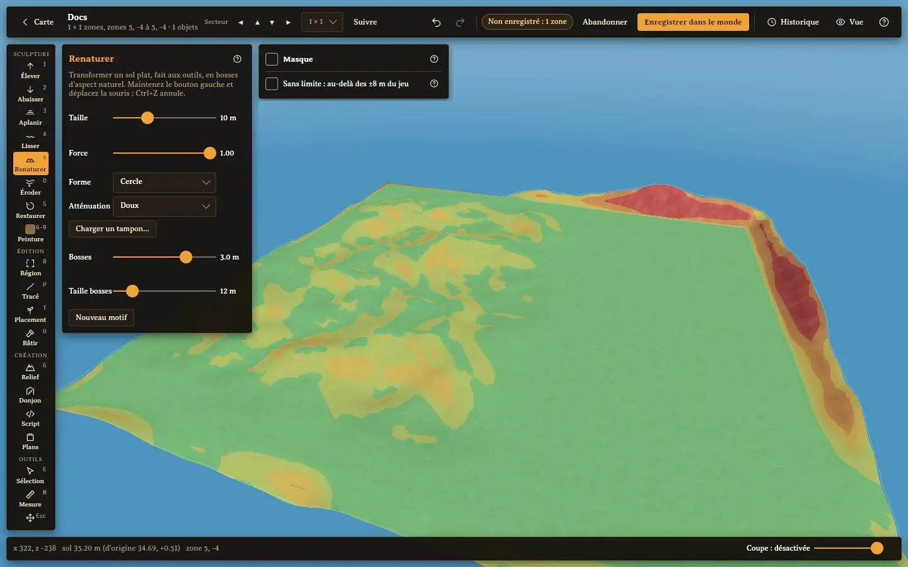
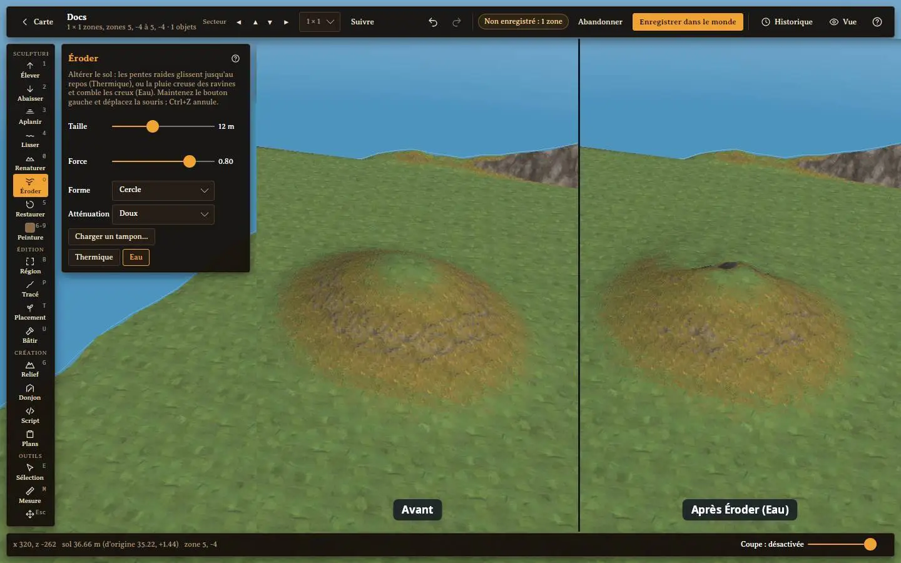
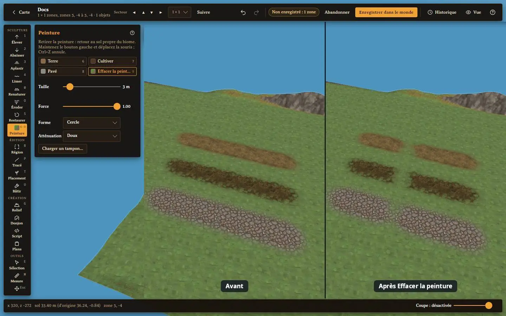
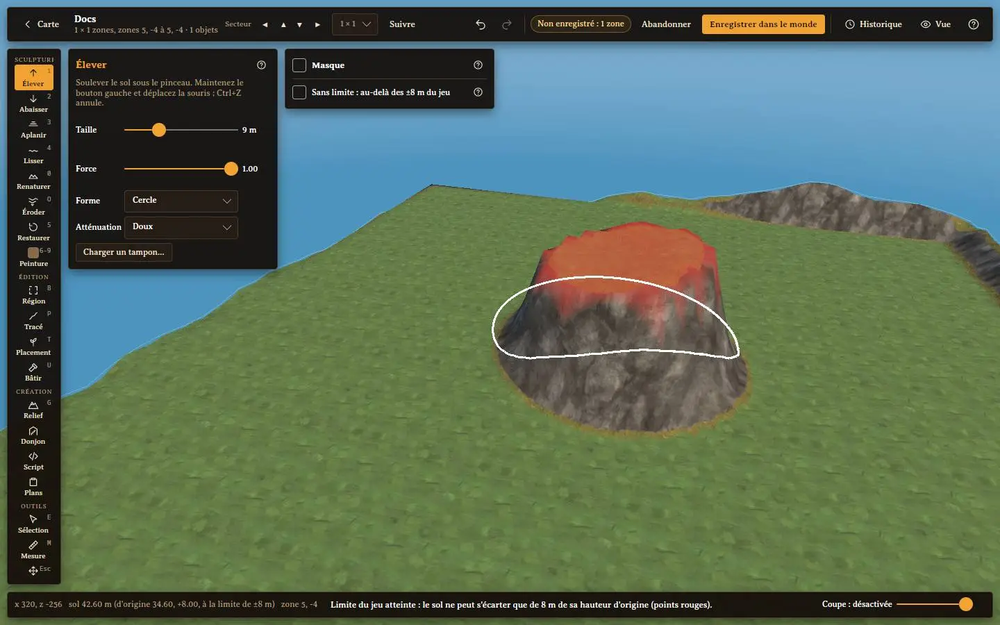
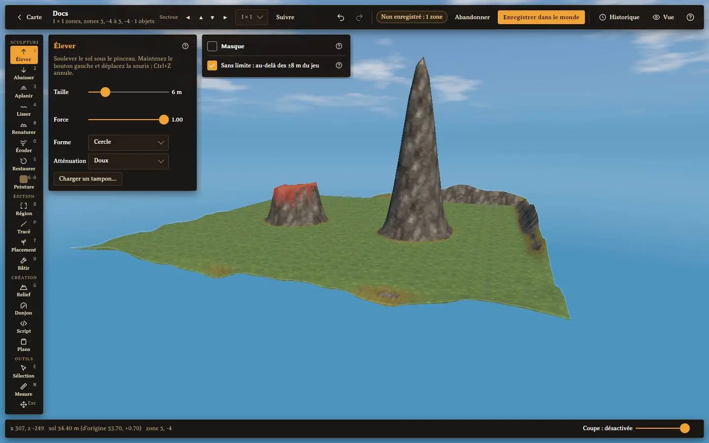

<!-- source: 9d7cf01c -->
# Sculpter et peindre

Élevez, abaissez, aplanissez, lissez et peignez le sol avec un pinceau que vous maintenez et faites glisser, comme avec
la houe, la pioche et le cultivateur du jeu, mais en plus rapide et en plus grand.

**Où :** barre d'outils, section **SCULPTURE** · **Touches :** `1` à `9`, `0`, `O` · **Fonctionne dans :** mondes
enregistrés, en direct

*Une butte faite de trois coups de pinceau Élever. L'anneau blanc à son sommet est le pinceau ; le panneau de gauche
contient ses réglages.*

Chaque modification suit les règles du jeu, si bien que le monde se charge dans le jeu de chaque joueur, joueurs sur
console compris, sans aucun mod. Chaque coup de pinceau est une étape d'annulation (`Ctrl+Z`).

## L'utiliser

1. Dans la barre d'outils, cliquez sur un pinceau de la section **SCULPTURE**, ou appuyez sur sa touche (voir
   [Raccourcis](#raccourcis)). Pour peindre, cliquez sur **Peinture** et choisissez la peinture dans son panneau (voir
   [Pinceau Peinture](#pinceau-peinture)).
2. Dans le panneau, réglez **Taille** et **Force**. `[` et `]` changent la taille en cours de travail.
3. Maintenez le bouton gauche de la souris sur le sol et déplacez-vous. Le pinceau agit tant que le bouton est enfoncé :
   rester immobile travaille donc le même endroit de plus en plus.
4. Relâchez. Tout le coup de pinceau forme une étape d'annulation, au nom du pinceau (« Élever »).
5. Pour conserver la modification, **Enregistrer dans le monde** (ou **Appliquer en direct** en
   [mode direct](live-mode.md)). Jusque-là, elle est
   [en attente](concepts/saving-and-history.md#modifications-en-attente).

L'anneau sur le sol épouse les reliefs en dessous et montre la forme du pinceau : un carré ou un tampon montre son
contour tourné, la forme Anneau un second contour, intérieur.

## Réglages

Le panneau affiche les réglages communs à tous les pinceaux, puis ceux du pinceau choisi. La forme et l'atténuation
sont retenues.

| Réglage | Ce qu'il fait |
|---|---|
| **Taille** | Le rayon du pinceau, de 1 à 30 m (pour un carré, la moitié de son côté). 6 m par défaut. |
| **Force** | La vitesse à laquelle le pinceau agit, de 0.05 à 1 (0.40 par défaut). |
| **Forme** | **Cercle**, **Carré**, **Anneau**, **Irrégulier (bruit)**, ou une image (**Tampon : …**, voir [Tampons](#tampons)). |
| **Atténuation** | Comment l'effet diminue du centre vers le bord (ci-dessous). Masqué pour les tampons : une image a sa propre atténuation. |
| **Tourner** | **Carré** et tampons seulement : tourne le pinceau, de -180° à 180°. |
| **Charger un tampon…** / **Oublier le tampon** | Ajoute une image comme forme de pinceau, ou retire une image que vous avez ajoutée (voir [Tampons](#tampons)). |
| Réglages d'Aplanir, Renaturer, Éroder | Affichés seulement pour ce pinceau (voir [Pinceaux de sculpture](#pinceaux-de-sculpture)). |

Deux réglages valent pour tous les outils de sol, pas seulement les pinceaux : ils sont donc sur la fiche **Masque** à
côté du panneau. Le [Masque](masks.md) lui-même, et **Sans limite : au-delà des ±8 m du jeu** en dessous (voir
[Sans limite](#sans-limite)).

### Formes

| Forme | Ce qu'elle couvre |
|---|---|
| **Cercle** | Un pinceau rond. |
| **Carré** | Un carré aussi large que le pinceau. Il tourne avec **Tourner**. |
| **Anneau** | Seulement une bande : rien à l'intérieur de 40 % de la taille, pleine force à 70 %, rien au bord. Pour les bords de cratère, les douves et les murs de terre. |
| **Irrégulier (bruit)** | Un pinceau rond dont le bord avance et recule jusqu'à un tiers de la taille. Le motif est fixé au monde : deux coups de pinceau au même endroit ont le même bord. |

*Une touche de peinture Pavé par forme, chacune légendée : Cercle, Carré, Anneau, Irrégulier (bruit) et le tampon
Bord de cratère. La liste Forme est ouverte dans le panneau.*

### Atténuations

| Atténuation | Comment elle diminue | Idéale pour |
|---|---|---|
| **Doux** (par défaut) | Une courbe en S : douce au centre et au bord. | La plupart des travaux. |
| **Linéaire** | Régulièrement du centre vers le bord. | Les cônes, les pentes régulières. |
| **Dôme** | Reste forte loin du centre, puis chute vite près du bord. | Les collines rondes au pied raide. |
| **Sommet plat** | Pleine force sur les 80 % intérieurs, ne diminue que dans le cinquième extérieur. | Les plateformes, les terrasses, les collines au sommet plat. |
| **Pointe** | Forte seulement près du centre. | Les flèches et les fosses. |
| **Bord net (pioche)** | Pleine force jusqu'au bord, rien au-delà. | Les parois raides et les coupes droites. |

*Le même coup de pinceau Élever avec chaque atténuation, légendée : Doux, Linéaire, Dôme, Sommet plat, Pointe, Bord net
(pioche). Les couleurs de pente sont activées : plus le flanc est raide, plus il est rouge.*

## Pinceaux de sculpture

| Pinceau (libellé de la barre) | Touche | Ce qu'il fait |
|---|---|---|
| **Élever** | `1` | Soulève le sol tant que vous maintenez le bouton. |
| **Abaisser** | `2` | Creuse le sol. |
| **Aplanir** | `3` | Met le sol à niveau à une hauteur : le sol plus bas est élevé, le sol plus haut est entaillé. |
| **Lisser** | `4` | Atténue les bosses et les arêtes vives. Repassez au même endroit pour un effet plus fort. |
| **Renaturer** | `0` | Transforme un sol plat, façonné par les outils, en bosses d'aspect naturel. |
| **Éroder** | `O` | Altère le sol : les pentes raides glissent vers le bas, ou la pluie creuse des ravines. |
| **Restaurer** | `5` | Ramène le sol tel que le monde l'a généré, et retire la peinture. |

*Légendés depuis la gauche : une fosse creusée avec Abaisser ; une butte brute dont Lisser a adouci la moitié droite ;
une butte élevée dont Restaurer a ramené la moitié droite au sol généré, avec l'anneau du pinceau dessus.*

Aplanir, Lisser, Renaturer et Restaurer ne dépassent jamais leur but : à chaque instant, ils déplacent le sol d'une
partie du chemin vers leur objectif, si bien que maintenir plus longtemps ne fait que s'en rapprocher.

Les outils [Région](area.md) et [Tracé](path.md) ont les mêmes actions sous les mêmes noms, appliquées en une fois à
une sélection ou le long d'une ligne au lieu de sous un pinceau maintenu. (Région présente Restaurer sous le nom
**Revenir au sol généré**, dans son groupe **Récupérer**.) Ils modifient le sol de la même façon : un **Lisser** y
rapproche chaque point de la moyenne du sol dans un rayon de 3 m, à peu près ce que fait le pinceau Lisser maintenu
une seconde ou deux au même endroit à la force par défaut.

### Aplanir

*Un seul coup d'Aplanir commencé au sommet de la butte l'a mis à niveau. **Niveler à la hauteur où commence le coup de
pinceau** est activé : **Hauteur (m)** est donc grisé et affiche la hauteur prise, 43.4 m.*

| Réglage | Ce qu'il fait |
|---|---|
| **Niveler à la hauteur où commence le coup de pinceau** | Activé (par défaut) : le sol où vous appuyez sur le bouton fixe la hauteur pour tout le coup de pinceau. **Hauteur (m)** l'affiche. |
| **Hauteur (m)** | Utilisée quand l'option ci-dessus est désactivée : chaque coup de pinceau met le sol à cette hauteur. |

Pour aplanir à une hauteur de votre choix, faites `Alt`+clic sur le sol avec n'importe quel pinceau : l'éditeur passe à
**Aplanir**, désactive l'option ci-dessus et met cette hauteur dans **Hauteur (m)**. Servez-vous-en pour faire
correspondre plusieurs plateformes, ou pour aplanir un terrain à la hauteur d'une porte déjà construite.

### Renaturer

| Réglage | Ce qu'il fait |
|---|---|
| **Bosses** | La hauteur des bosses, de 0.2 à 4 m (1.2 m par défaut). |
| **Taille bosses** | Leur largeur, de 4 à 60 m (16 m par défaut) : les petites valeurs donnent un sol accidenté, les grandes de douces ondulations. |
| **Nouveau motif** | Un nouveau motif de bosses aléatoire pour le prochain Renaturer (ce pinceau, celui de l'outil Région ou de l'outil Tracé) et pour les tracés avec Aspect naturel. Le bord de la forme **Irrégulier (bruit)** et le bruit des formules de [Relief](landform.md#écrire-une-formule) viennent du même motif : ils changent donc aussi. |

Un second coup de pinceau au même endroit n'empile pas davantage de bosses. Le motif est fixé au monde : des coups de
pinceau voisins se raccordent sans jointure. Le **Renaturer** et l'**Aspect naturel (bords irréguliers, bosses)** de
l'outil [Tracé](path.md) et le **Renaturer** de l'outil [Région](area.md) utilisent les mêmes réglages et le même motif,
et les affichent dans leurs propres panneaux : une valeur réglée dans l'un l'est dans les trois.

*Un sol aplani avec les couleurs de pente activées. La moitié gauche a été renaturée (Bosses 3 m, Taille bosses
12 m) : ses bosses apparaissent en taches jaunes. La moitié droite reste plate et uniformément verte.*

### Éroder

| Réglage | Ce qu'il fait |
|---|---|
| **Thermique** | Le sol plus raide que l'**Angle de repos** glisse vers ses voisins plus bas jusqu'à se stabiliser : éboulis au pied des falaises, parois façonnées par les outils adoucies. Le sol est seulement déplacé, jamais perdu. |
| **Eau** | La pluie : des gouttes tombent sous le pinceau, ruissellent vers le bas, emportent du sol là où elles vont vite et le déposent là où elles ralentissent. Beaucoup de gouttes creusent des ravines, laissent des cônes de matériaux au pied des pentes et adoucissent le fond des vallées. La **Force** règle le nombre de gouttes. |
| **Angle de repos** | **Thermique** seulement : la pente la plus raide qui tient, de 10° à 60° (33° par défaut). Des valeurs plus basses aplanissent davantage. |

Le matériau qui glisse ou ruisselle hors du pinceau peut retomber juste à côté. L'**Éroder** des outils
[Région](area.md) et [Tracé](path.md) fait les deux à la fois, sur toute une sélection ou le long d'une ligne, avec cet
**Angle de repos** (leurs panneaux l'affichent aussi).

*La même butte, de la même caméra. À gauche : telle qu'elle a été élevée. À droite : après deux secondes d'Éroder
(Eau) : la pluie a usé son sommet et strié ses flancs de petites ravines.*

### Restaurer

**Restaurer** retire vos modifications un peu à chaque instant, jusqu'à ce que le sol soit tel que le monde l'a
généré. Il ramène aussi le sol élevé ou creusé avec [Sans limite](#sans-limite), enregistré ou non : l'enregistrement
suivant retire les disques de sol dont il n'a plus besoin. Il ne retire la peinture que dans la partie intérieure du
pinceau, pour que le bord de la peinture reste net.

## Pinceau Peinture

**Peinture**, le dernier bouton de la section **SCULPTURE** de la barre, est un seul pinceau pour les quatre peintures.
Son panneau les montre sous forme de quatre échantillons : cliquez sur l'un d'eux pour peindre avec. L'échantillon
choisi est entouré, et le bouton de la barre prend sa couleur.

| Peinture | Touche | Ce qu'elle fait |
|---|---|---|
| **Terre** | `6` | De la terre nue, comme un chemin battu. |
| **Cultiver** | `7` | De la terre cultivée, comme celle du cultivateur. En jeu, les cultures ne se plantent que dessus. |
| **Pavé** | `8` | Un sol de pierre pavée. |
| **Effacer la peinture** | `9` | Peint le sol ordinaire du biome. |

Chaque touche choisit le pinceau Peinture avec cette peinture, depuis n'importe quel outil. Le bouton de la barre
revient avec la dernière peinture utilisée (Terre au départ).

Peinture utilise les mêmes Taille, Force, Forme, Atténuation et Masque que les pinceaux de sculpture. Elle change
l'aspect du sol et ce qui y pousse, jamais sa hauteur. Un coup léger ou le bord doux du pinceau donne un mélange ;
maintenez plus longtemps pour la couleur pleine.

**Effacer la peinture ou Restaurer ?** **Effacer la peinture** peint le sol ordinaire du biome par-dessus tout : elle
cache donc aussi la terre que le monde a générée à cet endroit. **Restaurer** retire votre peinture : le sol montre à
nouveau ce que le monde a généré.

*À gauche : des bandes pavée, cultivée et de terre. À droite : les mêmes bandes après un coup d'Effacer la peinture en
travers des trois (le panneau Peinture à gauche).*

## Tampons

Un tampon est une image utilisée comme forme de pinceau : les parties blanches agissent pleinement, les parties grises
en partie, les parties noires pas du tout. Choisissez-en un dans **Forme**, où les tampons sont listés sous la forme
**Tampon : …**. Un tampon couvre un carré deux fois plus large que la **Taille** et tourne avec **Tourner**. Il
fonctionne avec chaque pinceau de sculpture et avec Peinture.

| Tampon | Forme |
|---|---|
| **Colline accidentée** | Un petit sommet aux flancs accidentés. |
| **Mesa (sommet plat)** | Un sommet plat aux flancs raides, légèrement irréguliers. |
| **Bord de cratère** | Un mur en anneau, pour les cratères (abaissez l'intérieur ensuite) et les vieux terrassements. |
| **Dunes** | Des crêtes parallèles dans une tache ronde. |
| **Sol rocailleux** | Un sol bosselé et accidenté. |

| Réglage | Ce qu'il fait |
|---|---|
| **Charger un tampon…** | Utilise n'importe quelle image (PNG, JPEG…) comme tampon : une carte des hauteurs d'un autre outil, un logo, une forme dessinée à la main. Sa luminosité est la force ; les parties transparentes comptent comme du noir. Elle est mise à l'échelle sur un carré de 128 × 128 points : une image large est donc écrasée et les détails fins sont perdus. Elle est conservée pour la prochaine fois sous son nom de fichier. |
| **Oublier le tampon** | Retire l'image chargée choisie dans **Forme**. Affiché seulement pour les images chargées : les tampons intégrés restent. |

**Pour mettre toute une image dans le sol en un clic**, à une hauteur que vous fixez, utilisez le type **Image** de
l'outil [Relief](landform.md#image) au lieu d'un pinceau : il propose les mêmes images, et celles que vous chargez
ici.

## Sans limite

Le jeu garde chaque modification du sol à moins de 8 m du sol qu'il a généré. Un pinceau s'arrête là, teinte le point
en rouge, et la barre d'état indique « Limite du jeu atteinte : le sol ne peut s'écarter que de 8 m de sa hauteur
d'origine (points rouges). » Voir [La limite de 8 m du jeu](concepts/ground-limits.md#la-limite-de-8-m-du-jeu).

*Élever maintenu jusqu'à ce que le sol s'arrête 8 m plus haut. Avec **Marques de limite** activé, son sommet est teinté
de rouge ; la barre d'état affiche le message et la lecture sous le curseur se termine par « à la limite de ±8 m ».*

**Sans limite : au-delà des ±8 m du jeu**, sur la fiche **Masque** à côté du panneau de l'outil (sous le Masque),
permet aux outils de sol d'aller jusqu'à 400 m du sol généré : falaises, canyons, flèches, fosses profondes. C'est un
seul interrupteur pour tous les outils qu'il gouverne, et la fiche l'affiche avec chacun d'eux : chaque pinceau de
sculpture, [Relief](landform.md) (ses types **Formule** et **Image**), [Tracé](path.md) et [Région](area.md) (y compris
ses imports de cartes des hauteurs). Il reste activé pour tous les outils jusqu'à ce que vous le désactiviez, et il est
désactivé à chaque démarrage de l'éditeur. Le type **Montagne** de Relief et le collage d'un endroit copié dépassent
toujours la limite.

> [!IMPORTANT]
> Enregistrer du sol Sans limite relit le secteur depuis le monde et **efface son Historique** : vous ne pouvez pas
> annuler au-delà de cet enregistrement. Vérifiez la forme avant d'enregistrer.

*Le même coup d'Élever avec Sans limite désactivé (à gauche : arrêté à 8 m, son sommet rouge) et activé (à droite :
bien plus haut). L'interrupteur est sur la fiche Masque, coché comme pour celui de droite.*

À l'enregistrement, le sol au-delà de ±8 m devient des disques de sol invisibles que le jeu de chaque joueur construit
de la même façon. Le message d'enregistrement indique combien de disques ont été créés et combien d'arbres et de
rochers ont été retirés, par exemple « Sol Sans limite : 312 disque(s) de sol, 40 arbre(s)/rocher(s) retiré(s) ; une
partie du sol s'écarte jusqu'à 2.5 m (trop raide) ». Comment cela fonctionne et ce que cela change en jeu :
[Sans limite](concepts/ground-limits.md#sans-limite).

Après l'enregistrement :

- Les arbres, rochers, minerais, buissons et ramassables là où le sol a bougé de plus de 2 m ont disparu (ils seraient
  enterrés ou flotteraient). Les pièces de construction restent.
- Le nouveau sol compte comme du sol généré : la houe et la pioche du jeu agissent à ±8 m de lui. Pour retirer une
  forme enregistrée, **Restaurez**-la (retour au sol généré par le monde), ou retravaillez-la vers le bas avec Sans
  limite activé.
- Les parois très raides ressortent un peu plus douces que dessinées.
- Les zones qu'aucun joueur n'a encore visitées gardent leur ancien sol ; le message indique combien. Visitez-les
  d'abord en jeu.
- La carte du jeu ne montre pas la nouvelle forme.

## Raccourcis

| Touche ou souris | Ce qu'elle fait |
|---|---|
| `1` `2` `3` `4` `0` `O` `5` | Élever, Abaisser, Aplanir, Lisser, Renaturer, Éroder, Restaurer. |
| `6` `7` `8` `9` | Le pinceau Peinture avec Terre, Cultiver, Pavé, Effacer la peinture. |
| `[` / `]` | Taille du pinceau 1 m plus petite / plus grande. |
| Maintenir le bouton gauche et glisser | Travailler le sol. |
| `Alt`+clic | Prendre la hauteur à cet endroit : passe à Aplanir à cette hauteur. |
| `Alt`+`Shift`+clic | Activer le [Masque](masks.md) de 2 m sous ce point à 2 m au-dessus (avec l'outil Tracé aussi). |
| Glisser avec le bouton du milieu | Faire glisser la vue (même avec un pinceau choisi). |
| `Ctrl+Z` | Annuler le dernier coup de pinceau. |
| `Esc` | Quitter le pinceau (retour à Vue). |

Toutes les touches de l'éditeur : [Raccourcis](help/shortcuts.md).

## Astuces et limites

- **Lisez le sol sous le curseur** dans la barre d'état : `sol 41.20 m (d'origine 35.00, +6.20)`. Elle ajoute « à la
  limite de ±8 m » quand le point y est. La mer est à 30 m.
- **La rangée de points la plus extérieure du secteur ne change jamais**, pour que le secteur se raccorde au terrain
  alentour. Pour travailler à cet endroit, déplacez ou agrandissez le secteur : voir
  [Le bord verrouillé](concepts/areas-and-zones.md#le-bord-verrouillé).
- **Le sol a une hauteur par mètre.** Une paroi s'étend donc toujours sur environ un mètre et le sol ne peut pas former
  de surplomb (un mod comme Tunnelheim creuse de vrais tunnels : voir
  [Modifier un monde créé avec Expand World, Riverheim ou Tunnelheim](guides/use-mods-worlds.md)). Un bord tracé du
  nord-est au sud-ouest montre une petite dent de scie, en jeu aussi.
- **Les villages, le marchand et les entrées de donjon aplanissent le sol autour d'eux.** Vos modifications s'y
  ajoutent ; activez **Aplanissement des lieux** dans le panneau Vue pour voir où. Voir
  [Les lieux aplanissent le sol](concepts/ground-limits.md#les-lieux-aplanissent-le-sol).
- **Vitesse :** Élever et Abaisser déplacent le centre du pinceau d'environ 2,4 m par seconde à la Force par défaut,
  6 m par seconde à la Force 1.
- **Rien n'a changé ?** Le [Masque](masks.md) laisse peut-être de côté tout le sol sous le pinceau ; la barre d'état le
  signale.
- **Pour annuler une modification :** `Ctrl+Z` pour le dernier coup de pinceau, **Restaurer** pour un endroit,
  **Abandonner** pour tout ce qui n'est pas enregistré. Voir [Annuler des modifications](guides/undo-changes.md).

## Voir aussi

- [Élever ou creuser au-delà de la limite de 8 m du jeu](guides/raise-past-the-limit.md)
- [Dégager arbres et rochers, aplanir un terrain à bâtir](guides/clear-an-area.md)
- [Limites du sol](concepts/ground-limits.md)
- [Masque](masks.md), [Relief](landform.md)
- [Comment le sol est stocké](concepts/ground-limits.md#comment-le-sol-est-enregistré), [à quelle vitesse agit un pinceau](concepts/ground-limits.md#à-quelle-vitesse-travaille-un-pinceau)
