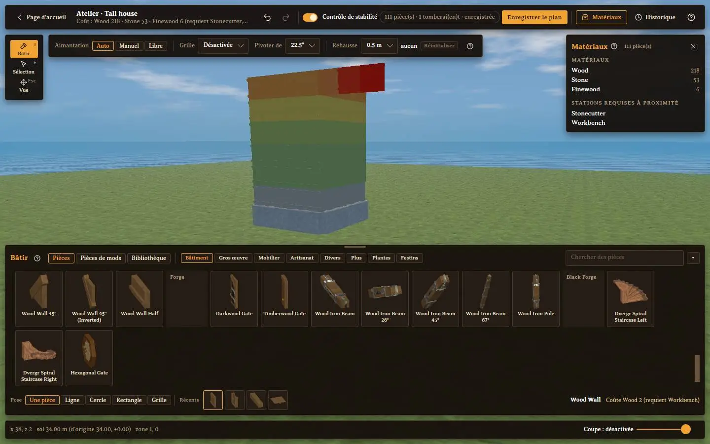
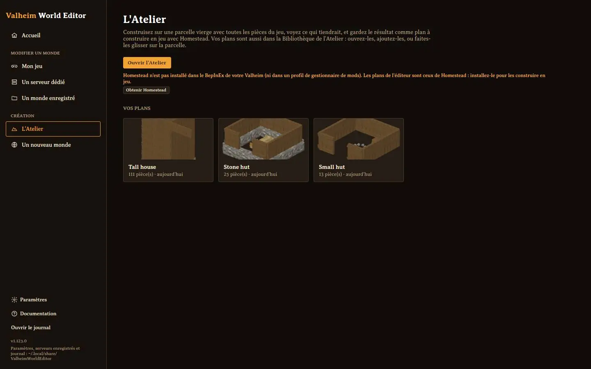
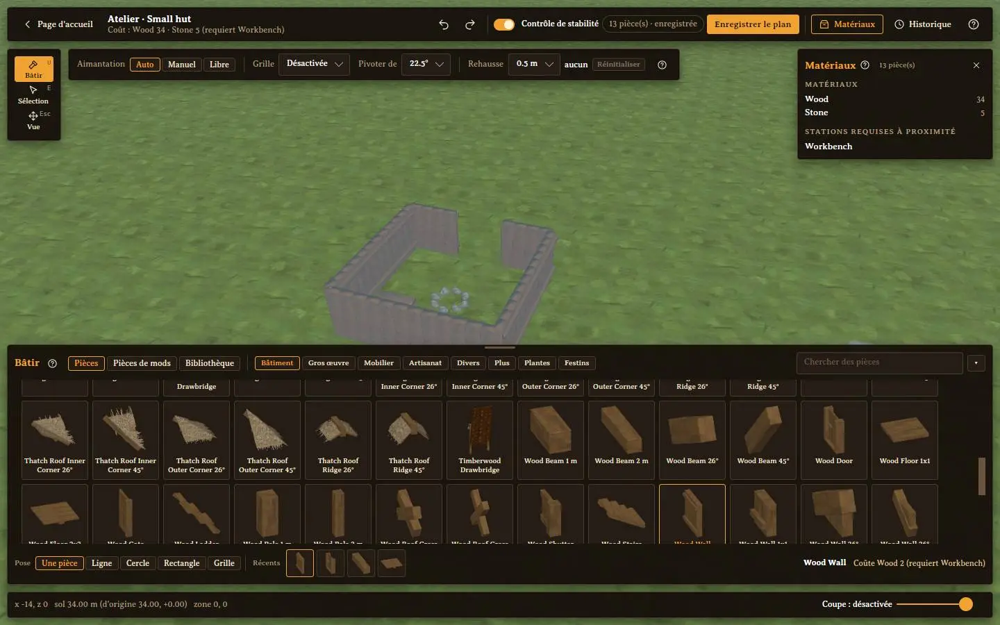
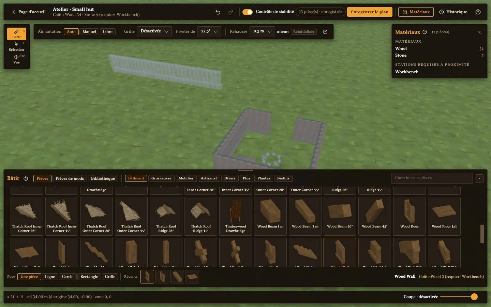
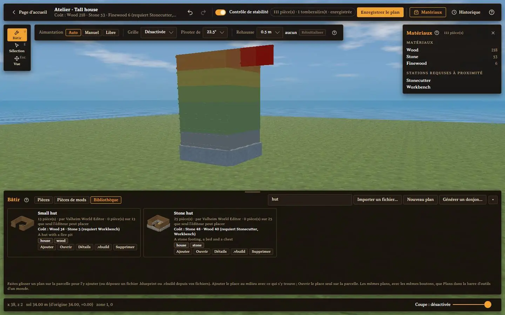
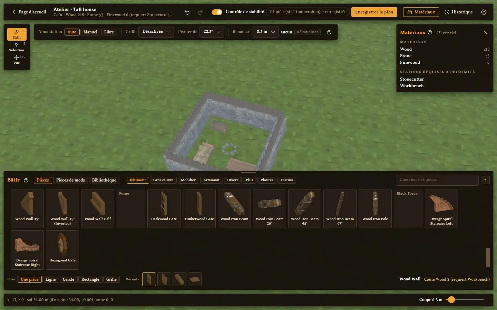
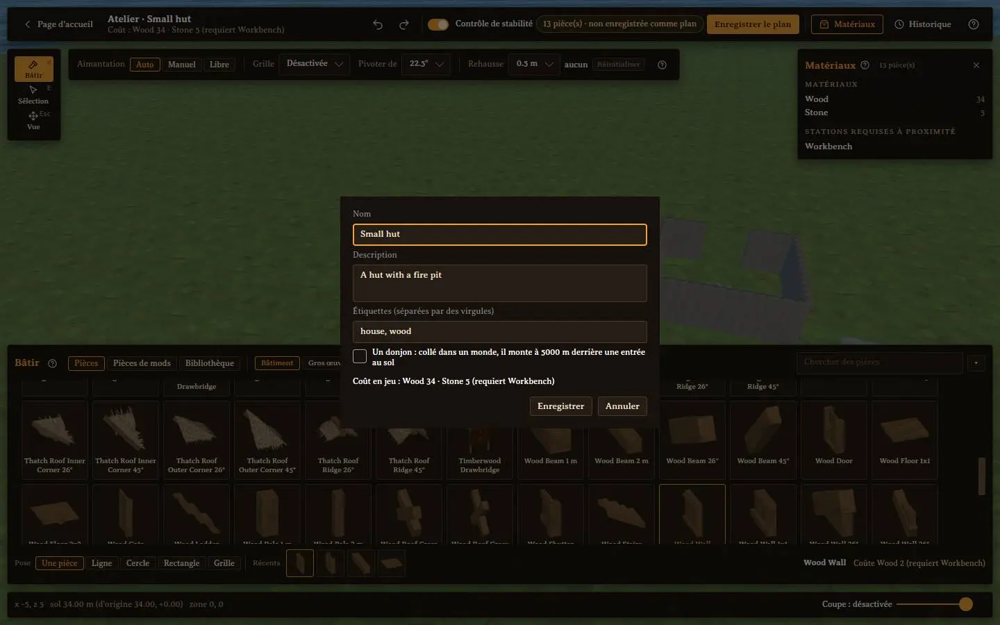
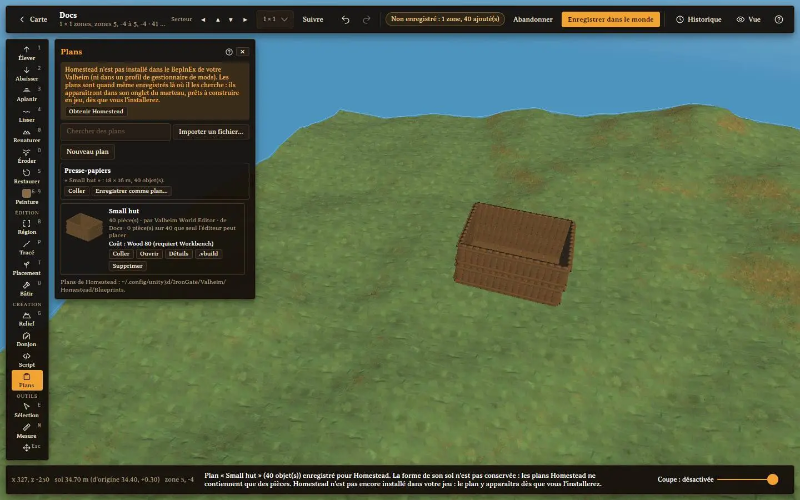

<!-- source: 820eb141 -->
# Atelier

Construisez sur une parcelle vierge avec toutes les pièces du jeu, voyez ce qui tiendrait et ce que cela coûte, et
gardez le résultat comme plan à construire en jeu ou à coller dans n'importe quel monde.

**Où :** page d'accueil, **L'Atelier** → **Ouvrir l'Atelier** ; dans un monde, **Plans** (barre d'outils, section
**CRÉATION**) → **Nouveau plan** · **Touche :** aucune · **Fonctionne dans :** la parcelle propre à l'Atelier (le
panneau **Plans** fonctionne dans les mondes enregistrés et en direct)

*Une haute maison avec le **Contrôle de stabilité** activé : la base en pierre en bleu clair, les murs de bois
au-dessus en vert, puis jaune, puis orange près du sommet, et le surplomb qui avance depuis la rangée du haut en orange,
puis rouge. La barre du haut indique `111 pièce(s) · 1 tomberai(en)t · enregistrée`.*

Un plan est un fichier de [Homestead](https://thunderstore.io/c/valheim/p/sighsorry/Homestead/), le mod de
construction en jeu : le même fichier apparaît dans l'onglet du marteau de Homestead, prêt à construire en jeu, et peut
être collé dans un monde depuis l'éditeur.

## L'utiliser

Pour construire une cabane et la garder :

1. Sur la page d'accueil, cliquez sur **L'Atelier**, puis sur **Ouvrir l'Atelier**. (Depuis un monde : **Plans** dans
   la barre d'outils, puis **Nouveau plan** ; un monde qui a des modifications non enregistrées vous demande d'abord.)
2. Dans le panneau **Bâtir** en bas, choisissez une pièce dans l'onglet **Pièces**.
3. Cliquez sur la parcelle pour la poser. Elle s'aimante aux pièces déjà présentes, comme avec le marteau.
4. Tournez la pièce avec `,` et `.` ; rehaussez-la avec `PgUp` et `PgDn` (ou `Ctrl` + molette) ; maintenez `Alt` pour
   la placer librement par quart de mètre. Pour déplacer ou supprimer des pièces, appuyez sur `E` (Sélection).
5. Surveillez les couleurs du **Contrôle de stabilité** et le nombre de pièces qui tomberaient dans la barre du haut,
   ainsi que le coût dans le panneau **Matériaux** à droite.
6. Cliquez sur **Enregistrer le plan** (`Ctrl+S`), et donnez-lui un nom, une description et des étiquettes.
7. Cliquez sur **Page d'accueil** pour revenir à la page d'accueil.

Pour modifier un plan enregistré, cliquez dessus sous **Vos plans** sur la page d'accueil (ou dans **Accueil**), ou
cliquez sur **Ouvrir** à côté de lui dans la bibliothèque (le panneau Plans d'un monde, ou l'onglet **Bibliothèque** de
l'Atelier).

*Sur la page d'accueil, **L'Atelier** : **Ouvrir l'Atelier**, **Obtenir Homestead** (il n'est pas installé ici), et
trois plans sous **Vos plans**, chacun avec son image, du plus récent au plus ancien.*

## La parcelle

La parcelle ne fait partie d'aucun monde : 3 × 3 zones (192 m de côté) de prairie plate à une seule hauteur. Son
milieu, au niveau du sol, est l'**ancre** du plan, le point depuis lequel Homestead mesure chaque pièce.

- La barre d'outils n'a que [Bâtir](build.md) (`U` ou `T`), **Sélection** (`E`) et **Vue**. Les outils de sol sont
  pour les mondes.
- À côté de la barre d'outils, la **barre de construction** : **Aimantation**, **Grille**, **Pivoter de** et
  **Rehausse** (voir [La barre de construction](#la-barre-de-construction)).
- En bas, le **panneau Bâtir** : les pièces, les pièces de vos mods et vos plans (voir
  [Le panneau Bâtir](#le-panneau-bâtir)).
- À droite, le panneau **Matériaux** : ce que coûte la construction (voir [Matériaux](#matériaux)).
- Il n'y a ni Masque, ni panneau Vue, ni limites des zones, et les constructions sont dessinées pleines.
- La barre du haut contient **Page d'accueil**, annuler et rétablir, l'interrupteur **Contrôle de stabilité**,
  **Enregistrer le plan**, **Matériaux** et **Historique**. Elle compte les pièces, indique combien tomberaient et si la
  construction est enregistrée (`12 pièce(s) · 2 tomberai(en)t · non enregistrée comme plan`).
- Sous le titre : ce que coûte la construction en jeu, en bref ; une ligne longue se termine par « … ».
- La barre d'état contient le curseur **Coupe**, comme dans un monde (voir [Coupe](#coupe)).

Il n'y a pas d'**Abandonner** : annulez, ou rouvrez le plan. Partir avec une construction non enregistrée comme plan
(**Page d'accueil**, ouverture d'un autre plan, fermeture) vous demande d'abord.

*L'Atelier avec une petite cabane sur la parcelle : la barre d'outils avec seulement **Bâtir**, **Sélection** et
**Vue**, la barre de construction à côté ; la barre du haut avec **Page d'accueil**, **Contrôle de stabilité**, le
nombre de pièces, **Enregistrer le plan** et **Matériaux** ; le panneau **Matériaux** à droite ; le panneau Bâtir en bas
sur l'onglet **Bâtiment**, avec les quatre dernières pièces choisies sous **Récents** et le mur en bois sélectionné.*

## Réglages

### Le panneau Bâtir

Le panneau **Bâtir** (celui de l'outil [Bâtir](build.md), le même dans un monde) occupe le bas de la fenêtre, pour
laisser le reste à la parcelle. Sa rangée du haut contient trois onglets,
**Pièces**, **Pièces de mods** et **Bibliothèque**, puis les choix propres à l'onglet et sa recherche. Faites glisser
son bord supérieur vers le haut ou vers le bas pour l'agrandir ou le réduire, et cliquez sur **▾** à son extrémité
droite pour le replier sur cette rangée (**▴** le rouvre). Les deux sont conservés pour la prochaine fois.

**Pièces** liste tout ce que construisent les joueurs, chaque pièce avec une image tirée du modèle du jeu :

| Onglet | Ce qu'il contient |
|---|---|
| **Bâtiment**, **Gros œuvre**, **Mobilier**, **Artisanat**, **Divers**, **Plus** | Les onglets du marteau lui-même, dans l'ordre du jeu. |
| **Plantes** | Les pièces du cultivateur : cultures, pousses et fleurs. |
| **Festins** | Les pièces du plateau de service. |

Dans chaque onglet, les pièces sont groupées selon la station d'artisanat dont elles ont besoin, dans l'ordre où les
joueurs les obtiennent (aucune, établi, tailleur de pierre, forge, table d'artisan, forge noire, table de galdr), puis
par nom. Chaque groupe commence par le nom de la station.

**Pièces de mods** liste les pièces qu'ajoutent vos mods, un mod à la fois : choisissez le mod dans la liste sur le
côté gauche (avec son nombre de pièces). Les titres sont les groupes propres au mod (sa station d'artisanat pour une
pièce qui n'en a pas). Les pièces viennent de deux endroits :

- **Les mods installés sur cet ordinateur**, dans les dossiers BepInEx que l'éditeur connaît (celui de votre Valheim,
  ceux de vos profils de gestionnaire de mods, ceux ajoutés dans Paramètres). L'Atelier lit leurs fichiers à sa
  première ouverture, sans le jeu, puis seulement quand ils changent ; **Relire les mods** les relit tout de suite.
  Leurs noms et leurs images viennent des propres fichiers des mods. Une pièce lue ainsi s'aimante par ses propres
  points d'aimantation, mais son coût n'est pas connu (les mods le définissent au démarrage du jeu) : elle affiche
  `Coût inconnu`, et [Matériaux](#matériaux) la liste sous **Aucune recette connue**.
- **Une partie en direct** qui fait tourner les mods avec WorldEditorBridge (voir [Mode direct](live-mode.md#jeux-moddés)) :
  elle donne leurs vrais noms et coûts, qui l'emportent sur ce que disent les fichiers.

Les mods qui créent leurs pièces dans leur code (Railroads) sont listés grâce à leur [module complémentaire](modding.md),
qui les nomme.

<!-- picture: workshop-mod-pieces.jpg, the Mod pieces tab with Moonforged Build Pieces and Railroads installed: the two mods down its side, Moonforged's walls with their pictures, two of them snapped together on the plot -->

| Réglage | Ce qu'il fait |
|---|---|
| **Chercher des pièces** | Trouve des pièces dans tous les onglets, ceux des mods aussi, par nom ou par prefab (`stone floor`, `woodwall`). Chaque mot doit correspondre. |
| La vignette d'une pièce | La choisit. Son nom et son coût s'affichent au pied du panneau (`Wood Wall · Costs Wood 2 (needs Workbench)`), avec le nom de son mod pour une pièce de mod. Survolez une vignette pour voir le nom de son prefab. |
| **Récents** | Les 12 dernières pièces choisies, de la plus récente à la plus ancienne, au pied du panneau : cliquez sur l'une pour la choisir à nouveau. Conservé pour la prochaine fois. |

Chaque clic pose une pièce. Si aucune pièce n'est choisie, Bâtir prend le mur en bois. **Pose**, au pied du panneau,
place plutôt la pièce le long d'une ligne, autour d'un cercle ou d'un rectangle, ou en grille : voir
[Poser des pièces le long d'une ligne ou en grille](build.md#poser-des-pièces-le-long-dune-ligne-ou-en-grille).

**Raccourcis** quand **Bâtir** est actif :

| Souris | Ce qu'elle fait |
|---|---|
| Glisser | Pose une rangée de la pièce depuis l'endroit où vous avez appuyé : des copies bord à bord, espacées de la longueur d'une pièce (la largeur d'un mur, le côté d'un sol), le long du côté de la pièce le plus proche de la direction du glissé, à la hauteur de la première, jusqu'à 64. Un mur ne se range que dans le sens de sa largeur : tournez-le d'abord pour le ranger dans l'autre sens. Relâchez pour poser la rangée, en une étape d'annulation. |
| `Shift` + clic droit | Retire la pièce sous le pointeur (`Ctrl+Z` la ramène). Un glissé droit tourne toujours la vue, et `Shift` + glissé droit la fait toujours glisser. |
| Clic milieu | Construit avec le type de la pièce sous le pointeur, comme une pipette : il est choisi dans le panneau et placé en tête de **Récents**. Un glissé milieu fait toujours glisser la vue. |

*Un glissé depuis la gauche : une rangée de murs en bois posés bout à bout, transparents jusqu'au relâchement du
bouton.*

### La barre de construction

La barre à côté de la barre d'outils contient la façon dont la pièce se pose : **Aimantation** (**Auto**, **Manuel**,
**Libre**), **Grille**, **Pivoter de** et **Rehausse**. C'est la même barre dans un monde, où Sélection et Coller la
partagent et où elle a aussi **Construit par** : voir [La barre de construction](build.md#la-barre-de-construction).

### Onglet Bibliothèque

*L'onglet **Bibliothèque** qui cherche « hut » : la recherche, **Importer un fichier…**, **Nouveau plan** et **Générer
un donjon…** dans la rangée du haut du panneau, puis les deux cabanes côte à côte (la haute maison est exclue), chacune
avec son image, ses pièces, son coût, sa description, ses étiquettes et ses boutons **Ajouter**, **Ouvrir**,
**Détails**, **.vbuild** et **Supprimer**.*

La Bibliothèque est la même liste que le [panneau Plans](#panneau-plans) d'un monde : les mêmes plans, présentés de
la même façon, avec les mêmes boutons. Seule la façon d'en poser un diffère : la parcelle le reçoit avec **Ajouter**
(ou par glisser), un monde avec **Coller**.

| Réglage | Ce qu'il fait |
|---|---|
| **Chercher des plans** | Garde les plans dont le nom, l'auteur, la description ou les étiquettes contiennent chaque mot saisi. |
| **Ajouter** | Ajoute le plan à la parcelle, en son milieu. Une étape d'annulation. |
| Faire glisser un plan sur la parcelle | Ajoute le plan là où vous le déposez. |
| **Ouvrir** | Le plan seul sur la parcelle, pour le modifier (demande d'abord quand la parcelle n'est pas enregistrée). **Enregistrer le plan** le réécrit. |
| **Détails** | Modifie son nom, sa description, ses étiquettes et l'interrupteur donjon. Un nouveau nom renomme le fichier et l'image quand ce nom est libre. Pour le plan sur la parcelle, l'Atelier prend le nouveau nom, et **Enregistrer le plan** écrit ce fichier. |
| **.vbuild** | Écrit ses objets dans un fichier `.vbuild` dans le dossier `export` du dossier des plans de l'éditeur, et indique où. |
| **Supprimer** | Retire son fichier et son image, après confirmation. Homestead le perd aussi. Supprimer le plan qui est sur la parcelle y laisse la construction, marquée *non enregistrée comme plan*. |
| Déposer des fichiers sur la parcelle | Les fichiers `.blueprint` et `.vbuild` venus de votre gestionnaire de fichiers sont importés, puis ajoutés là où ils tombent. Déposés sur un monde, ils sont seulement importés. |
| **Importer un fichier…** | Importe un fichier `.blueprint` (Homestead, PlanBuild) ou `.vbuild` dans la bibliothèque. |
| **Nouveau plan** | Une parcelle vierge (demande d'abord quand la parcelle n'est pas enregistrée). |
| **Générer un donjon…** | Affiche le générateur de donjons (pièces de construction seulement ; voir [Donjon](dungeons.md)). **Ouvrir sur la parcelle** y place le donjon seul, **Ajouter à la parcelle** l'ajoute au milieu ; dans les deux cas, son plan est gardé dans la bibliothèque, sans image `.png` à côté. **← Bibliothèque** revient en arrière. |

Un plan ouvert ou ajouté garde sa forme exacte, déplacé d'un bloc pour que sa pièce de construction la plus basse
repose sur la parcelle. Un plan Homestead garde son ancre au milieu de la parcelle ; les autres fichiers sont centrés.
L'enregistrer à nouveau garde la hauteur de l'ancre : la construction se dresse ainsi comme avant quand Homestead la
construit. Les pièces de mods que vous n'avez pas sont laissées de côté, et le message les liste. Un plan ouvert depuis
l'extérieur du dossier de Homestead demande confirmation avant d'écraser un plan de la bibliothèque du même nom.

Les plans des versions de l'éditeur antérieures à Homestead sont listés après les autres, sous **Anciens plans de
l'éditeur** : **Vers Homestead** en garde un comme plan Homestead, qui peut alors être ajouté ou ouvert.

### Matériaux

Le panneau **Matériaux** à droite liste ce que coûte en jeu la construction posée sur la parcelle, et suit chaque
modification :

| Partie | Ce qu'elle liste |
|---|---|
| **Matériaux** | Chaque matériau avec sa quantité, du plus abondant au moins abondant. |
| **Stations requises à proximité** | Les stations d'artisanat qui doivent être proches pour la construire. |
| **Aucune recette connue** | Les pièces dont l'éditeur ne connaît pas la recette (celles d'un mod, avant qu'une partie en direct la lui ait donnée), par mod. Elles ne sont pas comptées. |
| **Seul l'éditeur peut les placer** | Statues, accessoires, navires et créatures : le marteau de Homestead les ignore, elles ne sont donc pas comptées. |

**Matériaux** dans la barre du haut (ou le **✕** du panneau) le ferme et l'ouvre ; l'Atelier retient votre choix.

### Contrôle de stabilité

Le **Contrôle de stabilité** (activé par défaut) colore chaque pièce de construction aux couleurs que le mode
construction du jeu donne à sa stabilité :

| Couleur | Signification |
|---|---|
| **Bleu clair** | Stabilité totale : elle repose sur le sol. |
| **Vert** | Solide. |
| **Jaune**, **orange** | Plus faible. |
| **Rouge** | Sur le point de se briser : en jeu, elle tombe dès qu'un joueur s'approche. |

La barre du haut indique combien de pièces tomberaient, et **Enregistrer le plan** demande d'abord confirmation quand
certaines tomberaient (même avec l'interrupteur désactivé : il ne fait que masquer les couleurs). La pierre monte haut
mais ne peut pas avancer en porte-à-faux ; le bois avance plus loin mais ne monte pas aussi haut. Voir [Le contrôle de stabilité](concepts/objects.md#le-contrôle-de-stabilité).

### Coupe

*La même maison avec **Coupe à 3 m**, vue d'en haut : tout ce qui dépasse 3 m est masqué, et vous voyez l'intérieur
de son rez-de-chaussée, avec le foyer, le lit, la table et le coffre.*

Le curseur **Coupe**, dans la barre d'état, masque tout ce qui se trouve au-dessus d'une hauteur, de 0 à 39 m
au-dessus de la parcelle, et le pointeur traverse ce qui est masqué : vous pouvez ainsi construire à l'intérieur. Son
extrémité droite le désactive (`Coupe : désactivée`). C'est le même curseur que dans un monde et dans un donjon, où ses
mètres se comptent depuis le sol ou le plancher du donjon : voir
[Coupe](editor-basics.md#coupe).

## Enregistrer un plan

**Enregistrer le plan** (`Ctrl+S`) demande :

| Champ | Ce que c'est |
|---|---|
| **Nom** | Homestead le liste sous ce nom ; le fichier porte ce nom. |
| **Description** | Quelques mots, affichés dans la bibliothèque et aux personnes avec qui vous le partagez. Les retours à la ligne deviennent des espaces. |
| **Étiquettes (séparées par des virgules)** | Des mots pour le retrouver : `house, viking, stone`. Jusqu'à 12, doublons supprimés. |
| **Un donjon : collé dans un monde, il monte à 5000 m derrière une entrée au sol** | En fait un plan de donjon : voir [Donjon](dungeons.md). |

La boîte de dialogue affiche le **Coût en jeu**. Enregistrer le plan que vous avez ouvert l'écrase ; un autre nom en
crée un nouveau, et ne remplace un plan de ce nom qu'après confirmation. Une image est enregistrée à côté du fichier
(un `.png`, la construction vue d'en haut en biais, sur fond transparent), que Homestead utilise comme icône. Elle est
dessinée avec les modèles du jeu quand l'éditeur peut les lire, sinon avec la forme de chaque pièce dans la couleur de
son matériau. Un plan créé ailleurs sans image en reçoit une dessinée dans la bibliothèque, en mémoire seulement.

*Enregistrement de la cabane : **Nom** « Small hut », **Description** « A hut with a fire pit », **Étiquettes**
« house, wood », **Un donjon** désactivé, et la ligne **Coût en jeu** au-dessus d'**Enregistrer**.*

Ce qui est gardé :

- **Tout ce qui se dresse sur la parcelle**, pas le sol de la parcelle. La parcelle est vierge au départ : tout ce qui
  s'y trouve est donc à vous, les pièces que vous avez construites et tout ce qu'un plan ouvert ou ajouté a apporté
  (arbres, rochers, créatures). Il doit y avoir au moins une pièce de construction.
- **Ce que contiennent les objets** : le contenu d'un coffre, le texte d'un panneau, l'objet d'un présentoir, les
  étoiles d'une créature. Sélectionnez un objet et appuyez sur `I` pour le voir ou le modifier : voir
  [Inspecteur](select.md).
- **Si c'est une ruine** : des pièces sans constructeur, comme celles des ruines du jeu et des donjons générés. Aucun
  constructeur n'est écrit pour le reste : celui qui la construit en jeu en devient le constructeur.
- **Les pièces réservées à l'éditeur** : statues, accessoires, navires et créatures. Le marteau de Homestead les
  ignore ; coller depuis l'éditeur les place. La bibliothèque les compte (`2 pièce(s) sur 40 que seul l'éditeur peut placer`),
  et le coût les exclut.

## Panneau Plans

*Le panneau **Plans** dans un monde : la bannière Homestead, **Chercher des plans** et **Importer un fichier…**,
**Nouveau plan**, le **Copie** avec **Coller** et **Enregistrer comme plan…**, puis une cabane enregistrée avec
son image, ses pièces, son coût et ses boutons **Coller**, **Ouvrir**, **Détails**, **.vbuild** et **Supprimer**.*

Dans un monde, **Plans** dans la barre d'outils (ou **Plans…** dans le panneau Région) ouvre la bibliothèque à côté de
la barre d'outils ; **✕** revient à Vue. Une bannière indique si Homestead est installé, avec sa version, ou propose
**Obtenir Homestead**. Chaque plan affiche son image, ses pièces, son auteur, le monde d'où il vient, son coût, sa
description et ses étiquettes. **Chercher des plans** cherche dans le nom, l'auteur, la description et les étiquettes.
C'est la même liste, avec les mêmes boutons, que l'[onglet Bibliothèque](#onglet-bibliothèque) de l'Atelier ; un plan sans
image en reçoit une dessinée ici aussi.

| Bouton | Ce qu'il fait |
|---|---|
| **Coller** | Ferme le panneau et commence à le coller dans le secteur ouvert (voir [Copier et coller](area.md#copier-et-coller)). Les types que ce monde ne peut pas créer sont laissés de côté et listés. Un plan de donjon monte plutôt derrière une entrée. |
| **Ouvrir** | L'ouvre dans l'Atelier, seul sur la parcelle, pour le modifier. |
| **Détails** | Modifie son nom, sa description, ses étiquettes et l'interrupteur donjon. Un nouveau nom renomme le fichier et l'image quand ce nom est libre. |
| **.vbuild** | Écrit ses objets (pas le sol) dans un fichier `.vbuild` (BuildShare et outils plus anciens) dans le dossier `export` du dossier des plans de l'éditeur, et indique où. |
| **Supprimer** | Retire son fichier et son image, après confirmation. Homestead le perd aussi. |
| **Importer un fichier…** | Importe un fichier `.blueprint` ou `.vbuild`. |
| **Nouveau plan** | Ouvre l'Atelier sur une parcelle vierge. |

La rangée **Copie**, au-dessus des plans, montre ce qui a été copié en dernier avec l'outil Région ou avec
`Ctrl+C` dans Sélection (sa taille et le nombre d'objets), ou que rien n'est encore copié :

| Bouton | Ce qu'il fait |
|---|---|
| **Coller** | Colle le presse-papiers, comme le fait `Ctrl+V`. |
| **Enregistrer comme plan…** | Enregistre les objets du presse-papiers comme plan Homestead, avec un nom, une description et des étiquettes, et s'il s'agit d'un donjon (voir [Donjons](dungeons.md)). Le sol et les constructeurs ne sont pas gardés. Un plan du même nom est remplacé, après confirmation. Identique à **Enregistrer un plan…** dans le panneau Région. |

Les plans des versions de l'éditeur antérieures à Homestead se trouvent sous **Anciens plans de l'éditeur**, avec
**Coller**, **Vers Homestead** (le garde comme plan Homestead, numéroté quand le nom est déjà pris), **.vbuild** et
**Supprimer**. Les plans Homestead ne contiennent pas de sol : la forme du sol d'une copie n'est pas gardée, et le
message le dit.

**Pour enregistrer un plan depuis un monde**, copiez quelque chose avec l'outil Région ou Sélection (`Ctrl+C`), ouvrez
**Plans** dans la barre d'outils et cliquez sur **Enregistrer comme plan…** dans la rangée **Copie**. Voir
[Coller un plan dans un monde](guides/paste-a-blueprint.md) pour l'inverse.

## Fichiers de plan

Homestead construit les plans de l'éditeur en jeu, avec un coffre pour les matériaux. La page d'accueil et le panneau
Plans cherchent `Homestead.dll` dans chaque dossier `BepInEx/plugins` que l'éditeur connaît : celui de votre Valheim,
le profil de gestionnaire de mods depuis lequel l'éditeur est lancé, les dossiers ajoutés dans Paramètres, et les
profils de r2modman et de Thunderstore Mod Manager. Les plans sont enregistrés là où Homestead les cherche même quand
il n'est pas installé : ils apparaissent donc en jeu dès que vous l'installez.

Les plans se trouvent dans le dossier de Homestead, dans le dossier de sauvegarde de Valheim (celui qui l'a déjà,
sinon le dossier de sauvegarde de vos mondes) :

- Linux : `~/.config/unity3d/IronGate/Valheim/Homestead/Blueprints`
- Windows : `%USERPROFILE%\AppData\LocalLow\IronGate\Valheim\Homestead\Blueprints`

Pour partager une construction, partagez son fichier `.blueprint` et le `.png` qui l'accompagne.

**Importer** lit les fichiers `.blueprint` de Homestead et de PlanBuild (leurs marques de sol ne sont pas gardées) et
les fichiers `.vbuild`. Le fichier devient un plan Homestead sous son propre nom, numéroté (`House (2)`) quand le nom
est déjà pris. Le message indique combien de pièces étaient inconnues et combien de lignes n'ont pas pu être lues.

Un plan Homestead est un fichier `.blueprint` de PlanBuild avec des lignes d'en-tête (`#Name:`, `#Creator:`, `#Description:`,
`#Category:`, `#HomesteadVersion:`...) et une ligne par pièce après `#Pieces` :
`prefab;Building;x;y;z;qx;qy;qz;qw;"";1;1;1`, sa position en mètres depuis l'ancre, sa rotation et son échelle.
L'éditeur ajoute ses propres lignes (`#Tags:`, `#EditorData:` pour ce que contiennent les objets, `#EditorRuin:1`),
que Homestead et PlanBuild ignorent : le fichier se construit donc toujours en jeu. Les pièces sont écrites de la plus
basse à la plus haute, au millimètre près. Le nom du fichier est celui du plan, les caractères que Windows ou Linux
refusent étant changés en `_`, 64 caractères au plus.

Le coût vient des recettes de votre propre Valheim : les matériaux de chaque pièce multipliés par leur nombre, du plus
abondant au moins abondant, avec les stations qui doivent être proches
(`Wood 120 · Stone 64 · Core wood 20 · … (needs Stonecutter, Workbench)`). Les pièces sans recette connue (venues de
mods) sont listées à part ; si aucune n'est connue, il indique `Coût inconnu (pièces de mods ?)`.

## Raccourcis

| Touche ou souris | Ce qu'elle fait |
|---|---|
| `U` ou `T` | Bâtir. Ses touches (rotation, rehausse, points d'aimantation, rangées, lignes) sont sur la page de [Bâtir](build.md#raccourcis). |
| `E` | Sélection : déplacer, tourner, supprimer des pièces (avec **Aimantation** sur **Manuel** dans Bâtir : le point d'aimantation suivant). |
| `Esc` | Vue. |
| `Ctrl+S` | Enregistrer le plan. |
| `Ctrl+Z` | Annuler. |
| `Ctrl+Y` ou `Ctrl+Shift+Z` | Rétablir. |

Toutes les touches de l'éditeur sont dans [Raccourcis](help/shortcuts.md).

## Astuces et limites

- **Récupérer :** `Ctrl+Z` fonctionne sur la parcelle. Un plan enregistré reste dans la bibliothèque : **Ouvrir** le
  ramène.
- Un onglet affiche au plus 300 pièces : cherchez pour trouver les autres.
- **Ce qui revient.** Collés depuis l'éditeur, les objets d'un plan contiennent ce qu'ils contenaient (contenu des
  coffres, panneaux, le boss). Construit en jeu avec Homestead, il ne reste que les pièces : les coffres sont vides et
  aucune créature ne vient.
- Copier et coller sont pour les mondes : `Ctrl+V` ne fait rien sur la parcelle, donc `Ctrl+X` n'y fait que retirer
  les pièces (`Ctrl+Z` les ramène). Pour ajouter une construction, utilisez **Ajouter** ou faites glisser un plan.
- Un plan créé avec des mods que vous n'avez pas s'ouvre sans leurs pièces ; l'enregistrer l'écrit alors sans elles.
- Les créatures situées dans une pièce de construction sont posées sur la plus haute pièce sous elles (le message
  indique combien). La barre du haut compte celles qui sont encore dans une pièce.
- Le contrôle de stabilité laisse de côté les rochers et les arbres (la parcelle n'en a pas) et compte les formes
  maillées par leur boîte.
- Homestead vérifie les versions avec le serveur : un serveur qui le fait tourner déconnecte les joueurs qui ne l'ont
  pas (les joueurs sur console ne peuvent pas l'avoir). Les joueurs n'en ont besoin dans leur propre jeu que pour
  construire des plans.
- Pour construire sur le terrain ouvert d'un monde ou dans un donjon avec le même panneau Bâtir, voir
  [Bâtir](build.md) et [Donjon](dungeons.md).
- **Claude** peut construire sur la parcelle et enregistrer des plans : voir [Claude](claude.md).

## Voir aussi

- [Coller un plan dans un monde](guides/paste-a-blueprint.md)
- [Votre première construction](start/first-build.md)
- [Le contrôle de stabilité](concepts/objects.md#le-contrôle-de-stabilité) · [Aimantation](concepts/objects.md#aimantation)
- [Bâtir](build.md) · [Donjon](dungeons.md) · [Sélection](select.md)
