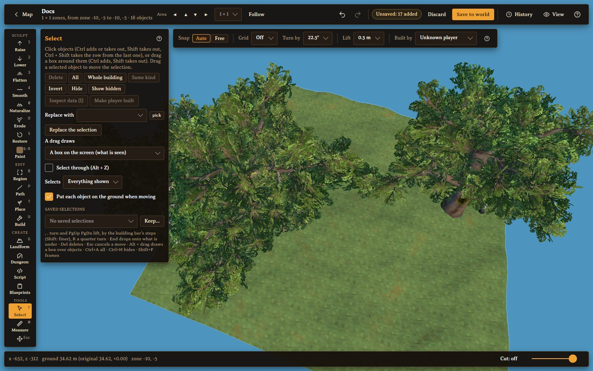

# Clear trees and rocks, level a building site

Remove the trees, rocks and bushes from a place and level it into a flat site to build on.

**You need:** a world open in 3D, with the game closed or in [live mode](edit-your-game-live.md).

1. Press `B` ([Region](../area.md)). At the top of its panel, choose **Polygon**.
2. Click corners round the site, a few metres wider than the building, and double-click to close it.
3. Choose **Objects**.
4. Check the kind chips: **Trees & logs**, **Rocks**, **Bushes & shrubs** and **Pickables** are on at first. Leave
   **Your buildings** off.
5. Press **Select the objects (Enter)**. The Select tool opens with them selected.
6. Press `Del`. They are gone.
7. Press `B` to come back to the Region tool: the polygon is still there. Choose **Ground**, then **Flatten** in
   **Action**.
8. Press **avg** for the average height inside, or type a **Height**. To match a door you already built, point at
   the ground at its sill and read the height in the status bar.
9. Set **Soft edge** (3 m at first) so the site blends into the slope. The line under the settings says how much
   ground will be dug and filled, and what is out of the game's 8 m reach.
10. Press **Flatten (Enter)**.
11. Optional: in **Action**, choose **Paint**, then **Dirt** or **Paved**, and press **Paint (Enter)**.
12. Click **Save to world** (or **Apply live**).

*After **Select the objects (Enter)** and `Del`: the trees inside the polygon are gone, the ones outside stand.*

## Check it worked

- Press `M` ([Measure](../measure.md)) and measure across the site: **Lowest / highest** should match.
- Or turn on **Slope colours** in the View panel: the site shows green.

## Undo it

- Each action is one step: `Ctrl+Z` takes back the last one. After saving, undo it and save again (see
  [Undo a step, take back one change, or discard everything](undo-changes.md)).
- To grow the trees back later, select the place, choose **Recover** and use **Regrow nature** (see
  [Region](../area.md#regrow-nature)).

## Related

- [Region, copy and paste](../area.md)
- [Mask](../masks.md): level only the bottom of a slope
- [Make a road or a ramp up a hill](make-a-road.md)
