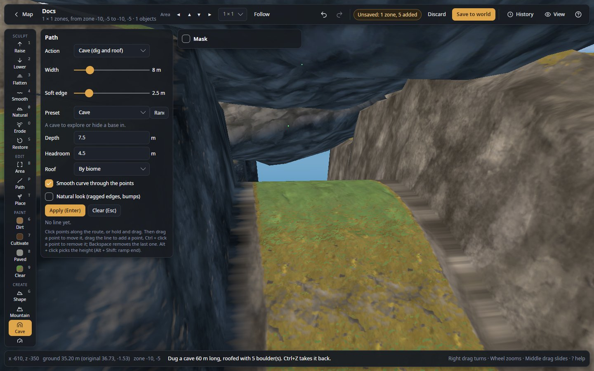

# Dig a cave

Dig a cave under a hill, roofed with the game's own boulders, with a sloping entrance at each end.

**You need:** a world open in 3D, with the game closed or in [live mode](edit-your-game-live.md). A hill or a big
mound to dig through looks best.

The game's ground cannot overhang, so a cave is a dug trench with boulders laid over it, like the game's own caves.

1. In the tool rail's **CREATE** section, click **Cave**. The [Path](../path.md) tool opens with **Cave (dig and
   roof)** chosen.
2. Click points along the cave, from one entrance to the other. Make the line long enough for both entrance slopes.
3. In the panel, choose a **Preset**: **Tunnel** (narrow), **Cave** or **Cavern** (a wide hall).
4. Optional: change **Width**, **Depth** (how far down the floor is) and **Headroom** (the height inside). **Depth**
   must be larger than **Headroom** by 1.5 m for a roof.
5. Optional: for a floor deeper than 8 m, tick **No limit: past the game's ±8 m** in the
   [brush settings](../terrain.md#no-limit) first.
6. Optional: choose the boulders in **Roof**; **By biome** matches the land.
7. Press **Apply (Enter)**. The status bar says how long the cave is, how many boulders roof it, and how many trees
   and rocks were taken away.
8. Press **Clear (Esc)**, then **Save** (or **Apply live**).

*A cave seen from its entrance: the slope leads down under the boulder roof, with daylight at the far end.*

## Check it worked

- Go down the entrance slope in the 3D view: the floor should be open to walk, the boulders overhead.
- If the status bar says the walls could not rise at some points, daylight may come in at the sides: apply again with
  No limit on, or make **Depth** smaller.
- If it says only the trench was dug, make **Depth** larger than **Headroom** by 1.5 m, or the line longer.

## Undo it

The whole cave, trench, boulders and clearing, is one undo step: `Ctrl+Z` takes it back. **Randomize** then gives new
sizes and boulders for the next try.

## Related

- [Path](../path.md#cave)
- [Raise or dig past the game's 8 m limit](raise-past-the-limit.md)
- [Ground limits](../concepts/ground-limits.md)
