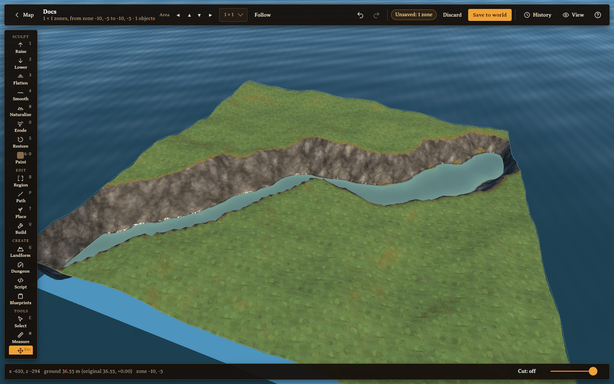

# Dig a river or a pond

Dig a river, a canal or a pond that fills with water.

**You need:** a world open in 3D, with the game closed or in [live mode](edit-your-game-live.md). Low ground near
the sea is easiest.

Valheim has no flowing water: the water in rivers is the sea, at 30 m everywhere. A river or pond has water only where
its bed is below 30 m.

1. Move the cursor over the route and read the ground height in the status bar. Without No limit you can dig only
   8 m down, so ground above about 36 m will not hold water.
2. Press `P` ([Path](../path.md)) and click points along the river, from the sea or a lake inland.
3. In the panel, choose **River / canal (water)**.
4. Set **Width** (the water's width), **Soft edge** (the banks) and **Depth** (how far below sea level the bed is in
   its middle, 2 m at first).
5. Press **Apply (Enter)**. The bed fills with water.
6. For a pond, press `B` ([Region](../area.md)), choose **Polygon**, click round the pond and double-click the last
   corner to close the shape.
7. In the **Ground** group, choose **Flatten** in **Action**, type a **Height** below 30 m (28 m makes water 2 m
   deep), set **Soft edge** to about 5 m for gentle banks, and press **Flatten (Enter)**.
8. Click **Save to world** (or **Apply live**).

*A river dug with River / canal (water): the sea fills it.*

## Check it worked

- The water shows in the 3D view as soon as the bed is below 30 m.
- If the status bar says part of it reached the game limit, the ground is too high there: lower it near the sea first,
  follow lower ground, or turn on **No limit** (see [Raise or dig past the game's 8 m
  limit](raise-past-the-limit.md)).

## Undo it

`Ctrl+Z` takes back the last **Apply** or **Flatten**. After saving, undo and save again (see
[Undo a step, take back one change, or discard everything](undo-changes.md)).

To fill a river in later, when the undo steps are gone, draw the line again (or keep it) and apply the Path tool's
**Restore**: the ground along it goes back to how the world generated it. The **Restore** brush (`5`) does the same
in one place.

## Related

- [Path](../path.md#river-or-canal)
- [Measure and overlays](../measure.md): water depth
- [Ground limits](../concepts/ground-limits.md)
