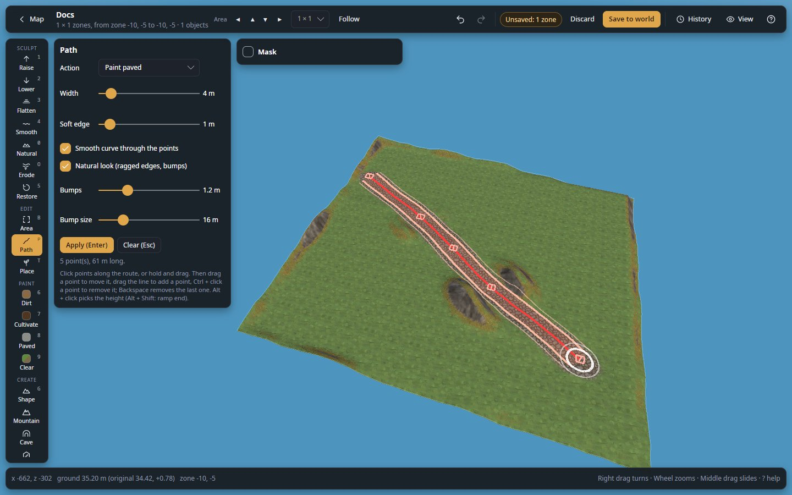

# Make a road or a ramp up a hill

Draw a level road with an even ramp up the hill, paved along its middle.

**You need:** a world open in 3D, with the game closed or in [live mode](edit-your-game-live.md).

1. Optional: check the slope first. Press `M` ([Measure](../measure.md)), click the foot of the hill, then its top:
   **Slope** is what a ramp between them will give.
2. Press `P` ([Path](../path.md)) and click points along the level part of the road.
3. In the panel, choose **Flatten to height**. `Alt`+click the ground to take its height, or type it in **Height**.
4. Set **Width** (8 m is a good road) and **Soft edge** (4 m blends it into the slope).
5. Optional: tick **Natural look (ragged edges, bumps)** for a worn track.
6. Press **Apply (Enter)**, then **Clear (Esc)**.
7. For the hill, click a point at its foot and one at its top, and choose **Ramp (start → end)**. **Start** and
   **End** follow the ground under the two ends; type a height to change one.
8. Press **Apply (Enter)**. The line stays.
9. To pave it, choose **Paint paved**, make **Width** and **Soft edge** smaller (4 m and 1 m), and press **Apply
   (Enter)** again on the same line.
10. **Save** (or **Apply live**).

*A road made with Flatten to height, then Paint paved on the same line.*

## Check it worked

- Measure along the road: **Slope** stays the same all along a ramp.
- If points turned red, part of the road reached the game's 8 m limit: see
  [Raise or dig past the game's 8 m limit](raise-past-the-limit.md).

## Undo it

Each **Apply** is one undo step: `Ctrl+Z` takes back the last one. **Clear (Esc)** removes only the line, not what
you applied.

## Related

- [Path](../path.md)
- [Measure and overlays](../measure.md)
- [Clear trees and rocks, level a building site](clear-an-area.md)
