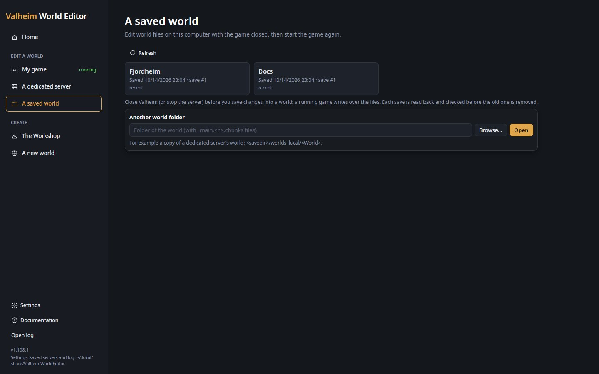

# Open a world that is not in the list

Open a world from any folder on this computer: a copy of a server's world, a backup, a world on another drive.

**You need:** the world's folder (the one that holds `_main.<n>.chunks` files), and no game or server running with
it.

1. Close Valheim, or stop the server that uses the world: a running game writes over the files the editor saves.
2. For a dedicated server's world, copy its folder, `<savedir>/worlds_local/<World>`, from the server to this
   computer.
3. On the start page, click **A saved world**.
4. Under **Another world folder**, click **Browse…** and choose the world's folder, or paste its path in the box.
5. Click **Open**. The world opens on its [map](../map.md).
6. Optional: to have the world in the list every time, open **Settings**, click **Add a folder** under **World
   folders**, choose the world's folder (or a folder of worlds) with **Browse…**, then **Save**.

*The worlds the editor found by itself, then **Another world folder** with **Browse…** and **Open**.*

## Check it worked

- The map shows the world, with its name and seed at the top of the side panel.
- On **Home**, the world is under **Recent**, so the next time it opens in one click.
- With the folder added in **Settings**, **A saved world** lists the world with *yours* under its name.

## Undo it

Opening a world changes nothing in it: only **Save to world** writes. To take a folder out of the list, open
**Settings**, click **✕** beside it under **World folders**, then **Save**.

## Tips

- The editor says what is wrong with a folder: "That folder holds worlds; pick one of them" (you chose
  `worlds_local`: choose one world inside it), or "No Valheim world in that folder".
- A world in the old single-file format (`<World>.db` and `.fwl`) shows greyed out: load it in Valheim once, and the
  game turns it into a world folder the editor opens.
- A world made with a world generation mod (Expand World, Riverheim) needs its add-on: see
  [Edit a world made with Expand World, Riverheim or Tunnelheim](use-mods-worlds.md).
- After editing a server's world here, copy the folder back to the server with the server stopped.

## Related

- [Back up a world before editing](back-up-a-world.md)
- [Edit a dedicated server while people play](edit-a-server-live.md)
- [The editor window](../editor-basics.md)
- [The world map](../map.md)
