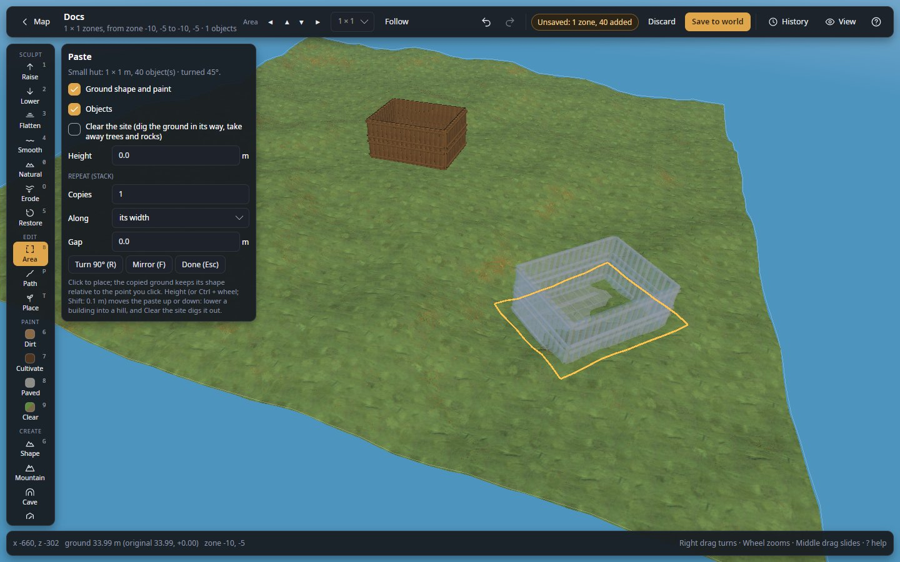

# Paste a blueprint into a world

Put a building from your blueprint library (made in the Workshop, saved from a world, or imported) into a world.

**You need:** a world open in the editor, with the area where the building goes open, and a blueprint in the library
(see [Workshop](../workshop.md)). A backup first: see [Back up a world](back-up-a-world.md).

## Steps

1. Click **Blueprints** on the tool rail (CREATE section).
2. Optional: to bring in a file someone sent you, click **Import file…** and choose the `.blueprint` or `.vbuild`
   file.
3. Type a word of its name or tags in **Search blueprints**.
4. Click **Paste** beside the blueprint. It follows the cursor, see-through.
5. Turn it with `R` (a quarter turn) or `,` `.`; press `F` to mirror it.
6. Optional: to sink it into a slope, lower it with `Ctrl` + wheel, and switch on **Clear the site** in the Paste
   panel to dig out the ground in its way and take away trees and rocks.
7. Click where it should stand. Click again elsewhere for more copies.
8. Press `Esc` to stop pasting.
9. Click **Save to world** (or **Apply live**).

The pasted pieces hold what the blueprint holds: chest contents, sign texts, creatures. Pieces from mods this world
does not have are left out, and the message lists them.

*After **Paste**: the hut follows the cursor see-through, its footprint outlined, turned 45° (`turned 45°` in the
**Paste** panel), **Clear the site** off. Behind it, the hut it was saved from.*

A blueprint marked **A dungeon** is not put on the ground: its entrance goes where you click and the building 5000 m
above it. See [Dungeon](../dungeons.md).

## Check it worked

The building stands solid where you clicked, with green unsaved dots, and the status bar says how many objects were
pasted. Look under its edges: nothing should float. After saving, walk to it in game.

## Undo it

- Before saving: `Ctrl+Z` takes back each paste.
- After saving: see [Undo a step, take back one change, or discard everything](undo-changes.md).

## Tips

- The paste must fit inside the open area; if it says *Not pasted*, open a bigger area round the place.
- Pieces the editor places by itself (statues, props, creatures) are pasted too, though Homestead's hammer skips them.
- To change the blueprint first, click **Edit** to open it in the Workshop.

## Related

- [Workshop](../workshop.md) · [Area](../area.md)
- [Move or copy a building](move-a-building.md)
- [Player-built pieces](../concepts/objects.md#player-built-pieces)
