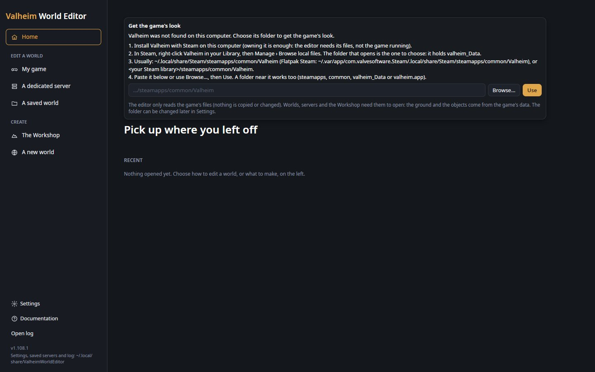
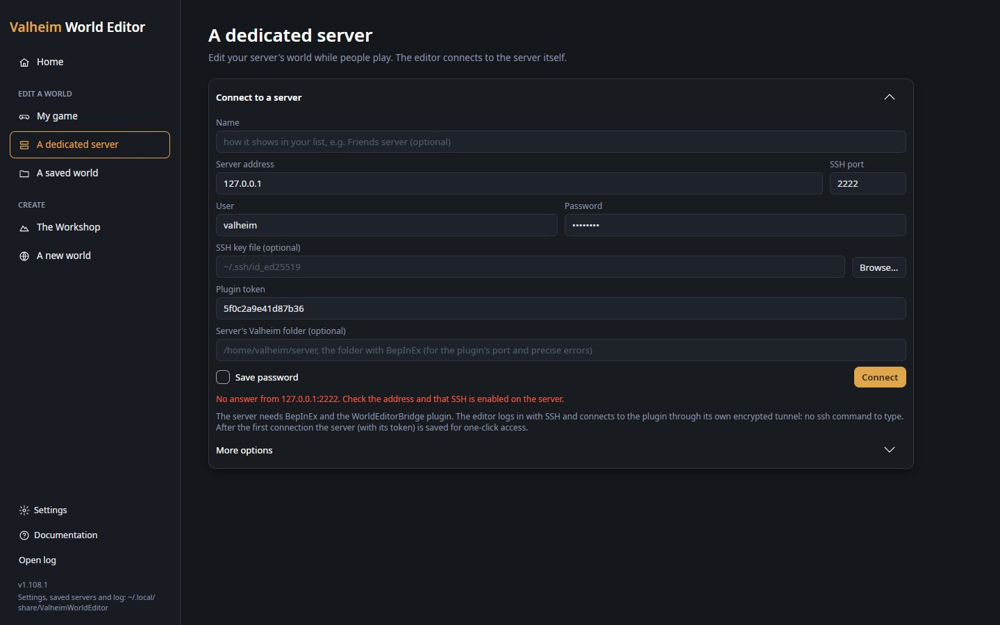
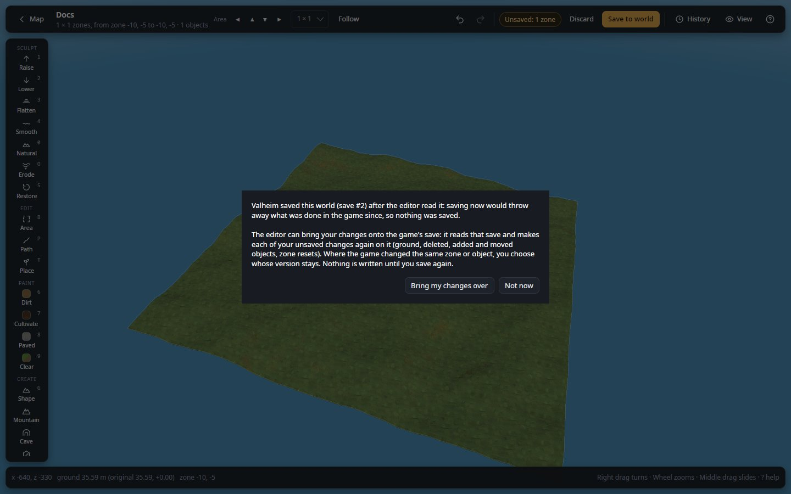

# Troubleshooting

Find what you see in the table, then follow its section: each says why it happens and what to do.

| What you see | Go to |
|---|---|
| "Valheim was not found on this computer", or boxes instead of models | [Valheim not found](#valheim-not-found) |
| **My game** lists steps, or the running game does not show on **Home** | [My game shows steps to do](#my-game-shows-steps-to-do) |
| A message under the server form after **Connect** | [A server will not connect](#a-server-will-not-connect) |
| A world card is greyed out, or a world will not open | [A world will not open or is greyed out](#a-world-will-not-open-or-is-greyed-out) |
| Saving ends with "Nothing changed" or "Not saved" | [Saving says nothing changed](#saving-says-nothing-changed) |
| "The game saved this world" when you save | [The game saved while you were editing](#the-game-saved-while-you-were-editing) |
| Live: players do not see a change, or the editor does not see theirs | [A live change does not show](#a-live-change-does-not-show) |
| Flicker, lines or a black 3D view on Windows | [Flicker or lines on Windows](#flicker-or-lines-on-windows) |
| "Windows protected your PC", or macOS will not open the app | [Windows or macOS blocks the app](#windows-or-macos-blocks-the-app) |
| Claude says it cannot reach the editor | [Claude cannot connect](#claude-cannot-connect) |
| A script says "mistakes", "error" or "changed nothing" | [A script fails](#a-script-fails) |
| Anything else | [The log and bug reports](#the-log-and-bug-reports) |

## Valheim not found

The editor reads the game's textures, models and terrain from your Valheim install; without it no world or Workshop
opens. The start page then shows **Get the game's look** with "Valheim was not found on this computer."

1. Install Valheim with Steam on this computer. Owning it is enough: the game need not run.
2. In Steam, right-click Valheim in your Library, then **Manage › Browse local files**. The folder that opens (the one
   with `valheim_Data`, or `valheim.app` on a Mac) is the one to choose.
3. Paste its path in the card, or use **Browse…**, then **Use**. A folder near it works too (`steamapps`, `common`,
   `valheim_Data`, `valheim.app`).

Usual places:

- Windows: `C:\Program Files (x86)\Steam\steamapps\common\Valheim`
- Linux: `~/.local/share/Steam/steamapps/common/Valheim` (Flatpak Steam:
  `~/.var/app/com.valvesoftware.Steam/.local/share/Steam/steamapps/common/Valheim`)
- macOS: `~/Library/Application Support/Steam/steamapps/common/Valheim`
- Another Steam library: `<library>/steamapps/common/Valheim`

The folder can be changed later in **Settings** → **Valheim game folder** (**Automatic** searches the Steam libraries
again). If the card says **The game's look could not be read**, press **Try again** or check the folder in Settings;
if it fails again, report it with the log ([below](#the-log-and-bug-reports)).

*"Valheim was not found on this computer.": choose the folder with `valheim_Data`, then **Use**.*

## My game shows steps to do

**My game** says what your Valheim still needs before **Edit live** appears:

| It says | Do this |
|---|---|
| "Your game needs BepInEx and the WorldEditorBridge plugin" | Install both: see [Edit the world you are playing](../guides/edit-your-game-live.md). |
| "BepInEx is installed: only steps 2 and 3 are left." | Add the plugin to `BepInEx/plugins`, then start Valheim. |
| "Start Valheim once with BepInEx" | The plugin has never run. Start the game through BepInEx (the mod manager's **Start modded**, or the pack's start script on Linux), not the plain Steam button. |
| "Start Valheim and load your world" | Load a world in game (single player, or host one). A game that joined someone else's server cannot be edited. |

The editor checks every few seconds. It looks for the plugin's settings file in each BepInEx folder it knows: your
Valheim folder, the mod manager profile the editor itself was installed in, every r2modman and Thunderstore Mod
Manager profile for Valheim (on Linux also the Flatpak r2modman), and the folders under **Settings** → **BepInEx
folders**. If your game or profile is somewhere else, add its `BepInEx` folder, its profile or a folder of profiles
there.

**Still nothing while the game runs?** The plugin listens on port 5182. If another program uses that port (a
`ssh -L 5182:…` tunnel you opened by hand, for example), the plugin cannot start, and the game's
`BepInEx/LogOutput.log` has a line `WorldEditorBridge: caught at … while listening on 127.0.0.1:5182 (the bridge does
not answer)`. Close that program, or change `Port` in the [plugin settings](../live-mode.md#plugin-settings).

"Your game could not be checked: …" means the editor could not read a BepInEx folder: the rest of the message says
why.

## A server will not connect

The message under the form says what went wrong. Messages that start alike are listed once.

| Message | What to do |
|---|---|
| "Enter the server address." / "Enter the plugin's token: …" | Fill in **Server address** or **Plugin token**. |
| "The server refused the login: check the user name and the password or key." | Check **User**, and the **Password** or **SSH key file**. A key with a passphrase needs **More options** → **Key passphrase**. |
| "No answer from <address>:<port>. Check the address and that SSH is enabled on the server." | Check **Server address** and **SSH port** (22 unless changed), and that the server accepts SSH. |
| "The server's identity changed (it was …, now …)." | If you reinstalled the server, empty the `HostKey` line the message names in `servers.cfg`, then connect again. Otherwise do not connect: someone may be pretending to be your server. |
| "The server answered but refused the token." | Copy the `Token` line of `BepInEx/config/Tie.WorldEditorBridge.cfg` on the server again, whole. |
| "That token cannot be sent (…)" | The token holds a line break or another stray character: copy it again. |
| "The tunnel is open, but the plugin does not answer on the server: …" | The server is not running, or not with BepInEx and the plugin. Fill in **Server's Valheim folder (optional)** in the form and connect again for a precise answer (below). |
| "The plugin answered, but the game it runs in does not host the world" | The plugin is in a game that joined another server. Install it on the server that hosts the world. |
| "The server answered with an error (…). Is it the WorldEditorBridge plugin?" | Something else answers on the plugin's port: check **More options** → **Plugin port** and `Port` in the plugin's settings. |
| "Could not connect: …" | Any other failure; the rest of the message says what. |

With **Server's Valheim folder** filled in, the editor looks there over SSH and says exactly what is missing: "The
folder … does not exist on the server", "BepInEx is not installed in …", "The plugin is not in …/BepInEx/plugins",
"The plugin is installed but has never run: restart the server with BepInEx", or "The plugin is installed but does
not answer: is the server running, and started with BepInEx (not the plain start script)?".

With **I made my own tunnel**, "Nothing answers on 127.0.0.1:…" or "No answer from 127.0.0.1:… within … s" means your
tunnel is not open, or the server is not running with the plugin.

*Connect pressed with nothing answering at the address: "No answer from 127.0.0.1:2222. Check the address and that SSH
is enabled on the server." Check **Server address** and **SSH port**.*

## A world will not open or is greyed out

A greyed-out card under **A saved world** says why in orange. The usual reasons:

- "Old save format: load this world in Valheim once, then it can be edited here." The game converts old single-file
  worlds when it loads them.
- "Made with a world generation mod (…) that no add-on in use draws", "… the add-on is turned off", or "… draws once
  … is in one of the BepInEx plugins folders": install the add-on, turn it on in **Settings → Add-ons**, or add the
  mod's BepInEx folder in Settings. See [Edit a world made with Expand World, Riverheim or Tunnelheim](../guides/use-mods-worlds.md).
- A Riverheim world also needs a Riverheim that knows its preset (update an older one); worlds made with Riverheim's
  deprecated beta cannot be opened.

For a folder you typed under **Another world folder**: "That folder holds worlds; pick one of them (…)" means you
chose a `worlds_local` folder instead of one world; "No Valheim world in that folder" means it holds no
`_main.<n>.chunks` files. See [Open a world that is not in the list](../guides/open-a-world.md).

"Could not open the world: …" gives the reason after the colon; the log has the details.

## Saving says nothing changed

The editor checks every save by reading it back: if anything is wrong, it removes the new files and ends with
"Nothing changed". Your world is as it was, and your changes are still in the editor.

| Message | What to do |
|---|---|
| "There are no unsaved changes." | Nothing waits to be saved. |
| "Valheim saved this world (save #…) after the editor read it" | See [The game saved while you were editing](#the-game-saved-while-you-were-editing). |
| "Saving failed (…). Nothing changed." / "The saved world did not read back correctly (…). Nothing changed." | Check the reason in brackets (a full disk, a folder you cannot write). Close Valheim if it uses the world, then save again. |
| "This world uses save format …; the editor saves only formats … to …." | A newer format: update the editor. An older one: load and save the world in an up-to-date Valheim, then open it again. |
| "Not saved: … zone …: not generated yet (…; visit it in game first)" | No player has been there, so the world has no data to change. Walk there in game, then edit again. |
| "Not saved: … the world has no terrain object to copy yet (edit the ground once in game first)" | Dig or level the ground once anywhere in game, save the game, then save again. |
| "Nothing could be saved." | Everything was in the "Not saved" list above. |

A brush stroke that does nothing with "Nothing changed: the Mask leaves out all the ground under the brush" is the
[Mask](../masks.md) at work: check its height, slope, biome and paint settings.

## The game saved while you were editing

A running game keeps the world in memory and writes over the files. If it saved after the editor read the world,
**Save to world** saves nothing and asks **The game saved this world**:

1. Press **Bring my changes over**. The editor reads the game's save and makes each of your changes again on it.
2. If the game changed the same zones or objects, it asks once per kind (ground, objects changed, objects removed):
   **Keep mine** or **Keep the game's**.
3. Look the result over: your changes are now pending on the game's save. Nothing is written yet.
4. Close Valheim (or stop the server), then press **Save to world** again.

*Save refused because the game saved the world after the editor read it: **Bring my changes over** makes your changes again on the game's save.*

**Not now** leaves everything as it was. Bringing your changes over may drop some History steps (the message says
how many).

To avoid it, close the game before you save, or edit live. More in
[Saving a world](../concepts/saving-and-history.md#saving-a-world).

## A live change does not show

- **Players do not see an applied change.** Look at the server's `BepInEx/LogOutput.log`: the lines after each apply
  say what was destroyed, created and moved, and whether something made a destroyed object again. See
  [What the plugin logs](../live-mode.md#what-the-plugin-logs).
- **"Could not apply live: …" or "Could not reach the game: …"**. The game did not answer within 30 seconds (it is
  loading, or busy). Nothing of it was done: press **Apply live** again.
- **"Not applied: the game changed the ground where you have changes"**. You answered **Not now** to **Apply over the
  game's changes**: apply again and choose **Apply**, or undo your changes there.
- **The editor does not see what players change** and says "The WorldEditorBridge plugin on the server is older than
  this editor". Update the plugin; meanwhile **Reload** reads the world again.

## Flicker or lines on Windows

On Windows the editor draws through Direct3D, as games do. If the 3D view or the map flickers, shows lines, draws
wrongly or slowly, try the graphics driver's own OpenGL:

1. On the start page, open **Settings**.
2. Under **Drawing**, turn on **Draw with the graphics driver's OpenGL**, then **Save**.
3. Close the editor and start it again.

Turn it off the same way if it is worse. Updating the graphics driver helps too. The **Controls** card (`F3` in the 3D
view) shows under **This computer** which graphics card and OpenGL version draw the view.

## Windows or macOS blocks the app

**Windows: "Windows protected your PC".** SmartScreen shows it the first time, until it knows the editor's signature.
Click **More info** (it shows the publisher), then **Run anyway**.

**macOS: "cannot be opened".** The Mac build is signed, but not with an Apple Developer certificate, so macOS cannot
check who made it.

1. Double-click **ValheimWorldEditor.app** once and close the message.
2. In **System Settings › Privacy & Security**, click **Open Anyway** next to ValheimWorldEditor.
3. Or, in Terminal: `xattr -dr com.apple.quarantine /Applications/ValheimWorldEditor.app`.

<!-- picture: os-blocked.jpg: two halves side by side: left, Windows SmartScreen "Windows protected your PC" after More info, showing the publisher and Run anyway; right, macOS System Settings › Privacy & Security scrolled to the "ValheimWorldEditor was blocked" line with Open Anyway -->

After that it opens with a double-click. The Mac build is experimental (Apple silicon, macOS 12 or later).

## Claude cannot connect

| Check | What to do |
|---|---|
| The editor is running | Claude reaches the editor only while it runs. Start it. |
| **Allow Claude to connect** is on | In **Settings → Claude**, turn it on and press **Save**. The section should say "Listening on http://127.0.0.1:5731/mcp". |
| "Could not listen on port …" | Another program uses the port. Choose another **Port**, **Save**, then add the editor to Claude again with the new command. |
| You pressed **New token** | The old token stopped working: run the new Claude Code command again. |
| Claude Desktop | Restart it after editing its configuration. If you moved the editor's folder, copy the lines from Settings again: they hold the program's path. |
| Claude Code | `/mcp` should list **valheim-editor** as connected. If not, run the command from Settings again. |

Claude connected but changes nothing? While a live world has **Auto** on, Claude may change only the View panel: turn
Auto off. Scripts need **Claude may run scripts**. See [Claude](../claude.md).

## A script fails

The output box under the script says what happened, and nothing changed in every case:

- "The script has mistakes": a typing or C# mistake, listed with its line (`line 4: The name 'Groud' does not exist
  in the current context`). Fix that line. "The script has no statement to run" below it means the box is empty or
  holds only comments: write at least one line of code, or load an example.
- "The script stopped with an error": it failed while running, at the line given (an object name the editor cannot
  make, a paint or mountain preset it does not know, a size of 0 or less, a division by zero).
- "The script ran and changed nothing.": use `Print` to check that your loop finds what you expect.
- "The area changed while the script ran": you edited, undid or saved meanwhile. Run it again and wait.
- "The script was stopped (or ran 2 minutes)": make it lighter, for example `Area.Points(step: 4)`.

More in [Script](../scripting.md#when-something-goes-wrong).

## The log and bug reports

Everything the editor says goes to `ValheimWorldEditor.log`, started anew each run, in the editor's data folder:

- Windows: `%LOCALAPPDATA%\ValheimWorldEditor`
- Linux: `~/.local/share/ValheimWorldEditor`
- macOS: `~/Library/Application Support/ValheimWorldEditor`

**Open log**, at the bottom of the start page's side menu, opens it; the folder is shown there too. Every error the
editor handles is a line starting `Caught at`, with where it happened and what the editor was doing. Personal data
is left out: your home folder is written `~`, and paths, addresses, account names, passwords and tokens are replaced
by placeholders such as `<path>`.

To report a problem, [open an issue](https://github.com/Shuiei/valheim-world-editor/issues) with:

1. What you did and what you saw (a screenshot helps).
2. The editor's log, from **Open log**, right after the problem (before you start the editor again).
3. Live: the game's or server's `BepInEx/LogOutput.log`.
4. For a slow view: turn on **Record frame rates** on the **Controls** card (`F3`), use the view, and attach
   `perf-native.log` from the same data folder.

Found a security problem? Report it privately: see [SECURITY.md](../../SECURITY.md).
