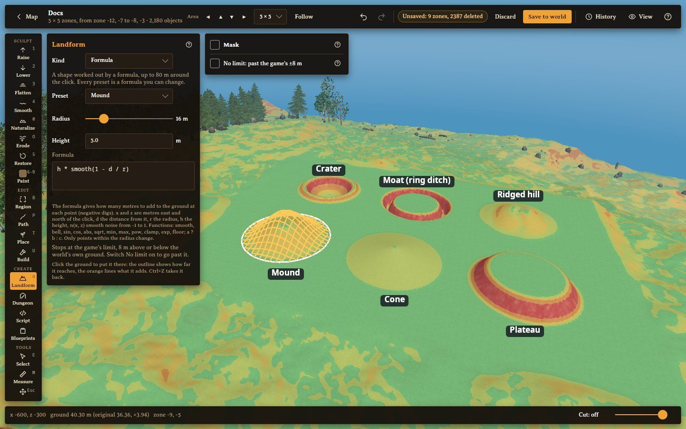
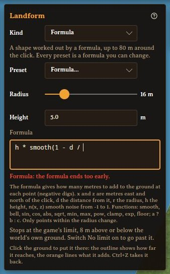
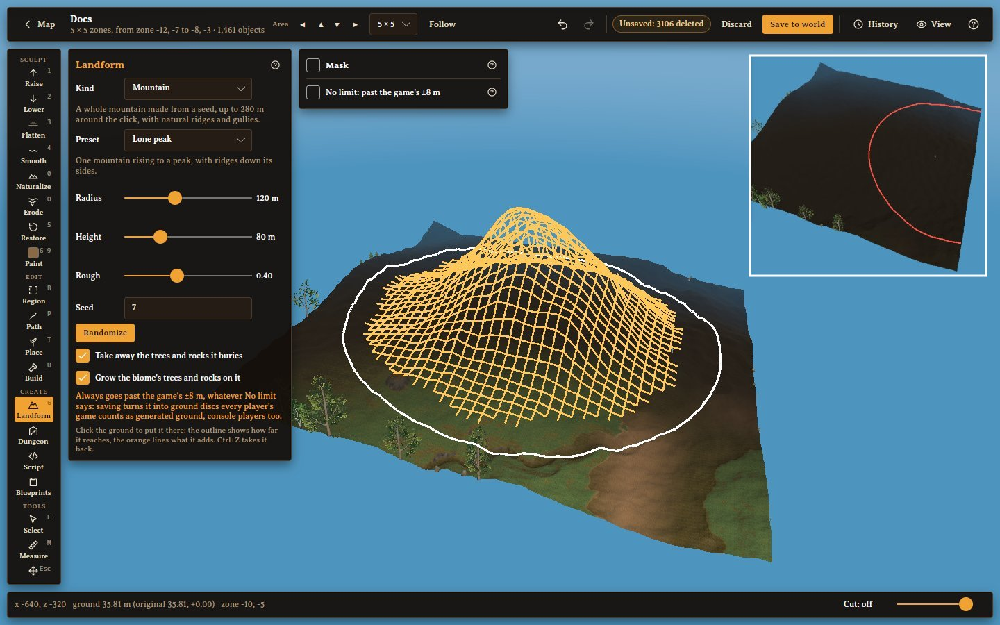
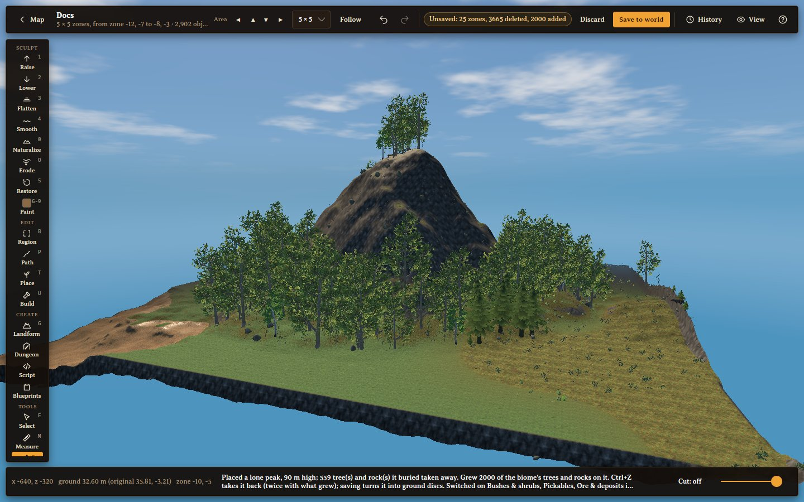
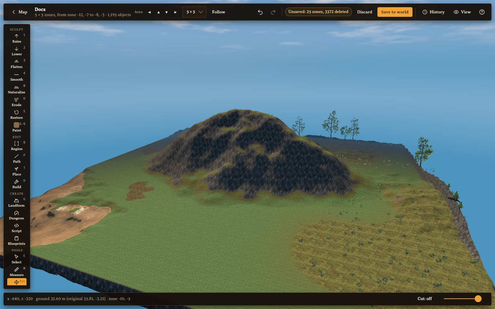
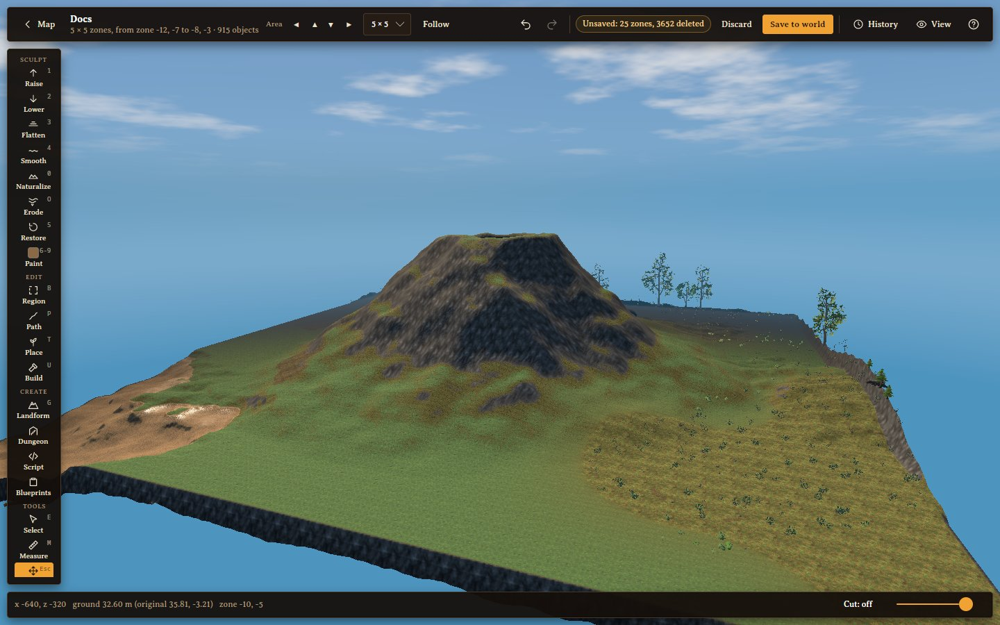
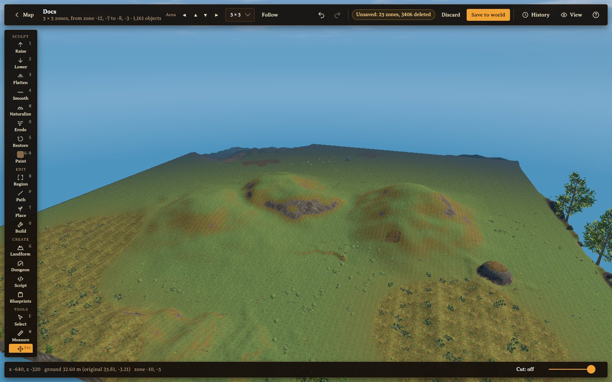
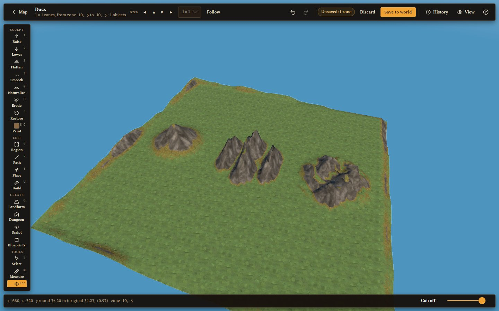
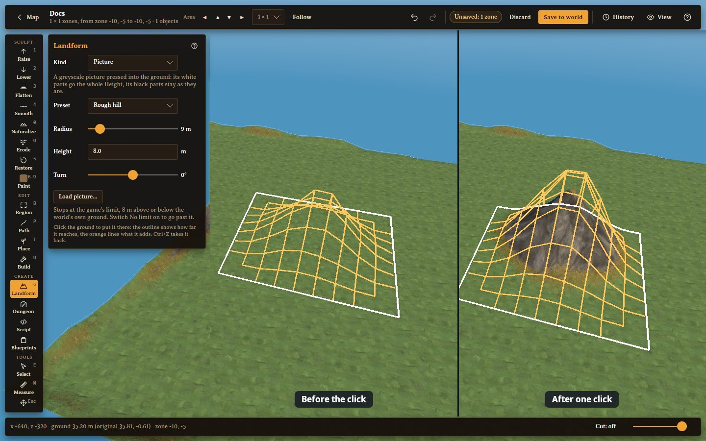

# Landform

Put a whole landform into the ground with one click: a mound or a crater worked out by a formula, a mountain far past
the game's 8 m, or a picture of your own pressed in.

**Where:** tool rail, **CREATE** section · **Key:** `G` · **Works in:** saved worlds, live

*The **Formula** kind. Front row from left: Mound, Cone, Plateau. Back row from left: Crater, Moat (ring ditch),
Ridged hill, each at the default radius of 16 m and height of 5 m, with **Slope colours** on in View so their slopes
read. The panel shows the Mound and its formula; on the mound, the white outline is the radius and the orange lines
what another click would add.*

## Use it

1. In the tool rail, click **Landform** (`G`).
2. In the panel, choose a **Kind**: **Formula**, **Mountain** or **Picture** (see [The three kinds](#the-three-kinds)).
3. Choose a **Preset**, then set **Radius** and **Height**.
4. Move the pointer over the ground. The white outline shows how far the landform reaches, and the orange lines show
   what it adds, as high or as deep as it will be.
5. Click. The landform goes in at once.
6. Not right? `Ctrl+Z` takes it back. Each click is one undo step ("Landform: Mound").

## The three kinds

Each kind has its own presets. No preset has the same name in two kinds, so the name tells which one you used.

| Kind | Makes | Radius | The game's ±8 m limit |
|---|---|---|---|
| **Formula** | A smooth, exact shape worked out by a formula you can read and change. | 2 to 80 m | Obeys it, unless **No limit** is on. |
| **Mountain** | A whole natural mountain from a seed, with ridges and gullies, and trees grown on it. | 20 to 280 m | Always goes past it. |
| **Picture** | A greyscale picture pressed in: a built-in one, or any picture file. | 2 to 80 m | Obeys it, unless **No limit** is on. |

A line near the bottom of the panel says how the kind you chose stands with the limit right now. It turns amber when
the landform will go past it. See [No limit](terrain.md#no-limit) for the switch and for what saving does with ground
past the limit.

## Settings every kind has

These are in the same place, under the same names, for the three kinds. Each kind remembers its own values.

| Setting | What it does |
|---|---|
| **Kind** | What the landform is made from. Remembered for next time. |
| **Preset** | The landform: the kind's own list. |
| **Radius** | How far it reaches from the click. |
| **Height** | How high it rises (m). For **Formula** and **Picture**, a negative height turns it upside down: a mound becomes a pit, a moat a ring wall. |
| **Turn** | Its direction, where it has one: a **Mountain** ridge or range, and any **Picture**. |

## Formula

A shape worked out point by point. Every preset is a formula shown in the box; change it and the list switches to
**Formula…**, your own, which is remembered for next time.

| Preset | Shape |
|---|---|
| **Mound** | A smooth round hill. |
| **Cone** | Straight slopes to a point. |
| **Plateau** | A flat top with a smooth slope round it. |
| **Crater** | A hollow with a raised rim. |
| **Moat (ring ditch)** | A ditch at three quarters of the radius. With a negative height, a ring wall. |
| **Bowl** | A round hollow. |
| **Ridged hill** | A mound with ridges running across it. |
| **Formula…** | Your own. |

| Setting | What it does |
|---|---|
| **Radius** | 2 to 80 m (default 16 m). Only the ground within it changes. |
| **Height** | Default 5 m. It is `h` in the formula. |
| **Formula** | How many metres to add to the ground at each point within the radius; a negative number digs. A mistake shows under the box, and nothing can be placed until it is fixed. |

*An unfinished formula: the list switched to **Formula…**, and the line under the box says what is wrong ("the
formula ends too early").*

### Write a formula

The formula is worked out for every ground point within the radius, and the result is added to the ground there.

| Name | Meaning |
|---|---|
| `x`, `z` | Metres east and north of the click. |
| `d`, `r`, `h` | Distance from the click, the radius, the height. |
| `n(x, z)` | Smooth noise from about -1 to 1, from the brushes' pattern (**New pattern** in [Naturalize](terrain.md#naturalize) changes it). Use `n(x / 10, z / 10)` for wide bumps. |
| `pi` | 3.14159… |

Functions: `abs`, `atan2(y, x)`, `bell(t)` (1 at 0, fading out by about ±1), `ceil`, `clamp(v, a, b)`, `cos`, `exp`,
`floor`, `log`, `max(…)` and `min(…)` (any number of values), `pow(a, b)`, `round`, `sign`, `sin`, `smooth(t)` (0
below 0, 1 above 1, a smooth S between), `sqrt`, `tan`.

Operators: `+ - * / %`, `^` (power), comparisons `< > <= >= == !=` (1 or 0), `&&`, `||`, `!`, and `a ? b : c`.

The presets show how it works:

| Preset | Formula |
|---|---|
| **Mound** | `h * smooth(1 - d / r)` |
| **Cone** | `h * max(0, 1 - d / r)` |
| **Plateau** | `h * smooth((r - d) / (0.35 * r))` |
| **Bowl** | `-h * smooth(1 - (d / r) ^ 2)` |
| **Moat (ring ditch)** | `-h * bell((d - 0.75 * r) / (0.12 * r))`: a ditch at three quarters of the radius. |

Two more to start from: `h * smooth(1 - d / r) * (1 + 0.3 * n(x / 8, z / 8))` is a bumpy hill, and
`abs(x) < 3 ? -h : 0` digs a 6 m wide trench across the circle.

## Mountain

A whole mountain made from a seed, added to the ground that is there, so it keeps the land's own lie and fades back
into it at its edge. Its outline is never a perfect circle, and **Rough** adds swells, ridges and gullies in
proportion to its size.

*Lone peak, 80 m high, radius 120 m, before the click: the orange lines show it as high as it will rise and the white
ring how far it reaches. Inset, top right: with the pointer near the area's edge the ring turns red and no preview
shows, because it would not fit.*

| Preset | Height / radius it rolls | Shape |
|---|---|---|
| **Lone peak** | 50–110 m / 120–240 m | One mountain rising to a peak, with ridges down its sides. |
| **Ridge** | 35–80 m / 140–260 m | A long crest, half as wide as it is long. |
| **Mountain range** | 40–90 m / 180–280 m | Three to five peaks along a line, joined by saddles. |
| **Mesa** | 20–50 m / 70–150 m | A flat top with steep, rocky sides: room to build up there. Roughness goes only on the sides. |
| **Volcano** | 45–100 m / 130–240 m | A cone with a crater at the top. |
| **Rolling hills** | 12–30 m / 100–220 m | Three to six gentle hills together. |

| Lone peak | Ridge |
|---|---|
|  |  |
| **Volcano** | **Rolling hills** |
|  |  |

*Four presets in the middle of a 5 × 5 area cleared and levelled first, so each stands out. The lone peak has the
biome's trees grown on it; the others are left bare so their shape shows.*

| Setting | What it does |
|---|---|
| **Preset** | The kind of mountain. Choosing one rolls a new mountain of it, like **Randomize**. |
| **Radius** | 20 to 280 m. Its outline is ragged, up to 15% further: the ring shows it. |
| **Height** | How high it rises above the ground there, 5 to 300 m. |
| **Turn** | **Ridge** and **Mountain range** only: the direction it runs, 0° to 179°. |
| **Rough** | 0: smooth slopes. 1: deep gullies and ridges. |
| **Seed** | The number its detail comes from: the same preset, values and seed make the same mountain again. |
| **Randomize** | A new mountain of the preset: new size, roughness, direction and seed. If it would not fit in the open area, it is made smaller as a whole, height too, so the slopes stay as gentle. |
| **Take away the trees and rocks it buries** | On at first. Trees, rocks, ore, bushes and pickables where it raises the ground more than 2 m are taken away (saving would do it anyway). Building pieces stay, and so does what is in a dungeon high above. |
| **Grow the biome's trees and rocks on it** | On at first. Grows the biome's own trees and rocks, by the game's rules, on the slopes it raised by more than a metre, away from what already stands there. A second undo step. |

A mountain must fit whole in the open area, ragged edge included: where the ring is red, a click puts nothing in.

## Picture

A greyscale picture pressed into the ground: its white parts go the whole **Height**, grey parts part of it, black
parts stay as they are. The picture covers a square twice as wide as **Radius**; the outline shows it.

*The built-in pictures, 6 m high at a radius of 8 m. From left: Rough hill, Dunes, Rocky ground.*

*The **Rough hill**, **Radius** 9 m and **Height** 8 m. Left: its square outline and orange preview on flat ground
before the click. Right: the whole hill, put in by one click.*

| Preset | Shape |
|---|---|
| **Rough hill** | A small peak with rough sides. |
| **Dunes** | Parallel ridges inside a round patch. |
| **Rocky ground** | Lumpy, broken ground. |
| Your own | Every picture you loaded, under its file name. |

| Setting | What it does |
|---|---|
| **Radius** | Half the picture's side, 2 to 80 m (default 16 m). |
| **Height** | How far the white parts rise (m, default 4). Negative: they are pressed down instead. |
| **Turn** | Turns the picture, -180° to 180°. |
| **Load picture…** | Uses any picture (PNG, JPEG…): a heightmap from another tool, a logo, a hand-drawn shape. Its brightness is the height; transparent parts count as black. It is scaled to a square of 128 × 128 points, so a wide picture is squeezed and fine detail is lost. It is kept for next time under its file name. |
| **Forget picture** | Removes the loaded picture chosen. Shown only for loaded pictures: the built-in ones stay. |

The pictures are the brushes' [stamps](terrain.md#stamps): one you load here is a brush shape too, and one loaded
there is offered here. Two built-in stamps, **Mesa (flat top)** and **Crater rim**, are brush shapes only: as
landforms, the **Formula** kind makes them (**Plateau**, and **Moat** with a negative height).

## Shortcuts

| Key or mouse | What it does |
|---|---|
| `G` | Choose Landform. |
| Click the ground | Put the landform in there. |
| `Ctrl+Z` | Take the last one back (press twice when trees grew on a mountain). |
| `Esc` | Leave the tool (back to View). |

## Tips and limits

- **Formula and Picture stop 8 m from the generated ground**, and the status bar says so. For taller ones, tick
  **No limit: past the game's ±8 m** on the **Mask** card next to the panel (see [No limit](terrain.md#no-limit)):
  it stays on for every ground tool until you switch it off.
- **A mountain always goes past the game's 8 m**, whatever **No limit** says. Saving turns it into ground discs and
  clears the area's History, as with [No limit](terrain.md#no-limit). Check it before you save.
- **For big mountains, open a bigger area first** (the area size list in the top bar): on a 5 × 5 area the radius can
  be up to about 137 m.
- **The [Mask](masks.md) applies**: where it leaves ground out, the landform stops in a step, a mountain in a cliff.
- **A formula that gives 0 everywhere** changes nothing, and the status bar says so. Points where it gives no number
  (a division by zero) are left as they were.
- **The area's outermost line of points never changes** (see
  [The locked edge](concepts/areas-and-zones.md#the-locked-edge)).
- **To soften an edge** afterwards, go over it with the **Smooth** or **Naturalize** brush.
- **Gentle slopes keep grass and trees; steep ones show bare rock**, as the game draws them.
- **To use a picture as a brush** while you drag, choose it as the brush's **Shape** instead (see
  [Stamps](terrain.md#stamps)). To set a whole area's heights from a picture, see
  [Heightmap](area.md#heightmap).
- **A [script](scripting.md)** can place formula shapes and mountains too, by rule.

## Related

- [Raise or dig past the game's 8 m limit](guides/raise-past-the-limit.md)
- [No limit](concepts/ground-limits.md#no-limit): how the ground is saved past 8 m
- [How a mountain is made](concepts/ground-limits.md#how-a-mountain-is-made)
- [Growing rules](concepts/objects.md#growing-rules): what grows on a mountain
- [Sculpt and paint](terrain.md): brushes and stamps
