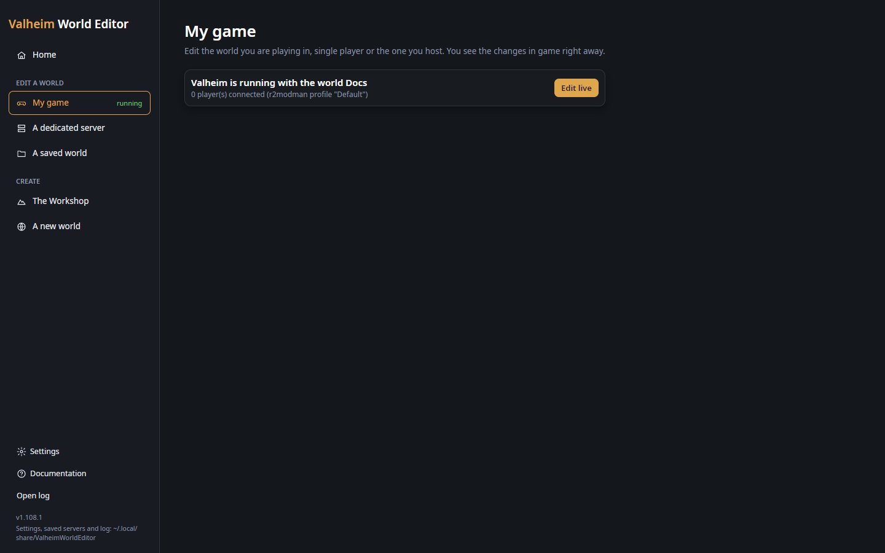
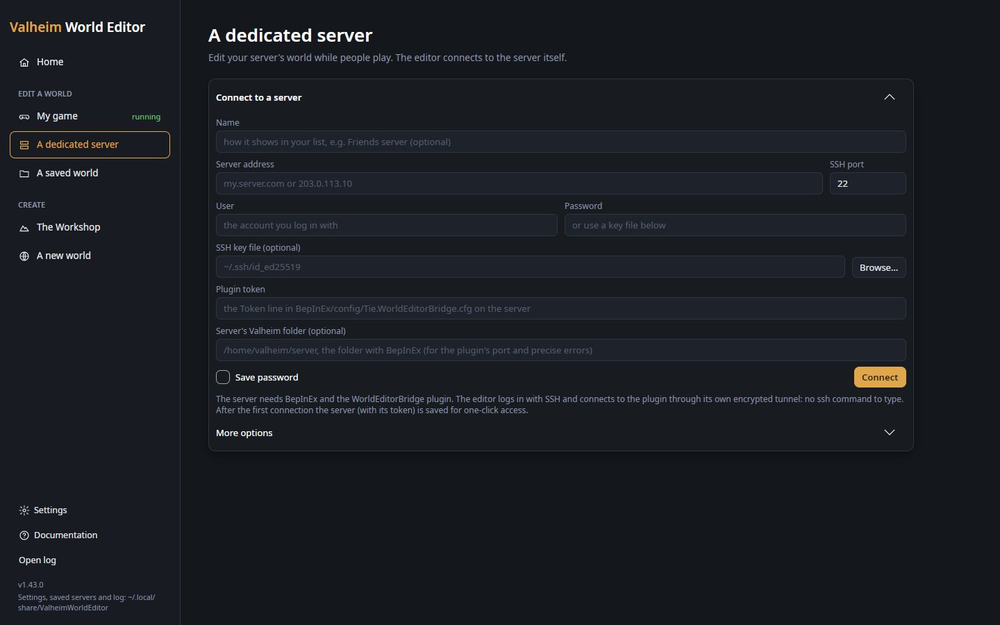

# Live mode



*The start page has noticed the running game by itself: **Edit live** opens its world.*

In live mode the editor works on the world of a **running** game instead of a save on disk. Players can stay
connected while you edit, and they see the changes as soon as you apply them. The game then saves them like any
other change. While an area is open, the editor also follows what players do there.

It needs **BepInEx** (the mod loader, [BepInExPack for Valheim](https://thunderstore.io/c/valheim/p/denikson/BepInExPack_Valheim/))
and the **WorldEditorBridge** plugin in the game that hosts the world: normally the dedicated server, or your own
game when you play single player or host. Players who join need neither, and offline mode does not use BepInEx.

## How it works

The WorldEditorBridge plugin runs inside the game that hosts the world. It answers the editor on a port of that
computer (5182 at first), and only when the editor sends the plugin's secret **token**. Through it the editor:

1. **Reads the whole world** from the game when you connect: every object the game keeps, the zones it has made,
   its locations. This is the same data a save holds, so the map, the search and every tool work as offline.
2. **Sends your changes** when you press **Apply live** (or at once with **Auto**): the ground of each changed
   zone, the objects to remove, make and move, then the zones to reset. The game shares them with every player
   connected, as it does with what players build.
3. **Asks every 2 seconds** what changed in the zones of the open area, so you see what players build, dig and
   remove while you edit ([Following the game](#following-the-game)).

All of this runs in the game's own loop, a few requests per frame, so the game never reads or changes its world
from two places at once.

The plugin's version is the editor's version: use the plugin from the same release as your editor. Some
features need a recent plugin (see [Limits](#limits)); with an older one the editor says what is missing.

## My game

For single player, or a world you host from the game.

1. **BepInEx in your Valheim**, once: install [BepInExPack for Valheim](https://thunderstore.io/c/valheim/p/denikson/BepInExPack_Valheim/)
   with a mod manager (r2modman, Thunderstore Mod Manager) or by hand into the Valheim folder, as its page
   explains. On Linux with the native game, BepInEx is started through the pack's start script (its page shows
   the Steam launch option); a mod manager does that for you.
2. **The plugin:** install WorldEditorBridge with a mod manager (Thunderstore or Hexium), or copy
   `WorldEditorBridge.dll` from `WorldEditorBridge-<version>.zip` (on the editor's releases page) into
   `BepInEx/plugins` of your Valheim, or of your mod manager profile.
3. **Start Valheim** with BepInEx and load your world. The plugin's first start writes its settings file
   (`BepInEx/config/Tie.WorldEditorBridge.cfg`, with the token), which the editor reads.
4. The start page notices the game by itself. **Home** shows "Valheim is running with the world …", how many
   players are connected, and an **Edit live** button; **My game** in the side menu says *running*.

**My game** always says where you are: "Your game needs BepInEx and the WorldEditorBridge plugin" with the three
steps above (and "BepInEx is installed: only steps 2 and 3 are left" when it is), "Start Valheim once with
BepInEx" when the plugin is installed but has never run, "Start Valheim and load your world" when everything is
ready, and the running card with **Edit live** once the game runs. It checks every 2.5 seconds (every 5 seconds
while the game runs).

### How the editor finds your game

On your own computer the editor reads the plugin's port and token itself, from the settings file in each
BepInEx folder it knows:

- your Valheim folder (found through Steam, or set in **Settings**);
- the mod manager profile the editor itself was installed in, if any;
- every r2modman and Thunderstore Mod Manager profile for Valheim (on Linux also the Flatpak r2modman);
- the folders you added in **Settings** (a BepInEx folder, a profile holding one, or a folder of profiles).

It then asks each plugin found whether a world is loaded. The running card names where the plugin was found
(for example *r2modman profile "Default"*). If your Valheim or your mod manager profile is not in a usual place,
add it in **Settings** on the start page.

The plugin listens on port 5182 of your computer. If something else uses that port (for example an `ssh -L
5182:…` tunnel you opened by hand), the plugin cannot start: close that tunnel, or change `Port` in the plugin's
settings ([below](#plugin-settings-tieworldeditorbridgecfg)). The game's `BepInEx/LogOutput.log` then says
`WorldEditorBridge could not listen on …`.

## A dedicated server



*The form under **A dedicated server**. After the first connection the server is saved above it, for one-click access.*

1. **On the server, once:** BepInEx (BepInExPack for Valheim, following its dedicated-server instructions), then
   `WorldEditorBridge.dll` (from `WorldEditorBridge-<version>.zip`) in its `BepInEx/plugins/`, then restart the
   server. Its log shows `WorldEditorBridge <version> listening on http://127.0.0.1:5182/ (token in
   BepInEx/config/Tie.WorldEditorBridge.cfg)`. This first start writes the settings file and its token: until
   the server has started once with the plugin, there is no token to enter.
2. Start page → **A dedicated server** (under **Edit a world**) → **Connect to a server**. Fill in the form
   (below).
3. **Connect.** The editor:
   - logs in to the server over SSH (no `ssh` program needed: it has its own);
   - forwards a free port of your computer (from 15182 up) to the plugin's port on the server, through that
     encrypted connection;
   - checks that the plugin answers and accepts the token, then loads the world.
4. The server is saved in the list above the form, with its token, for one-click access next time.

| Field | What it is |
|---|---|
| **Name** | How the server shows in your list (optional; the address otherwise). |
| **Server address** | The server's name or IP address. You can also type `user@address` here. |
| **SSH port** | The server's SSH port (22 unless it was changed). |
| **User** | The account you log in to the server with. |
| **Password** | The account's password. Leave it empty to log in with a key. |
| **SSH key file (optional)** | Your private SSH key file (**Browse…** to choose it). Empty: the usual keys in `~/.ssh` (`id_ed25519`, `id_ecdsa`, `id_rsa`) are tried. |
| **Plugin token** | The `Token` line of `BepInEx/config/Tie.WorldEditorBridge.cfg` on the server. |
| **Server's Valheim folder (optional)** | The server folder that holds `BepInEx`. With it, the editor reads the plugin's port there (never the token), and when the plugin does not answer it says exactly what is missing. |
| **Save password** | Keep the password with the saved server (see [Saved servers](#saved-servers)). |
| **More options** → **Key passphrase** | The key file's passphrase, when it has one. It is never saved. |
| **More options** → **Plugin port** | The plugin's port on the server, when it is not 5182 and no folder is given. |
| **More options** → **I made my own tunnel** | **Bridge address** and **Token**, then **Connect**: for a tunnel you made yourself with `ssh -L` or PuTTY (or a plugin on this computer). |

The **token is always typed by you**: the editor never reads it from the server. So an SSH login alone is not
enough to change the world: whoever connects must also know the plugin's secret.

### When it does not connect

The message under the form says what went wrong:

- "The server refused the login": check the user name and the password or key.
- "No answer from …": check the address and SSH port, and that SSH is enabled on the server.
- "The server answered but refused the token": copy the `Token` line again.
- "The tunnel is open, but the plugin does not answer on the server": the server is not running, or not with
  BepInEx and the plugin. With **Server's Valheim folder** filled in, the editor looks in that folder over SSH and
  says which: the folder does not exist, BepInEx is not installed there, the plugin is not in
  `BepInEx/plugins`, the plugin has never run (restart the server with BepInEx), or the plugin is installed but
  the server was started with the plain start script instead of BepInEx's.
- "The plugin answered, but the game it runs in does not host the world": the plugin is in a game that joined
  someone else's server. Install it on the server that hosts the world.

Of the usual keys in `~/.ssh`, one the editor cannot use (it has a passphrase, or a format it does not read) is
skipped, and the other keys and the password are still tried.

### Saved servers

After the first successful connection the server is listed above the form (most recent first) with **Connect**,
**edit** and **forget**, and the form folds away under **Connect to another server**. Each row shows
`user@address`, whether it uses a key file, a saved password, or asks for the password, and its folder. Boxes in
the row ask for what is not saved: **Password**, **Key passphrase (if any)** (never saved), or **Plugin
token**.

- **edit** fills the form with the server, to change its address, folder, port or name; then Connect updates it.
- **forget** removes it (its password and token with it).

The servers are kept in `servers.cfg` in the editor's data folder (`~/.local/share/ValheimWorldEditor` on Linux,
`%LOCALAPPDATA%\ValheimWorldEditor` on Windows; the start page's side menu shows the folder), one section per
server, so you can also edit it by hand:

```
[My server]
Host = my.server.com
SshPort = 22
User = valheim
Password =
KeyFile =
Token = …
BridgePort = 5182
GameFolder = /home/valheim/server
HostKey = SHA256:…
```

- A server is one account on one address and port: connecting again with the same ones updates its section.
- `Password` is only filled when **Save password** was ticked. It is stored as plain text: on Linux the file can
  only be read by you; prefer an SSH key where you can.
- `HostKey` is the server's identity, remembered on the first connection (trust on first use). If it ever
  changes, the editor refuses to connect, because someone could be pretending to be your server; this holds for
  every account on that address and port, not only the one saved. If you reinstalled the server, empty that line
  (in each saved server with that address) to accept the new identity.

### Plugin settings (`Tie.WorldEditorBridge.cfg`)

In `BepInEx/config` of the game or server. Plugins older than 0.41.0 named it `local.worldeditorbridge.cfg`;
the plugin moves it to the new name on its first start (port and token are kept), and the editor reads either.

| Setting | Default | Meaning |
|---|---|---|
| `BindAddress` | `127.0.0.1` | Address the bridge listens on. Keep `127.0.0.1` and use an SSH tunnel (the editor makes its own); anything else exposes the bridge to the network. |
| `Port` | `5182` | TCP port of the bridge. |
| `Token` | generated | The secret the editor must send. Made on the first start when empty: 24 random letters and digits. Anyone with the token and access to the port can change the world, so keep it private. For your own game the editor reads it from this file; for a server you type it in. Empty the line and restart to get a new one. |

## What changes in the editor


*Connected to a running server: **LIVE**, **Reload** and **Auto** in the top bar, and a hut just built that the game
does not have yet ("Not applied: 1 zone, 40 added", green dots on the new pieces).*

In live mode the editor looks and works as offline, with these differences:

| Control | What it does |
|---|---|
| **LIVE** badge | Shows that the editor is connected to the running game. |
| **Apply live** | Takes the place of **Save to world** (also `Ctrl+S`). Sends every pending change to the game ([below](#apply-live-auto-and-reload)). |
| **Auto** | Applies after every stroke, placement and undo, without pressing **Apply live**. Turning it on sends what is already waiting. Remembered between runs. |
| **Reload** | Loads the whole world again from the game. Changes you have not applied are dropped (you are asked first). You stay in the same place. |
| Pending counter | Reads "Not applied: …" (or "All applied"); the map's line reads "Not applied yet: …". |
| Players | Connected players are drawn at their place with their name: blue posts in the 3D view, blue dots on the map. They move as the players do (every 2 seconds in 3D, every 5 on the map). **View → PLAYERS → Go to** a player, **Go**: the camera goes to them, and the area moves to them when they are outside it. |

## Apply live, Auto and Reload

**Apply live** sends, in this order:

1. **The ground** of every zone you changed (height and paint, and [No limit](terrain.md#no-limit) ground turned into the
   game's own ground). Every player's game takes the new ground at once.
2. **The objects**: those you deleted, placed, pasted, replaced or changed, and those you moved
   ([Moving things](#moving-things)). Only what changed since the last apply is sent.
3. **Zone resets**, last. The game regenerates those zones, so after them the editor reads the world again from
   the game and the history starts over.

The message after it says what was done ("Applied to the running game: 2 zone(s) of ground; …"). If the game
does not answer, nothing is marked as applied and the next apply sends it again. One apply runs at a time: a
second press waits and sends only what is still pending.


*After **Apply live**: "All applied", the green dots gone, and the hut in the game at once. The status bar shows what
came back from the game.*

After each apply the history is kept on disk with the world, as after a save: if you close the editor and
connect to the same game later, the steps are there to undo.

**Auto** makes every change an apply. It waits for the end of a stroke, so a long brush stroke goes as one apply.
Claude cannot change a live world while Auto is on (see [Claude](claude.md)).

**Reload** reads the whole world from the game again. You need it rarely: the open area follows the game by
itself. Use it for the rest of the world (the map), or with a plugin too old to follow.

## Following the game

While an area is open, the editor asks the game every 2 seconds what changed in that area's zones. Only those
zones are asked about, and cheaply: the game answers with one number per zone that changes whenever something in
the zone does, and only the zones whose number changed are read again.

- **Objects** players built, removed or changed there appear, go or change in the editor, without a step in
  History. A changed object (a chest used, a piece moved) stays the same object in the editor, so its place in
  History, the selection and the inspector stay with it; the inspector does not apply over a version the game
  changed meanwhile (it shows the new one to change again). An object you deleted and applied stays deleted
  (undo brings it back); one the game removed is gone for good: undo and redo leave it alone, and a deletion of
  it not applied yet is dropped. Objects you placed that players then picked or destroyed go too. Creatures and
  other things that move by themselves, and fires, smelters, beehives and the like (which change their own data
  all the time), are followed when they appear or go, not for every move or tick; portals are followed too.
- **Ground** dug, flattened, paved or cultivated in the game comes in where you have no changes of your own in
  that zone. Where you have changes not applied yet, yours are kept and the status bar says so. **Apply live**
  (and **Auto**) then asks first ("Apply over the game's changes"): applying writes your ground over that zone,
  and what players did to its ground since may be erased. Answer **Not now** to keep your changes pending
  (nothing is applied then); undo them and the game's ground comes in at the next look.
- Following happens only in the 3D editor, never during a brush stroke or while applying. The map shows the
  world as it was last read (**Reload** reads all of it again).

The status bar says what came from the game, for example "From the game: 2 new object(s), 1 removed, the ground
of 1 zone(s)." A change of data alone (a fire burning down, a chest used) comes in without a word. Following
needs WorldEditorBridge 1.17.0 or newer; with an older one the editor says so, and **Reload** reads the world
again.

## Moving things

An object you move (the Select tool's move or turn, or a **Cut** then pasted) moves in the game as the same
object, under its own id, when nothing about it changed but its place and turn. A mod that keeps track of objects
while the game runs (a chest's label sign, a warehouse's chests, a ward) then still knows it, instead of seeing
an object gone and a new one made, and the chest keeps what is in it as the game has it. Undo moves it back the
same way.

A player's game puts a standing object (a wall, a chest, a sign) where it is once, as it comes into range, and
does not move it afterwards. So an object is moved this way only when no player has both its old and its new
place loaded (the zones round each player that the game keeps active, about 160 m; more for the large objects
seen from afar). Otherwise, as before, it is made again at its new place and taken away where it was, and the
message after **Apply live** says how many: those are new objects to the other mods. Move a build while nobody
is near it to keep everything about it.

Objects that change on the way (a copy whose data you edited, the parts of a mod's linked group such as a ship,
creatures) are always made again. A plugin older than 1.40.0 makes every moved object again.

## Modded games

Mods make most of their objects while the game runs, so the editor cannot find them in Valheim's files. When a
live world opens, the editor asks the game for every object it knows and keeps those that are not Valheim's own:
a modded game's objects then have their names, the Place list offers them, the Workshop's Build panel lists the
mods' building pieces on a **Mods** tab with their cost (whatever tool builds them in game: a mod's own hammer
too), and the inspector says which mod an object comes from ("From the mod …" when Jötunn is installed, which
knows; else "From a mod").

What the editor learns is kept (`mod-catalogue.json` in the editor's data folder), so a modded server's world
opened afterwards from its files, offline, shows them too. Each connection adds to it; a mod's newer pieces
replace their older entries. Needs WorldEditorBridge 1.26.0 or newer; with an older one the world opens as
before.

Their models are drawn as in game (WorldEditorBridge 1.27.0 or newer): the game tells what it draws of each mod
object, and the editor finds those meshes, materials and textures in the mods' own files, which it reads from
your Valheim folder and your mod manager profiles (the same mods must be installed there, as players need them
anyway), else in Valheim's. The first time, the mods' bundles are copied out of their DLLs into the editor's data
folder (`mod-bundles`, a few seconds; again only when a mod changes). Meshes a mod builds in code while the game
runs (sails made on the fly, for example) cannot be found and are not drawn: those pieces show untextured.

A mod can also ship a `worldeditor.json` for what the editor cannot guess (its data's labels, helpers not to
offer, groups for its pieces): see [For mod authors](modding.md).

The Workshop's **Mods** tab lists one mod's pieces at a time: choose the mod in the row under the tabs (each with
its number of pieces). At most 300 pieces show at once; search to find the others.

### Mods' own plugins (bridge hooks)

A mod whose plugin registered with the bridge (its author did, through the bridge's API: see [Live mode for
mods](modding.md#live-mode)) is told what the editor applied, right away: the objects made, removed and moved,
the zones whose ground changed and the zones reset. So what it builds out of its objects while the game runs (a
ship from its pieces, in the made-up Example Vehicles mod) is put together again at once. Its editor extension
can also ask that plugin for what only the running game knows. The editor's log (**Open log** on the start page)
names the mods registered when a game is opened; a mod that fails on what was applied is named in the game's
`BepInEx/LogOutput.log`, and the apply itself still goes through. Needs WorldEditorBridge 1.35.0 or newer.

### The Expand World mods

With **Generate worlds as the Expand World mods make them** on in Settings, a live world follows the mods the
game itself runs: the editor reads their settings and data files from the game's own `BepInEx` folder through
the plugin (WorldEditorBridge 1.54.0 or newer), and the world's own settings from its file on the game's disk,
so a server's world is drawn and predicted as that server makes it, whatever is installed on this computer.
Only the YamlDotNet library the data files need is still taken from a local BepInEx folder (the Expand World
folder in Settings first). The log says what was read; the files are copied under `live-bepinex` in the
editor's data folder. With an older plugin, the local folders answer, as for a world opened from its files. See
[Expand World](expand-world.md).

## Undo after applying

Applied changes can still be undone: undo (or **Remove** in History) and apply again.

- A **deleted** object comes back as a copy of what it was when the world was read: the same kind, place and
  data (a chest with its contents as they were then). To the game it is a new object.
- A **placed** object is removed from the game again. If another mod on the server made it again under a new id
  meanwhile (some mods do, for pieces, plants or fires), the plugin finds it by its kind and place (within 10 cm)
  and removes that one.
- A **moved** object moves back, under its own id when it can ([Moving things](#moving-things)).
- **Zone resets** cannot be undone once applied.

The history is kept after the editor closes. Steps from an earlier session are marked so in History; because
the game may have changed the world since, you are asked once before undoing or redoing them.

## What the plugin logs

The server's (or game's) `BepInEx/LogOutput.log` says what each apply did, for when a change does not show for
every player:

- `WorldEditorBridge: destroyed N object(s) (M found again at their place under a new id, K already gone),
  created C, moved I in place and F by making it again (a player had both places loaded, or it was gone); A -> B
  object(s) known, P peer(s)`: one line per apply of objects. *Found again* are objects another mod had made
  again under a new id, found by kind and place. A and B are how many objects the game knew before and after
  (the destroyed ones go on the game's next update, so B still counts them); P is how many players are
  connected. The moves part is there when the apply moved objects ([Moving things](#moving-things)).
- `WorldEditorBridge: 1 s after the apply: S of N destroyed object(s) still exist, R other object(s) of their
  prefab within 10 cm of their place (made again, or there all along); B object(s), P peer(s)`: a second later. A
  destroyed object the game still has means something on the server made it again or kept it (a mod, most
  likely). R counts other objects of the same prefab standing within 10 cm of where a destroyed one stood (those
  the same apply created left out): one made again by a mod, or one that was there all along, which the line
  cannot tell apart; compare with what stood there. Both at zero means the server did its part, and what a
  player still sees is that player's own game.
- `WorldEditorBridge: applied terrain to N zone(s) (C new)`: the ground. *New* counts zones that had no ground
  changes before, for which the plugin made the game's ground object.
- `WorldEditorBridge: reset N zone(s): D object(s) removed, L location(s) to place again`: zone resets.
- `WorldEditorBridge: caught at <file>:<line> (<member>) while <doing>: <error type>: <message>`: an error the
  plugin handled, such as a request it could not do (`while answering the request /…`), followed by its stack trace
  unless it is an expected one (a client that went away). The server's home folder is written `~`.

## Limits

- The plugin only works in a game that **hosts** the world (server, single player or host). In a game that
  joined someone else's server it refuses to change anything: such a game only knows the objects around its
  player.
- **Zone resets** need WorldEditorBridge 0.10.0 or newer on the server. The game generates a reset zone again at
  once when a player is near it, otherwise the next time someone comes. A reset cannot be undone once applied.
- Versions: following the game needs the plugin 1.17.0 or newer, mods' objects 1.26.0, their models 1.27.0,
  mods' own plugins 1.35.0, moves under the same id 1.40.0, an apply whose answer was lost (a dropped tunnel)
  not making objects twice when applied again 1.45.3, and the Expand World mods' files from the game 1.54.0.
- Objects placed live are created by the server; players see them like objects someone just built or planted.
- Big changes (thousands of objects at once) are applied in one go and can make the server hitch for a moment.
  Reading the whole world when you connect takes a while on a big world (up to a few minutes).
- If the game does not answer a request within 30 seconds (it is loading, or very busy), the request fails and
  nothing of it is done; apply again.
