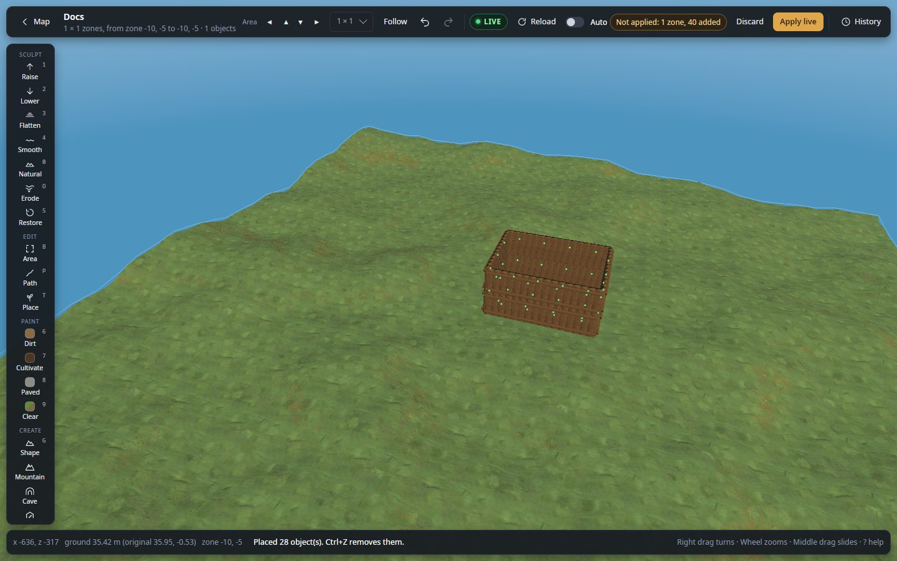
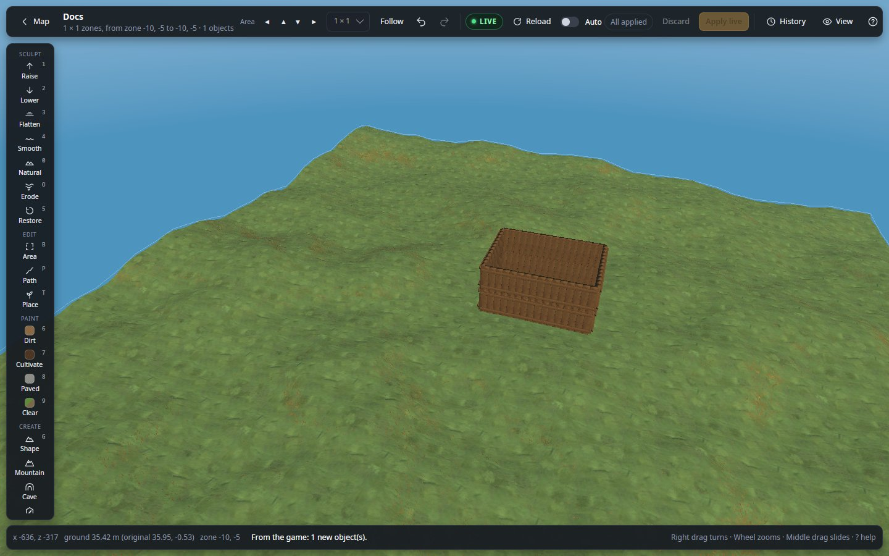

# Live mode

Edit the world of a running game or dedicated server while people play: they see each change as soon as you apply it.

**Where:** start page, **Edit live** on **Home** or **My game**, or **A dedicated server** · **Key:** `Ctrl+S` applies ·
**Works in:** your own game (single player or the world you host), a dedicated server

*Connected to a running server: **LIVE**, **Reload** and **Auto** in the top bar, and a hut the game does not have yet
("Not applied: 1 zone, 40 added", green dots on the new pieces).*

Live mode needs **BepInEx** and the **WorldEditorBridge** plugin in the game that hosts the world. Players who join
need neither. To set it up and connect, follow [Edit the world you are playing](guides/edit-your-game-live.md) or
[Edit a dedicated server while people play](guides/edit-a-server-live.md). How the editor talks to the game is in
[Live editing](concepts/live-editing.md#how-it-connects).

## Use it

1. Connect: on the start page, click **Edit live** (your game) or **Connect** next to a saved server.
2. On the world map, click a spot and choose **Edit in 3D**.
3. Edit with any tool, as you would offline. New objects carry a green dot; the top bar counts what is not applied.
4. Press **Apply live** (or `Ctrl+S`). Players see the change at once, and the game saves it as usual.
5. To take a change back, undo it (`Ctrl+Z`) and press **Apply live** again.

## Settings

Live mode works as offline, with these controls in the top bar and the View panel:

| Control | What it does |
|---|---|
| **LIVE** badge | Shows that the editor is connected to the running game. |
| **Reload** | Reads the whole world from the game again. Changes not applied yet are dropped, after asking. You stay where you are. |
| **Auto** | On: every stroke, placement and undo is applied at once, without pressing **Apply live**. Switching it on sends what is already waiting. Remembered between runs. |
| Pending counter | "Not applied: …" in amber, or "All applied". The map's line reads "Not applied yet: …". |
| **Apply live** | Takes the place of **Save to world**. Sends every pending change to the game. |
| **View → PLAYERS** | Connected players by name. Choose one under **Go to**, then **Go** (see [Players](#players)). |

## Apply live, Auto and Reload

**Apply live** sends the ground of every zone you changed, then the objects you deleted, placed, moved or changed,
then the zone resets. Only what changed since the last apply goes. The order and what each part does are in
[What is sent and when](concepts/live-editing.md#what-is-sent-and-when).

The status bar then says what was done, for example "Applied to the running game: 2 zone(s) of ground; …". If
the game does not answer, nothing is marked as applied and the next apply sends it again. One apply runs at a
time: a second press waits and sends only what is still pending.

*After **Apply live**: "All applied", the green dots gone, and the status bar says "Applied to the running game: …".*

**Auto** makes every change an apply. It waits for the end of a stroke, so a long brush stroke goes as one apply.
While Auto is on, [Claude](claude.md) changes nothing; turn Auto off to let it work.

**Reload** is rarely needed: the open area follows the game by itself. Use it to refresh the rest of the world
(the map), or when the plugin is too old to follow.

After each apply the history is kept on disk, as after a save: connect to the same game later and the steps are
there to undo (see [History](concepts/saving-and-history.md#history)).

## Following the game

While an area is open, the editor asks the game every 2 seconds what changed in that area's zones. What players
build, remove, dig or pave there shows up in the editor without a step in History. The status bar says what came
in, for example "From the game: 2 new object(s), 1 removed, the ground of 1 zone(s)." A change of data alone (a
fire burning down, a chest used) comes in without a word.

- **Objects** that players change keep their place in your History and selection.
- **Your own objects, once applied,** show where and how the game really has them (a piece settled by physics, a
  creature's health).
- **Ground** players changed comes in only where you have no changes waiting in that zone. Where you do, yours are
  kept, and **Apply live** first asks **Apply over the game's changes**: **Apply** writes your ground over that
  zone (what players did there since may be erased); **Not now** keeps your changes pending.
- Following happens only in the 3D view, never during a stroke or while applying. The map shows the world as it
  was last read.

The details are in [Following the game](concepts/live-editing.md#following-the-game).

<!-- picture: live-apply-over.jpg: live world, a 3 × 3 area where you raised ground in one zone and a player then dug in the same zone; Apply live pressed: the "Apply over the game's changes" question with its text naming the zone, and the Apply and Not now buttons, over the 3D view -->

## Players

Connected players are drawn at their place with their name: blue posts in the 3D view, blue dots on the map.
They move as the players do (every 2 seconds in 3D, every 5 on the map). In **View → PLAYERS**, pick a player
under **Go to** and press **Go**: the camera goes to them, and the area moves to them when they are outside it.

<!-- picture: live-players.jpg: live world with two players connected, 3D view at about 60 m showing two blue posts with their names over a base, View panel open on PLAYERS with a name chosen under Go to and the Go button visible -->

## Moving things

A moved object (the Select tool's move or turn, or **Cut** then paste) moves in the game as the same object, when
only its place and turn changed. Mods that track objects (a chest's label sign, a warehouse's chests, a ward) then
still know it, and a chest keeps its contents as the game has them. Undo moves it back the same way.

This works only when no player has both the old and the new place loaded (the zones round each player, about
160 m, more for large objects). Otherwise the object is made again at its new place and taken away from the old
one, and the apply message says how many: to other mods those are new objects. **Move a build while nobody is near
it** to keep everything about it.

An object whose data you change (in the [Select](select.md) tool's inspector, or with a mod's tool) also keeps its
identity in the game. The parts of a mod's linked group (such as a ship) and creatures are always made again.

## Undo after applying

Applied changes can still be undone: undo (or **Remove** in History), then **Apply live** again.

- A **deleted** object comes back as a copy of what it was when the world was read (a chest with its contents as
  they were then). To the game it is a new object.
- A **placed** object is removed from the game again. If another mod made it again under a new id meanwhile, the
  plugin finds it by its kind and place (within 10 cm) and removes that one.
- A **moved** object moves back, as the same object when it can.
- **Zone resets** cannot be undone once applied.

Steps from an earlier session are marked so in History. Players may have changed the world since, so you are
asked once before undoing or redoing them.

## Modded games

Mods make most of their objects while the game runs, so the editor learns them from the game when a live world
opens. A modded game's objects then have their names, the [Place](place.md) list offers them, the
[Workshop](workshop.md)'s Build panel lists the mods' pieces on a **Mods** tab with their cost (one mod at a time,
chosen in the row under the tabs; at most 300 pieces show, search for the others), and the inspector says which
mod an object comes from ("From the mod …" when Jötunn is installed, else "From a mod").

What the editor learns is kept (`mod-catalogue.json` in the editor's data folder), so the same server's world
opened later from its files shows the mods' objects too. Each connection adds to it.

Mods' models are drawn as in game, from the mods' own files in your Valheim folder and mod manager profiles (the
same mods must be installed there). The first time, their bundles are copied into the editor's data folder
(`mod-bundles`, a few seconds). Meshes a mod builds in code while the game runs (sails made on the fly, for
example) cannot be found: those pieces show untextured. A mod can also ship a `worldeditor.json` for what the
editor cannot guess: see [For mod authors](modding.md).

### Mods' own plugins

A mod whose plugin registered with the bridge is told right away what you applied (objects made, removed and
moved, zones whose ground changed or reset), so what it builds from its objects (a ship from its pieces) is put
together again at once. The editor's log names the mods registered when a game opens; a mod that fails on an
apply is named in the game's `BepInEx/LogOutput.log`, and the apply still goes through.

### The Expand World mods

With the [Expand World add-on](../addons/ExpandWorld/README.md) installed and on (**Settings → Add-ons**), a live
world follows the mods the game itself runs: their settings and data files are read from the game's own `BepInEx`
folder through the plugin, so a server's world is drawn as that server makes it. Only the YamlDotNet library the
data files need comes from a local BepInEx folder. The files are copied under `live-bepinex` in the editor's data
folder; the log says what was read. With an older plugin, your local folders are used instead.

### Riverheim

A live Riverheim world is drawn with your own copy of Riverheim: the [Riverheim add-on](../addons/Riverheim/README.md)
must be installed and on, and Riverheim installed on this computer. Your Riverheim and the game's must be of the
same release (the first two numbers of the version); otherwise the editor names both versions and does not open
the world.

## Plugin settings

The plugin's settings are in `BepInEx/config/Tie.WorldEditorBridge.cfg` of the game or server, written on its first
start. (Plugins older than 0.41.0 named it `local.worldeditorbridge.cfg`; the plugin renames it, and the editor
reads either.)

| Setting | Default | What it does |
|---|---|---|
| `BindAddress` | `127.0.0.1` | The address the plugin listens on. Keep `127.0.0.1`: the editor reaches a server through its own SSH tunnel. Anything else exposes the plugin to the machine's local networks (never the internet: callers from elsewhere are refused), with the token unencrypted, and the log warns about it. |
| `Port` | `5182` | The plugin's port. Change it when another program uses 5182. |
| `Token` | made on first start | The secret the editor must send, in a header (never in the address): 24 random letters and digits. Anyone with it and access to the port can change the world, so keep it private. Empty the line and restart to get a new one. |

## What the plugin logs

The game's or server's `BepInEx/LogOutput.log` says what each apply did, for when a change does not show for every
player. On start it says `WorldEditorBridge <version> listening on http://127.0.0.1:5182/ (token in
BepInEx/config/Tie.WorldEditorBridge.cfg)`. Then, per apply:

- `WorldEditorBridge: destroyed N object(s) (M found again at their place under a new id, K already gone), created C,
  moved I in place and F by making it again (…); A -> B object(s) known, P peer(s)`: the objects. *Found again* are
  objects another mod had made again, found by kind and place. A and B are the objects the game knew before and
  after (destroyed ones go on the game's next update, so B still counts them); P is the players connected.
- `WorldEditorBridge: 1 s after the apply: S of N destroyed object(s) still exist, R other object(s) of their prefab
  within 10 cm of their place (…)`: a second later. S above 0 means something on the server (a mod, most likely)
  made a destroyed object again or kept it. R counts objects of the same kind standing where a destroyed one stood:
  made again by a mod, or there all along. Both at 0 means the server did its part, and what a player still sees
  is that player's own game.
- `WorldEditorBridge: applied terrain to N zone(s) (C new)`: the ground. *New* counts zones that had no ground
  changes before.
- `WorldEditorBridge: reset N zone(s): D object(s) removed, L location(s) to place again`: zone resets.
- `WorldEditorBridge: caught at <file>:<line> (<member>) while <doing>: <error type>: <message>`: an error the
  plugin handled, with its stack trace unless it is an expected one. The server's home folder is written `~`.

## Shortcuts

| Key | Action |
|---|---|
| `Ctrl+S` | **Apply live** |
| `Ctrl+Z`, `Ctrl+Y` | Undo, redo (then **Apply live** sends it, or **Auto** does at once) |

Every other key works as offline: see [Shortcuts](help/shortcuts.md).

## Tips and limits

- The plugin works only in a game that **hosts** the world (a server, single player or the host). In a game that
  joined someone else's server it refuses to change anything.
- **Zone resets** happen at once where a player is near, otherwise the next time someone comes. They cannot be
  undone once applied.
- Objects placed live are made by the server; players see them like objects someone just built or planted.
- Thousands of objects at once are applied in one go and can make the server hitch for a moment. Reading a big
  world when you connect can take a few minutes.
- If the game does not answer within 30 seconds (it is loading, or very busy), nothing of that request is done:
  apply again.
- Use the plugin from the same release as your editor. With an older plugin the editor says what is missing.
  The features that need a recent plugin:

| Plugin version | Needed for |
|---|---|
| 0.10.0 | Zone resets |
| 1.17.0 | Following the game |
| 1.26.0 | Mods' objects and their names |
| 1.27.0 | Mods' models |
| 1.35.0 | Mods' own plugins told what was applied |
| 1.40.0 | Moves keeping the same object |
| 1.45.3 | An apply whose answer was lost (a dropped tunnel) not making objects twice when sent again |
| 1.54.0 | The Expand World mods' files and a Riverheim world read from the game |
| 1.57.3 | Creatures, ships and other moving things followed as they move |
| 1.97.0 | Changed objects keeping their identity |

## Related

- [Edit the world you are playing](guides/edit-your-game-live.md)
- [Edit a dedicated server while people play](guides/edit-a-server-live.md)
- [Live editing](concepts/live-editing.md): how it connects, what is sent, several editors and players
- [Troubleshooting](help/troubleshooting.md#a-server-will-not-connect): when it does not connect
