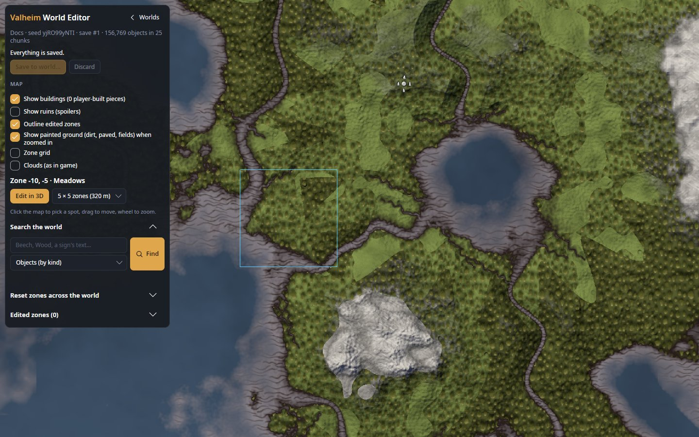
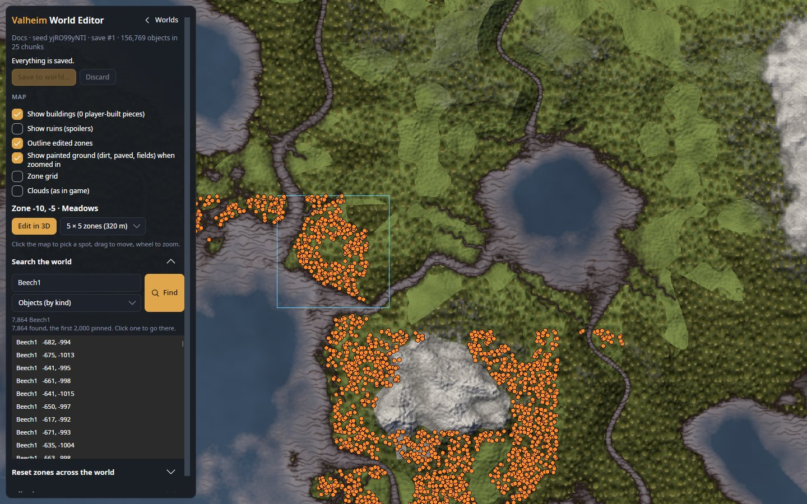
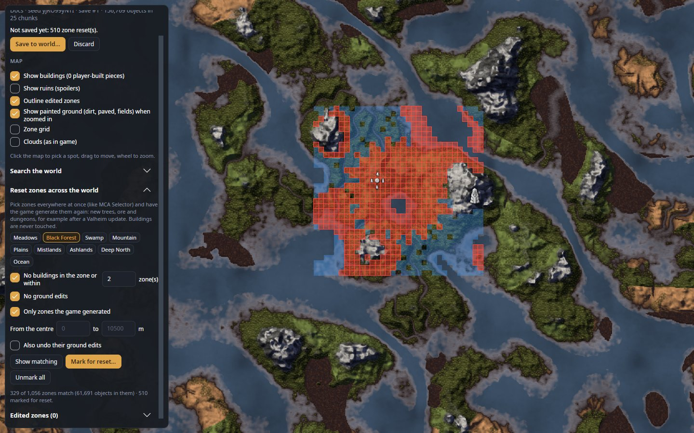
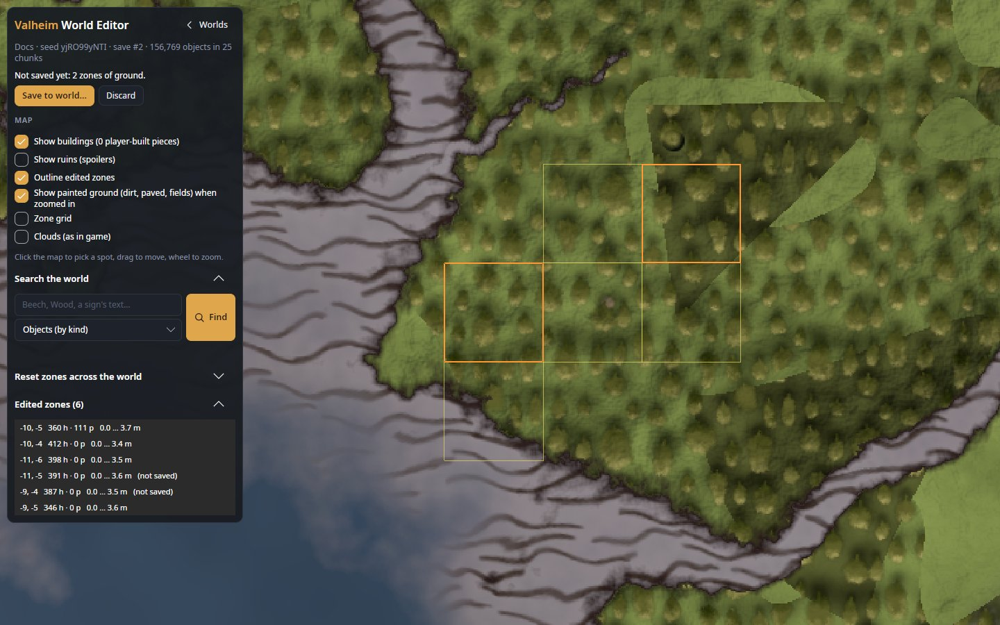

# World map

See the whole world, pick the place to edit in 3D, search every object, chest and sign, reset zones anywhere at once,
and save what is waiting.

**Where:** opens with every world; **Map** in the editor's top bar goes back to it · **Key:** none (`F1` opens this
page) · **Works in:**
saved worlds, live

> [!WARNING]
> **Close the game or stop the server before you save a world offline.** A running game writes over the world files
> when it saves, and your changes, zone resets included, are lost. To change a world while it runs, use
> [live mode](live-mode.md).

*A zone is picked: the light blue square is the area **Edit in 3D** will open, at the size chosen next to the button.*

The map is drawn as the game draws its own, from the world's data, so it looks like the in-game map with everything
revealed. The start and the traders (once their zone is made) show their icons as in game.

## Use it

1. Drag to move the map; turn the mouse wheel to zoom towards the pointer.
2. Click a spot. The side panel shows its zone and biome ("Zone 12, -4 · Black Forest"), and the area that will open
   is outlined in light blue.
3. In the side panel, choose the size in the list next to **Edit in 3D**.
4. Press **Edit in 3D**. The [3D editor](editor-basics.md) opens around the zone you clicked.

The map remembers where you last looked, also the next time you start the editor. The box at the bottom shows the
point under the pointer: its coordinates, zone and biome ("x 812, z -260 · zone 13, -4 · Meadows"), and its area's
alt biome when it has one ("alt biome Dark Meadows", shown a few seconds after the map opens).

## Settings

The top of the side panel gives the world's name, seed, save number and how many objects it holds (live: the
connection instead of the save number); after a save it shows the new save number. **Worlds** goes back to the start
page: with changes pending it asks first, and **Leave anyway** loses them.

| Setting | What it does |
|---|---|
| **Show buildings (N player-built pieces)** | Draws every player-built piece: footprints close up, dots further out, nothing zoomed far out. Ruins players built onto are drawn with the building. On at first. |
| **Show ruins (spoilers)** | Also draws the world's ruins (stone towers, ruined houses, Mistlands and Ashlands ruins), fainter. Off at first, because it shows where they are. |
| **Outline edited zones** | Outlines zones whose ground was changed: a thin yellow line for changes already in the world, a thicker orange line for changes not saved or applied yet. On at first. |
| **Show painted ground (dirt, paved, fields) when zoomed in** | Close up, the map is drawn at 1 m detail with your pending ground changes; this also shows dirt, paved and cultivated ground. On at first. |
| **Zone grid** | Draws the lines between the 64 m [zones](concepts/areas-and-zones.md#zones), when zoomed in enough. |
| **Clouds (as in game)** | Draws the drifting cloud shadows of the in-game map. |
| **Edit in 3D** | Opens the 3D editor on the area around the picked zone. |
| Size list (next to **Edit in 3D**) | How much ground the editor loads: **3 × 3 zones (192 m)**, **5 × 5 zones (320 m)** (default), **7 × 7**, **9 × 9**, **13 × 13** or **17 × 17 zones (1088 m)**. Use 5 × 5 for most work, 9 × 9 or more to paste a town or raise a big mountain. Bigger areas are slower. You can change it later in the top bar. |
| **Save to world…** / **Apply live** | Writes every pending change into the world files (live: sends it to the running game). The line above says what is waiting, for example "Not saved yet: 3 zones of ground, 12 deleted, 40 added, 25 zone reset(s)." |
| **Discard** | Throws away every change not saved or applied yet, after asking. |
| **Reload from the game** | Live only: reads the whole world again from the running game. The line above lists the players online ("Live world · 2 player(s) online: Ragnar, Freya"). |

In live mode the players online show as blue dots with their names, updated every 5 seconds. Changes stay
[pending](concepts/saving-and-history.md#pending-changes) across areas: edit one area, come back to the map, open
another, and save everything at once.

## Search the world

*Each orange pin is one object found. The result picked in the list is larger, with a gold ring, and the map is
centred on it.*

1. Open **Search the world**.
2. Type part of a name or text, for example `Beech`, `Wood` or a sign's words. Letter case does not matter.
3. Choose what to look for (below).
4. Press **Find** (or `Enter`). Every result is pinned on the map and listed.
5. Click a result: the map centres on it and picks its zone. **Edit in 3D** then opens with that object selected.

| Look for | Finds |
|---|---|
| **Objects (by kind)** | Every object whose kind contains the text: `portal`, `Beech`, `chest`, `guard_stone`… |
| **Items in containers** | Every chest, cart, ship or other container holding an item whose name contains the text: `Wood`, `Draugr`, `Silver`… Each result says how many ("Wood ×50"). |
| **Texts (signs, portals, wards…)** | Every object with a text that contains it: sign texts, portal tags, ward and tombstone names. Each result shows the text that matched. |

A line above the results counts what was found per kind (per item for containers) and in all. The list shows the
first 300 results; up to 2,000 are pinned. For items and texts, the object's
[data](select.md) opens too, so you can change the chest's contents or the sign's text at once. Changing what to look
for searches again at once.

The search reads the world as it is in the editor: objects you placed but did not save are found, objects you deleted
but did not save are not. The game's own bookkeeping objects (names starting with `_`, such as `_ZoneCtrl`) are found
only when your text starts with `_` too.

## Reset zones across the world

*The Meadows zones were marked for reset (red), then **Black Forest** chosen and **Show matching** pressed (blue). The
line under the buttons counts both.*

Pick zones anywhere in the world by what they are, and have the game generate them again: new trees, rocks, ore and
dungeons, for example after a Valheim update, in places nobody built. To reset the zones under one selection, use the
[Area](area.md#reset-zones) tool instead; step by step: [Generate zones again](guides/reset-zones.md).

1. Open **Reset zones across the world**.
2. Set the filter (below).
3. Press **Show matching**. The first time, the editor reads every zone (a moment). Matching zones turn blue and a line
   says "N of M zones match (K objects in them)". From then on the map follows the filter as you change it.
4. Press **Mark for reset…** and agree. The matching zones turn red.
5. **Save to world** (offline) or **Apply live** does the reset. Until then, **Unmark all** cancels it.

> [!CAUTION]
> **A reset cannot be undone once it is saved or applied.** Every object in the zone is removed but players'
> tombstones and player-built pieces: trees, rocks, ore, ruins, dungeon entrances, items on the ground and creatures,
> tamed animals too. Move tamed animals out first, and [back up the world](guides/back-up-a-world.md).

| Setting | What it does |
|---|---|
| Biome buttons (**Meadows** … **Ocean**) | Only zones whose middle is in one of the biomes switched on. None on: every biome. |
| **No buildings in the zone or within N zone(s)** | Leaves out zones within N zones of player-built pieces, diagonals included (0 to 50; 2 at first). On at first. A zone that holds pieces is always left out, even with this off. |
| **No ground edits** | Leaves out zones whose ground was changed (in game or in the editor). On at first. |
| **Only zones the game generated** | Only zones a player has already been near. Off: also zones that only hold objects or ground edits from the editor. On at first. |
| **From the centre … to … m** | Only zones at this distance from the world's middle. Empty: no limit (the world's edge is at 10,500 m). For example, reset only the outer rings. |
| **Also undo their ground edits** | The reset also takes away the zones' ground changes, back to the seed's ground. Matters only when **No ground edits** is off. |
| **Show matching** | Shades the matching zones blue and counts them and the objects in them. |
| **Mark for reset…** | Marks every matching zone for reset (red), after asking. |
| **Unmark all** | Cancels every zone reset that is marked, also those marked with the Area tool. |

The next time a player comes near a reset zone, the game generates it again from the seed, its location (ruin,
dungeon, altar) included. Live, that happens at once where players are; after a live reset the editor reads the world
again, and the history comes along without what it did in the reset zones.

## Edited zones

**Edited zones (N)** lists every zone whose ground was changed, most changed first. Each row gives the zone, how many
height points (`h`) and paint points (`p`) were changed, the range of the height changes (`-2.4 … 6.0 m`), and "(not
saved)" when some changes are pending ("(not applied)" in a live world). Click a row to zoom in on that zone and pick
it, ready for **Edit in 3D**.

*Four zones saved (thin yellow) and two edited since (thicker orange): the list marks the pending ones "(not saved)".*

## Shortcuts

| Key or mouse | What it does |
|---|---|
| Drag | Move the map. |
| Mouse wheel | Zoom towards the pointer. |
| Click | Pick the zone there. |
| `Enter` in the search box | Find. |

## Tips and limits

- **The map shows the world as it was read.** Live, the 3D editor follows what players change in the open area, but
  the rest of the map changes only with **Reload from the game**.
- **Zoomed in closer than about 6 m a pixel**, the part in view is drawn again at 1 m detail, with your pending ground
  changes in it.
- **Only zones inside the world** are listed for reset. A dedicated server with nobody online also generates zones far
  outside the world: those are left out.
- **To take a change back**, **Unmark all** cancels marked resets, and **Discard** drops everything pending. To undo
  one change, open its area in 3D and press `Ctrl+Z` or use History: see
  [Undo a step, take back one change, or discard everything](guides/undo-changes.md).
- **Search finds nothing?** Check the spelling and the **Look for** choice; bookkeeping objects need a leading `_`.
- **Worlds made with Expand World**: with its add-on installed and on, a wider world shows whole, the location icons
  come from its data, and the readout adds the territory and the status effects a player gets there ("territory
  frost · effects Freezing (night)"). See
  [Edit a world made with Expand World, Riverheim or Tunnelheim](guides/use-mods-worlds.md).

## Related

- [Find an object, a chest's item or a sign](guides/find-things.md)
- [Generate zones again](guides/reset-zones.md)
- [Back up a world before editing](guides/back-up-a-world.md)
- [Areas and zones](concepts/areas-and-zones.md)
- [Editor basics](editor-basics.md), [Live mode](live-mode.md)
