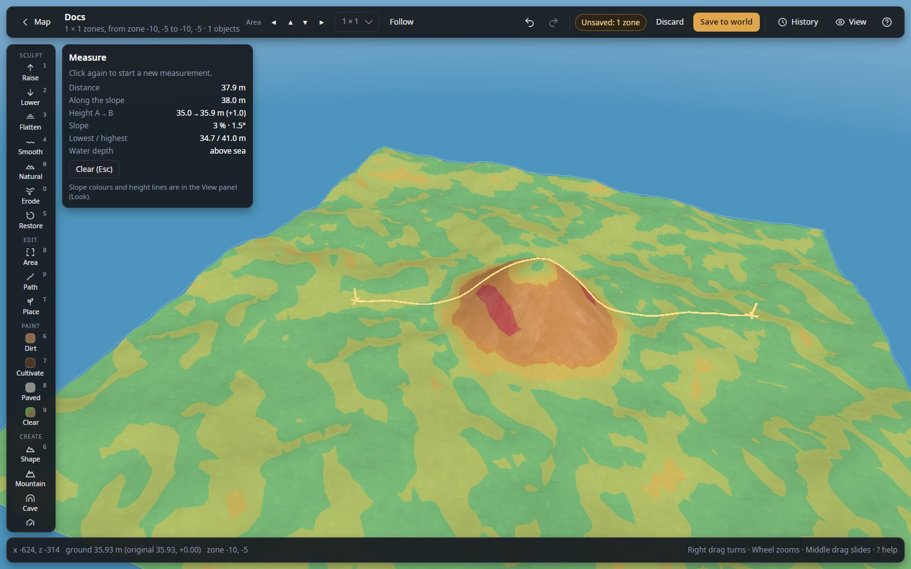
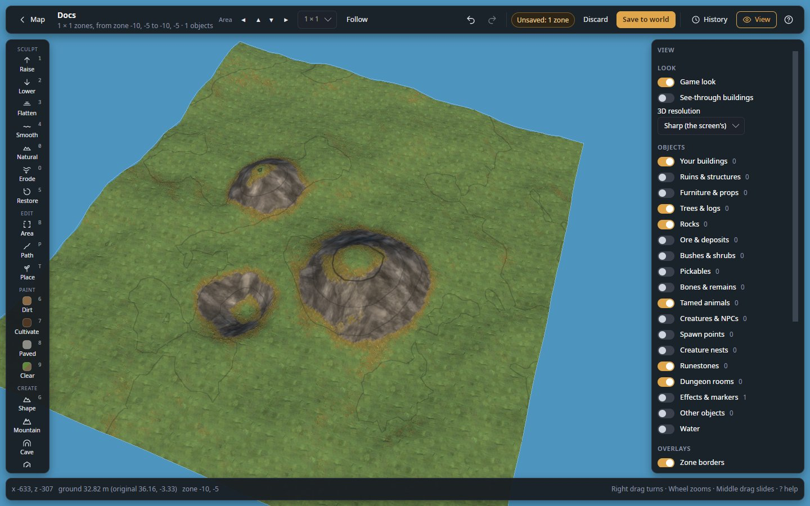

# Measure and overlays

Click two points and read the distance, the height difference and the slope between them. Two ground overlays, slope
colours and height lines, show steepness and height everywhere at once while you use any tool.

**Where:** tool rail, **TOOLS** section; the overlays in the View panel · **Key:** `M` · **Works in:** saved worlds,
live

*A measure from the foot of a mound over its top, with slope colours on. The line follows the ground; the panel shows
the distance, the heights and the slope.*

## Use it

1. In the tool rail, click **Measure** (`M`).
2. Click a first point on the ground. The line follows the cursor.
3. Click a second point to fix the measure. The panel shows the readouts.
4. Click once more to start a new measure, or press **Clear (Esc)** to remove it.

The line is drawn along the ground, so it shows the profile between the two points. The hint at the top of the panel
says what the next click does.

## Readouts

| Readout | What it means |
|---|---|
| **Distance** | The straight distance seen from above, as on a map (m). |
| **Along the slope** | The length of a straight line from A to B, height difference included (m). |
| **Height A → B** | The ground height at both points and the difference, for example `35.0 → 42.5 m (+7.5)`. |
| **Slope** | The average slope from A to B, in % and in degrees. A 100% slope is 45°. |
| **Lowest / highest** | The lowest and highest ground along the line, read every metre: a bump or dip shows here even when A and B are level. |
| **Water depth** | How far the lower point is under the sea (the sea is at 30 m), or "above sea". |

Heights are the game's, as in the status bar. You can select the values in the panel and copy them.

## Ground overlays

In the View panel (`V`), under **GROUND (game look)**:

| Setting | What it does |
|---|---|
| **Slope colours** | Colours the ground by steepness, so you see where a ramp or building site is too steep: green under 10°, yellow-green 10–20°, yellow 20–30°, orange 30–45°, red above 45°. Hills keep their light and shade. |
| **Height lines every** *N* **m** | Draws height lines (contours) every **1**, **2** (default), **5** or **10** m. Every fifth line is darker and thicker. Lines close together mean steep ground. |

Both need **Game look** (the View panel's ground look), stay on while you use other tools, and are remembered. Height
lines fall on multiples of the step, so sea level (30 m) always has one and the coast line is easy to follow.

*Height lines every 2 m over two mounds and a hollow, zone borders off. The View panel shows **Height lines every**
2 m under **GROUND (game look)**; every fifth line is darker.*

<!-- picture: slope-colours.jpg: one mound with gentle and steep sides plus a cliff cut, Slope colours on, Zone borders off, camera 35° above so all five colours (green, yellow-green, yellow, orange, red) show on the one mound; View panel scrolled to GROUND (game look) with Slope colours ticked -->

## Shortcuts

| Key or mouse | What it does |
|---|---|
| `M` | Choose Measure. |
| Click | Set point A, then point B, then start again. |
| `Esc` | Clear the measure; a second `Esc` leaves the tool. |
| `V` | Show or hide the View panel (the overlays). |

## Tips and limits

- **The measure changes nothing** in the world and is not saved.
- **A and B are read when you click.** After you change the ground, measure again.
- **Plan a ramp:** measure from its foot to its top. **Slope** is the slope the [Path](path.md) tool's **Ramp** gives
  along a straight line between the same points.
- **Limit marks**, in the same View panel, tints red the ground that reached the game's ±8 m. See
  [Limit marks](concepts/ground-limits.md#limit-marks).

## Related

- [Make a road or a ramp up a hill](guides/make-a-road.md)
- [Clear trees and rocks, level a building site](guides/clear-an-area.md)
- [Editor basics](editor-basics.md): the View panel
- [Path](path.md), [Sculpt and paint](terrain.md)
