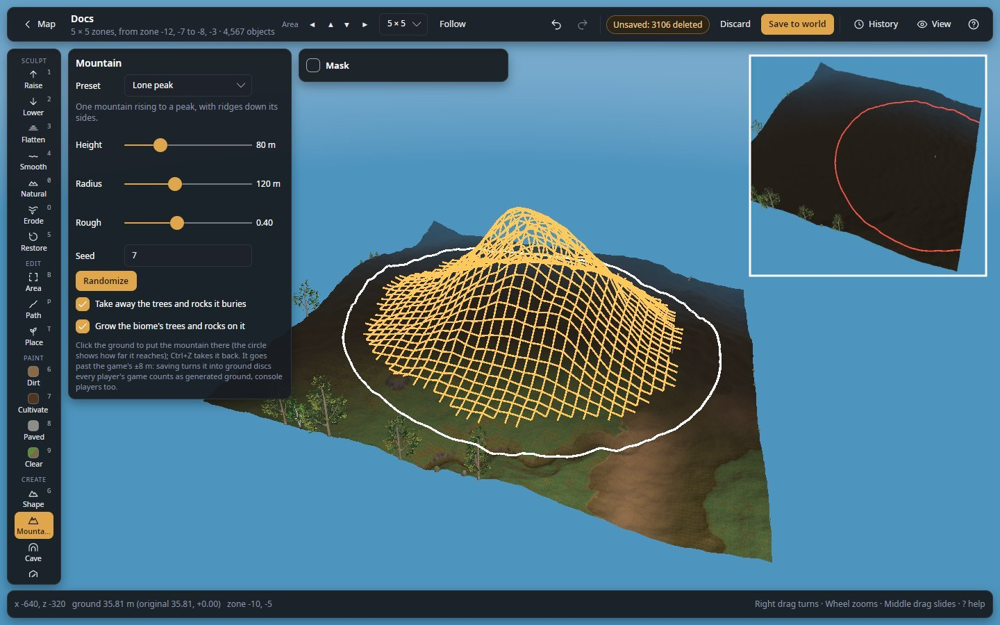
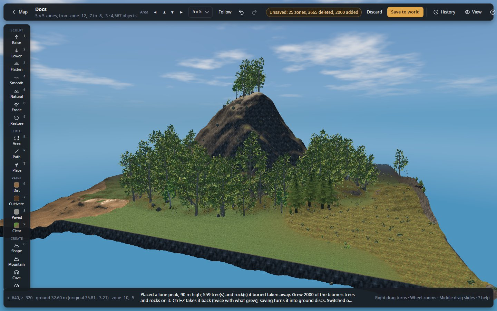
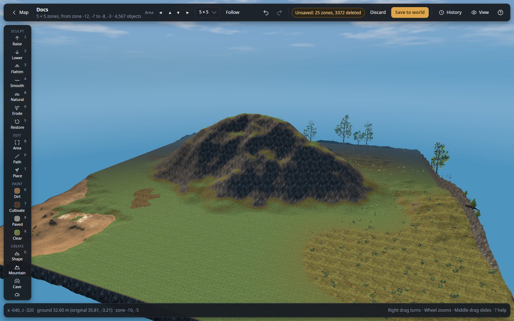
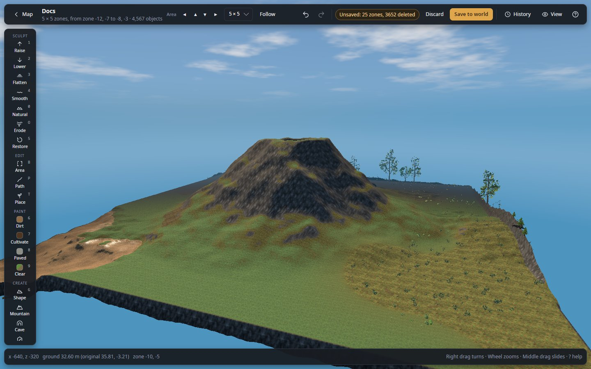
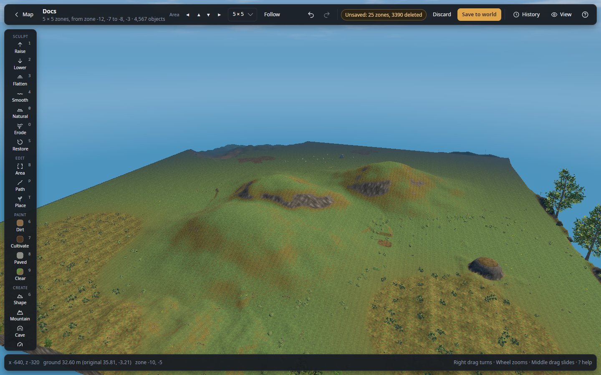

# Mountain

Raise a whole mountain with one click, far past the game's 8 m: a lone peak, a ridge, a range, a mesa, a volcano or
rolling hills.

**Where:** tool rail, **CREATE** section · **Key:** none · **Works in:** saved worlds, live

*Lone peak, 80 m high, radius 120 m, before the click: the orange mesh shows it as high as it will rise and the white
ring how far it reaches. Inset, top right: with the pointer near the area's edge the ring turns red and no mesh
shows, because it would not fit.*

| Lone peak | Ridge |
|---|---|
|  |  |
| **Volcano** | **Rolling hills** |
|  |  |

*Four presets in the middle of a 5 × 5 area cleared and levelled first, so each stands out. The lone peak has the
biome's trees grown on it; the others are left bare so their shape shows: a crest much longer than it is wide, a
cone with its crater, a few gentle hills with saddles between them.*

## Use it

1. In the tool rail, click **Mountain**.
2. In the panel, choose a **Preset**. It rolls a new mountain of that kind.
3. Optional: change **Height**, **Radius** and **Rough**, or press **Randomize** until you like it.
4. Move the pointer over the ground. The mountain shows as an orange mesh, as high as it will rise, and the ring shows
   how far it reaches. Where the ring is red, the mountain does not fit in the open area.
5. Click. The mountain goes in at once; with **Grow the biome's trees and rocks on it**, its trees follow a moment
   later.
6. Not right? `Ctrl+Z` takes it back (twice when trees grew on it).

## Settings

| Setting | What it does |
|---|---|
| **Preset** | The kind of mountain (below). Choosing one rolls a new mountain of it, like **Randomize**. |
| **Height** | How high it rises above the ground there, 5 to 300 m. |
| **Radius** | How far it reaches from the click, 20 to 280 m. Its outline is ragged, up to 15% further. |
| **Rough** | 0: smooth slopes. 1: deep gullies and ridges. |
| **Turn** | **Ridge** and **Mountain range** only: the direction it runs, 0° to 179°. |
| **Seed** | The number its detail comes from: the same preset, values and seed make the same mountain again. |
| **Randomize** | A new mountain of the preset: new size, roughness, direction and seed. If it would not fit in the open area, it is made smaller as a whole, height too, so the slopes stay as gentle. |
| **Take away the trees and rocks it buries** | On at first. Trees, rocks, ore, bushes and pickables where it raises the ground more than 2 m are taken away (saving would do it anyway). Building pieces stay. |
| **Grow the biome's trees and rocks on it** | On at first. Grows the biome's own trees and rocks, by the game's rules, on the slopes it raised by more than a metre, away from what already stands there. A second undo step. |

## Presets

| Preset | Height / radius it rolls | Shape |
|---|---|---|
| **Lone peak** | 50–110 m / 120–240 m | One mountain rising to a peak, with ridges down its sides. |
| **Ridge** | 35–80 m / 140–260 m | A long crest, half as wide as it is long. |
| **Mountain range** | 40–90 m / 180–280 m | Three to five peaks along a line, joined by saddles. |
| **Mesa** | 20–50 m / 70–150 m | A flat top with steep, rocky sides: room to build up there. Roughness goes only on the sides. |
| **Volcano** | 45–100 m / 130–240 m | A cone with a crater at the top. |
| **Rolling hills** | 12–30 m / 100–220 m | Three to six gentle hills together. |

Each mountain is added to the ground that is there, so it keeps the land's own lie, and fades back into it at its
edge. Its outline is never a perfect circle, and **Rough** adds swells, ridges and gullies in proportion to its size.

## Shortcuts

| Key or mouse | What it does |
|---|---|
| Click the ground | Put the mountain there. |
| `Ctrl+Z` | Take it back (press twice when trees grew on it). |
| `Esc` | Leave the tool (back to View). |

## Tips and limits

- **It must fit in the open area**, ragged edge included. For big mountains, open a bigger area first (the area size
  list in the top bar): on a 5 × 5 area the radius can be up to about 137 m.
- **It always goes past the game's 8 m**, whatever the **No limit** switch says. Saving turns it into ground discs
  and clears the area's History, as with [No limit](terrain.md#no-limit). Check it before you save.
- **The [Mask](masks.md) applies, all or nothing**: where the Mask leaves ground out, the mountain stops in a cliff.
- **Gentle slopes keep grass and trees; steep ones show bare rock**, as the game draws them.
- **A [script](scripting.md)** can place mountains too, by rule.

## Related

- [Raise or dig past the game's 8 m limit](guides/raise-past-the-limit.md)
- [No limit](concepts/ground-limits.md#no-limit): how the ground is saved past 8 m
- [Growing rules](concepts/objects.md#growing-rules): what grows on it
- [Shape](shape.md), [Sculpt and paint](terrain.md)
- [How a mountain is made](concepts/ground-limits.md#how-a-mountain-is-made)
