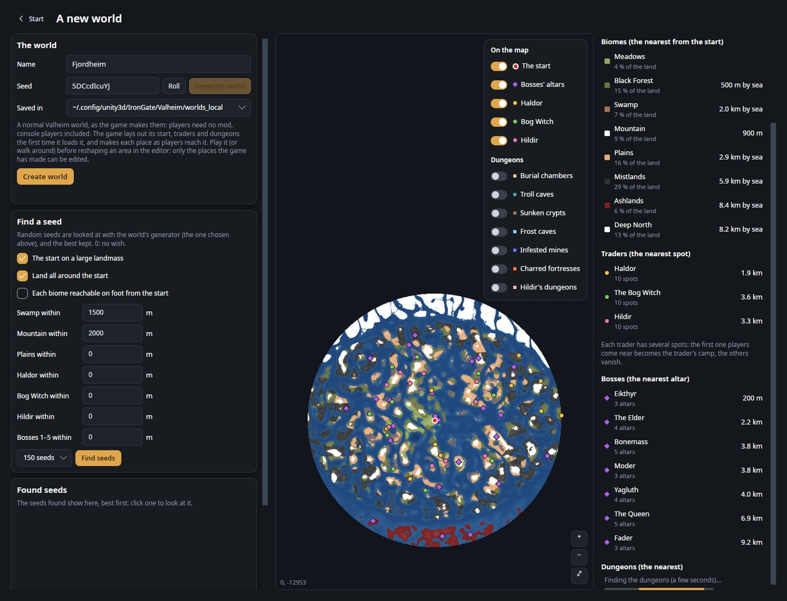
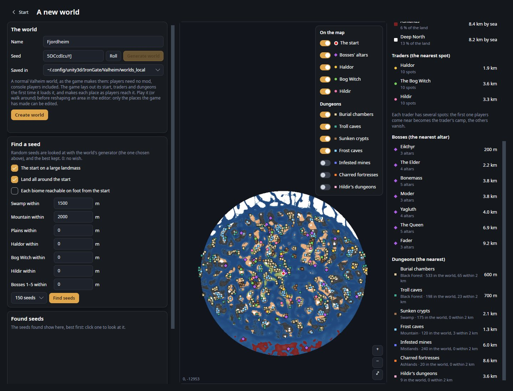
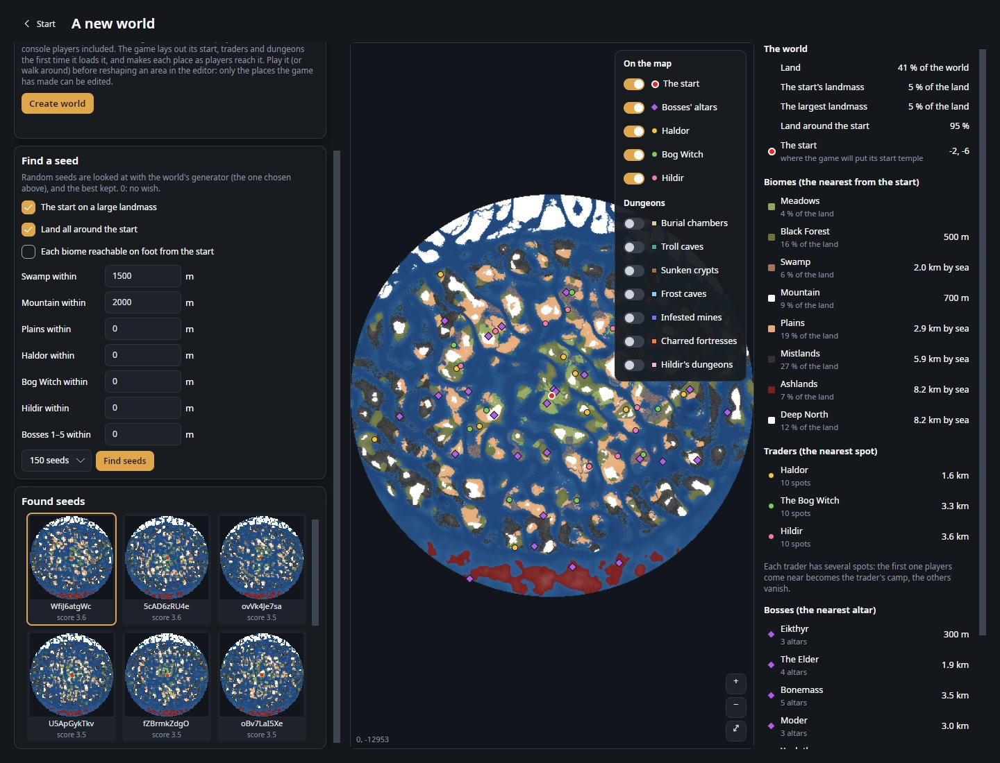

# A new world

See a seed's world before it exists, search many seeds for one that suits you, and make the world.

**Where:** start page, **Create** → **A new world** → **Make a new world** · **Key:** none · **Works in:** the start page
(no world needs to be open)

*The red dot is the start, purple diamonds are bosses' altars, the yellow, green and pink dots are the traders' spots.
The column on the right lists the seed's facts, here scrolled down to the bosses' nearest altars.*

The world you create is a normal Valheim world, made by the game's own rules from its seed: players join it without
any mod, console players on crossplay included (unless you choose a world generation mod's generator, see
[Tips and limits](#tips-and-limits)).

## Use it

1. On the start page, choose **A new world** under **Create**, then **Make a new world**. A random seed's world is
   shown.
2. Type a seed and press **Generate world** (or `Enter`), or press **Roll** for another random one. To let the
   editor search, see [Find a seed](#find-a-seed).
3. Look at the map and the facts beside it. Optional: switch on the kinds of dungeon you care about.
4. Type the world's **Name**, choose where it is **Saved in**, and press **Create world**. The editor writes the world
   and opens its map.
5. Start Valheim, load the new world and walk around the parts you want to edit. The game makes each place only as
   players come near it.
6. Open the world again in the editor to reshape what the game has made.

**Start** (top left) goes back to the start page; nothing is made.

## Settings

| Setting | What it does |
|---|---|
| **Seed** | Up to 10 letters and digits, as in the game. The same seed always makes the same world. Letter case matters: `Valheim` and `valheim` are two worlds. |
| **Roll** | Puts another random seed in the box and shows its world. |
| **Generate world** | Shows the seed's world (or `Enter` in the seed box). Greyed while the seed in the box is the one shown. |
| **On the map** | Show or hide **The start**, **Bosses' altars**, **Haldor**, **Bog Witch** and **Hildir**. |
| **Dungeons** | Show where each kind of dungeon will be (off at first). See [Dungeons](#dungeons). |
| **Name** | The world's name, as the game lists it. It is also its folder's name, so it cannot hold `/ \ : * ? " < > \|`. |
| **Saved in** | Which of the game's world folders it goes in: your local worlds (`worlds_local`) or the Steam cloud worlds (`worlds`), those that exist on this computer. The folder the installed game saves to comes first (on Linux, the Windows build run through Proton keeps its worlds inside its Steam prefix), so the game lists the world. |
| **Generator** | Shown only when an add-on for a world generation mod is in use and the mod is found: the mod's generator or **The game's**. See [Tips and limits](#tips-and-limits). |
| **Create world** | Makes the world and opens its map. A world of the same name already in that folder is never written over: you are asked for another name. |

## The map

The map shows the seed's world as the game will make it: land coloured by biome (higher ground lighter), water on
land tinted blue, the sea shaded by depth, north up. It takes a few seconds; "Looking at …'s world…" shows meanwhile.
Zoomed in, the view is drawn again at one point per screen pixel, so coasts and rivers stay sharp. The bottom left
corner shows the coordinates under the pointer.

Over the map are the places the game lays out when it first loads the world:

- the **start** (red dot with a white ring): the start temple, where new players arrive;
- the **bosses' altars** (purple diamonds): Eikthyr, the Elder, Bonemass, Moder, Yagluth, the Queen and Fader;
- the **traders' spots**: Haldor (yellow), the Bog Witch (green) and Hildir (pink). Each trader has several spots: the
  first one players come near becomes the camp, and the others vanish.

Hover a mark for its coordinates and its distance from the start. The spots are exactly where the game will put
them: the editor replays the game's placement rules, read from your Valheim's files (a few seconds, the first time).

## Dungeons

*Four kinds switched on: each small square is one dungeon, its colour its kind, as in the switches and in
**Dungeons (the nearest)** (distance, biome, how many in the world and within 2 km).*

The **Dungeons** switches show **Burial chambers**, **Troll caves**, **Sunken crypts**, **Frost caves**, **Infested
mines**, **Charred fortresses** and **Hildir's dungeons**. The editor starts finding them as soon as a seed is shown
(a few seconds); a kind you switch on shows as soon as it is found. The dungeons of the last 20 seeds you looked at
are kept, so going back to one shows them at once.

**Dungeons (the nearest)** gives, for each kind, how far the nearest one is from the start, its biome, how many there
are in the world and how many lie within 2 km. Click a row to switch that kind on and see the nearest on the map.

They include the kinds an **alt biome** (a variant such as Dark Meadows) adds or keeps out. Villages, ruins and the
other small places are not shown.

## The seed's facts

Beside the map, the seed's world as lists. Click a row with a mark to see it, or the nearest of its kind, on the map.

- **The world**: **Land** (how much of the world is land), **The start's landmass** and **The largest landmass** (each
  as a share of all the land), **Land around the start** (land within 400 m of the start), and the start's
  coordinates.
- **Biomes (the nearest from the start)**: each biome's share of the land and how far its nearest land is, with "by
  sea" when it is on another landmass (you need a boat).
- **Traders (the nearest spot)**: how far the nearest spot of each trader is, and how many spots it has.
- **Bosses (the nearest altar)**: how far the nearest altar of each boss is, and how many there are.
- **Dungeons (the nearest)**: see [Dungeons](#dungeons).

Land here is ground you can stand on or wade through: at most 1 m under water, or 3 m in a Swamp. A landmass is
land joined to land without crossing deeper water.

## Find a seed

*The wishes (here a large landmass with land all around, a Swamp within 1500 m and a Mountain within 2000 m, 150
seeds); the best seeds found under **Found seeds**, best first. The first was clicked: its border lights up and its
world fills the large map.*

**Find a seed** looks at many random seeds in the background and keeps the best for your wishes. 0 in a distance box
means "no wish". For a step-by-step search, see [Find a seed with what you want near the start](guides/find-a-seed.md).

| Setting | What it does |
|---|---|
| **The start on a large landmass** | Prefer seeds whose start is on a large landmass (on at first). |
| **Land all around the start** | Prefer seeds with little water within 400 m of the start (on at first). |
| **Each biome reachable on foot from the start** | Prefer seeds where the nearest of each biome is on the start's own landmass. |
| **Swamp within**, **Mountain within**, **Plains within** | Prefer seeds where that biome's nearest land is within so many metres (0 to 8,000 m, in steps of 250; 1,500 for the Swamp and 2,000 for the Mountain at first). |
| **Haldor within**, **Bog Witch within**, **Hildir within** | Prefer seeds where one of that trader's spots is within so many metres. |
| **Bosses 1–5 within** | Prefer seeds where an altar of each of Eikthyr, the Elder, Bonemass, Moder and Yagluth is within so many metres. |
| Seeds list | How many random seeds to look at: **60 seeds**, **150 seeds** (the default) or **400 seeds**. |
| **Find seeds** | Starts the search; the bar under it shows how far it is. |
| **Stop** | Stops the search and shows the best found so far. |

The 12 best seeds appear under **Found seeds**, each as a small map with its seed and score. Hover one for its facts;
click it to see it on the large map (it gets a coloured border).

### How seeds are scored

- **The start on a large landmass** adds up to 3 (the start landmass's share of the land, times 3); **Land all around
  the start** adds up to 2 (the share of land within 400 m, times 2).
- A distance wish that is met adds 1 to 2, more the closer it is. One that is missed takes away, more the further it
  is; a biome or trader the seed does not have at all takes away 2. **Bosses 1–5 within** counts the average of the
  five bosses.
- **Each biome reachable on foot** adds 0.25 for each biome whose nearest land is on the start's landmass.

A score is never below 0. The search looks at each seed more coarsely than the large map (points about 210 m apart
instead of about 40 m), so it may miss small islands and narrow straits: check a found seed on the large map before
you choose it. Wishes for traders or bosses make the search a few times slower.

## Shortcuts

| Input | Action |
|---|---|
| `Enter` (in the seed box) | Show the seed's world |
| Mouse wheel | Zoom where the pointer is |
| Drag | Move the map (from anywhere, a mark included) |
| Double click | Show the whole world again |
| **+**, **−**, **⤢** (bottom right) | Closer, farther, all of the world |

## Tips and limits

- **Play the world before you edit it.** A new world holds no trees, rocks or buildings yet, only its name, seed and
  an empty zone list. The game lays out the start, traders, altars and dungeons the first time it loads the world
  (where this page showed them), and makes each zone as players come near. The editor can only reshape zones the game
  has made; until then the map shows the seed's land with nothing on it.
- The world is written in the save format of Valheim 1.0.20 and later, as the game writes a new world: an older
  game or server refuses it, so update it first. A world of the same name is never written over.
- If the bosses and traders cannot be read from your game's files, the page says so: the map still shows the biomes,
  but the marks are missing and the search cannot look for them. The log (**Open log** on the start page) says why.
- With the [Expand World add-on](../addons/ExpandWorld/README.md) in use, the seeds looked at and the world made
  follow the mods' settings and data files (the page says so above **Create world**): a wider world, other biomes and
  places, the mods' sea level. A biome the mods add and a territory show in their own map colours.
- With the [Riverheim add-on](../addons/Riverheim/README.md) in use and Riverheim installed, **Generator** offers
  Riverheim (chosen at first, as the game makes every new world a Riverheim world while the mod is installed) or **The
  game's**. A Riverheim world needs Riverheim in every player's game, so console players on crossplay cannot join it.
  Each seed takes a few seconds: Riverheim lays its whole world out first.
- Nothing is made until **Create world**: **Start** and closing the page leave no trace. To remove a world you made,
  delete its folder from the world folder it was saved in.

## Related

- [Find a seed with what you want near the start](guides/find-a-seed.md)
- [Edit a world made with Expand World, Riverheim or Tunnelheim](guides/use-mods-worlds.md)
- [Areas and zones](concepts/areas-and-zones.md#zones): why the game must make a zone before you can edit it
- [Dungeons](dungeons.md): edit a dungeon once the game has made it
