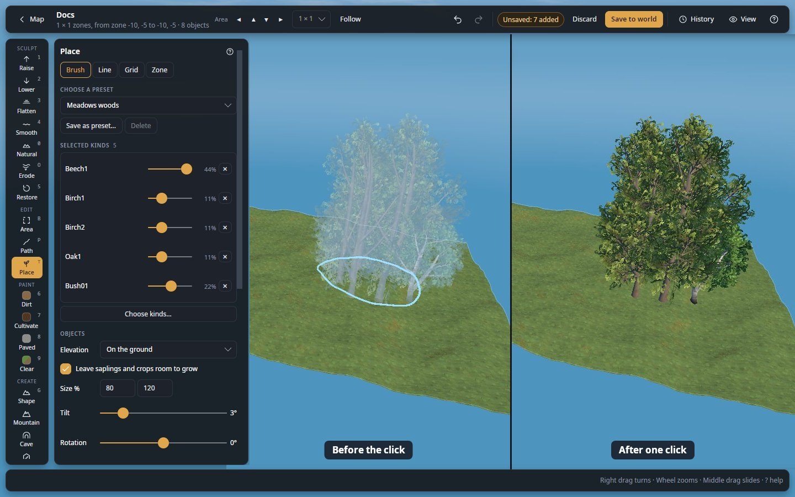

# Place

Put trees, rocks, bushes, crops, building pieces and spawn points into the world, one at a time or by the hundred.

**Where:** tool rail, **EDIT** section · **Key:** `T` · **Works in:** saved worlds, live (in the Workshop, `T` opens
**Build** instead: see [Workshop](workshop.md))

*The see-through trees and bushes standing in the brush circle are exactly what a click places; the panel shows
the Meadows woods preset and its kinds.*

*Left: the see-through preview in the brush circle. Right: the same spot after one click, the trees and bushes
standing where the preview showed them.*

## Use it

To plant a small wood:

1. Press `T`.
2. In the **Place** panel, under **Choose a preset**, choose **Meadows woods**.
3. At the top of the panel, choose **Brush**.
4. Point at the ground: the see-through preview shows what a click places.
5. Click to place it, or drag to keep adding.

For Line, Grid and Zone, draw the shape instead, check the preview, then press `Enter` (**Place (Enter)**). The
shape stays after placing, its preview now empty (what it would place is there already): press **Clear (Esc)** to draw
the next one.

Each click, stroke or `Enter` is one undo step (`Ctrl+Z`). Nothing is written to the world until you **Save to world**
(or **Apply live**). To move or delete what you placed, use [Select](select.md).

## Settings

The panel, top to bottom. Rows that do not apply to the chosen mode or kinds are hidden. The settings are remembered
between runs. The [Mask](masks.md) is on its own card beside the panel and applies to every mode.

| Setting | What it does |
|---|---|
| **Brush**, **Line**, **Grid**, **Zone** | The mode: see [Modes](#modes). |
| **Line shape** | Line mode only: **Points**, **Circle** or **Rectangle**. See [Line](#line). |
| **Choose a preset** | Loads a mix: its kinds with their shares, plus Density, Spacing, Clumping, Patch size, Size and Tilt, with random facing on. Built in: **Meadows woods**, **Black forest**, **Swamp**, **Berry patch**, **Forest floor**, **Meadows rocks**; yours follow as **Yours: *name***. Kinds the world cannot place are left out (the status bar says how many). **None** loads nothing; choosing it after a preset unticks every kind. |
| **Save as preset…** / **Delete** | Saves the chosen kinds, shares and those settings under a name. **Delete** removes one of yours, after asking. |
| **Selected kinds** | The kinds you chose, each with its share slider and a ✕ to drop it ("None yet" while there are none). With two or more kinds, drag a slider to set that kind's share: the others follow so the shares make 100%, and each keeps at least 1%. Beech at 75% with Birch gives three beeches for one birch. |
| **Choose kinds…** | Opens the **Choose kinds** card: see [Choose what to place](#choose-what-to-place). |
| **OBJECTS: Elevation** | **On the ground**: each object stands on the ground (a building piece by its bottom). **Above the ground**: **Height** metres above the ground under it. **At one height**: every object's bottom at the same **Height**, whatever the ground does (a level wall, a platform). |
| **Height** | The metres for Above the ground, or the height for At one height. |
| **Snap to pieces already there** | Shown when a ticked kind is a building piece. On: the piece locks onto the pieces around it, like the hammer. In Brush mode, **Beside** puts it end to end with the piece next to the cursor and **On top** sits it on the piece under the cursor. The line under the buttons says what it snapped to ("Snapped beside woodwall."). See [Snapping](concepts/objects.md#snapping). |
| **Leave saplings and crops room to grow** | Shown when a sapling, a crop or a tree that grows from one is ticked. On: they keep the room the game needs to grow them. Off: as tight as you like (they may not grow). See [Growing rules](concepts/objects.md#growing-rules). |
| **Size %** min / max | Each object gets a random size between the two, 10 to 300% (80 to 120 at first). |
| **Tilt** | Random lean, 0 to 20°. |
| **Rotation** | Turns the brush's pattern and every object's facing, -180 to 180°. |
| **Random facing (off: all face the rotation)** | On: each object faces a random way. Off: all face the Rotation. |
| **BRUSH: Brush size** | Brush radius, 1 to 30 m. |
| **One at a time, exactly at the cursor** | Brush: one object exactly under the cursor per click; a drag adds no more. Only an object right on that spot blocks it. |
| **Density** | Brush and Zone: objects per 100 m², 0.2 to 20. |
| **Spacing** | Brush and Zone: the least distance between objects, 0.5 to 15 m, also from objects already there. In Grid: the cell size, 1 to 30 m. |
| **Clumping** | Brush and Zone: gathers the objects in groves with clearings between them, 0 to 100%. 0 is an even spread. |
| **Patch size** | With Clumping: how big the groves and clearings are, 5 to 120 m. |
| **fit** | Shown when a ticked kind is wider than the spacing ("Beech1 is about 6.2 m wide: 4 m apart they overlap."). Click it to set the spacing to that width. |
| **Place (Enter)**, **Clear (Esc)**, **Remove last point (Backspace)** | Line, Grid and Zone: place what the preview shows, remove the shape, or take back the last point clicked. |
| **New layout (R)** | New random spots, kinds, sizes and facings for the preview (and new groves with Clumping). |

The line at the bottom says how many objects the preview shows and which keys apply. An orange line under the
selected kinds warns when something needs care: "Nothing to place yet", or crops that "only grow on cultivated ground
(paint it with Cultivate first)".

## Choose what to place

**Choose kinds…** opens a card beside the panel with every kind the game saves in a world, including kinds your world
has none of yet and your mods' kinds. Creatures, dropped items and ragdolls are not in it. **Done** closes it.

*The Choose kinds card searching "rock", with BigRock ticked: the Rocks category counts 1 ticked kind beside its total,
and BigRock heads the Recent row.*

| Control | What it does |
|---|---|
| **Search kinds (oak, rock, bush…)** | Filters the list by name and opens every category with a match. Spawn points and nests are also found by their creature (`boar` finds `Spawner_Boar`). |
| Tick boxes | Every ticked kind is placed; each object picks one of them at random, by share. Click a category's name to fold or open it; after the name, how many kinds it has, or "ticked / all". |
| **Pick from world** | Click an object in the world to place only its kind; `Shift` + click adds it to the ticked kinds (or takes it out). `Esc` cancels. |
| **Untick all** | Unticks every kind. |
| **Favourites** | Click the ☆ after a kind to star it; starred kinds show as buttons above the list. |
| **Recent** | The last eight kinds you placed, newest first, after the kinds chosen now. |
| Favourite and Recent buttons | Click: tick or untick that kind. `Shift` + click: place only that kind. **all** / **none** tick or untick the whole row. |

The categories: **Trees & logs**, **Rocks**, **Bushes & shrubs**, **Pickables**, **Ore & deposits**, **Ruins &
structures**, **Furniture & props**, **Bones & remains**, **Spawn points**, **Creature nests**, **Creatures & NPCs**
(traders, birds), **Effects & markers** (mist, music, boss event zones), **Your buildings** (building pieces) and
**Other objects**. Kinds without a model show as boxes in the preview.

## Modes

| Mode | How it works |
|---|---|
| **Brush** | The preview follows the cursor inside the brush circle. A click places exactly what it shows; a drag keeps adding (how fast follows Density and the sculpt brushes' **Strength**). `Shift` + drag removes the ticked kinds under the brush. With only building pieces ticked, **One at a time** switches itself on and each piece snaps. |
| **Line** | Click points along a route, or draw a circle or a rectangle. Objects go every **Every** metres, or end to end. |
| **Grid** | Drag a box. One object goes in the middle of each cell; the box gets as many whole cells as fit. |
| **Zone** | Click points around a zone, or hold and drag to draw it freely. Objects go at random spots inside (Density, Spacing). |

In Line and Zone, drag a point to move it, drag the outline to add a point, and `Ctrl` + click a point to remove it.
Double-clicking the last point places the shape, like `Enter`. In Grid and Zone, `,` `.` and `Alt` + wheel turn the
whole box or zone, with its cells.

### Line

*The preview of a fence end to end along a line through points, the Line panel beside it.*

| Control | What it does |
|---|---|
| **Points** | Click points along the way, or hold and drag to draw freely. **Close the loop (back to the first point)** returns to the first point, to fence a zone in. **Smooth curve through the points** draws a curve instead of straight stretches. |
| **Circle** | Press at the centre and drag out to the size; let go to see it. |
| **Rectangle** | Press at one corner and drag to the opposite one. |
| **End to end (snap together, like in game)** | Each piece starts where the last one ends, turned along the line, like the hammer snaps them: a fence, a stake wall, a row of walls or floors. Several ticked kinds alternate. It switches itself on when every ticked kind is a piece the game snaps. With it, a circle snaps its size to whole pieces, and a rectangle's sides fill from the corners so the corners meet. |
| **Layers** | With End to end: the line stacked 1 to 20 pieces high (a wall 3 high, a double fence). |
| **Every** | Without End to end: the distance between objects, 0.5 to 30 m. |
| **Wiggle** | Random sideways offset from the line, 0 to 5 m. |
| **Follow the line (plus the rotation; replaces random facing)** | On (the default): each object faces along the line, plus the Rotation. Off: random facing. Circles and rectangles always follow their outline. |

*Line's Circle (a ring of stake walls) and Rectangle (stone walls, Layers 2), placed end to end; the Place panel shows
End to end on and Layers at 2.*

- When the line does not end on a whole piece, the bottom line says how much is left ("0.8 m of the line left at
  the end: move a point to close it").
- A line that starts within 1 m of a piece already there (with **Snap to pieces already there** on) continues it, at
  its level.
- On a slope, end-to-end pieces stay level and step up or down with the ground, like a fence going up a hill. For one
  even fence, flatten the ground along the line first ([Path](path.md), Flatten), or use **At one height**.

### Grid

*Carrots and turnips on a grid turned 15°, seen from close above so each cell's crop shows. The orange line in the
panel warns that crops need cultivated ground.*

### Zone

*A zone drawn point by point, with bushes and young trees previewed at random spots inside.*

The spots are drawn once and kept while the zone stays the same; **New layout (R)** draws new ones.

## Spawn points and nests

Spawn points are the game's invisible markers that put creatures in camps, villages and dungeons. Find them in
**Choose kinds** under **Spawn points** (search the creature: `boar`), then place them like any kind. Each kind shows
what it spawns, read from your game:

- the creature and its stars (`Boar · 0–2 ★`);
- **spawns once** (the first time a player comes near, never again once it dies), or **back *N* min after it dies**;
- **by night only**, **by day only**, or **when an event wakes it** for the few that wait.

The creature, stars and respawn time are fixed per kind: pick the kind that spawns what you want. **Creature nests**
(greydwarf nests, bone piles...) keep spawning around themselves until destroyed; their line says how many and how far
("Greydwarf, Greydwarf_Elite · up to 3 around, within 5 m"). See [Spawn points](concepts/objects.md#spawn-points).

*Close on two boar spawn points and a draugr one by a hut. The selected draugr's Inspector line says what it spawns
and whether it comes back.*

In the 3D view each spawn point and nest shows as a plain box with a marker above it, seen through anything in front,
within 250 m: orange for a spawn point (red when its creature comes back), purple for a nest. They are hidden at first: switch on **Spawn
points** and **Creature nests** in the [View panel](editor-basics.md).

## Shortcuts

| Key or mouse | What it does |
|---|---|
| `T` | Opens Place. |
| Click / drag | Brush: place / keep adding. Line and Zone: add points. Grid: draw the box. |
| `Shift` + drag | Brush: remove the ticked kinds under the brush. |
| `Ctrl` + click a point | Line and Zone: remove that point. |
| `Enter` | Place the line, grid or zone. |
| `Esc` | Clear the shape; cancel **Pick from world**. |
| `Backspace` | Remove the last point. |
| `R` | New layout. |
| `,` `.` or `Alt` + wheel | Turn by 1° (`Shift`: 15°): the facing, or in Grid and Zone the whole box or zone. |
| `[` `]` | Brush size. |
| `PgUp` / `PgDn` | Raise or lower the elevation by 0.5 m (`Shift`: 0.1 m). From On the ground, it starts lifting above it. |
| `Alt` + click | Switch to At one height, at the top of the piece clicked (to build on it), or of the ground there. |
| `Ctrl+Z` | Undo the last placement. |

All the editor's keys are in [Shortcuts](help/shortcuts.md).

## Tips and limits

- **Undo:** `Ctrl+Z` takes back a click, a stroke or a shape, after saving too (then save again). See
  [Undo changes](guides/undo-changes.md).
- At most 2000 objects per line, grid or zone, and 400 per brush click.
- Objects go only inside the open area, not on its outermost line of points, and where the Mask allows.
- An object on the ground is left out where the ground is more than 0.3 m under water (kelp and seaweed excepted).
  Above the ground or At one height, it may stand over water.
- Brush and Zone keep Spacing from what already stands. Line and Grid ignore it, except an object right on the spot,
  so placing the same shape twice does not double it.
- Crops grow only on cultivated ground: paint it with **Cultivate** (or the Area tool's Paint) first.
- Building pieces you place are player built, by the player chosen in View → **Built by**; trees, rocks and spawn
  points are not. See [Player-built pieces](concepts/objects.md#player-built-pieces).
- New objects are fresh: no contents, no health. To fill a chest, see
  [Change what a chest holds](guides/fill-a-chest.md).

## Related

- [Plant a forest, a field or a hedge](guides/plant-a-forest.md)
- [Clear trees and rocks, level a building site](guides/clear-an-area.md)
- [What an object is](concepts/objects.md#what-an-object-is)
- [Select](select.md) · [Masks](masks.md)
