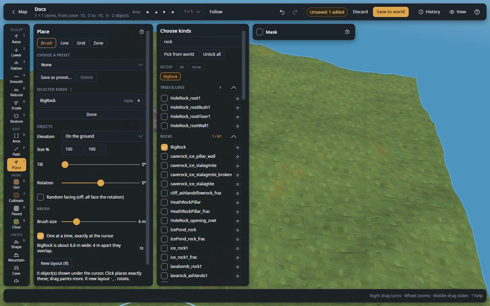
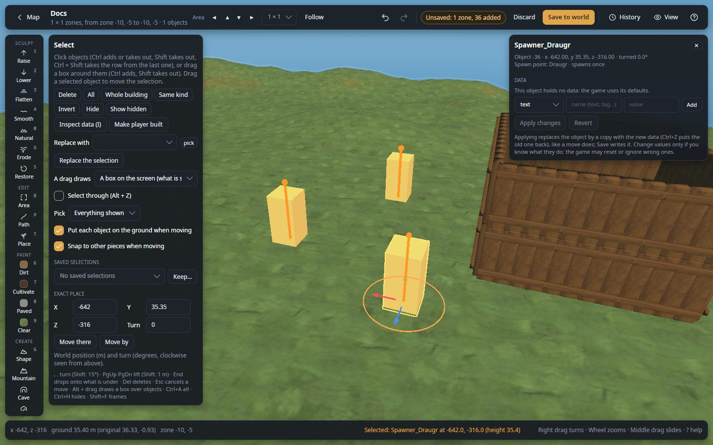
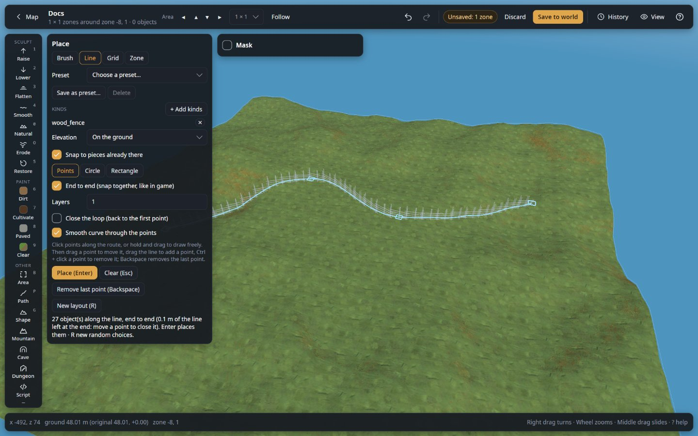
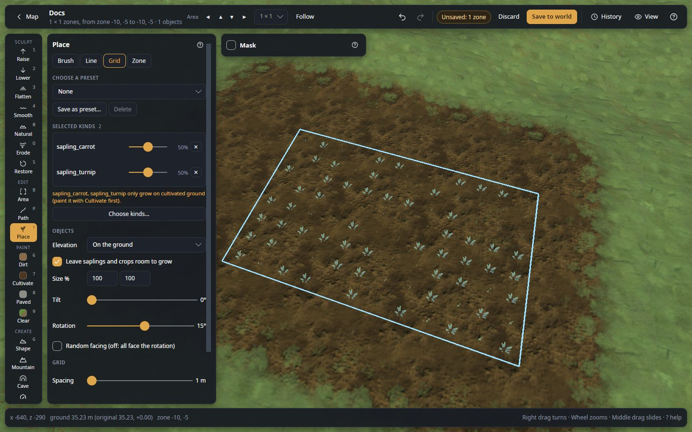
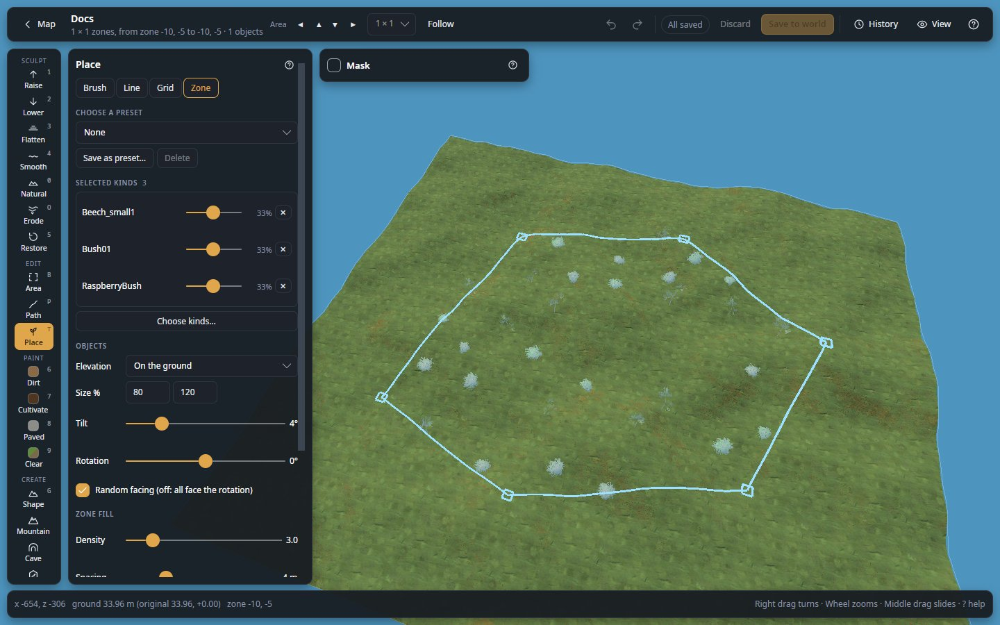
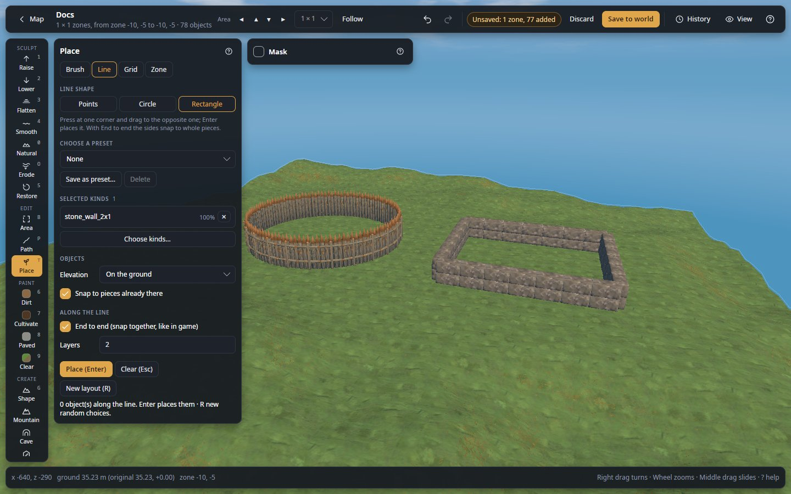

# Place (`T`)

*The Meadows woods preset in Brush mode: the see-through trees and bushes under the pointer are exactly what
a click will place.*

Place trees, rocks, bushes, crops, building pieces, spawn points or anything else the game has, in four
patterns: a brush, a line, a grid or a zone. A see-through **preview** always shows exactly what will be
placed, so you see how many there are and how they look before you click.

## How to use it

1. Press `T` (or **Place** in the rail's EDIT section).
2. Choose what to place: a preset under **Choose a preset**, or **Choose kinds…** to tick kinds in the
   list (see [Choosing what to place](#choosing-what-to-place)).
3. Choose a mode: **Brush**, **Line**, **Grid** or **Zone**.
4. Brush: click where the preview is, or drag to keep adding. Line, Grid and Zone: draw the shape, check
   the preview, then press **Place (Enter)**.

Every click, stroke or Enter is one undo step (`Ctrl+Z`). Nothing is written to the world until you
**Save** (or **Apply live**).

The panel is in sections, top to bottom: the four mode buttons, **Line shape** (Line mode only),
**Choose a preset**, **Selected kinds**, **Objects** (where they stand, how big and turned), then the
chosen mode's own section (**BRUSH**, **ALONG THE LINE**, **GRID** or **ZONE FILL**) and the buttons. The
[Mask](masks.md) is on its own card next to it. The Place tool's settings are remembered between runs.

## Choosing what to place

Under **Selected kinds** the panel lists the kinds you chose, each on a row with its share and a ✕ to
drop it ("None yet" while there are none). **Choose kinds…** under them opens **Choose kinds**, a list of
every kind in a card beside the panel; **Done** closes it.

*The Choose kinds card searching "rock": every category with a match is open, the ticked kinds counted
after the category's name.*

| Control | What it does |
|---|---|
| **Search kinds (oak, rock, bush…)** | Filters the list by name. Spawn points and nests are also found by the creature they spawn (boar finds `Spawner_Boar`). Searching opens every category with a match. |
| **Tick boxes** | Every ticked kind is used; each object picks one of them at random, by share. The list is grouped in categories that fold open or shut with a click on their name. After the name: how many of its kinds there are, or "ticked / all" once some are ticked. Which categories are open is remembered (Trees & logs at first). |
| **Shares** | In the panel, with two or more kinds chosen, a slider per kind sets how much of what is placed is that kind, in %: Beech at 75% with Birch gives three beeches for one birch. Moving one slider moves the others, keeping their proportions, so the shares always make 100% (each kind keeps at least 1%). An equal share sits in the middle: the slider ends at twice it (99% with two kinds, 67% with three, 50% with four); a share past the end shows there, with the real % beside it. Remembered. |
| **Choose a preset** | Loads a mix: its kinds with their shares, and its Density, Spacing, Clumping, Patch size, Size and Tilt, with random facing on. Built in: **Meadows woods**, **Black forest**, **Swamp**, **Berry patch**, **Forest floor**, **Meadows rocks**; yours follow as "Yours: name". Kinds a world cannot place are left out (the status bar says how many). **None** (the default) loads nothing; choosing it after a preset unticks every kind. |
| **Save as preset…** / **Delete** | Saves the chosen kinds, shares and those settings under a name (kept in the editor's data folder); **Delete** removes one of yours, after asking. |
| **Pick from world** | Eyedropper: click an object in the world to place only its kind; `Shift` + click adds it to the ticked kinds (or takes it away when it is ticked). `Esc` cancels. |
| **Untick all** | Unticks every kind. |
| **FAVOURITES** | Click the ☆ after a kind in the list to star it; starred kinds show as buttons above the list. |
| **RECENT** | The last eight kinds you placed, newest first, as buttons above the list, after the kinds chosen now (so what is chosen always shows there). |
| Favourite and Recent buttons | A click ticks or unticks that kind; `Shift` + click places only that kind. **all** / **none** after the row's name tick or untick every kind of the row. Both lists are kept in the editor's data folder. |

The list has every kind the game saves in a world, including kinds your world has none of yet, and the
kinds of your mods. Creatures, dropped items and ragdolls are left out. Kinds without a model show as
boxes in the preview.

Its categories, in order: **Trees & logs**, **Rocks**, **Bushes & shrubs**, **Pickables**, **Ore &
deposits**, **Ruins & structures**, **Furniture & props**, **Bones & remains**, **Spawn points**,
**Creature nests**, **Creatures & NPCs** (traders, birds), **Effects & markers** (mist, music, boss event
zones), **Your buildings** (building pieces) and **Other objects**, which keeps only what fits none of
them (tombstones...).

A line in orange under the selected kinds warns about what needs care: "Nothing to place yet", or crops
that "only grow on cultivated ground (paint it with Cultivate first)".

## Spawn points

*Two boar spawn points and a draugr one placed by a hut. Each shows as an orange box with a marker above it, seen
through anything in front; the one selected is open in the Inspector, whose line says what it spawns
(`Spawn point: Boar · 0–2 ★ · spawns once`).*

The game's invisible spawn points (`Spawner_Boar`, `Spawner_Draugr`, ...) are what puts creatures in
camps, villages and dungeons: each spawns its creature where it stands. They are under **Spawn points**,
each with what it spawns under its name, read from your game:

- the creature and its stars (`Boar · 0–2 ★`);
- **spawns once**: the creature is spawned the first time a player comes near, and never again once it
  dies (most of the game's spawn points); **back N min after it dies**: it comes back that long after it
  died (the `*_respawn_*` ones, `Spawner_Location_*`, `Spawner_imp_respawn`, `Spawner_Fish4`; the time is
  the kind's own, often 60 min);
- **by night only** or **by day only** for the few that wait; **when an event wakes it** for the
  `TriggerSpawner_` ones.

Which creature, its stars and its respawn time are the game's, fixed per spawn point kind: pick the kind
that spawns what you want. The [Inspector](select.md#inspecting-and-changing-an-objects-data) shows the
same line for a spawn point or nest that is already in the world.

**Creature nests** are the visible ones (greydwarf nests, bone piles, Elaking holes...). They keep
spawning creatures around themselves until destroyed; their line says how many and how far ("Greydwarf,
Greydwarf_Elite · up to 3 around, within 5 m").

In the 3D view, spawn points show as orange boxes (red when their creature comes back) and nests as
purple ones, each with a marker of the same colour above it, seen through anything in front, within
250 m of the camera. View → **Spawn points** and **Creature nests** show or hide them (they are spoilers,
hidden at first).

## Modes

| Mode | How it works |
|---|---|
| **Brush** | The preview follows the cursor, inside the brush's circle. A **click** places exactly what the preview shows; a **drag** keeps adding objects under the brush (not with **One at a time**). `Shift` + drag removes the ticked kinds under the brush. |
| **Line** | Click points along a route (or hold and drag), or draw a **Circle** or a **Rectangle**. Objects go every **Every** metres along it, or **end to end** like the game's hammer snaps them. |
| **Grid** | Drag a box. One object goes in the middle of each cell; the box gets as many whole cells as fit best (at least one), centred in it. |
| **Zone** | Click points around a zone (or hold and drag to draw it freely). Objects go at random spots inside it (**Density**, **Spacing**). |

In Line and Zone, drag a point to move it, drag the outline to add a point, `Ctrl` + click a point to
remove it. In Line, Grid and Zone, press **Place (Enter)** (or double-click the last point of a line or
zone); **Clear (Esc)** removes the shape; **Remove last point (Backspace)** takes back the last point you
clicked.

The line under the buttons says how many objects the preview shows and what the keys do.

### Brush

The brush lays out a pattern of random spots in its circle, at least **Spacing** apart, as many as
**Density** asks (400 at most). The pattern stays put while you move, so what you see is what a click
places. **New layout (R)** draws a new one.

While you drag, the brush adds objects about 30 times a second around the cursor, away from what
already stands and from what the stroke has placed. How fast it fills follows **Density** and the brush
**Strength** (the sculpt brushes' setting, which the brush shares). The whole stroke is one undo step.

### Line

*A fence placed end to end along a line through points, the Line panel beside it.*

Under **Line shape**:

| Control | What it does |
|---|---|
| **Points** | Click points along the way, or hold and drag to draw freely (a point every 2 m). **Close the loop (back to the first point)** goes back to the first point at the end, to fence a zone in. **Smooth curve through the points** draws a smooth curve instead of straight stretches. |
| **Circle** | Press at the centre and drag out to the size. Let go to see it; Enter places it. |
| **Rectangle** | Press at one corner and drag to the opposite one. |

Under **ALONG THE LINE**, when not end to end:

| Control | What it does |
|---|---|
| **Every** | Distance between two objects along the line, 0.5 to 30 m. |
| **Wiggle** | Random sideways offset from the line, up to this many metres (0 to 5). |
| **Follow the line (plus the rotation; replaces random facing)** | On (the default): each object faces along the line, plus the Rotation. Off: random facing. Circles and rectangles always follow their outline. |

### Grid

*Carrots and turnips on a grid turned 15° over cultivated ground. The orange line in the panel warns that
the crops need cultivated ground.*

Under **GRID**, **Spacing** is the space between objects, centre to centre (1 to 30 m): the size of each
cell.

### Zone

*A zone drawn point by point, with bushes and young trees previewed at random spots inside.*

Under **ZONE FILL**, **Density** and **Spacing** set how many objects go in and how far apart. The spots
are drawn once and kept while the zone stays the same; **New layout (R)** draws new ones.

In Grid and Zone mode, `,` `.` and `Alt` + wheel **turn the whole box or zone** (with its cells and the
objects' facing) instead of only the facing.

## Fences and walls: end to end

*Line's Circle (a ring of stake walls) and Rectangle (stone walls, two layers high), placed end to end.*

In **Line** mode, **End to end (snap together, like in game)** places pieces so that each one starts
exactly where the last one ends, turned along the line, like the game's hammer snaps them: a fence, a
stake wall, a row of walls or floors in a few clicks.

How the length is found: a piece's two ends are the middles of its two short sides, from its snap
points (read from your game); kinds without snap points use their model's box. Ticking several kinds
alternates them. End to end (and **One at a time** for the Brush) switches itself on when every ticked
kind is a piece that the game snaps (fences, walls, stakes, floors...) and off for other kinds, until you
change it yourself.

| Control | What it does |
|---|---|
| **Circle** | With End to end, the size snaps so that whole pieces close the ring. |
| **Rectangle** | With End to end, the sides snap to whole pieces, and each side is filled from its corner, so the corners meet exactly. |
| **Layers** | With End to end: the line stacked this many pieces high, 1 to 20, each layer on top of the one below (a wall 3 high, a double fence). |

- When a line does not end on a whole piece, the line under the buttons says how much is left ("0.8 m of
  the line left at the end: move a point to close it").
- A line that starts within 1 m of a piece already there (with **Snap to pieces already there** on)
  continues it: it starts at that piece's snap point and stays at its level.
- On a slope the pieces stay level, each standing on the lowest of the ground at its start, middle and
  end (so it never floats): every piece is a little higher or lower than the last one, touching it, like
  a fence going up a hill. For one straight, even fence, flatten the ground along the line first (Path
  tool, Flatten), or use **At one height**.

## Objects: where they stand

The **Objects** section is for every mode.

| Control | What it does |
|---|---|
| **Elevation**: **On the ground** | Each object stands on the ground where it goes. A building piece stands by its bottom (its lowest snap point: walls have their middle at their origin); other objects sit 5 cm into the ground. |
| **Elevation**: **Above the ground** | Each object stands **Height** metres above the ground under it. |
| **Elevation**: **At one height** | Every object at the same **Height** (its bottom there), whatever the ground does: a level wall over uneven ground, a floor for a platform. |
| **Height** | The metres for Above the ground, or the height for At one height. |
| `PgUp` / `PgDn` | Up or down by 0.5 m (`Shift`: 0.1 m). From On the ground they start lifting above it. |
| `Alt` + click | At one height: the top of the piece clicked (to build on it), or the ground there. |
| **Size %** min / max | Each object gets a random size between the two, 10 to 300% of its normal size (80 to 120 at first). |
| **Tilt** | Random lean of each object, up to this many degrees (0 to 20). |
| **Rotation** | Turns the brush's pattern and every object's facing (-180 to 180°). `,` `.` or `Alt` + wheel change it by 1° (`Shift`: 15°). |
| **Random facing (off: all face the rotation)** | On: each object faces a random direction. Off: they all face the Rotation. |
| **Leave saplings and crops room to grow** | Only shown when a sapling, a crop or a tree that grows from one is ticked. See [Room to grow](#room-to-grow). |

Size, Tilt and the facing rows are hidden for an end-to-end line: its pieces are placed at their own size,
upright and along the line.

### Building pieces: snapping

When a ticked kind is a building piece (it has snap points: walls, fences, floors, beams...), the Brush
places one at a time under the cursor, and **Snap to pieces already there** (on by default) locks it
onto the pieces around it (within 12 m), like the game's hammer:

| Control | What it does |
|---|---|
| **Beside** | The piece goes end to end with the piece next to the cursor, at its level (bottom with bottom, top with top), where a pair of snap points meets within 1 m, in whichever quarter turn meets best. |
| **On top** | The piece sits on top of the piece under the cursor (or the nearest within 3 m), its bottom on that piece's top. |
| Facing | A snapped piece faces like the piece it attaches to; **Rotation** turns it from there in quarter turns. |

The line under the buttons says what it snapped to ("Snapped beside woodwall."). Untick **Snap to pieces
already there** to place freely.

## The brush and zone settings

Under **BRUSH** (and **ZONE FILL** for the scatter rows):

| Control | Modes | What it does |
|---|---|---|
| **Brush size** | Brush | Brush radius, 1 to 30 m; `[` `]` change it. |
| **One at a time, exactly at the cursor** | Brush | One object exactly under the cursor per click. Only an object right on that spot (0.3 m) blocks it. A drag adds no more, so Density, Spacing, Clumping and Patch size are hidden while it is on (Brush size stays: `Shift` + drag still removes inside it). |
| **Density** | Brush, Zone | Objects per 100 m², 0.2 to 20. |
| **Spacing** | Brush, Zone | The least distance between objects, 0.5 to 15 m, also from objects already there. |
| **Clumping** | Brush, Zone | Gathers the objects in groves with clearings between them, 0 to 100%. See below. **New layout (R)** moves the groves. |
| **Patch size** | Brush, Zone (with Clumping) | How big the groves and clearings are, 5 to 120 m. |
| **fit** | Brush, Zone, Grid, Line (not End to end) | Shown when a ticked kind at its largest size is wider than the mode's spacing: "Beech1 is about 6.2 m wide: 4 m apart they overlap." **fit** sets the spacing (Spacing, Every or the grid's Spacing) to it, rounded up to the half metre. |
| **New layout (R)** | All | New random positions, kinds, sizes and facings for the preview. |

How Clumping works: a noise pattern is laid over the world, its blobs **Patch size** across. Where the
pattern is low, spots are thinned out; the higher the Clumping, the more of the ground is cleared and the
smaller and fewer the groves. The pattern is fixed to the world, not to the brush, so strokes next to each
other match.

## Rules it follows

Every object, in every mode, goes through these checks before it is shown in the preview:

- **Inside the open area.** Not on its outermost line of points.
- **The Mask** applies (biome, height, slope, paint).
- **Not under water**: an object on the ground is left out where the ground is more than 0.3 m under
  the water line, except kelp and seaweed. Objects placed above the ground or at one height may stand
  over water.
- **Spacing**: Brush and Zone keep Spacing from every object already there. Line and Grid ignore what
  stands, except an object right on the spot (0.3 m), so you cannot place the same pattern twice by
  accident.
- **Clumping** (Brush and Zone) thins the spots out where its pattern is low.
- **At most 2000** objects per line, grid or zone, and 400 per brush click.

### Room to grow

**Leave saplings and crops room to grow** (on at first) follows the game's growing rules. A sapling or a
crop only grows when nothing stands within its grow radius (read from your game: 0.5 m for most crops,
2 to 3 m for tree saplings). With it on:

- saplings and crops keep at least their grow radius from everything, including each other;
- grown crops (`Pickable_Carrot`...) and trees that grow from saplings (`Beech1`, `Oak1`...) keep the room
  their sapling needs, like a planted field or orchard;
- bushes do not grow from anything in the game: use **Spacing** for them.

Off: place them as tightly as you like (they may not grow in game).

**Crops need cultivated ground** in the game. When a ticked crop needs it, the panel says so: paint the
ground with **Cultivate** (or the Area tool's Paint) first.

## What placed objects are

- New objects are fresh: for a kind the world already has, a copy of one with nothing unique kept (no
  contents, no health); for a kind it does not have, a new object exactly like the game makes one.
- Building pieces (kinds built with the hammer, hoe or another tool) go in as player-built pieces, built by
  the player chosen in View → Building → **Built by** (see
  [Player-built pieces](editor-basics.md#player-built-pieces)). Trees, rocks and spawn points are not.
- The kinds you place go to the **RECENT** row.
