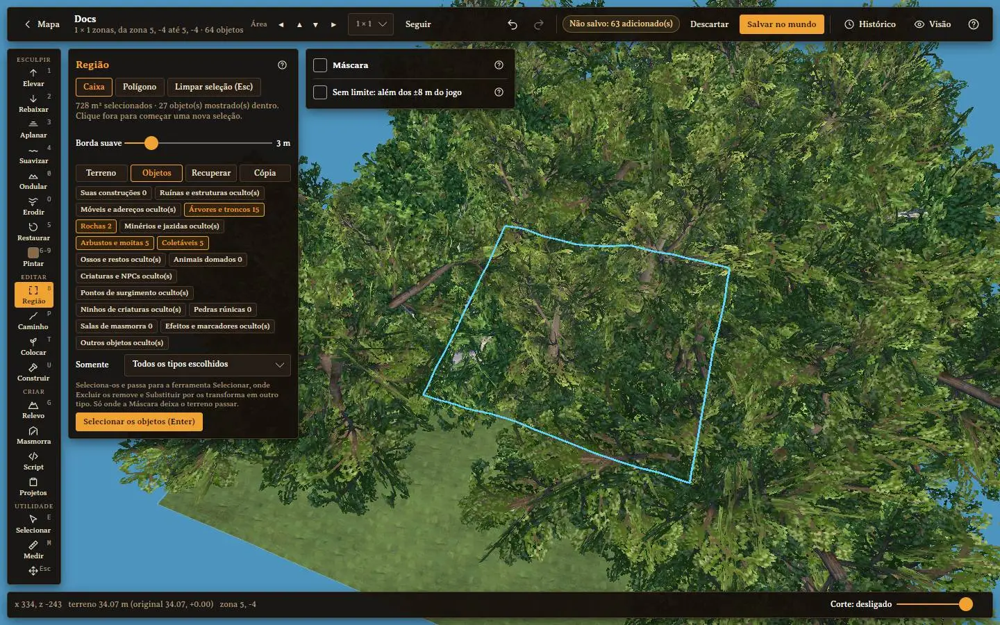
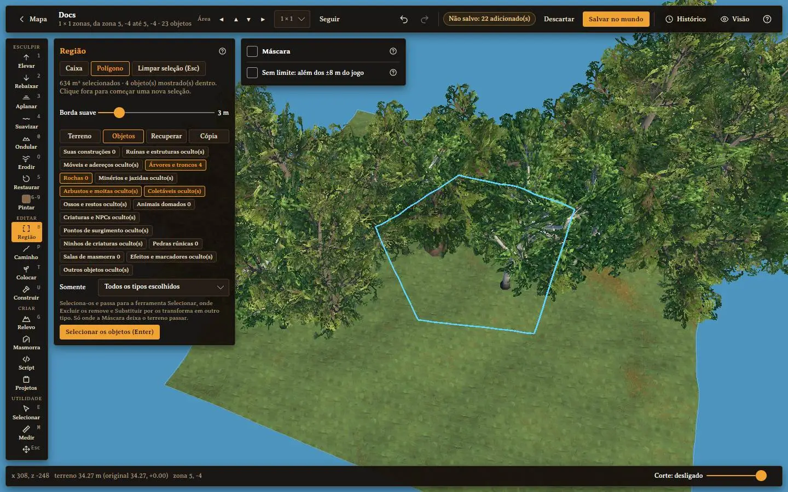
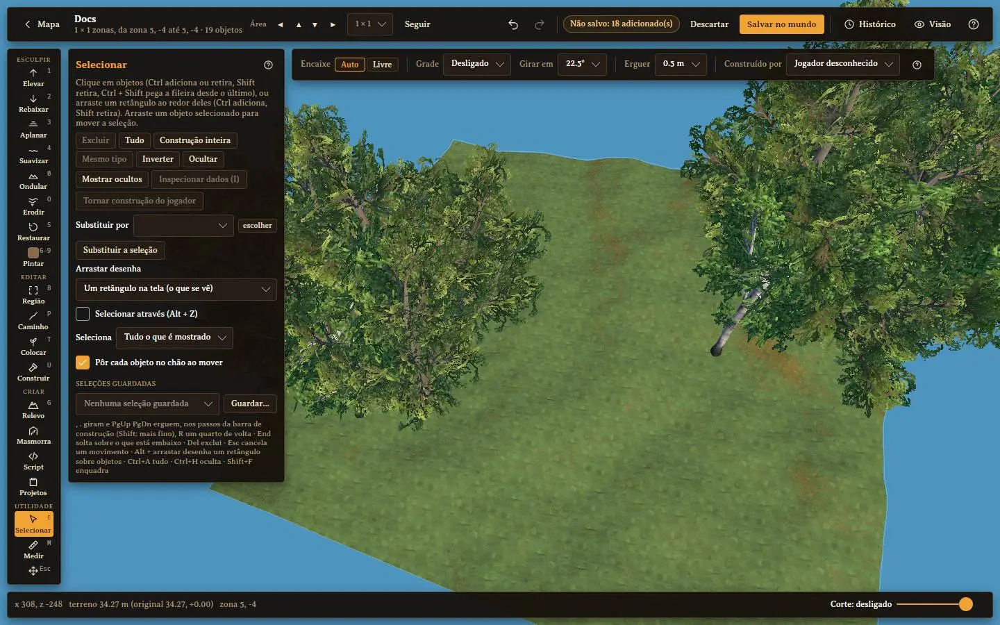
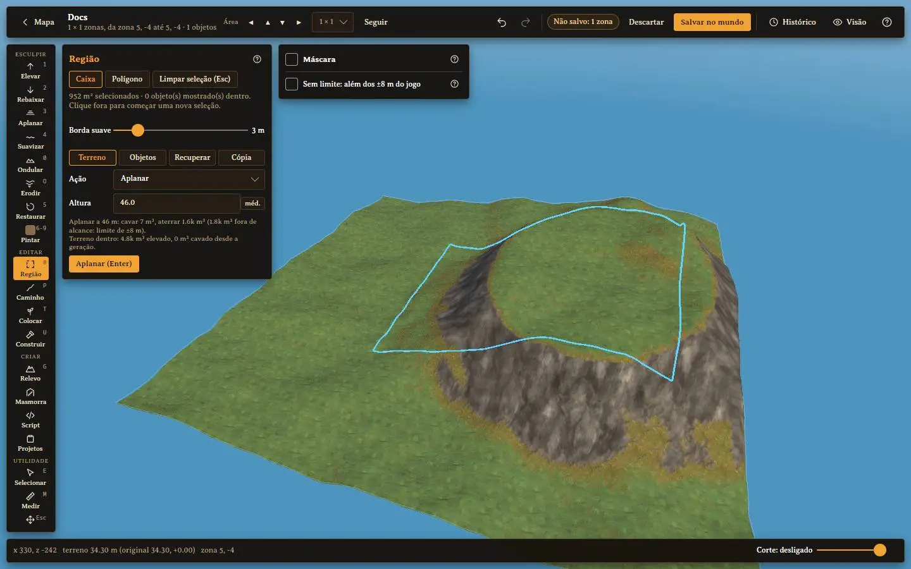
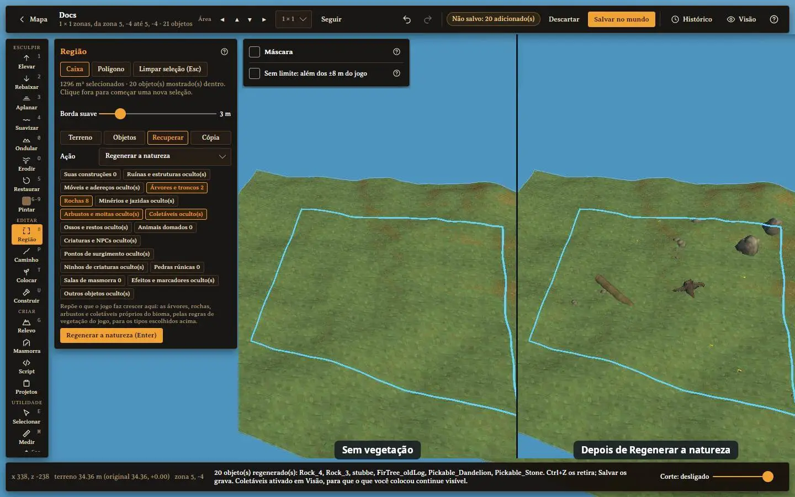
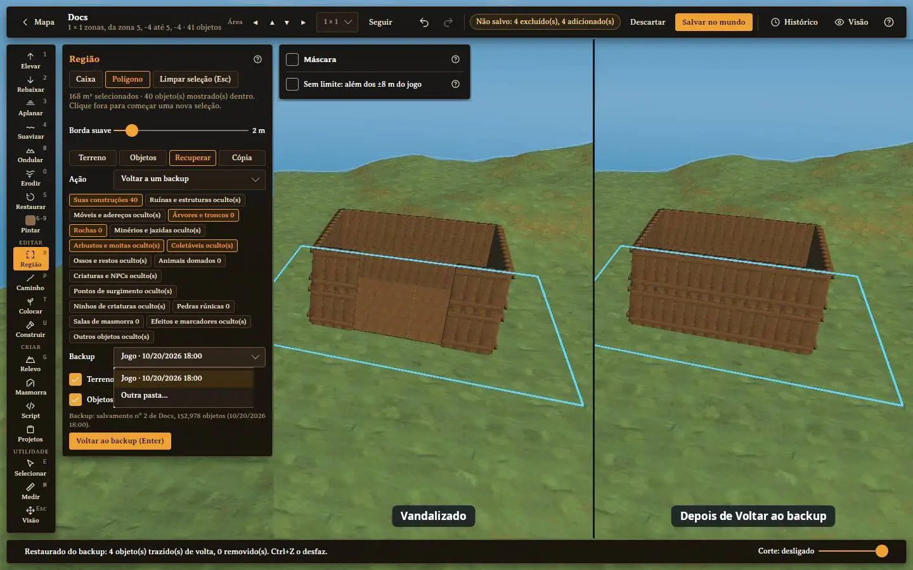
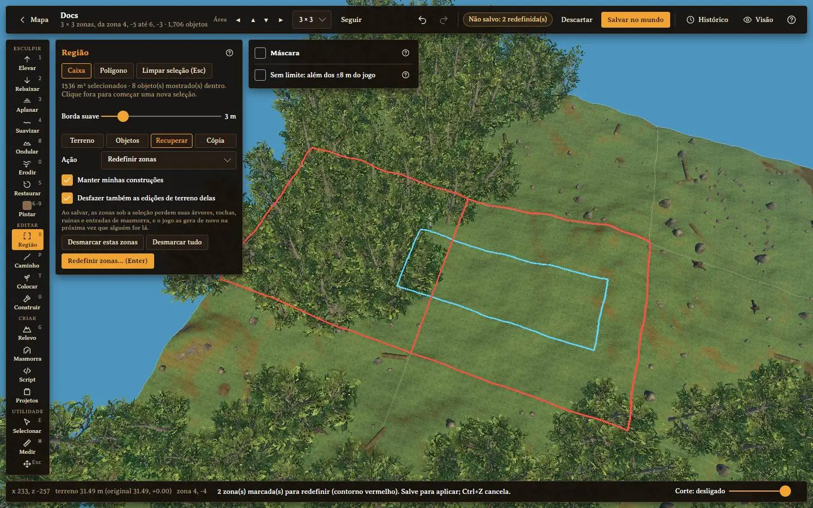
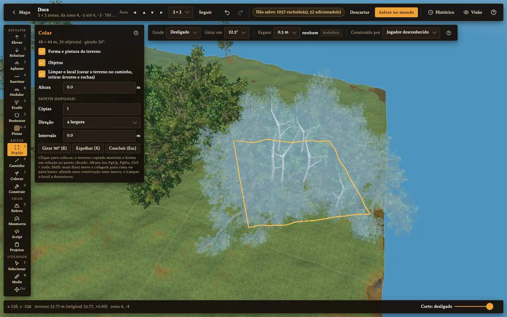
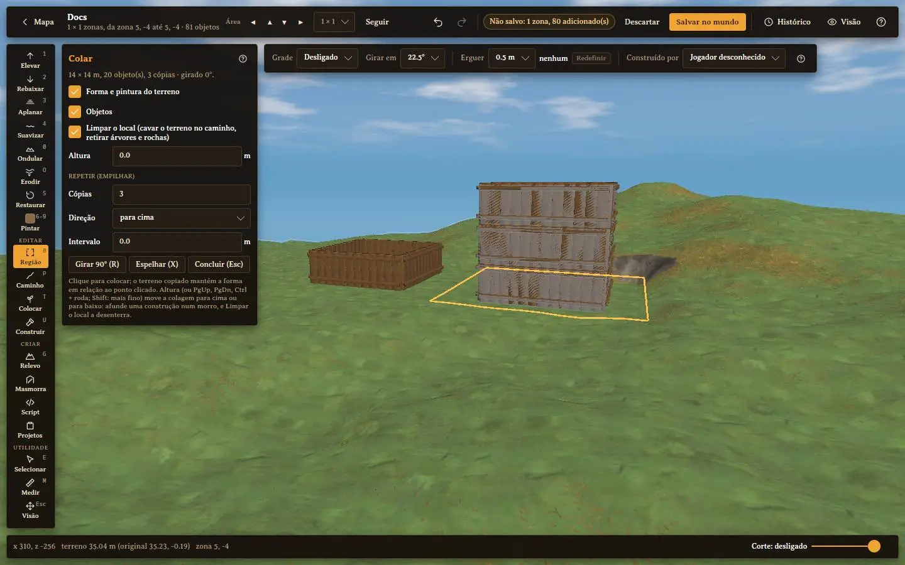
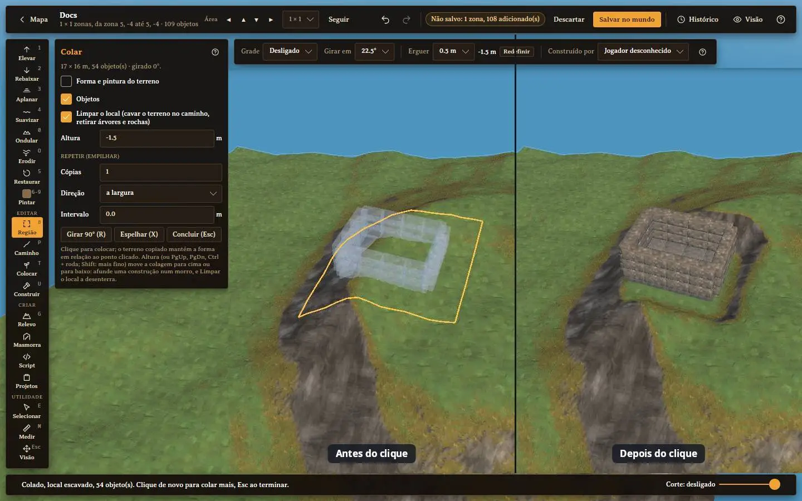

<!-- source: 89a0aafb -->
# Região, copiar e colar

Altere tudo dentro de uma caixa ou de um polígono de uma vez: aplane ou pinte o terreno, escolha os objetos para
excluí-los ou substituí-los, copie e cole, ou devolva o que havia ali: o terreno gerado, um backup, a natureza do
próprio jogo.

**Onde:** barra de ferramentas, seção **EDITAR** · **Tecla:** `B` · **Funciona em:** mundos salvos, ao vivo

*Uma caixa arrastada em volta de um bosque com **Objetos** escolhido: os chips de tipo contam as árvores, rochas,
arbustos e coletáveis que há dentro. Nada mudou ainda: o botão embaixo os seleciona.*

## Como usar

1. Na barra de ferramentas, clique em **Região** (`B`).
2. No alto do painel, escolha **Caixa** ou **Polígono** e desenhe a seleção no terreno.
3. Escolha um grupo: **Terreno**, **Objetos**, **Recuperar** ou **Cópia**. Terreno e Recuperar
   oferecem então as ações deles na lista **Ação**. O painel mostra só as configurações da ação escolhida e uma linha
   dizendo o que ela faz.
4. Pressione o botão embaixo, ou `Enter`. O rótulo dele dá o nome da ação: **Aplanar (Enter)**, **Selecionar os
   objetos (Enter)**, **Regenerar a natureza (Enter)**…
5. Não ficou bom? `Ctrl+Z` desfaz: cada ação é um passo no Histórico. **Salvar no mundo** (ou **Aplicar ao vivo**)
   a mantém.

| Grupo | O que contém |
|---|---|
| **Terreno** | [Ações de terreno](#ações-de-terreno): Aplanar, Elevar, Rebaixar, Suavizar, Ondular, Erodir, Pintar, e [Mapa de altura](#mapa-de-altura). |
| **Objetos** | [Selecionar objetos](#ações-de-objetos): os objetos de dentro, por tipo, entregues à ferramenta Selecionar para excluir, substituir ou mover. |
| **Recuperar** | [O que havia ali](#recuperar-o-que-havia-ali), de volta: [Voltar ao terreno gerado](#voltar-ao-terreno-gerado), [Regenerar a natureza](#regenerar-a-natureza), [Voltar a um backup](#voltar-a-um-backup), [Redefinir zonas](#redefinir-zonas). |
| **Cópia** | [Copiar e colar](#copiar-e-colar), e [projetos](#projetos). |

A ação escolhida é lembrada, e cada grupo volta na ação em que estava por último. A [Máscara](masks.md), no cartão
próprio ao lado do painel, limita as ações de terreno, Selecionar objetos, Regenerar a natureza e Voltar a um backup ao
terreno que ela deixa passar.

## Configurações

| Configuração | O que faz |
|---|---|
| **Caixa** | Arraste um retângulo no terreno. Uma caixa menor que um metro é descartada. Arrastar em outro lugar começa uma nova caixa. |
| **Polígono** | Clique nos cantos. Um clique duplo ou `Enter` fecha a forma (três cantos no mínimo); `Backspace` remove o último canto. Clicar depois que ela está fechada começa outra. |
| **Limpar seleção (Esc)** | Limpa a seleção, para começar uma nova. |
| **Borda suave** | De 0 a 20 m (3 m de início). As ações de terreno entram aos poucos ao longo dessa quantidade de metros dentro do contorno, para que o resultado se misture com o terreno em volta. Em **0** a borda é nítida e segue reto um contorno inclinado. |
| **Terreno**, **Objetos**, **Recuperar**, **Cópia** | O grupo de ações mostrado (veja a tabela acima). |
| **Ação** | As ações do grupo, para Terreno e Recuperar. Objetos e Área de transferência têm uma ação cada, então não há lista. |

A linha sob os botões dá a superfície e quantos objetos mostrados há dentro ("1250 m² selecionados · 84 objeto(s)
mostrado(s) dentro"). A seleção só é desenhada na ferramenta Região e durante a colagem; ela é mantida quando você usa
outra ferramenta.

*Um polígono fechado em volta de parte de um bosque, com **Objetos** escolhido.*

*Depois de **Selecionar os objetos (Enter)** e então `Del` na ferramenta Selecionar: as árvores dentro do polígono
sumiram, as de fora continuam de pé.*

## Ações de terreno

Cada ponto é atenuado pela **Borda suave** e pela Máscara. Estas são as ações dos [pincéis](terrain.md) e da
ferramenta [Caminho](path.md), com os mesmos nomes: aqui elas se aplicam à seleção inteira de uma vez.

| Ação | O que faz |
|---|---|
| **Aplanar** | Nivela o terreno de dentro na **Altura** (m). **méd.** põe em Altura a altura média do terreno de dentro. |
| **Elevar** / **Rebaixar** | Ergue / cava o terreno de dentro em **Quantidade** (m). |
| **Suavizar** | Suaviza as saliências: cada ponto se aproxima da média do terreno num raio de 3 m. |
| **Ondular** | O terreno é suavizado e depois recebe saliências naturais. **Saliências**, **Extensão** e **Novo padrão** aparecem embaixo: são os do pincel [Ondular](terrain.md#ondular), com os mesmos valores onde quer que você os defina. |
| **Erodir** | Desgasta o terreno de uma vez: as encostas se acomodam, a chuva cava ravinas e deixa leques de sedimento, as encostas se acomodam de novo. **Ângulo de repouso** aparece embaixo: o do pincel [Erodir](terrain.md#erodir), com o mesmo valor onde quer que você o defina. |
| **Pintar** | Pinta o terreno de dentro com **Terra**, **Cultivado**, **Pavimentado** ou **Limpar pintura** (a lista embaixo). |
| **Mapa de altura** | O terreno como imagem em tons de cinza, para fora e de volta: veja [Mapa de altura](#mapa-de-altura). |

Para devolver o terreno ao que o mundo gerou, escolha **Recuperar** e depois
[Voltar ao terreno gerado](#voltar-ao-terreno-gerado).

As ações de terreno ficam dentro dos ±8 m do jogo, a menos que **Sem limite: além dos ±8 m do jogo** esteja marcado no
cartão **Máscara** ao lado do painel: o interruptor único para todas as ferramentas de terreno, que fica ligado até
você desligá-lo. Veja [Sem limite](terrain.md#sem-limite).

Sob **Aplanar**, **Elevar** e **Rebaixar**:

| Configuração | O que faz |
|---|---|
| Linha de corte e aterro | Quanto terreno a ação moveria ("Aplanar a 35 m: cavar 120 m³, aterrar 340 m³"), e, para Aplanar, o que fica fora de alcance ("(40 m³ fora de alcance: limite de ±8 m)"; com Sem limite ligado, só o que passa dos ±400 m dele). A segunda linha, "Terreno dentro: … elevado, … cavado desde a geração", compara com o mundo como foi gerado. As duas acompanham cada alteração, a borda suave e a Máscara. |

*Uma caixa sobre um morro com **Aplanar** a 46 m e **Sem limite** desligado: "Aplanar a 46 m: cavar 0 m³, aterrar 1.5k
m³ (2.2k m³ fora de alcance: limite de ±8 m)", e embaixo o terreno já elevado dentro desde que o mundo foi gerado.*

### Mapa de altura

Exporte o terreno como imagem em tons de cinza, altere-a num editor de imagens (GIMP, Krita…) ou numa ferramenta de
terreno (Gaea, World Machine…) e traga-a de volta.

| Configuração | O que faz |
|---|---|
| **Exportar** | Grava o terreno da caixa da seleção, ou da área aberta inteira quando nada está selecionado, como PNG de 16 bits em tons de cinza: preto é o ponto mais baixo, branco o mais alto, norte no alto, um pixel por metro (uma área inteira de 3 × 3 tem 193 × 193 pixels). Vai para a pasta `heightmaps` da pasta de dados do editor; a barra de status diz onde. Um polígono é exportado como a caixa em volta dele. |
| **Importar…** | Lê um PNG (em tons de cinza ou colorido, de 8 ou 16 bits) e o ajusta à caixa da seleção, ou à área inteira quando nada está selecionado. |
| **Mais baixo** / **Mais alto** | As alturas do preto e do branco. Uma imagem que o editor exportou traz as próprias, então uma imagem inalterada devolve o terreno exatamente. |
| **Aplicar ao terreno** | Põe o terreno nas alturas da imagem, num único passo de desfazer. Dentro de uma seleção, a **Borda suave** faz a transição. A Máscara e o limite de ±8 m se aplicam (a menos que Sem limite esteja ligado): os pontos que não alcançam a altura deles ficam vermelhos, e a barra de status os conta. |
| **Cancelar** | Esquece a imagem sem alterar o terreno. |

Use 16 bits quando puder: uma imagem de 8 bits tem só 256 degraus entre Mais baixo e Mais alto (degraus de 20 cm em
50 m).

*Sem nada selecionado, depois de **Exportar** e então **Importar…** da mesma imagem: "Imagem 65 × 65 ajustada a 65 × 65
m (a área inteira), com as alturas com que foi exportada", **Mais baixo** e **Mais alto** lidos dela. Nada muda até
**Aplicar ao terreno**.*

## Ações de objetos

A ferramenta Região escolhe **quais** objetos: os que estão dentro da seleção, dos tipos que você ligar, onde a Máscara
deixa o terreno passar. A ferramenta [Selecionar](select.md) faz então coisas **com** eles: excluir, substituir, mover,
girar, copiar, ocultar.

Uma fileira de **chips de tipo** escolhe os tipos. Cada chip mostra quantos objetos do tipo dele há dentro ("Árvores e
troncos 42"). De início, **Árvores e troncos**, **Rochas**, **Arbustos e moitas** e **Coletáveis** estão ligados;
escolha **Suas construções** para peças feitas por jogadores, **Minérios e jazidas** para cobre, estanho, prata e
afins. Os mesmos chips escolhem os tipos para [Regenerar a natureza](#regenerar-a-natureza) e
[Voltar a um backup](#voltar-a-um-backup).

Um chip que diz "oculto(s)" é um tipo desligado no [painel Visão](editor-basics.md): os objetos dele não são contados e
ficam intocados, exceto por **Voltar a um backup**.

| Configuração | O que faz |
|---|---|
| Chips de tipo | Os tipos de objetos considerados. |
| **Somente** | **Todos os tipos escolhidos** considera todos eles. Ou escolha um objeto entre os de dentro, listados com quantos há, os mais comuns primeiro ("Beech1 (42)"): só esses são considerados. A lista acompanha os chips. |
| **Selecionar os objetos (Enter)** | Seleciona-os e passa para a ferramenta Selecionar. A barra de status diz quantos. Quando não há nada dos tipos escolhidos dentro, ela diz isso e a ferramenta Região continua. |

Então, na ferramenta Selecionar:

| Para | Faça isto |
|---|---|
| Removê-los | Pressione `Del` (ou **Excluir**). Um passo no Histórico; `Ctrl+Z` os traz de volta. Um grupo vinculado (o navio de um mod) vai inteiro. |
| Substituí-los por outro tipo | Escolha o tipo em **Substituir por** (ou use **escolher** para pegá-lo no mundo) e depois **Substituir a seleção**. Para substituir só as faias de um bosque, escolha-as primeiro em **Somente**. Veja [Selecionar](select.md#configurações). |
| Movê-los, girá-los, copiá-los, ocultá-los | Como qualquer seleção: veja [Selecionar](select.md). |
| Voltar | Pressione `B`: a caixa ou o polígono continua ali. |

## Recuperar o que havia ali

Quatro maneiras de trazer de volta o que havia ali, da mais leve à mais pesada.

| Ação | O que traz de volta |
|---|---|
| **Voltar ao terreno gerado** | O terreno de dentro como o mundo o gerou. Os objetos ficam. |
| **Regenerar a natureza** | As árvores, rochas, arbustos e coletáveis que o jogo faz crescer ali, no terreno como ele está agora. |
| **Voltar a um backup** | O terreno e os objetos de dentro como estavam num backup deste mundo. |
| **Redefinir zonas** | Zonas inteiras, refeitas pelo jogo na próxima vez que alguém for até lá. |

### Voltar ao terreno gerado

O terreno de dentro volta ao que o mundo gerou: a altura (inclusive o terreno elevado ou cavado com Sem limite) e a
pintura. Atenuado pela **Borda suave** e pela Máscara, como as [ações de terreno](#ações-de-terreno). Faz numa caixa ou
num polígono o que o pincel [Restaurar](terrain.md#restaurar) faz sob o cursor.

### Regenerar a natureza

*À esquerda: uma caixa em terreno vazio. À direita: a mesma caixa depois de **Regenerar a natureza**: as árvores e
rochas do próprio jogo para o bioma, e a barra de status diz o que cresceu.*

Regenerar a natureza devolve as árvores, rochas, arbustos, coletáveis e minérios que o jogo faz crescer ali, para os
tipos escolhidos com os [chips de tipo](#ações-de-objetos), dentro da seleção e onde a Máscara permite. Use-a para
desfazer o desmatamento de um bosque, ou para vestir um terreno que você remodelou.

- **Segue as próprias regras do jogo** e a semente do mundo: num terreno ainda como foi gerado, você recebe de volta as
  mesmas árvores nos mesmos lugares. Os biomas alternativos (Dark Meadows, Rock Black Forest…) recebem o que eles
  acrescentam.
- **Usa o terreno como ele está agora**: um morro que você elevou recebe o que cresce na nova altura e no novo declive
  dele.
- **Não duplica o que está de pé**: nada cresce a menos de 1 m de um objeto, de 3 m de um do mesmo tipo ou de 4 m de
  uma peça de construção, nem onde um local (uma aldeia, a entrada de uma masmorra) mantém o terreno livre.
- **Até 16 zonas de uma vez** (256 × 256 m): escolha uma seleção menor para mais.
- Se um tipo que ela fez crescer estiver oculto em Visão, ela o liga, para que o que cresceu continue visível.

As regras completas: [Regras de crescimento](concepts/objects.md#regras-de-crescimento).

### Voltar a um backup

Devolva a seleção ao que era num backup deste mundo, para desfazer um vandalismo, um ataque ruim ou uma edição de que
você se arrependeu, sem voltar o mundo inteiro. Passo a passo: [Restaurar uma área a partir de um backup](guides/restore-from-backup.md).

| Configuração | O que faz |
|---|---|
| **Backup** | Os backups ao lado da pasta do mundo, os mais novos primeiro: os do próprio jogo ("Jogo · data") e os do editor de versões antigas ("Editor · data"). **Outra pasta…** escolhe qualquer outra cópia do mesmo mundo, como o backup de um servidor copiado para este computador; ao vivo, a lista fica vazia, então esse é o caminho. Uma cópia de outro mundo (outra semente) é recusada. A linha embaixo diz qual salvamento é e quantos objetos ele contém. |
| **Terreno (altura e pintura)** | O terreno de dentro volta exatamente como no backup, inclusive o terreno de Sem limite; dentro da **Borda suave**, ele faz a transição. A Máscara se aplica. |
| **Objetos dos tipos escolhidos acima** | Os objetos dos tipos escolhidos com os [chips de tipo](#ações-de-objetos) voltam com todos os dados deles: um baú restaurado tem o conteúdo dele. Escolha **Suas construções** para trazer construções de volta. |
| **Voltar ao backup (Enter)** | Faz isso: um passo no Histórico. |

Um objeto que é igual nos dois (mesmo tipo, lugar e direção) fica intocado. Todos os outros objetos dos tipos
escolhidos que estão dentro são removidos, mesmo ocultos em Visão, e todo objeto do backup sem correspondente volta. As
pedras rúnicas nunca são tocadas. Quando nada difere, a barra de status diz "Nada para restaurar: a seleção está como
estava no backup."

*À esquerda: um polígono em volta de uma cabana sem parte da parede da frente, **Voltar a um backup** escolhido, a
lista **Backup** aberta no backup do jogo e **Suas construções** ligado. À direita: depois de **Voltar ao backup
(Enter)**, a parede está inteira de novo; a linha acima do botão dá o nome do salvamento do backup, a barra de status
conta o que voltou.*

### Redefinir zonas

Marque as zonas sob a seleção para que o jogo as gere de novo: novas árvores, rochas, minérios e locais. Para escolher
zonas no mundo inteiro por bioma ou distância das construções, use o
[mapa do mundo](map.md#redefinir-zonas-pelo-mundo), que tem os mesmos dois interruptores e marca do mesmo jeito;
passo a passo: [Gerar zonas de novo](guides/reset-zones.md).

| Configuração | O que faz |
|---|---|
| **Manter minhas construções** | Os objetos feitos por jogadores nas zonas são mantidos. Ligado de início. Desligado, as construções nas zonas vão junto. |
| **Desfazer também as edições de terreno delas** | Desfaz também as edições de terreno das zonas: altura (inclusive o terreno de Sem limite) e pintura. A visão mostra o terreno de volta como gerado assim que as zonas são marcadas. Ligado de início. |
| **Redefinir zonas… (Enter)** | Marca para redefinir todas as zonas sob a seleção (contorno vermelho), depois de perguntar. |
| **Desmarcar estas zonas** | Desmarca as zonas sob a seleção: elas não são redefinidas. |
| **Desmarcar tudo** | Desmarca todas as zonas marcadas para redefinir, inclusive as marcadas no mapa e fora da área aberta. Um passo no Histórico. |

Uma zona conta quando o contorno abrange pelo menos um dos pontos de terreno dela, seja qual for a borda suave: uma zona
que fica fora da seleção não é redefinida. A redefinição acontece quando você salva (offline) ou aplica ao vivo
(WorldEditorBridge 0.10.0 ou mais recente).

> [!CAUTION]
> **Depois de salva ou aplicada, uma redefinição não pode ser desfeita.** Toda árvore, rocha, ruína, entrada de
> masmorra, criatura e item largado nas zonas some; as lápides dos jogadores ficam. Os animais domados não têm
> construtor, então também somem: tire-os de lá primeiro.

*Uma caixa sobre duas zonas, **Redefinir zonas** com **Manter minhas construções** e **Desfazer também as edições de
terreno delas** ligados, depois de **Redefinir zonas… (Enter)**: as duas zonas com contorno vermelho, a barra de status
contando-as. Nada é redefinido até você salvar.*

## Copiar e colar

*Um bosque copiado de algumas dezenas de árvores e rochas seguindo o cursor, transparente e girado 30°; a linha no alto
do painel Colar diz o que está na área de transferência. Um clique o coloca.*

O grupo **Cópia** mostra estes botões. `Ctrl+C` e `Ctrl+X` funcionam com qualquer ação da ferramenta
Região (e na ferramenta Selecionar); `Ctrl+V` funciona em qualquer ferramenta.

| Configuração | O que faz |
|---|---|
| **Copiar (Ctrl+C)** | Copia todos os objetos mostrados de dentro (seja o que for que os chips de tipo digam), e o terreno sobre o qual as construções deles estão. Ao colar, árvores, rochas e afins mantêm a altura acima do terreno onde cada um cai; as peças de construção mantêm a forma da construção. Os tipos que o mundo não pode criar ficam de fora. A cópia é lembrada: cole-a em outra área, em outro mundo ou depois de reiniciar o editor. |
| **Recortar (Ctrl+X)** | A mesma cópia, e então os objetos copiados saem do mundo (`Ctrl+Z` os traz de volta), de modo que colar os move. O terreno fica. |
| **Colar (Ctrl+V)** | Começa a colagem: a cópia segue o cursor; clique para colocá-la. Cole quantas quiser; `Esc` para. |
| **Salvar projeto…** / **Projetos…** | Veja [Projetos](#projetos). |

A linha sob os botões diz o que está na área de transferência ("Área de transferência: 24 × 18 m, 54 objeto(s).", com o
nome do projeto quando ela veio da biblioteca). Uma seleção sem objetos mostrados dentro não copia nada (o terreno dela
só vai junto com construções): a barra de status diz isso, e a área de transferência mantém o que tinha.

Uma cópia contém:

- **Os objetos, com todos os dados deles**: o conteúdo de um baú, o texto de uma placa, a vida deles, quem os
  construiu.
- **Só o terreno sob as construções**: sob cada peça de construção mais 1 m, sumindo aos poucos ao longo de mais 3
  metros. O resto do terreno da seleção não é copiado, então uma vila colada se assenta no terreno em que cai.
- **Alturas de dois jeitos.** Árvores, rochas e outros elementos da natureza mantêm a altura acima do terreno e seguem o
  terreno onde cada um cai. As peças de construção e as partes de um grupo vinculado (o navio de um mod) mantêm a forma
  da construção, medida a partir do terreno médio da cópia, que vai para a altura do terreno onde você clica.

A cópia da ferramenta [Selecionar](select.md) contém só os objetos que você selecionou, e o terreno sob as peças de
construção deles, sem a pintura. Ela é colada do mesmo jeito.

### Colar

*Um clique com **Cópias** 3 e **Direção** para cima, visto do chão: ao lado da cabana original, três cópias empilhadas
em três andares (o contorno é a próxima colagem, seguindo o cursor).*

A colagem precisa caber na área aberta: o contorno dela fica vermelho quando não cabe, e um clique ali diz isso. Abra
uma área maior primeiro (a lista de tamanho da área na barra superior, ou o [mapa](map.md)).

| Configuração | O que faz |
|---|---|
| **Forma e pintura do terreno** | Cola o terreno sob as construções, mantendo a forma dele em relação ao ponto em que você clica, além dos ±8 m do jogo quando necessário. Uma construção fica sobre o terreno em que foi construída. |
| **Objetos** | Cola os objetos copiados. |
| **Limpar o local (cavar o terreno no caminho, retirar árvores e rochas)** | Ligado de início. Cava o terreno no caminho das peças de construção coladas até a peça mais baixa (nunca eleva o terreno), e retira árvores, rochas, minérios, arbustos e coletáveis da área ocupada por elas. Construções e criaturas ficam. |
| **Altura** | Move a colagem para cima ou para baixo (m); `PgUp`, `PgDn` e `Ctrl` + roda também. Afunde uma construção num morro e Limpar o local a desenterra. |

Sob **REPETIR (EMPILHAR)**:

| Configuração | O que faz |
|---|---|
| **Cópias** | Quantas cópias um clique coloca, de 1 a 50, tudo num único passo de desfazer. |
| **Direção** | Em que direção elas se seguem: **a largura** ou **a profundidade** (estas giram e espelham com a colagem), ou **para cima** (andares empilhados). |
| **Intervalo** | Espaço entre duas cópias (m); um valor negativo as sobrepõe. Para cima, o tamanho de uma cópia é a altura dela mais um metro. |

Embaixo no painel:

| Configuração | O que faz |
|---|---|
| **Girar 90° (R)** | Um quarto de volta. `,` e `.` giram pelo passo **Girar em** da barra de construção (`Shift`: 1°). |
| **Espelhar (X)** | Espelha a colagem de leste a oeste, antes de girar. |
| **Concluir (Esc)** | Para de colar e volta à ferramenta Região. |

Enquanto você cola, [a barra de construção](build.md#a-barra-de-construção) aparece ao lado do painel, a mesma que Construir
e Selecionar usam: **Grade** (a colagem a segue), **Girar em** e **Erguer** (os passos de `,` `.` e de `PgUp` `PgDn`; a
barra mostra a altura, **Redefinir** a leva de volta a zero) e **Construído por**.

As cópias lado a lado se assentam cada uma no terreno onde caem; empilhadas para cima, só a primeira molda o terreno. A
linha no alto do painel diz o que está na área de transferência: nome, tamanho, objetos, cópias, giro, espelhamento. A
barra de status diz o que a colagem fez: "Colado com o terreno, 54 objeto(s), 7 árvore(s), rocha(s) e afins retirados
do local."

*Com **Limpar o local** ligado (**Forma e pintura do terreno** desligado, **Altura** -1.5 m): à esquerda, a cópia
transparente afundada na encosta de um monte; à direita, depois do clique, o terreno cavado em volta das paredes.*

## Projetos

Um projeto é uma construção salva como arquivo, para colar em qualquer mundo ou construir no jogo com o
[Homestead](https://thunderstore.io/c/valheim/p/sighsorry/Homestead/). A biblioteca, a Oficina e a verificação de
suporte estão em [A Oficina](workshop.md).

| Configuração | O que faz |
|---|---|
| **Salvar projeto…** | Salva os objetos da área de transferência (o que Região ou Selecionar copiou por último) como projeto do Homestead, com nome, descrição e tags, e se é uma masmorra (veja [Masmorras](dungeons.md)). O terreno e os construtores não são guardados. Um projeto com o mesmo nome é substituído, depois de perguntar. |
| **Projetos…** | Abre a biblioteca (também **Projetos** na barra de ferramentas). **Colar** põe um projeto na área de transferência e começa a colagem. |

As peças coladas mantêm o que o projeto contém (textos de placas, itens em suportes, conteúdo de baús) e são
construídas pelo jogador escolhido em **Construído por** na [barra de construção](build.md#a-barra-de-construção) (as peças
que ninguém construiu continuam assim). Os tipos que o jogo não conhece (mods não instalados) ficam de fora, e o
editor diz quais. Um projeto de masmorra vai para 5000 m de altura, atrás de uma entrada no terreno onde você clica,
como o jogo guarda as masmorras dele.

## Atalhos

| Tecla ou mouse | O que faz |
|---|---|
| `B` | Escolher Região. |
| Arrastar (Caixa) / clicar nos cantos (Polígono) | Desenhar a seleção. |
| Clique duplo ou `Enter` | Fechar o polígono. |
| `Backspace` | Remover o último canto do polígono. |
| `Enter` | Fazer a ação escolhida. |
| `Enter`, depois `Del` | Com **Objetos** escolhido: selecionar os objetos de dentro e depois excluí-los (na ferramenta Selecionar). |
| `Esc` | Limpar a seleção; um segundo `Esc` sai da ferramenta. |
| `Ctrl+C` / `Ctrl+X` / `Ctrl+V` | Copiar / recortar a seleção / colar. |
| Durante a colagem: `R`, `X` | Girar 90°, espelhar. |
| Durante a colagem: `,` `.` ou `Alt`+roda | Girar pelo passo **Girar em** da barra de construção, 22.5° de início (`Shift`, mais fino: 1°). |
| Durante a colagem: `PgUp` / `PgDn` ou `Ctrl`+roda | Altura pelo passo **Erguer** da barra de construção, 0.5 m de início (`Shift`, mais fino: um quinto disso). |
| Durante a colagem: `Esc` | Concluir. |

## Dicas e limites

- **Desenhe a seleção alguns metros mais larga que as construções**: o terreno copiado se atenua dentro da **Borda
  suave**, então uma construção perto do contorno leva menos do terreno dela.
- **Uma vila grande precisa de uma área grande**: escolha 9 × 9 ou mais na lista de tamanho da área antes de colar.
- **Os objetos colados são objetos novos** com todos os dados copiados, então uma colagem funciona também em outro
  mundo. Os grupos vinculados (o navio de um mod) recebem ids novos próprios. Ao vivo, **Recortar** e depois colar move
  os objetos no jogo em execução quando possível (veja [Modo ao vivo](live-mode.md)).
- **Nenhuma ação toca a linha de pontos mais externa da área** (veja
  [A borda travada](concepts/areas-and-zones.md#a-borda-travada)).
- **Para desfazer uma ação**, `Ctrl+Z`, também depois de salvar (e então salve de novo: o
  [Histórico](concepts/saving-and-history.md#histórico) fica); para uma alteração mais antiga que o histórico,
  [Restaurar uma área a partir de um backup](guides/restore-from-backup.md).

## Relacionados

- [Retirar árvores e rochas, aplanar um terreno para construir](guides/clear-an-area.md)
- [Restaurar uma área a partir de um backup](guides/restore-from-backup.md)
- [Mover ou copiar uma construção](guides/move-a-building.md)
- [Gerar zonas de novo](guides/reset-zones.md)
- [Objetos](concepts/objects.md), [Backups](concepts/saving-and-history.md#backups)
- [Como uma colagem limpa o local](concepts/objects.md#como-uma-colagem-limpa-o-local), [como Regenerar decide o que cresce](concepts/objects.md#como-regenerar-decide-o-que-cresce)
