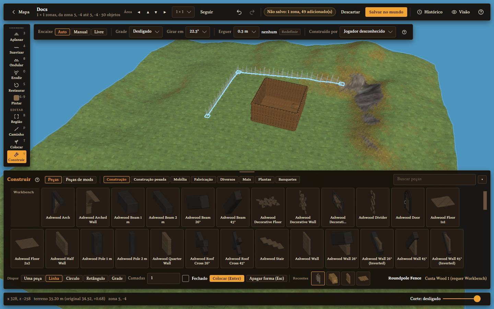
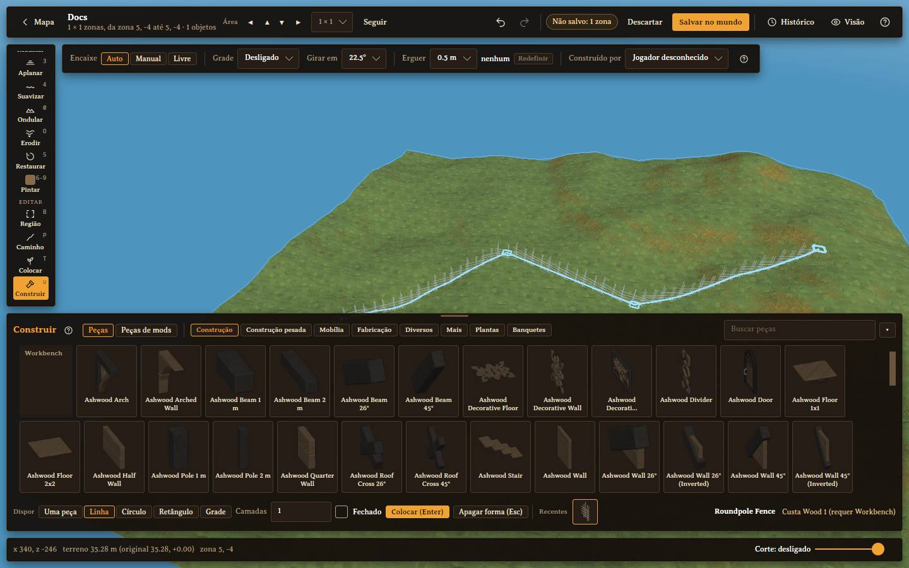
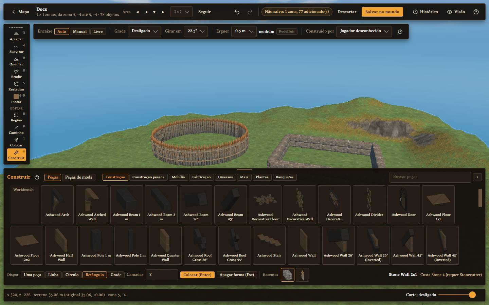
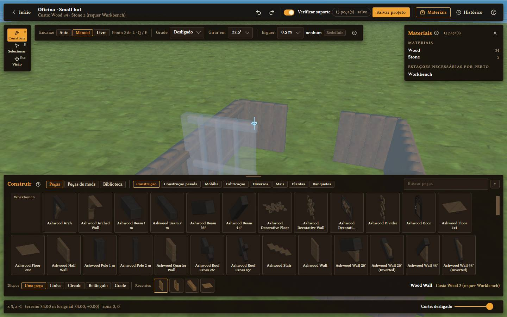

<!-- source: 1f261984 -->
# Construir

Coloque as peças que os jogadores constroem (paredes, pisos, telhados, cercas, móveis, estações de fabricação), uma
por vez como o martelo do jogo, ou ao longo de uma linha, em volta de um círculo ou de um retângulo, ou numa grade.

**Onde:** barra de ferramentas, seção **EDITAR** · **Tecla:** `U` (na Oficina, `T` também) · **Funciona em:** mundos
salvos, ao vivo, na [Oficina](workshop.md) e nas salas de uma masmorra com [Construir aqui](dungeons.md)

*Construir num mundo: uma cabana erguida em terreno nivelado e uma cerca de troncos sendo disposta ao longo de uma
linha de três pontos (**Dispor** em **Linha**, mostrada antes de **Colocar (Enter)**). Embaixo: o painel Construir com
as peças da aba **Construção** e a fileira **Dispor**. Em cima: a barra de construção, com **Encaixe**, **Grade**,
**Girar em**, **Erguer** e **Construído por**.*

## Como usar

Para erguer uma parede e uma cerca num mundo:

1. Pressione `U`. O painel **Construir** se abre ao longo da parte de baixo da janela, e
   [a barra de construção](#a-barra-de-construção) ao lado da barra de ferramentas.
2. No painel, clique numa peça (busque `wall`). Ela acompanha o ponteiro, transparente, onde o martelo a colocaria.
3. Aponte para o terreno ou para uma peça: a peça se encaixa nas peças que já estão ali. Clique para colocá-la.
4. Pressione `,` ou `.` para girar a próxima, `PgUp` ou `PgDn` para erguê-la ou abaixá-la.
5. Para uma cerca, escolha-a e, no rodapé do painel, escolha **Dispor** → **Linha**, clique em pontos no terreno e
   pressione `Enter`.

Cada clique, fileira ou `Enter` é um passo de desfazer (`Ctrl+Z`). Nada é gravado no mundo até você usar **Salvar no
mundo** (ou **Aplicar ao vivo**). Para mover, girar ou excluir peças, use [Selecionar](select.md), que compartilha a
barra de construção.

Árvores, rochas, plantações em campo e pontos de surgimento são colocados com [Colocar](place.md), não com Construir.

## O painel Construir

O painel ocupa a parte de baixo da janela. As abas, a busca, **Recentes**, o custo da peça e os atalhos (arrastar uma
fileira, `Shift` + clique direito para retirar uma peça, clique do meio para construir com o tipo de uma peça) são os
mesmos em todo lugar: veja [O painel Construir](workshop.md#o-painel-construir) na página da Oficina.

O que muda conforme o lugar:

| Onde | O painel |
|---|---|
| O terreno aberto de um mundo | **Peças** e **Peças de mods**. Sem **Biblioteca**: cole um projeto com o [painel Projetos](workshop.md#painel-projetos). A [Máscara](masks.md) não se aplica a Construir. |
| A Oficina | **Peças**, **Peças de mods** e **Biblioteca**; **Materiais** conta quanto a construção custa. Sem **Construído por**: um projeto não guarda construtor. |
| Uma masmorra (**Construir aqui**) | **Peças** e **Peças de mods**, uma peça por vez: as linhas e a grade de **Dispor** são desenhadas no terreno, muito abaixo das salas de uma masmorra. |

A barra de ferramentas e os painéis da direita terminam acima do painel Construir; a barra de ferramentas rola com a
roda do mouse. Recolha o painel com **▾** para ter mais espaço.

## Dispor peças ao longo de uma linha ou numa grade

**Dispor**, no rodapé do painel, escolhe como a peça escolhida é colocada. A escolha é mantida para a próxima vez.

| Dispor | O que faz |
|---|---|
| **Uma peça** | Uma peça onde você aponta, como o martelo. Arraste para dispor uma fileira. |
| **Linha** | Clique em pontos no terreno: a peça é disposta ponta a ponta ao longo de trechos retos entre eles, cada uma encontrando a anterior pelos pontos de encaixe (uma cerca, uma parede, uma estrada de pisos). Arraste um ponto para movê-lo, arraste a linha para adicionar um, `Ctrl` + clique remove um, `Backspace` remove o último. **Fechado** volta ao primeiro ponto, para cercar um pátio. |
| **Círculo** | Pressione no centro e arraste para fora. O tamanho é arredondado para que peças inteiras fechem o anel. |
| **Retângulo** | Pressione num canto e arraste até o canto oposto. Os lados são preenchidos a partir dos cantos, para que os cantos se encontrem. |
| **Grade** | Pressione num canto e arraste até o outro: uma peça no meio de cada célula, a **Espaçamento** uma da outra (2 m para os pisos de 2 m do jogo), tantas células inteiras quantas couberem. `,` e `.` giram a grade inteira. |

| Configuração | O que faz |
|---|---|
| **Camadas** | Linha, Círculo e Retângulo: a linha empilhada de 1 a 20 peças de altura (uma parede com 3 de altura, uma cerca dupla). |
| **Espaçamento** | Grade: a distância entre as peças, de centro a centro, de 0.5 a 30 m. |
| **Colocar (Enter)** | Coloca o que a prévia transparente mostra, num só passo de desfazer. Um clique duplo no último ponto de uma linha faz o mesmo. |
| **Apagar forma (Esc)** | Remove a linha, a figura ou o retângulo desenhado. Ela continua depois de colocar, com a prévia vazia, até você apagá-la. |

*Uma cerca disposta ponta a ponta ao longo de uma linha que passa por quatro pontos, transparente até `Enter` colocá-la.*

***Círculo** (um anel de paredes de estacas) e **Retângulo** (paredes de pedra, **Camadas** 2), cada um colocado com
`Enter`.*

- Uma linha que começa a até 1 m de uma peça já existente a continua, no mesmo nível (com **Encaixe** em **Auto** ou
  **Manual**).
- Numa encosta, as peças ficam niveladas e sobem ou descem em degraus com o terreno, como uma cerca subindo um morro.
  Para uma parede regular, aplane antes o terreno ao longo da linha ([Caminho](path.md), Aplanar).
- A elevação (`PgUp`, `PgDn`) ergue a linha ou a grade inteira acima do terreno: um piso disposto 2 m acima é um
  telhado.
- No máximo 2000 peças por linha ou grade.

## A barra de construção

A barra ao lado da barra de ferramentas guarda as configurações de construção. É uma única barra para **Construir**,
[Selecionar](select.md) e [Colar](area.md#copiar-e-colar): o que você define numa vale nas outras e é mantido para a
próxima vez. Cada ferramenta mostra as partes que usa. Numa janela estreita, a barra se divide em duas fileiras.

| Configuração | Construir | Selecionar | Colar |
|---|---|---|---|
| **Encaixe** | **Auto** (o padrão): a peça se encaixa nas peças que já estão ali, como o martelo. **Manual**: só um dos pontos de encaixe dela encontra os outros, com alcance de 1,5 m; `Q` e `E` escolhem qual, marcado na peça (`Ponto 2 de 8 · Q / E`). **Livre**: ela fica onde toca aquilo para o que você aponta. | **Auto**: as peças movidas se encaixam nas peças ao redor, a até 0,75 m. **Livre**: elas ficam onde você as arrasta. | Não usado. |
| **Grade** | **Desligado** (como no jogo), **0.5 m**, **1 m** ou **2 m**: um ponto no terreno é arredondado para esta grade, contada a partir do meio da área. Uma peça apontada para outra peça se encaixa como de costume. | As peças arrastadas pelo terreno que não se encaixam seguem a grade. | A colagem segue a grade. |
| **Girar em** | Quanto `,` e `.` (ou `Alt` + roda) giram a peça: **1°**, **15°**, **22.5°** (o passo do jogo, o padrão), **45°** ou **90°**. | As mesmas teclas giram a seleção. | As mesmas teclas giram a colagem. |
| **Erguer** | Quanto `PgUp`, `PgDn` ou `Ctrl` + roda erguem a peça: **0.1 m**, **0.25 m**, **0.5 m** (o padrão) ou **1 m**. A barra mostra a elevação (`+1.5 m`); **Redefinir** a zera. | As mesmas teclas erguem a seleção. | As mesmas teclas elevam ou abaixam a colagem (a **Altura** dela); **Redefinir** a zera. |
| **Construído por** | O jogador gravado como construtor das peças que você coloca. | O construtor que **Tornar construção do jogador** e **Substituir** gravam. | O construtor das peças coladas. |

**`Shift` sempre deixa um passo mais fino**, nas três ferramentas: `,` e `.` giram 1°, e a elevação anda um quinto do
passo (0.1 m com 0.5 m). `R` gira um quarto de volta nas três, seja qual for o passo.

Segure `Alt` enquanto constrói para posicionar uma peça de um quarto de metro em um quarto de metro, sem encaixe, seja
qual for a configuração de **Encaixe** (como segurar `Alt` no jogo, mas com um passo). Veja
[Encaixe](concepts/objects.md#encaixe).

***Encaixe** em **Manual**, `E` pressionado uma vez: a barra mostra `Ponto 2 de 4 · Q / E`, e a parede transparente
que acompanha o ponteiro encontra a parede da cabana pelo canto de cima, marcado com uma cruz.*

### Construído por

**Construído por** lista os jogadores que construíram neste mundo (com as contagens de peças), os jogadores nomeados
em camas, proteções e lápides, e os personagens deste computador, marcados com "(este computador)". De início, ela
escolhe o jogador com mais peças; senão, o seu próprio personagem; senão, um jogador nomeado no mundo. **Outro id de
jogador…** pede qualquer id (um número inteiro). **Ninguém (não construído por jogador)** coloca peças sem construtor,
como partes de uma ruína. Sem nenhum jogador conhecido, as peças recebem **Jogador desconhecido** (id 1): proteções e
baús privados então não obedecem a ninguém, então escolha o seu próprio id quando puder. A escolha é lembrada por
mundo.

Ela não está na barra na Oficina: um projeto não guarda construtor, e as peças dele recebem o seu quando ele é colado.
Por que o construtor importa: veja [Peças construídas por jogadores](concepts/objects.md#peças-construídas-por-jogadores).

## Atalhos

| Tecla ou mouse | O que faz |
|---|---|
| `U` | Abre Construir (na Oficina, `T` também). |
| Clique | Coloca a peça (**Uma peça**); adiciona um ponto (**Linha**). |
| Arrastar | **Uma peça**: uma fileira da peça. **Círculo**, **Retângulo**, **Grade**: desenha a forma. |
| `,` `.` ou `Alt` + roda | Gira a peça pelo **Girar em** da barra (`Shift`: 1°). Em **Grade**: a grade inteira. |
| `R` | Gira o mesmo um quarto de volta. |
| `PgUp` / `PgDn` ou `Ctrl` + roda | Ergue ou abaixa a peça pelo **Erguer** da barra (`Shift`: um quinto dele). |
| `Alt` (segurado) | Posiciona de um quarto de metro em um quarto de metro, sem encaixe. |
| `Q` / `E` | Encaixe **Manual**: o ponto de encaixe anterior / seguinte da peça. |
| `Shift` + clique direito | Retira a peça sob o ponteiro. |
| Clique do meio | Constrói com o tipo da peça sob o ponteiro. |
| `Enter` | Coloca a linha, a figura ou a grade. |
| `Backspace` | Remove o último ponto da linha. |
| `Esc` | Apaga a linha, a figura ou a grade; sem nada desenhado, volta para **Visão**. |
| `Ctrl+Z` | Desfaz a última peça, fileira ou linha. |

Todas as teclas do editor estão em [Atalhos](help/shortcuts.md).

## Dicas e limites

- **Desfazer:** `Ctrl+Z` desfaz uma peça, uma fileira ou uma linha inteira, também depois de salvar (então salve de
  novo). Veja [Desfazer alterações](guides/undo-changes.md).
- As peças só vão para dentro da área aberta, não na linha de pontos mais externa dela.
- O editor não verifica se as peças se sustentam num mundo: use [Verificar suporte](workshop.md#verificar-suporte) na
  Oficina para uma construção que você pretende manter, ou construa-a lá e cole-a.
- As peças colocadas saem novas: vida cheia, baús vazios. Para encher um baú, veja
  [Alterar o que um baú guarda](guides/fill-a-chest.md).
- A aba **Plantas** guarda as mudas e plantações do cultivador, uma por vez ou numa **Grade**; [Colocar](place.md) também
  as tem, com o seu pincel, e mantém o espaço de que elas precisam para crescer.

## Relacionados

- [Projetar uma casa e salvá-la como projeto](start/first-build.md)
- [Oficina](workshop.md): o lote, a Biblioteca, Materiais, a verificação de suporte
- [Selecionar](select.md) · [Colocar](place.md) · [Região, copiar e colar](area.md)
- [Encaixe](concepts/objects.md#encaixe) · [Peças construídas por jogadores](concepts/objects.md#peças-construídas-por-jogadores)
