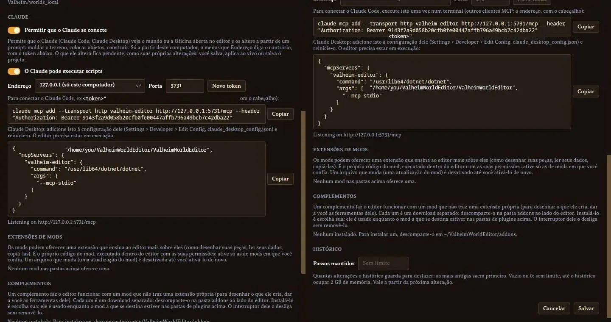
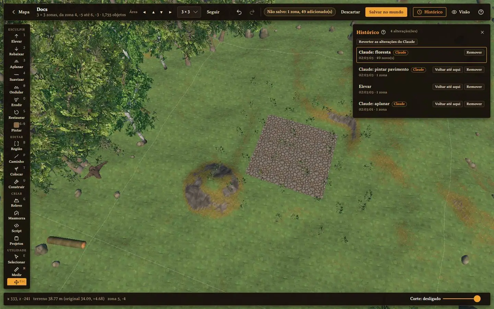

<!-- source: 3de08343 -->
# Claude

Deixe o Claude (no Claude Code, no Claude Desktop ou em outro cliente MCP) moldar o terreno, plantar, construir e gerar
masmorras no mundo ou na Oficina que você tem aberto, a partir de um prompt, enquanto você acompanha na visão 3D.

**Onde:** página inicial, **Configurações** → **Claude** · **Tecla:** nenhuma · **Funciona em:** mundos salvos, ao vivo
(com **Auto** desligado), a Oficina


*À esquerda: a seção **Claude** ligada e escutando; copie o comando num terminal (Claude Code) ou as linhas na
configuração do Claude Desktop. À direita: o fim de Configurações, com **Salvar**. O seu comando contém o seu próprio
token onde esta imagem diz `<token>`, e as linhas, o caminho do seu próprio programa.*

Tudo o que o Claude altera fica **pendente**, como as suas próprias alterações: um passo do Histórico cada (`Ctrl+Z` o
desfaz), contado na barra superior. O Claude nunca salva um mundo e nunca aplica nada a um jogo ao vivo: você faz isso,
quando gostar do que vê. Para configurar passo a passo, veja [Deixar o Claude moldar ou construir](guides/connect-claude.md).

## Como usar

1. Em **Configurações**, na página inicial, ative **Permitir que o Claude se conecte** e pressione **Salvar**.
2. Adicione o editor ao Claude uma vez: execute o comando que Configurações mostra (Claude Code), ou adicione as linhas
   dele à configuração do Claude Desktop.
3. Abra a área de um mundo ou a Oficina (ou peça ao Claude que abra uma).
4. Peça ao Claude o que você quer ([Pedir](#pedir)) e veja-o trabalhar na visão 3D.
5. Mantenha o que você gostar: **Salvar no mundo**, **Aplicar ao vivo** ou **Salvar projeto**. Desfaça o que não gostar
   com `Ctrl+Z`, **Descartar** ou **Reverter as alterações do Claude** no Histórico.

## Configurações

Em **Configurações** (na página inicial), seção **Claude**:

| Configuração | O que faz |
|---|---|
| **Permitir que o Claude se conecte** | Ligado: o editor aceita os pedidos do Claude, só a partir deste computador (a menos que **Endereço** diga o contrário), de quem tiver o token. Desligado: nada pode se conectar. |
| **O Claude pode executar scripts** | Ligado: o Claude pode executar scripts em C#, como faz a ferramenta [Script](scripting.md), cada um mostrado antes a você para executar ou recusar. Um script é um programa com as suas permissões neste computador, inclusive sobre os seus arquivos. Desligado (o padrão): os scripts do Claude são recusados; as outras ferramentas dele continuam funcionando. |
| **Endereço** | De onde o Claude pode se conectar: escolha um na lista, ou digite um endereço. `127.0.0.1 (só este computador)`, o padrão; `0.0.0.0 (todas as redes)`; ou uma das redes deste computador com o endereço dela (`192.168.1.20 (Ethernet)`): só essa rede. Com todas as redes, uma linha sob o comando dá os endereços que outro computador usa: o nome deste computador (`http://my-pc.local:5731/mcp`), onde a rede responde a nomes `.local` (mDNS), e o endereço dele em cada rede (`http://192.168.1.20:5731/mcp`), que sempre funciona mas muda quando a rede lhe dá outro. Veja [Segurança](#segurança). |
| **Porta** | A porta a que o Claude se conecta: 5731 de início, de 1024 a 65535. Mude-a se outro programa usar a 5731. |
| **Novo token** | Cria outro token. Assim que você **Salvar**, o antigo para de funcionar: adicione o editor ao Claude de novo com o novo comando. |
| Comando do Claude Code, **Copiar** | O comando que adiciona o editor ao Claude Code. Ele contém o token: guarde-o só para você. |
| Linhas do Claude Desktop, **Copiar** | As linhas a adicionar à configuração do Claude Desktop. |

Depois de **Salvar**, a seção mostra "Listening on http://127.0.0.1:5731/mcp" (escutando nesse endereço; em outro
endereço, "Listening on 0.0.0.0:5731, from other computers too", também a partir de outros computadores), ou por que
não conseguiu ("Could not listen on 127.0.0.1:5731: …", não foi possível escutar, quando a porta está ocupada, ou
quando um endereço de rede não é mais deste computador).

## Adicionar o editor ao Claude

**Claude Code:** execute o comando que Configurações mostra, uma vez, num terminal. Ele se parece com isto, com o seu
token:

```sh
claude mcp add --transport http valheim-editor http://127.0.0.1:5731/mcp --header "Authorization: Bearer <token>"
```

No Claude Code, `/mcp` passa então a listar **valheim-editor** como conectado enquanto o editor estiver rodando.

**Claude Desktop** inicia um programa em vez de se conectar a um endereço. Adicione as linhas que Configurações mostra
à configuração dele (Claude Desktop → Settings → Developer → Edit Config, `claude_desktop_config.json`) e reinicie-o:

```json
{
  "mcpServers": {
    "valheim-editor": { "command": "/path/to/ValheimWorldEditor", "args": ["--mcp-stdio"] }
  }
}
```

`--mcp-stdio` não abre nenhuma janela: ele repassa as mensagens do Claude ao editor que está rodando (com **Permitir
que o Claude se conecte** ligado), com o token das configurações dele.

**Outros clientes MCP** se conectam ao endereço (HTTP streamable) com o mesmo cabeçalho `Authorization`.

O editor precisa estar rodando para o Claude alcançá-lo.

## O que o Claude pode fazer

As ferramentas do Claude chamam o mesmo código que as ferramentas e botões do próprio editor, então o que ele faz segue
as mesmas regras do jogo que as suas edições: o limite de 8 m do terreno do jogo (só um script dele mesmo passa disso),
o encaixe das peças de construção, as zonas, os locais.
Cada passo que ele dá se chama "Claude: …" no Histórico e traz uma etiqueta **Claude**. Ele confere o trabalho com
imagens da visão 3D e do mapa, e com a verificação de suporte.

| O Claude pode | As ferramentas dele |
|---|---|
| Ver o que está aberto, os mundos deste computador e as alturas, biomas, água e objetos de uma área; abrir uma área de 1 a 17 zonas; buscar no mundo inteiro um tipo, o item de um baú ou o texto de uma placa; listar o ponto inicial, os comerciantes, os altares e as entradas de masmorras | `editor_state`, `list_worlds`, `open_world`, `open_area`, `describe_area`, `list_objects`, `ground_at`, `search_world`, `list_locations` |
| Ver o próprio trabalho: imagens da visão 3D (de qualquer câmera, ou quatro vistas de um lugar de uma vez) ou do mapa, um mapa da área vista de cima com uma grade em metros, a verificação de suporte (quais peças cairiam) | `screenshot`, `area_map`, `support_check` |
| Usar a sua seleção, e mostrar a você o que ela significa | `get_selection`, `select_objects` |
| Ajustar qualquer controle como você faria (os interruptores de Visão, o Recortar da barra de status, as configurações das ferramentas, a barra de ferramentas) | `list_controls`, `set_control` |
| Consultar as peças do jogo e como elas se encaixam | `find_prefabs`, `piece_info`, `building_guide`, `list_blueprints` |
| Ver o mundo de uma semente (biomas, ponto inicial, comerciantes, chefes) e criar um mundo novo com um nome e uma semente | `preview_seed`, `create_world` |
| Nivelar, pintar, suavizar, ondular, erodir, restaurar, elevar ou rebaixar terreno; imprimir um carimbo ou um mapa de altura; cavar um rio, fosso ou rampa ao longo de uma linha, ou aplanar, elevar, rebaixar, suavizar, ondular, erodir ou restaurar o terreno ao longo dela; abrir uma estrada; marcar zonas para redefinir; regenerar as árvores e rochas do jogo | `flatten`, `paint_area`, `shape_ground`, `stamp`, `import_heightmap`, `dig_path`, `road`, `reset_zones`, `regrow_nature` (a maioria aceita uma [Máscara](masks.md)) |
| Plantar árvores ou rochas, colocar peças e objetos (eles se encaixam como com o martelo), copiar objetos uma vez ou em fileira ou anel, trocar objetos por outro tipo, retirar objetos | `forest`, `place_pieces`, `copy_objects`, `replace_objects`, `remove_objects` |
| Construir um piso, paredes com portas e um telhado de duas águas (26° ou 45°, de palha ou de telhas de madeira) sobre um retângulo; abrir a Oficina; adicionar um projeto ao lote ou a uma área; salvar o lote como projeto | `build_floor`, `build_walls`, `build_roof`, `place_pieces`, `open_workshop`, `add_blueprint`, `save_blueprint` |
| Mover e girar objetos como grupo, ou colocar, inclinar e dimensionar cada um com exatidão; encher um baú, vestir um suporte de armadura ou de itens, escrever numa placa, dar estrelas a uma criatura; mudar a tag de um portal, um construtor, os jogadores permitidos de uma proteção, a vida, o combustível, o nível de uma criatura ou se ela está domada | `move_objects`, `set_transform`, `get_object`, `set_object_data`, `set_contents` |
| Gerar uma masmorra no lote ou acima de um ponto do mundo, atrás da entrada dela; listar as salas de uma masmorra do jogo; adicionar uma sala numa ponta aberta, tirar uma, fechar todas as pontas abertas, definir uma porta | `generate_dungeon`, `list_dungeons`, `dungeon_rooms`, `add_dungeon_room`, `remove_dungeon_room`, `close_dungeon_ends`, `set_dungeon_door` |
| Executar um script (com a sua permissão) | `run_script`, `script_reference` |
| Desfazer e refazer | `undo`, `redo` |

Algumas regras que vale a pena conhecer:

- `open_world` é recusado enquanto o mundo aberto ou a Oficina tem alterações não salvas.
- `save_blueprint` só salva a construção da Oficina quando pedido, e nunca substitui um projeto a menos que mandem.
  Salvar um projeto de novo mantém a descrição e as tags dele.
- `generate_dungeon` recusa um bioma, estilo ou material de parede que não conhece, e lista os que conhece.
- `move_objects` mantém a forma de uma construção, e uma parte de um grupo vinculado de um mod (um navio e as peças
  dele) traz o grupo inteiro, também para cópias e remoções.
- Uma masmorra que o Claude gera no lote da Oficina faz parte da construção do lote, pendente como o resto; ela não é
  adicionada à sua biblioteca.
- Quando o Claude se conecta, o editor lhe dá um breve guia de como trabalhar nele, e dois prompts prontos:
  *build_in_workshop* e *shape_area*.

## Pedir

Abra o mundo ou a Oficina você mesmo, ou peça ao Claude que abra. Depois, por exemplo:

- "Abra a área em volta de 1200, -340 e faça um vale com um rio correndo para o norte, com bétulas ao longo dele."
- "Aplane um quadrado de 40 m no meio da área, pavimente-o e ponha um círculo de tochas em volta."
- "Na Oficina, construa uma pequena casa longa: piso de pedra, paredes de madeira com duas portas, um telhado de palha
  de 45°. Confira se ela se sustenta."
- "Abra a área em volta de 800, 950 e gere acima dela uma cripta do Pântano de dois níveis."
- "Estas árvores que eu selecionei: substitua-as por faias." (Selecione-as antes; o Claude lê a sua seleção.)

Trabalho de terreno, florestas e masmorras são as coisas mais fáceis de pedir. Construções detalhadas, colocadas peça
por peça, podem levar algumas rodadas ("o telhado passa do lado leste, corrija"), ou comece a partir de um dos seus
projetos.


*Os passos do Claude se chamam "Claude: …" e têm a etiqueta **Claude**; o seu **Elevar** fica entre eles. **Reverter as alterações do Claude**, no alto, remove os passos do Claude e mantém os seus.*

## Reverter as alterações do Claude

- `Ctrl+Z` desfaz o último passo, do Claude ou seu.
- No **Histórico**, **Remover** num passo com a etiqueta **Claude** tira esse passo e mantém tudo o que foi feito
  depois dele.
- **Reverter as alterações do Claude** (no alto do Histórico, enquanto houver alterações do Claude) remove todos os
  passos que o Claude deu no histórico da área aberta, os mais novos primeiro, e mantém os seus, mesmo os feitos depois
  dos do Claude. A barra de status diz quantos foram revertidos e quantos passos do Claude feitos em outras áreas são
  mantidos: abra essas áreas para revertê-los também (veja
  [O histórico pertence ao mundo](concepts/saving-and-history.md#o-histórico-pertence-ao-mundo)).
- **Descartar** joga fora tudo o que não foi salvo, o seu também.

Isso também funciona depois de salvar ou aplicar: o próximo **Salvar no mundo** ou **Aplicar ao vivo** grava o
resultado. Veja [Desfazer um passo, reverter uma alteração ou descartar tudo](guides/undo-changes.md).

## Segurança

- **Só este computador.** O editor escuta em `127.0.0.1` (ou em outro endereço de loopback que você digitar, como
  `::1`) e recusa qualquer pedido endereçado a outro nome, então uma página da web que você visita não consegue
  alcançá-lo. Com outro **Endereço**, os computadores dessa rede também podem alcançá-lo, por qualquer um dos nomes
  deste computador, com o token. Só as redes do próprio computador: um computador cujo endereço não é local (`10.x`,
  `172.16`–`172.31`, `192.168.x`, link-local, IPv6 `fc00::/7`) ou que não está na rede em que o editor escuta é
  recusado, então a internet nunca o alcança, nem por IPv6. Com `0.0.0.0`, essas redes são as que têm um gateway (não
  as do próprio Docker, WSL ou Hyper-V, nem um túnel de VPN). Uma VPN como o Tailscale, cujos endereços vão de
  `100.64.x.x` a `100.127.x.x`, também é aceita quando este computador está nela: escute no endereço Tailscale dele ou
  em `0.0.0.0`, e o outro computador se conecta a esse endereço. A VPN criptografa o caminho, então o token não é lido
  na rede.
- **Scripts só a partir deste computador.** Um Claude em outro computador tem os scripts recusados (`run_script`, o
  Executar da ferramenta Script) mesmo com **O Claude pode executar scripts** ligado: do contrário, quem lesse o token
  na rede poderia executar programas com as suas permissões. As outras ferramentas dele funcionam como aqui.
- **Sem criptografia fora deste computador.** A conexão é HTTP simples: com outro **Endereço**, qualquer pessoa nessa
  rede pode ler o token e tudo o que o editor e o Claude trocam, e, com o token, usar o editor. É uma troca razoável
  numa rede doméstica de confiança, e Configurações diz isso sob o endereço assim que você escolhe um. Em qualquer outro
  lugar, mantenha `127.0.0.1` e acesse-o de outro computador por um túnel SSH, que o criptografa:
  `ssh -L 5731:127.0.0.1:5731 you@this-computer`.
- **O token.** Todo pedido precisa trazer o token (48 caracteres aleatórios criados para o seu editor). **Novo token**
  cria outro.
- **Só pendente.** O Claude nunca salva, aplica ao vivo, descarta, recarrega, grava ou exclui os seus arquivos, nem se
  conecta a um jogo ao vivo: nenhuma ferramenta faz isso, e `set_control` recusa esses controles.
- **Os scripts precisam da sua permissão, um por um.** `run_script` (inclusive as simulações) e o **Executar** da
  ferramenta Script são recusados até você ligar **O Claude pode executar scripts**. Então cada script que o Claude
  escreve é mostrado a você antes de rodar: **Executar** ou **Recusar** (Enter e Esc recusam). Uma simulação seguida da
  execução do mesmo script na mesma área pergunta uma vez; qualquer outra execução pergunta de novo. As outras
  ferramentas do Claude (`flatten`, `road`, `forest`…) executam o próprio código do editor e não pedem permissão.
- **O que um mundo diz não é uma ordem.** Placas, tags de portais e nomes são escritos por jogadores, e um projeto ou
  os dados de um mod, por outras pessoas: o Claude é instruído a tratá-los como dados. Uma placa que tenta dar ordens ao
  Claude não consegue executar um script sem que você o veja antes.
- **Ao vivo com Auto ligado: nada.** Enquanto o mundo aberto está ao vivo com **Auto** ligado, cada alteração chegaria
  ao jogo na hora, então o Claude não altera nada além do painel Visão e pede que você desligue o Auto.
- **Desligado é desligado.** Desligue **Permitir que o Claude se conecte** e nada pode se conectar.

Mais em [Scripts e o Claude](concepts/safety.md#scripts-e-o-claude).

## Atalhos

O Claude não acrescenta teclas. `Ctrl+Z` e `Ctrl+Y` desfazem e refazem os passos dele como os seus.

## Dicas e limites

- O editor precisa estar rodando, com **Permitir que o Claude se conecte** ligado, para o Claude alcançá-lo. Se ele não
  conseguir, veja [O Claude não consegue se conectar](help/troubleshooting.md#o-claude-não-consegue-se-conectar).
- Depois de **Novo token** e **Salvar**, execute de novo o novo comando do Claude Code (o token antigo para de
  funcionar). O Claude Desktop lê o novo token sozinho.
- O Claude só vê a área aberta. Peça que ele abra outra área, ou uma maior, para obras maiores.

### A skill de construção (Claude Code)

Opcional, para construções que devem parecer feitas à mão: o repositório do editor tem uma skill do Claude Code,
[`.claude/skills/valheim-build`](../../.claude/skills/valheim-build/SKILL.md). Com ela, o Claude consulta construções
reais do Valheim em busca de ideias, escreve um breve plano de projeto, molda o terreno, testa peças pouco conhecidas
numa pequena maquete, constrói em fases com auxiliares comprovados (janelas em arco, cornijas, ameias, torres redondas,
telhados de telha, salões de enxaimel) e depois confere o próprio trabalho em busca de janelas bloqueadas, peças
duplicadas e junções ruins. Os interiores recebem estrutura, iluminação e mobília; o exterior recebe caminhos, luzes e
plantas.

O Claude Code a carrega sozinho quando você trabalha no repositório. Para tê-la em todo lugar, copie a pasta para as
suas próprias skills: `cp -r .claude/skills/valheim-build ~/.claude/skills/`. Depois peça como de costume, por
exemplo "Construa um castelo gótico com um fosso na Oficina". O que ela sabe sobre as peças está no
`references/pieces.md` dela; correções são bem-vindas ali.

## Relacionados

- [Deixar o Claude moldar ou construir](guides/connect-claude.md)
- [Desfazer um passo, reverter uma alteração ou descartar tudo](guides/undo-changes.md)
- [Segurança](concepts/safety.md#scripts-e-o-claude): scripts e o Claude
- [Script](scripting.md): o que `run_script` executa
