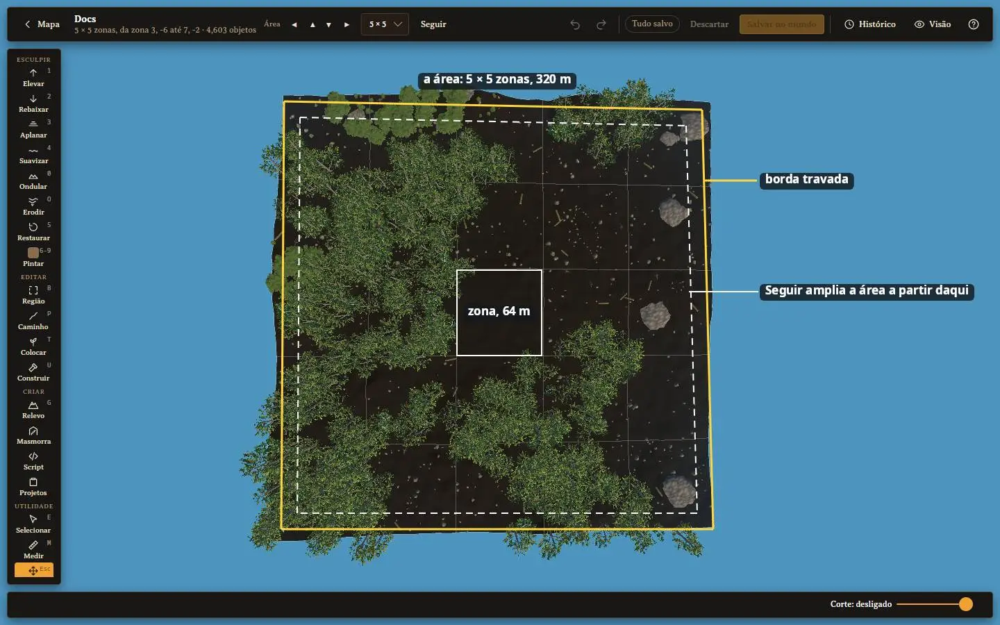

<!-- source: 24741409 -->
# Áreas e zonas

O Valheim divide o mundo em **zonas** quadradas de 64 m, e o editor abre um bloco delas de cada vez, a **área**. Isso
explica por que alguns lugares ainda não podem ser salvos, por que a borda da área nunca se move e por que uma área
grande é lenta.


*A área é um bloco de zonas. A linha mais externa de pontos do terreno (amarela) nunca muda; com **Seguir** ligado,
zonas são adicionadas quando o ponto para onde você olha passa da linha tracejada, 12 m para dentro.*

## Zonas

Uma zona é um quadrado de 64 × 64 m. A barra de status mostra a zona sob o mouse (`zona 20, -6`), **Visão → Bordas das
zonas** desenha as linhas delas em 3D, e a **Grade de zonas** do mapa as desenha no mapa.

O jogo cria uma zona na primeira vez que um jogador chega perto dela: as árvores, rochas e minério, e o local que ela
contém (uma vila, uma entrada de masmorra). Isso se chama **gerar** a zona. Até lá, os arquivos do mundo não guardam
nada ali, nem mesmo o terreno. Para você, isso significa:

- **Edições numa zona que ninguém visitou não podem ser salvas.** A mensagem de salvamento as lista. Passe pelo lugar no
  jogo primeiro, depois edite-o.
- **Um mundo novo está vazio.** O editor pode mostrar o terreno de uma semente antes que alguém jogue nele, mas não há
  nada para editar até o jogo criar as zonas (veja [Um mundo novo](../new-world.md)).
- **O jogo decide por zona.** Ele monta uma masmorra por zona, redefine zonas inteiras (abaixo), e a linha de
  pendências conta as zonas cujo terreno você alterou.

Cada zona tem 65 × 65 pontos de terreno, um por metro; zonas vizinhas compartilham os pontos da borda em comum.
Veja [Como o terreno é armazenado](ground-limits.md#como-o-terreno-é-guardado).

## A área

A área é o bloco de zonas aberto no editor 3D: de 3 × 3 até 17 × 17 zonas em volta do ponto que você escolheu no
[mapa](../map.md).

| Tamanho | Largura | Bom para |
|---|---|---|
| 3 × 3 | 192 m | Uma casa, uma plantação, edições rápidas; a mais rápida de abrir. |
| 5 × 5 (o padrão) | 320 m | Uma base e os arredores. |
| 7 × 7, 9 × 9 | 448 m, 576 m | Uma vila, uma estrada longa, colar uma cidade. |
| 13 × 13, 17 × 17 | 832 m, 1088 m | Uma cordilheira, um litoral. Lentas para abrir e para desenhar. |

O editor desenha todos os objetos e pontos de terreno da área, e é por isso que ele abre um bloco e não o mundo
inteiro. Tudo o que você faz acontece dentro dela: uma colagem, uma montanha ou um script precisam caber na área
aberta, então abra uma maior antes de um trabalho grande.

**Suas alterações pertencem ao mundo, não à área.** O editor mantém um único conjunto de alterações pendentes para o
mundo inteiro. Mova a área, mude o tamanho dela ou volte ao mapa e abra outro lugar: o que você fez em outro lugar
continua esperando e é salvo com o resto. O histórico vem junto (veja [Histórico](saving-and-history.md#histórico)).

As setas da barra superior movem a área uma zona (64 m) de cada vez, e a câmera fica onde está no mundo. A lista de
tamanhos abre a área de novo em outro tamanho, em volta da mesma zona central. Ambas esperam pelo que Seguir espera e
descartam o que ele descarta (veja [Seguir](#seguir)). Abrir outra área mostra de novo os objetos ocultos.

## A borda travada

A linha mais externa de pontos de terreno da área nunca muda. Nenhum pincel, caminho, ação de Região, colagem ou script
a move, e a ferramenta Colocar não põe nada nela.

O motivo: esses pontos são compartilhados com as zonas logo fora da área, que o editor não carregou. Se o editor os
movesse, o terreno lá fora daria num degrau ou num penhasco que ele não consegue ver. Com a borda travada, a área
sempre se junta ao terreno em volta sem emenda. Um script que grava ali não é interrompido: a alteração simplesmente
fica de fora.

```text
 fora      │ travada│         o que você pode editar   │ travada│   fora
 ──────────┼────────┼──────────────────────────────────┼────────┼──────────
           │  1 m   │  todo o resto da área            │  1 m   │
```

Para trabalhar perto de uma borda, mova a área com as setas, escolha um tamanho maior ou ligue **Seguir**.

## Seguir

Com **Seguir** ligado (na barra superior), a área cresce sozinha à medida que você trabalha em direção à borda. Quando
o ponto para onde você olha fica a menos de 12 m da borda, uma fileira de zonas é adicionada desse lado, ou dos dois
lados perto de um canto. Uma área de 3 × 3 vira 4 × 3, depois 4 × 4, e assim por diante.

Seguir só adiciona zonas, nunca retira, então nada em que você está trabalhando sai da área. Ele para em 17 zonas em
cada direção (cerca de 1 km) e avisa; então mova a área com as setas, ou abra outro lugar pelo mapa.

Seguir espera, e a barra de status diz por quê, enquanto crescer faria perder algo: o mundo está sendo salvo ou lido,
há objetos selecionados, um traço de pincel está em andamento, há um caminho desenhado e não aplicado, ou alterações
ainda estão sendo enviadas a um jogo ao vivo. Ele não espera por um retângulo de Região, uma linha, grade ou polígono de
Colocar ou uma medição: crescer os descarta.

## Redefinir zonas

Uma redefinição faz o jogo gerar uma zona de novo, como se ninguém nunca tivesse estado lá. Use-a para ter o conteúdo
novo de uma atualização do Valheim em lugares onde ninguém construiu, ou para trazer de volta um bosque ou uma masmorra.
Você marca zonas com a ferramenta [Região](../area.md) ou pelo mundo inteiro a partir do [mapa](../map.md); nada
acontece até você salvar ou aplicar ao vivo.

Quando a redefinição é gravada:

- **Tudo na zona some**: árvores, rochas, minério, coletáveis, ruínas, entradas de masmorra e as salas delas,
  geradores, itens largados e criaturas, animais domados incluídos (tire-os de lá antes).
- **Algumas coisas ficam**: as lápides dos jogadores, sempre; as peças construídas por jogadores com **Manter minhas
  construções** ligado (no mapa, as zonas que tiverem alguma ficam então totalmente de fora; desligado, as construções
  somem com o resto); as edições de terreno, a menos que você tenha escolhido desfazê-las também.
- **O jogo a cria de novo** na próxima vez que um jogador chegar perto: vegetação nova, e o local dela construído de
  novo no lugar, com saque e criaturas novos. Ao vivo, uma zona com um jogador por perto é criada de novo na hora.

Uma zona conta como selecionada quando o contorno da seleção abrange pelo menos um dos pontos de terreno dela,
qualquer que seja a borda suave, então uma seleção que entre numa zona, por pouco que seja, a redefine.

Uma redefinição não pode ser desfeita depois de salva ou aplicada; até lá, cancele ou desfaça a marcação. Depois que
uma redefinição é gravada, o editor lê o mundo de novo, e o histórico vem junto sem o que ele fez nas zonas redefinidas
(veja [O que um passo não pode desfazer](saving-and-history.md#o-que-um-passo-não-consegue-reverter)).
