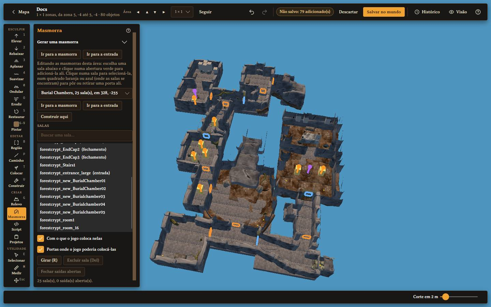

<!-- source: 5e6370cb -->
# Masmorras

O Valheim guarda as masmorras de um jeito incomum: lá no alto do céu, como uma lista de salas que o jogo constrói quando
alguém chega perto. Saber disso explica por que uma masmorra que ninguém visitou parece vazia no editor, por que uma
masmorra editada não precisa de mod e como uma masmorra de peças de construção se sustenta a 5000 m de altura. A
ferramenta [Masmorra](../dungeons.md) se baseia nisso.

## Como o jogo guarda as masmorras

**As masmorras não são cavadas no chão.** Cada uma é um **local** na superfície (o monte de uma burial chamber, a boca
de uma Frost Cave) cuja porta teleporta você para a masmorra em si, **5000 m acima** dele, onde o jogo trata tudo como
ambiente fechado. No editor, a câmera deixa de acompanhar o terreno lá em cima, e **Visão → Salas de masmorra** mostra ou
oculta as salas.

```text
   5000 m  ┌───────────────┐  as salas da masmorra
           │ ▢─▢─▢─▢       │  ◄── a porta leva de volta para baixo
           └───────────────┘
              ▲  teleporte
   chão    ───┴─── a entrada (um local: monte, boca de caverna, mina)
```

**Uma masmorra do jogo é uma lista de salas.** O jogo constrói as masmorras a partir de salas prontas. No salvamento,
uma masmorra é um objeto que guarda a **lista de salas**: qual sala, onde, girada para que lado. Quando um jogador chega
perto, o jogo constrói as salas a partir dessa lista, seja o que for que ela contenha, sem conferi-la com as próprias
regras. É por isso que uma masmorra editada funciona no jogo de todos os jogadores sem mod: o editor só altera a lista.

**Até um jogador ter chegado perto, a lista está vazia.** O jogo monta uma masmorra na primeira vez que alguém chega,
então antes disso o editor não tem salas para mostrar nem editar. Visite-a no jogo e depois abra a área de novo. As
vilas fuling e as fazendas dos Prados são montadas da mesma forma, no chão.

### Salas, aberturas e fechamentos


*Uma masmorra do jogo 5000 m acima, sem os tetos: cada sala é uma entrada da lista. Os quadrados marcam onde duas salas
se encontram: azul com porta, laranja sem.*

Cada sala tem **aberturas**, as passagens onde ela encontra a seguinte, e cada abertura tem um tipo: uma Frost Cave tem
aberturas simples de caverna, aberturas de gelo, aberturas de santuário e outras. O jogo só junta aberturas do mesmo
tipo, embora algumas salas (um corredor de gelo) juntem um tipo a outro. Um **fechamento** é uma pequena sala que fecha
uma abertura, para que nada leve para fora da masmorra.

O jogo impede que as salas se sobreponham e as mantém dentro do espaço da masmorra (para a maioria dos tipos, 64 × 64 m
em volta do centro da zona dela). Uma lista que o editor grava é construída mesmo assim, por isso o editor só avisa
quando uma sala quebra essas regras.

**O que há nas salas.** Quando monta uma masmorra pela primeira vez, o jogo sorteia o que vai em cada sala: baús,
geradores de criaturas, tochas, braseiros, gelo, decorações. Cada parte tem a sua chance, a partir da semente do mundo,
do lugar da sala, do tema da masmorra e da altura da sala. O editor as sorteia da mesma forma, então uma sala que ele
adiciona vem com o que o jogo teria posto ali. Algumas coisas (pingentes de gelo, cristais, peixes) se acomodam na
superfície mais próxima no jogo, então podem ficar um pouco diferentes de onde o editor as mostra.

**Portas.** Onde duas salas se encontram, o jogo às vezes põe uma porta, com a própria chance: as cortinas de pano e as
paredes de gelo de uma Frost Cave, os portões de uma cripta, as portas das minas. Cada tipo de masmorra tem as suas para
cada tipo de abertura, e a porta fica na abertura da sala que estava ali primeiro.

### Entradas, uma por zona

O jogo monta **uma masmorra por zona** e mantém livre o espaço acima de uma entrada mesmo antes de a masmorra ser
montada. Por isso o editor só põe uma masmorra atrás da entrada do jogo onde ainda não há nada lá em cima; caso
contrário, ponha a entrada em outra zona. Uma masmorra das Planícies, que se alcança por um portal, é empilhada mais
alto, em degraus de 50 m, quando o espaço está ocupado.

A entrada de uma masmorra colocada é o próprio local do jogo para o bioma, gravado como o jogo grava um local, então o
jogo cria a porta, as pedras e a passagem dela cada vez que a zona carrega. A masmorra vai para onde o jogo põe a da
própria entrada (a de uma Frost Cave, para o centro da zona), girada para que um jogador que passe pela porta chegue
voltado para dentro. As Planícies não têm masmorra própria: ali, um par de portais ligados faz as vezes da entrada, um
no chão, o gêmeo dele onde os jogadores chegam.

O jogo desenha as masmorras escuras, iluminadas só pelas tochas. O editor as ilumina como o lado de fora, para que você
veja o que edita.

## Como o gerador monta uma masmorra

O gerador pode fazer uma masmorra de duas coisas: **as salas do próprio jogo** ou **peças de construção**.

**Com as salas do próprio jogo**, ele as junta do jeito do jogo. Escolhe a masmorra do bioma (uma burial chamber nos
Prados e na Floresta Negra, uma sunken crypt no Pântano, uma Frost Cave na Montanha e no Extremo Norte, uma infested mine
nas Terras Nebulosas), começa com uma das salas de entrada dela e adiciona salas nas aberturas livres, com os pesos que
o jogo usa, onde couberem, até ter cerca de 8, 14, 20 ou 26 salas, conforme o tamanho. Fecha cada saída aberta, mobilia
cada sala como o jogo faria e põe portas onde as salas se encontram, com a chance do jogo. O resultado é um objeto de
masmorra com a sua lista de salas, exatamente como os do próprio jogo. Colocadas no mundo, as salas são montadas a
partir do objeto de masmorra, onde a entrada o põe, e mantidas dentro do espaço dessa zona, como o jogo faz: o lugar da
zona onde fica a entrada e a direção para onde ela está voltada mudam quais salas cabem.

**Com peças de construção**, ele planeja a masmorra numa grade de ladrilhos de 2 m, um nível de cada vez, depois a
constrói e a mobilia. As mesmas escolhas e a mesma semente sempre fazem a mesma masmorra. Cada nível é montado nesta
ordem:

| | O que é montado |
|---|---|
| **Saguão de entrada** | Abre o primeiro nível. Os jogadores chegam diante da parede do fundo, com o nome da masmorra numa placa ao lado. |
| **O caminho principal** | Cerca de duas salas em cada cinco são as salas principais do estilo, alternadas (o grande salão, o cruzamento, a galeria e a capela de uma cripta), cada uma ligada à anterior, quase sempre em frente. |
| **Descida, ou o chefe** | Cada nível, exceto o último, termina numa escadaria (8 × 24 m) que desce para o nível de baixo, 6 m mais baixo. O último termina numa antecâmara, na arena do chefe (24 × 24 m) e na sala do tesouro depois dela. |
| **Salas laterais e alas** | Salas laterais se ramificam, quase sempre a partir de cruzamentos e salões longos, escolhidas pelos pesos do estilo. Uma sala lateral muitas vezes nasce da anterior e tende a combinar com ela: uma cozinha junto ao salão de banquetes, celas junto à sala da guarda, uma forja junto à oficina. |
| **Gêmeas** | As salas laterais muitas vezes ganham uma gêmea espelhada do outro lado do salão (um templo quase sempre, uma toca de goblins raramente), para que a planta pareça a de um edifício, ao longo de eixos. |
| **Caminhos alternativos** | Salas a três ou mais de distância ao longo do caminho que por acaso fiquem perto uma da outra são ligadas, para que haja mais de um caminho. |
| **Becos sem saída e esconderijos** | Um ou dois corredores não levam a nada além de um esconderijo. Um esconderijo oculto (dois acima de 20 salas) fica junto a uma sala lateral, atrás de uma parede rachada ou de uma tapeçaria. |
| **A chave** | Com o chefe atrás de um portão, a chave vai num baú na sala lateral mais distante da arena. |
| **Portas** | O portão do chefe pede a chave; a sala do tesouro fica atrás de um portão; as celas ganham portões com mais frequência; as salas grandiosas às vezes ganham portões duplos imponentes; o resto segue o estilo. Onde uma escada desce, uma passagem aberta vira portão, para que o que vive embaixo fique embaixo. |

As salas variam dentro disso. O **tamanho** delas segue o tipo (um depósito pode ter 8 × 8 m, um grande salão de 12 a
20 m de largura e de 20 a 32 m de comprimento). Algumas têm cantos recortados, uma abside no fundo ou um canto faltando.
Os **corredores** são retos ou fazem curva, e algumas salas se encontram parede com parede. As salas têm 4 m de altura,
mas grandes salões, capelas, salas do trono e a arena podem subir 10 m, atravessando o nível de cima. Salas longas podem
ganhar **nichos** nas laterais.

### Por que ela se sustenta a 5000 m de altura

Toda peça de construção precisa de suporte a partir do chão no jogo, e não há chão lá em cima. Por isso uma masmorra de
peças de construção fica sobre **lajes de piso de mármore negro** (8 × 8 m), o piso e o teto de cada parte em uso: a
única peça cujo suporte o jogo nunca verifica (veja [A verificação de suporte](objects.md#a-verificação-de-suporte)). Todo o
resto fica sobre elas. O que fica sobre um piso é erguido 5 cm, porque uma peça cujo centro está bem em cima de uma
superfície não recebe suporte dela. Para fazer a sua própria masmorra de peças, faça o mesmo: pisos de mármore negro, e
tudo sobre eles.

Tudo o que o gerador coloca fica sem construtor, como nas masmorras do próprio jogo, então o jogo trata tudo como ruína
(veja [Peças construídas por jogadores](objects.md#peças-construídas-por-jogadores)).

## Mobília, luz e guardas

Uma masmorra de peças de construção é decorada sala por sala. **Luz** e **Ruína** sorteiam números aleatórios próprios,
então alterá-las não muda mais nada na masmorra.

**Cada sala é mobiliada conforme a função**, de uma entre duas a quatro maneiras escolhidas pela semente:

| Sala | Parte da mobília |
|---|---|
| Salões | Colunatas com um altar; um salão de hidromel em volta de uma fogueira, com mesas de cavalete; um salão dos mortos com um sarcófago num estrado; um salão vazio de pilares caídos. |
| Capelas | Bancos voltados para um altar entre estátuas; um altar elevado num círculo de braseiros; uma nave de tapetes e velas. |
| Câmaras mortuárias, ossários, galerias | Fileiras de sarcófagos ou um único túmulo num estrado; ossos ao longo das paredes ou amontoados; nichos, estátuas, teias de aranha. |
| Alojamentos, depósitos, gabinetes | Camas ou sacos de dormir em volta de uma fogueira; mantimentos ao longo das paredes ou prateleiras em fileiras; escrivaninhas e prateleiras. |
| Salões de banquete, salas do trono | Mesas longas, ou uma mesa principal num estrado; colunatas, uma sala de guerra, colunas caídas em volta do estrado. |
| Arenas, santuários | Um círculo de colunas em volta do chefe, um trono sobre crânios, ou um fosso afundado abaixo de plataformas. |
| Cozinhas, forjas, oficinas | As estações de verdade do jogo: fornos, caldeirões, fermentadores, fundições, a forja negra. |

**Mais lá dentro.** Uma sala grandiosa de pedra pode ter um mezanino sobre pilares acima da entrada; uma câmara mortuária
pode abrigar uma cripta interna; nichos e alcovas guardam um sarcófago, uma estátua ou um barril. Os cantos ganham
pequenos conjuntos que combinam com a sala (um acampamento, uma refeição, a escrivaninha de um escriba, um arsenal), e
salas grandes podem ganhar uma **peça de destaque** que aparece uma só vez na masmorra inteira: um dólmen, o crânio de um
gigante, uma fonte de wisps. Cada bioma acrescenta as próprias coisas (raízes nos bosques, gosma e piche no pântano,
pingentes de gelo nas montanhas, seeker creep nas minas, espinhos nas Terras Cinzentas), e os corredores variam:
meio desmoronados, forrados de ossos, acarpetados, fechados por um portão no meio, ou com uma armadilha. Cerca de uma
sala simples em cada doze fica quase vazia, com uma peça e uma luz no escuro. Com **Móveis** em Mobiliada ou Rica, as
salas grandiosas de pedra ganham ladrilhos de mármore negro e os aposentos ganham tábuas de madeira, cada um em metade
das vezes.

**Luz conforme a função.** As salas são iluminadas por tochas, arandelas ou braseiros, com as luzes próprias do bioma:
uma a cada 5 m de parede com **Clara**, 8 m com **Penumbra**, 12 m com **Escura** (e então só nas salas que importam). As
salas grandiosas são iluminadas com luzes mais próximas; as salas dos mortos, celas, depósitos e esconderijos, mais
espaçadas. Em catacumbas e prisões, alguns corredores ficam escuros entre salas iluminadas.

**Mais fundo é mais rico e mais perigoso.** Cada nível para baixo tem um quinto a mais dos monstros e do saque do nível
de cima: o segundo nível tem 1,2 vez o do topo, o sexto o dobro, o décimo sexto quatro vezes.

**Guardas.** Uma sala recebe cerca de um monstro a cada 75 m² de piso, na taxa usual do tipo dela, vezes **Monstros**,
vezes a profundidade, posicionado longe da entrada e voltado para ela. O baú da chave é guardado por um dos elites do
bioma, os túmulos guardam um, a sala do trono dois. O **chefe** é sempre colocado uma vez na arena, como a própria
criatura: sem estrela com **Monstros** em nenhum, uma estrela em × 1, duas estrelas em × 2 ou mais. Com **Os monstros
voltam** ligado, os outros vêm dos geradores do jogo e voltam algum tempo depois de mortos (veja
[Pontos de surgimento](objects.md#pontos-de-surgimento)); as salas do próprio jogo sempre trazem geradores.

**Saque.** Os baús, o tesouro espalhado e as moedas e barras do metal do bioma na sala do tesouro crescem com **Saque**
e com a profundidade. O baú da chave guarda a chave da cripta e alguns objetos de valor, gravados no baú para que o jogo
não o encha com o próprio saque, e o portão da chave tem uma placa: *Sealed. The key lies within these halls.*

Construída no jogo com o Homestead, uma masmorra salva como projeto é só as peças dela: nada de chave no baú, nada de
chefe.
