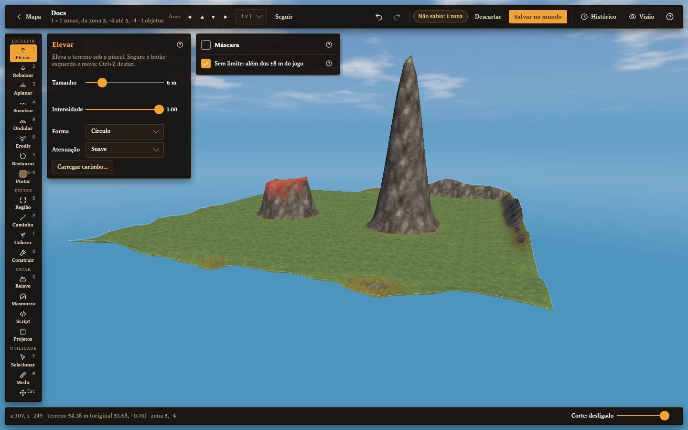
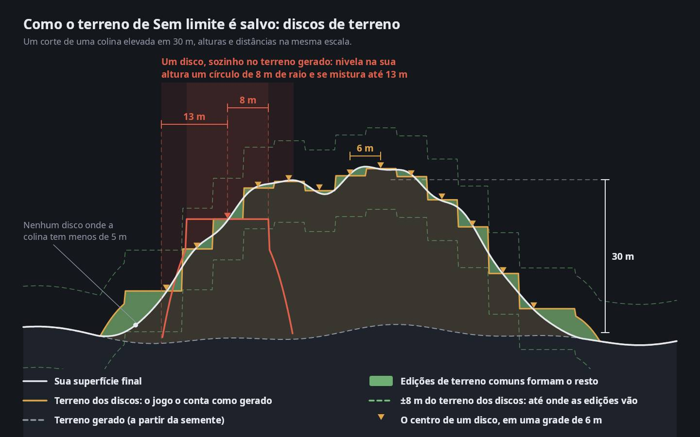
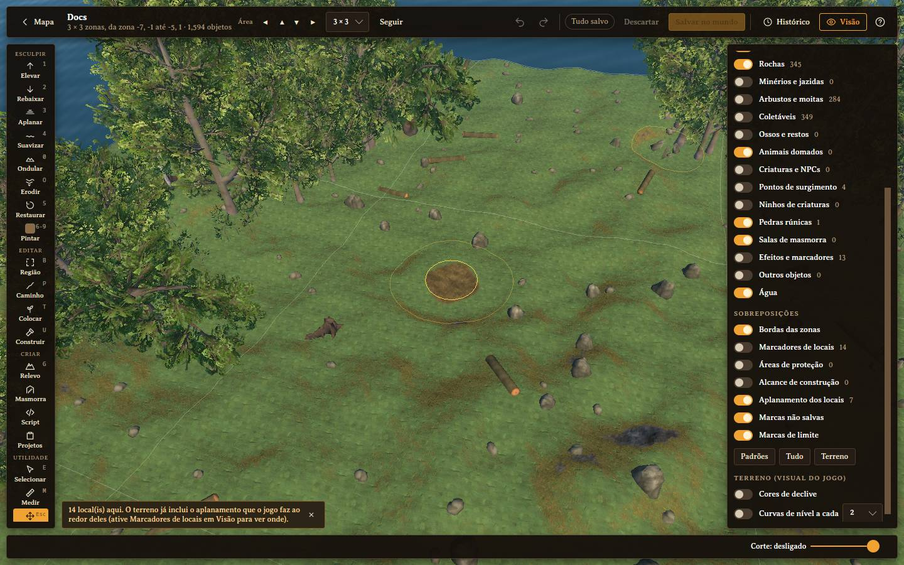

<!-- source: d97e56fa -->
# Limites do terreno

O jogo deixa o terreno se mover no máximo 8 m para cima ou para baixo de onde o mundo o gerou. O editor respeita essa
regra, para que todo mundo que ele salva carregue no jogo de cada jogador, inclusive nos consoles, sem nenhum mod.
**Sem limite** vai além dela de um jeito que o próprio jogo entende. Esta página explica o limite, como Sem limite o
contorna e como os locais do jogo moldam o terreno.

## O limite de 8 m do jogo

O jogo não guarda a altura do terreno. Ele guarda a **semente** do mundo, calcula a partir dela o terreno gerado e
salva só as suas **alterações** nele: para cada ponto do terreno, quanto ele foi elevado ou escavado. Essa alteração
pode ser no máximo de **±8 m** (mais uma alteração de suavização de no máximo ±1 m, que a enxada do jogo faz). Qualquer
coisa além disso é descartada quando o jogo carrega a zona. O editor aplica a mesma regra, então um ponto que atinge o
limite para ali.

O que isso significa na prática:

- **É medido a partir do terreno gerado, não de onde o terreno está agora.** Um morro elevado 8 m não pode subir mais,
  e um terreno escavado 8 m não pode descer mais, seja como for que você chegou lá. A barra de status mostra as duas
  alturas sob o mouse: `terreno 41.20 m (original 35.00, +6.20)`.
- **Obras grandes o atingem primeiro**: uma plataforma de construção cortada numa encosta, um rio atravessando terreno
  alto (o leito precisa ficar abaixo do mar, veja [Como o terreno é guardado](#como-o-terreno-é-guardado)), uma
  montanha.
- **As próprias ferramentas do jogo também o respeitam.** A enxada e a picareta de um jogador trabalham dentro de ±8 m
  do terreno gerado, no jogo como no editor.

```text
        ┌──────────────────────── +8 m: o mais alto que o jogo guarda
        │      ╭──╮  o terreno elevado para aqui
  ──────┼─────╯    ╰──────────── terreno gerado (a altura "original")
        │
        └──────────────────────── −8 m: o mais fundo que o jogo guarda
```

## Sem limite

O interruptor **Sem limite: além dos ±8 m do jogo** deixa as ferramentas de terreno moverem o terreno até 400 m a partir
do terreno gerado: montanhas, penhascos, cânions, poços profundos. É um único interruptor, no cartão **Máscara** ao lado
do painel de cada ferramenta que ele controla (os pincéis de esculpir, as fórmulas e imagens de Relevo, Caminho e
Região), e fica desligado cada vez que o editor inicia. As montanhas da ferramenta [Relevo](../landform.md) e a colagem
de uma cópia sempre passam do limite quando precisam, e os scripts também, a menos que sejam instruídos a não fazer
isso.

Enquanto você trabalha, a parte além de ±8 m é guardada como uma elevação separada sobre o terreno; desfazer, o
Histórico e **Restaurar** a tratam como qualquer outra alteração. A barra de status diz em que posição o interruptor
está cada vez que você o aciona.


*O mesmo traço sem e com Sem limite. À esquerda, o terreno para 8 m acima e o topo fica vermelho; à direita, ele
continua subindo. O interruptor fica no cartão Máscara.*

### Como é salvo: discos de terreno

O jogo nunca guarda edições de terreno além de 8 m, mas nivela o terreno sob os seus **locais** (vilas, o acampamento
do comerciante) sem limite nenhum, e conta esse terreno nivelado como gerado (veja
[Os locais nivelam o terreno](#os-locais-nivelam-o-terreno)). O editor se aproveita disso. Quando você salva ou aplica
ao vivo, ele transforma o terreno além do limite em **discos de terreno**: locais invisíveis do próprio jogo, sem
modelo. Cada disco nivela um círculo de 8 m de raio na altura dele e funde o terreno ao redor até uns 13 m: logo depois
do círculo, o terreno vai cerca de três quartos do caminho até a altura do disco (o jogo conta a fusão a partir do meio
do disco, então ela começa com um pequeno degrau), depois cada vez menos, até nada a 13 m.

1. Os discos ficam numa grade de 6 m, só onde o seu terreno está a mais de 5 m de onde o terreno estaria sem eles.
2. O editor calcula o terreno exatamente como o jogo vai construí-lo a partir dos discos, na ordem do jogo, e ajusta
   as alturas deles ao longo de várias rodadas para chegar o mais perto possível da sua forma. Onde ainda está longe
   demais, ele acrescenta um disco e tenta de novo.
3. Edições de terreno comuns, dentro de ±8 m do novo terreno, completam o resto.

O jogo de cada jogador constrói o mesmo terreno a partir dos discos, inclusive nos consoles, sem nenhum mod.


*Um morro elevado 30 m, como é salvo. Os topos planos dos discos (laranja) sobem o morro em degraus numa grade de 6 m,
sob a sua superfície (branco); um disco, em vermelho, nivela 8 m ao redor do meio e funde o terreno até 13 m. As
edições comuns (verde) completam o resto, dentro de ±8 m do terreno dos discos. Onde o morro tem menos de 5 m de
altura, não há disco.*

### O que isso significa para você

| | |
|---|---|
| **A mensagem de salvamento** | Diz quantos discos foram criados (e quantos antigos eles substituem), quantas árvores e rochas foram retiradas e o quanto o terreno mais íngreme ainda está fora: "Terreno sem limite: 312 disco(s) de terreno, 40 árvore(s)/rocha(s) retirada(s); parte do terreno está até 2.5 m fora (íngreme demais)". |
| **O Histórico permanece** | O editor guarda o seu terreno com Sem limite e calcula os discos a partir dele: desfaça uma colagem ou um traço, salve ou aplique de novo, e os discos dele vão embora, com o terreno ao redor também de volta como estava. Isso vale depois de abrir o mundo de novo (veja [O que um passo não consegue reverter](saving-and-history.md#o-que-um-passo-não-consegue-reverter)). |
| **O novo terreno conta como gerado** | No jogo, a enxada e a picareta trabalham ±8 m a partir do terreno dos discos. Quando o mundo é aberto de novo, a altura "original" da barra de status também é o terreno dos discos. **Restaurar** ainda traz o terreno de volta ao primeiro terreno do mundo, também sob os discos. Para tirar uma forma salva, restaure-a, desfaça-a no Histórico ou rebaixe-a de novo com Sem limite ligado: os discos são calculados de novo no próximo salvamento e saem de onde não são mais necessários. |
| **Árvores e rochas são retiradas** | Árvores, rochas, minério, arbustos e coletáveis onde o terreno se moveu mais de 2 m ficariam enterrados ou flutuando, então são retirados. As peças de construção ficam. |
| **Paredes muito íngremes ficam mais suaves** | Um disco não consegue acompanhar um corte mais estreito que ele. |
| **Zonas que ninguém visitou** | Mantêm o terreno antigo: a elevação delas é descartada, e a mensagem diz quantas. Visite-as no jogo primeiro. |
| **Os discos carregam primeiro** | O jogo de um jogador cria os discos antes das peças e das árvores ao redor, então o terreno fica pronto nos primeiros momentos de uma visita. Num servidor, o plugin WorldEditorBridge mantém essa ordem. |
| **Visto de longe** | A nova forma aparece quando você chega perto, como o terreno nivelado de uma vila. |
| **O mapa do jogo** | É desenhado a partir da semente, então não mostra a nova forma. |
| **Terra** | O jogo pinta o terreno de um disco como terra; o editor pinta esses pontos de volta com o próprio solo do bioma, para que os discos não apareçam. |

O editor oculta os discos: eles não aparecem como local, marcador nem objeto.

## Os locais nivelam o terreno

Vilas, o comerciante, entradas de masmorras, altares de chefes e os outros **locais** do jogo aplanam o terreno ao redor
deles. O terreno plano não é guardado no salvamento: o jogo o nivela de novo cada vez que carrega a zona, antes de
aplicar as alterações de qualquer pessoa. Depois, ele soma por cima as edições de terreno salvas.

O editor mostra o terreno com esse nivelamento já feito, e as suas edições vão por cima dele, como no jogo. Uma nota no
canto inferior esquerdo da visão 3D conta os locais na área (e a até 40 m dela), e **Visão → Aplanamento dos locais**
desenha onde eles nivelam: um anel para a parte plana, um mais fraco onde ela se funde com a terra.


*Visão → **Aplanamento dos locais** ligado, ao redor do altar de Eikthyr: o anel sólido é a parte plana que o jogo
nivela, o anel mais fraco é onde ela se funde de volta com a terra. A nota no canto inferior esquerdo conta os locais
na área.*

Por que isso importa:

- **Os ±8 m são contados a partir do terreno nivelado**, já que o jogo o conta como gerado.
- **Remover um local remove o nivelamento dele.** Excluir uma pedra rúnica retira o local dela para sempre, e com ele o
  pequeno nivelamento ao redor. Uma redefinição de zona coloca o local de novo, e o nivelamento dele volta.
- **As partes de um local não são objetos.** As rochas da entrada de uma cripta, o acampamento do comerciante, o altar
  de um chefe ou as paredes de uma caverna de troll são refeitos a partir do local cada vez que a zona carrega, então o
  editor os desenha (em **Ruínas e estruturas**), mas não pode escolhê-los nem alterá-los.
- **Alguns locais mantêm o terreno livre.** Nada cresce no quadrado ao redor de um local cujo tipo limpa o terreno, e
  Regenerar o mantém assim, como o jogo faz (veja [Regras de crescimento](objects.md#regras-de-crescimento)).
- **Os discos de terreno** são esse mesmo mecanismo, usado de propósito (veja [Sem limite](#sem-limite)).

## Marcas de limite

O terreno que atingiu o limite de ±8 m fica **vermelho** na visão 3D (no Visual do jogo; **Visão → Marcas de limite**,
ligado de início), e a barra de status acrescenta ", no limite de ±8 m" sob o mouse. Depois de um traço que o atingiu,
ela diz "Limite do jogo atingido: o terreno só pode se afastar 8 m da altura original (pontos vermelhos)."

As outras ferramentas mostram isso à sua maneira:

| Ferramenta | Como mostra o limite |
|---|---|
| [Caminho](../path.md) | Os pontos do terreno que o atingiram ficam vermelhos, e a barra de status avisa. |
| [Região](../area.md): Aplanar | A linha de corte e aterro diz quanto está fora de alcance: "(40 m³ fora de alcance: limite de ±8 m)". Para Elevar e Rebaixar, a linha conta só o terreno que o limite deixa mover. |
| Região: Mapa de altura | Os pontos que não conseguem alcançar a altura deles ficam vermelhos, e a barra de status os conta. |
| [Script](../scripting.md) | Com `Ground.NoLimit = false`, a linha de resultado conta os pontos que pararam. |

Terreno vermelho não é um erro: é terreno que o jogo não deixaria ir além. Para continuar, ative **Sem limite**, ou
mude o plano (um rio que segue terreno baixo, uma plataforma cortada um pouco mais acima).

## Como o terreno é guardado

**Uma altura por metro.** O terreno tem um ponto de altura por metro: 65 × 65 pontos numa zona de 64 m, com zonas
vizinhas compartilhando os pontos da borda. Por isso uma parede de terreno sempre ocupa cerca de um metro: ela não pode
ser mais vertical que isso, no editor nem no jogo, e o terreno nunca pode formar uma saliência por cima. Um túnel ou
uma caverna de verdade sob o terreno precisa de um mod que os escave, como o Tunnelheim (veja
[Editar um mundo criado com Expand World, Riverheim ou Tunnelheim](../guides/use-mods-worlds.md)).

**Dois triângulos por metro quadrado.** Cada metro quadrado é desenhado como dois triângulos divididos pela mesma
diagonal que no jogo, do canto sudeste ao canto noroeste. Uma borda que vai de noroeste a sudeste sai limpa; uma que
vai de nordeste a sudoeste mostra um pequeno serrilhado, também no jogo.

**As alturas são as do jogo.** O mar fica a 30 m. O Valheim não tem água corrente: a água dos rios e lagos é o mar, no
mesmo nível em todo lugar, então o terreno só tem água em cima onde está abaixo de 30 m. Um rio atravessando terreno
alto precisa de um corte fundo.

**Pintura.** Cada ponto do terreno também tem um valor de pintura: uma parcela de terra, de solo cultivado e de pedra
pavimentada, e uma marca dizendo que foi pintado. Um ponto nunca pintado mostra a pintura que o mundo gerou (o solo do
bioma, e terra onde o mundo a pôs). Um pincel de pintura move as parcelas do ponto um pouco em direção à cor dele a cada
momento, então um traço leve ou a borda suave do pincel dá uma mistura. É também por isso que **Limpar pintura** e
**Restaurar** são diferentes:

| | O que faz com um ponto |
|---|---|
| **Limpar pintura** | Pinta solo simples do bioma. O ponto continua pintado, então também esconde a terra que o mundo gerou ali. |
| **Restaurar** | Remove a marca de pintura, então o ponto mostra de novo o que o mundo gerou. |

**Bioma.** O bioma num ponto vem da semente. Editar o terreno nunca o altera.

## Como a Máscara avalia o terreno

A [Máscara](../masks.md) limita uma ferramenta ao terreno que atende a todas as configurações dela. Ela avalia cada
ponto do terreno separadamente, e não há fusão: onde ela deixa o terreno de fora, a ferramenta não faz absolutamente
nada; onde ela deixa o terreno passar, a ferramenta funciona como de costume.

| Configuração | O que é comparado |
|---|---|
| **Bioma** | O bioma que o mundo gerou naquele ponto. Editar o terreno não o altera. |
| **Altura** | A altura do terreno ali, como o jogo a conta (o mar fica a 30 m). |
| **Declive** | Calculado a partir das alturas 1 m de cada lado do ponto, de leste a oeste e de norte a sul. |
| **Pintar** | Um ponto conta como pintado quando foi pintado e tem alguma cor, então **Limpar pintura** o deixa não pintado para a Máscara. **Só terra**, **Só cultivado** e **Só pavimentado** precisam que essa cor seja pelo menos metade da pintura. |

**Um traço de pincel é avaliado no terreno como estava quando o traço começou.** Assim, um traço de Elevar em terreno
abaixo da altura da Máscara continua subindo além dela até você soltar, e um traço que muda o declive não se desliga
sozinho no meio. As edições feitas de uma vez (Relevo, uma colagem, Caminho, as ações da ferramenta Região) são cada
uma avaliadas no terreno logo antes delas.

Como não há borda suave, esculpir com uma Máscara pode deixar um degrau onde o terreno que atende encontra o terreno
deixado de fora, sobretudo com Elevar, Rebaixar e um Relevo. Suavize-o depois com a Máscara desligada.

## Como as ferramentas moldam o terreno

A maioria das ferramentas simplesmente eleva, escava ou nivela. Algumas seguem um padrão ou um modelo que vale a pena
conhecer, porque explica o que elas dão e o que não conseguem dar.

### Com que rapidez um pincel trabalha

Com **Intensidade** 1, Elevar e Rebaixar movem o meio do pincel até 6 m por segundo (2,4 m por segundo com o padrão de
0.40). Aplanar, Suavizar, Ondular e Restaurar não somam uma quantidade fixa: a cada momento, movem cada ponto uma
parcela do caminho até o objetivo delas, então o terreno se acomoda no objetivo e nunca passa dele. Suavizar move cada
ponto em direção à média dele e dos seus 8 vizinhos, então passar de novo por um lugar o suaviza mais. Restaurar
remove uma parcela da alteração a cada momento, e um ponto a até 1 cm da altura gerada conta como inalterado de novo;
ele só remove a pintura onde o pincel trabalha com mais de metade da intensidade, para que a borda da pintura não fique
desfiada.

### O padrão de Ondular

**Ondular** primeiro calcula a forma geral do terreno: o terreno desfocado ao longo de alguns metros, como estava quando
o traço começou. Ele soma a essa forma saliências de um padrão de ruído, com **Saliências** de altura e **Extensão** de largura, e puxa o terreno em direção ao resultado. Como o objetivo continua o mesmo, um segundo traço
sobre o mesmo lugar não acumula cada vez mais saliências: só chega mais perto do mesmo terreno.

O padrão é fixo no mundo, não no pincel, então traços e áreas vizinhos se unem sem emendas. O aspecto natural da
ferramenta Caminho, o Ondular da ferramenta Região e o `n(x, z)` da ferramenta Relevo numa fórmula usam o mesmo padrão;
**Novo padrão** o muda para todos eles.

### Erosão

A erosão **Térmica** move o terreno onde quer que dois pontos vizinhos estejam mais íngremes que o **Ângulo de
repouso**: o material escorrega do ponto mais alto para os vizinhos mais baixos, metade do excesso de cada vez, para que
as encostas se acomodem em vez de oscilar. O terreno só é movido, nunca perdido, o que forma depósitos de cascalho sob
os penhascos. A erosão de **Água** é chuva: gotas caem em pontos aleatórios e escorrem morro abaixo por até 40 passos,
levando terreno onde correm rápido e deixando-o onde desaceleram ou enchem uma depressão. Muitas gotas cavam ravinas
encosta abaixo e deixam leques de material ao pé delas. O terreno logo fora do pincel pode receber o que escorrega ou é
levado de dentro dele.

### Como uma montanha é feita

O corpo de uma montanha é um perfil natural, mais íngreme no alto e se suavizando no pé, e o contorno dela é deformado
por ruído para que nunca seja um círculo perfeito (até 15 % além do raio). **Aspereza** acrescenta ondulações largas e
cristas com ravinas entre elas encosta abaixo, em proporção ao tamanho da montanha, e um pouco de detalhe fino limitado
a alguns metros: cortes fundos e estreitos pareceriam rasgados, e os discos de terreno não conseguiriam acompanhá-los.
Na borda, ela se funde de volta com a terra, e é somada ao terreno que está ali, então mantém a inclinação natural da
terra. Cada montanha vem de uma **semente**: a mesma predefinição, os mesmos valores e a mesma semente criam a mesma
montanha de novo. Encostas suaves mantêm grama e árvores; as íngremes mostram rocha nua, como o jogo as desenha. Uma
montanha sempre passa de ±8 m, e salvar a transforma em [discos de terreno](#como-é-salvo-discos-de-terreno).

### Como a borda de um caminho se esvai

Cada ponto do terreno perto de um caminho é medido a partir do ponto mais próximo da linha dele. Dentro de metade da
**Largura**, a ação trabalha por completo; ao longo da **Borda suave**, ela se esvai numa curva em S, para que uma
estrada se funda com a encosta acima e abaixo dela. Com uma borda suave de 0, os pontos que a borda atravessa recebem
uma parcela da alteração conforme a distância a que a linha passa deles, para que a borda siga a linha em reta em vez
de ir em degraus de ponto a ponto. Com **Aspecto natural**, a largura varia até 45 % para mais ou para menos e as
bordas ficam irregulares, a partir do padrão de Ondular. O leito de um rio é uma forma em U abaixo do nível do mar que
só escava, então pode desembocar num lago ou no mar.
