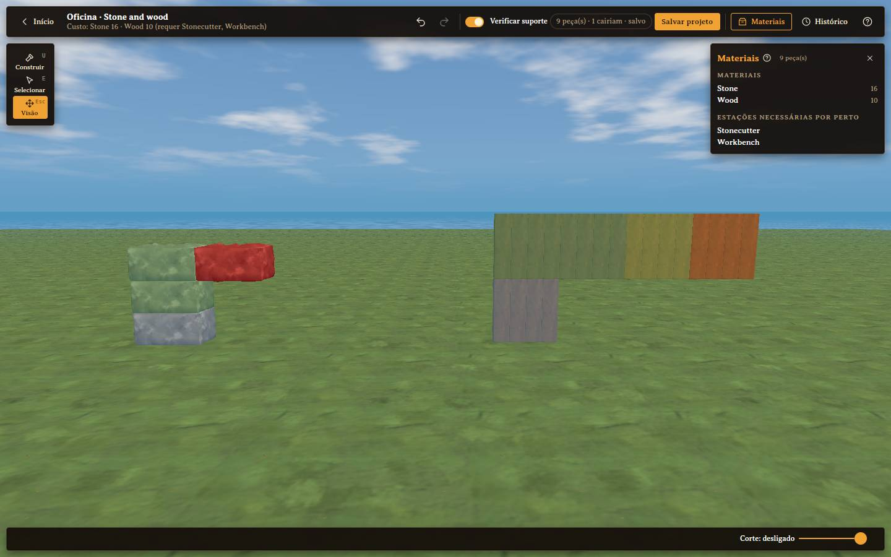
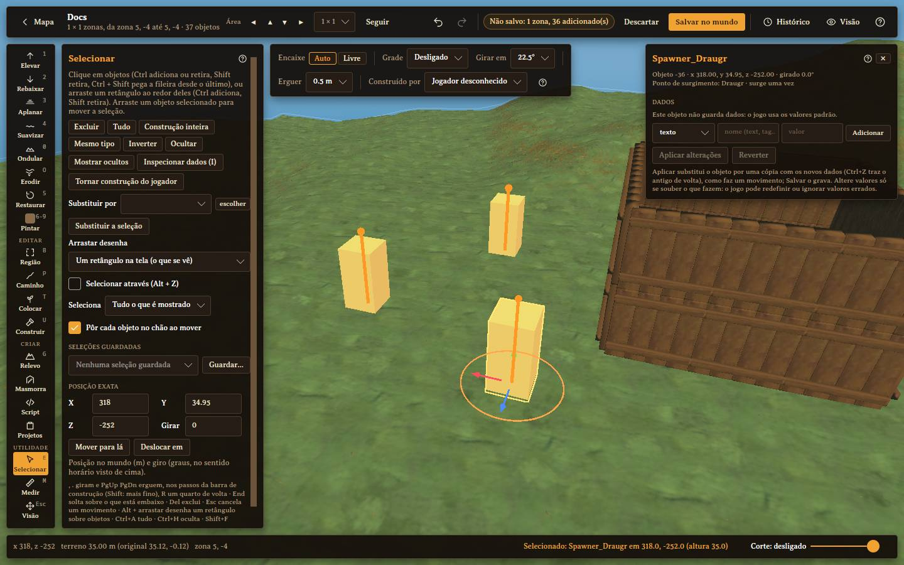
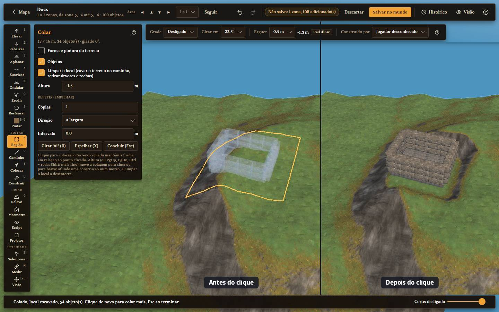

<!-- source: 551a19e3 -->
# Objetos

Tudo num mundo do Valheim que não é terreno é um **objeto**: uma árvore, uma rocha, uma parede, um baú, uma criatura,
um ponto de surgimento invisível. Esta página explica o que o jogo guarda de cada um, por quem ele conta como
construído, como as peças de construção se encaixam e se sustentam, as regras pelas quais as plantas crescem e o que
os pontos de surgimento fazem.

## O que é um objeto

No salvamento, cada objeto é um registro curto:

| Parte | Exemplo |
|---|---|
| O **tipo**, o nome que o jogo lhe dá (o *prefab* dele) | `Beech1`, `rock4_forest`, `piece_chest_wood`, `Spawner_Boar` |
| A **posição**, o **giro**, a inclinação e o tamanho | x 1250, z −380, altura 32,4 m, voltado para 90° |
| Os **dados**: valores que o jogo guarda para ele | O texto de uma placa, o conteúdo de um baú, quem o construiu, a vida dele, quando foi plantado, a etiqueta de um portal |

O [Inspetor](../select.md) mostra tudo isso. Os nomes dos valores vêm do código do jogo e do código dos seus mods, que o
editor lê dos arquivos deles mas nunca executa. Altere um valor só quando souber o que ele faz: o jogo pode redefinir
ou ignorar valores que não espera.

**Os ids mudam; o tipo e a posição, não.** Cada objeto também tem um id, mas o jogo dá ids novos aos objetos quando
salva, e o editor grava um objeto movido como uma cópia na nova posição. Por isso, sempre que o editor precisa
reencontrar um objeto mais tarde, ele procura o mesmo tipo na mesma posição: uma seleção guardada (com tolerância de
5 cm na horizontal e 20 cm na altura), as suas alterações trazidas para um salvamento mais novo, uma restauração a
partir de um backup, um desfazer depois de aplicar ao vivo. Um objeto que se moveu ou sumiu desde então conta como
ausente.

**Objetos novos começam do zero.** Um objeto colocado é uma cópia limpa de um do mesmo tipo no mundo, sem nada de
único guardado (sem conteúdo, sem vida), ou um objeto novo exatamente como o jogo o cria. Um objeto substituído também
começa do zero: um baú substituído por outro tipo de baú fica vazio. Já uma cópia colada ou um projeto guarda tudo o
que os objetos dele continham: o conteúdo do baú, o texto da placa. Tipos que o mundo não consegue criar (de um mod que
não está instalado) ficam de fora, e o editor diz quais.

**O conteúdo que você define continua seu.** Um baú que o jogo nunca abriu se enche com o saque do jogo na primeira vez
que carrega. Quando você altera o conteúdo de um baú, o editor o marca como próprio do baú, e o jogo o deixa como está.
Um item posto num suporte é salvo inteiro, novo e com a durabilidade máxima para a qualidade dele.

**Nem tudo o que você vê é um objeto.** Partes dos locais do jogo (as rochas da entrada de uma cripta, o acampamento do
comerciante, o altar de um chefe) são refeitas a partir do local cada vez que a zona carrega, então não podem ser
escolhidas nem alteradas (veja [Os locais nivelam o terreno](ground-limits.md#os-locais-nivelam-o-terreno)). Uma pedra
rúnica é igual: você pode excluí-la, o que remove o local dela para sempre, mas não movê-la, copiá-la nem inspecioná-la.

**Alguns mods escondem objetos bem abaixo do terreno**, como estações de fabricação 10 km abaixo de uma casa.
Retângulos, contornos, **Tudo** e **Construção inteira** deixam de fora o que fica mais de 10 m abaixo do terreno, para
que isso não seja levado junto com o que está acima.

### Grupos vinculados: navios e veículos

Alguns mods constroem uma coisa a partir de muitos objetos: a embarcação de um mod de navios é um objeto raiz com peças
construídas sobre ele. Cada peça é salva com o id daquilo em que está presa e o deslocamento em relação a ele, e o mod
a põe ali quando o grupo carrega. Um mod informa isso ao editor num arquivo `worldeditor.json` que ele traz; o editor
não conhece nenhum mod por conta própria. Então o editor desenha o grupo como o mod o constrói e o move, copia e exclui
inteiro, nunca uma parte sozinha. Cada colagem dá ids novos ao grupo, porque dois grupos que compartilham ids
compartilhariam as partes no jogo.

### As criaturas ficam sobre as peças

Uma criatura cuja posição fica dentro de uma peça de construção (o chefe de uma masmorra, um javali domado num cercado)
é posta sobre a peça mais alta abaixo dela sempre que o editor posiciona objetos: ao abrir ou adicionar um projeto, ao
mover, ao colar, num script, nas ferramentas do Claude. O terreno não é uma peça: uma criatura sobre ele fica onde foi
colocada.

## Peças construídas por jogadores

Tudo o que um jogador pode colocar com o martelo, a enxada, o cultivador ou a bandeja de servir é **construção do
jogador** no jogo: guarda **quem a construiu**, como um id de jogador. Isso importa mais do que parece. Sem construtor,
o jogo trata uma peça como parte de uma ruína:

| | Construção do jogador | Sem construtor (uma ruína) |
|---|---|---|
| Ao desmontá-la | Devolve todos os materiais | Devolve um terço deles |
| Uma fogueira ao lado | Forma uma base: monstros não surgem ali | Não forma base |
| Ataques | A têm como alvo | A ignoram |
| Uma proteção ou um baú privado | Obedece ao construtor | Não obedece a ninguém |

Por isso o editor grava um construtor em toda peça que coloca, cola ou constrói: o jogador escolhido em **Construído
por** na [barra de construção](../build.md#a-barra-de-construção). Essa lista oferece os jogadores que construíram neste
mundo (com as contagens de peças), os jogadores nomeados em camas, proteções e lápides, e os personagens deste
computador. Ela começa com o jogador com mais peças; senão, o seu próprio personagem. **Ninguém (não construído por
jogador)** coloca peças como partes de uma ruína de propósito. Sem nenhum jogador conhecido, as peças recebem
**Jogador desconhecido**: contam como construídas, mas proteções e baús privados não obedecem a ninguém, então escolha
o seu próprio id quando puder.

Algumas coisas mantêm ou abandonam o construtor de propósito:

- Mover ou editar um objeto mantém o construtor que ele tem.
- Um projeto não guarda construtor: quem o constrói no jogo se torna o construtor dele. Um projeto salvo a partir de uma
  ruína lembra que é uma ruína.
- Uma masmorra gerada não tem construtor, como as do próprio jogo: os ataques a ignoram, e ela devolve um terço dos
  materiais.
- **Tornar construção do jogador** (a ferramenta [Selecionar](../select.md)) dá um construtor a peças que não têm: uma
  ruína que você quer reparar e manter, ou peças colocadas por versões antigas do editor.

Uma ruína sobre a qual você construiu (uma torre de pedra remendada com madeira) conta como construção sua: as peças
dela que tocam as suas, e as que tocam essas, aparecem com as suas construções em Visão e no mapa.

## Encaixe

As peças de construção se unem como o martelo do jogo as une. Cada peça tem **pontos de encaixe**, nos cantos e nas
pontas, que o editor lê do seu Valheim com a forma real de cada peça (os colisores dela) e as regras de posicionamento
dela. Quando dois pontos de encaixe se aproximam, a peça se move para que eles se encontrem exatamente: as paredes ficam
ponta a ponta, os pisos se encontram borda com borda, uma parede se assenta sobre um piso.

**Como o martelo posiciona uma peça**, o que [Construir](../build.md) segue passo a passo num mundo, na Oficina e
numa masmorra (o encaixe **Auto** dele):

1. A linha do cursor encontra a coisa mais próxima: o terreno, ou a forma real de uma peça (não a caixa dela).
2. A peça, girada como você a definiu, é movida para que o ponto da forma dela mais próximo do impacto o toque. Tapetes
   e outras peças de chão, e peças que o jogo deixa afundar nas coisas, usam o meio delas em vez disso.
3. De todos os pontos de encaixe da peça e das peças a até 10 m, o par mais próximo a até meio metro se encontra.
   Aponte para o topo de uma parede para pôr a próxima em cima dela, perto da ponta para pôr uma ao lado.
4. Um encaixe que poria a peça exatamente onde a mesma peça já está é ignorado.

Uma elevação (`PgUp`, `PgDn` ou `Ctrl` + roda) é somada antes do encaixe, então uma peça erguida se encaixa em pontos
perto da nova altura. Uma grade arredonda só pontos no terreno: uma peça apontada para outra peça se encaixa como de
costume.

A barra de construção tem mais duas maneiras. **Manual** limita o passo 3 a um ponto de encaixe da peça, aquele que
`Q` e `E` escolhem (marcado na peça), e deixa que ele alcance 1,5 m: num canto apertado, onde o par mais próximo é a
borda errada, escolha o ponto que deve se encontrar. **Livre**, ou segurar `Alt` em qualquer modo, pula o passo 3: a
peça fica onde toca, e com `Alt` a posição horizontal dela é arredondada para um quarto de metro a partir do meio da
área.

As outras ferramentas se encaixam pelos mesmos pontos de encaixe, cada uma à sua maneira:

| Onde | Como encaixa |
|---|---|
| [Colocar](../place.md), **Encaixar nas peças já existentes** (partes de ruínas: as peças que os jogadores constroem são colocadas com Construir) | Uma peça por vez sob o cursor. **Ao lado**: ponta a ponta com a peça perto do cursor, no nível dela, onde um par de pontos de encaixe se encontra a até 1 m. **Em cima**: a base dela sobre o topo da peça sob o cursor. Uma peça encaixada fica voltada para o mesmo lado que a peça à qual se une. |
| [Construir](../build.md), **Dispor** em Linha, Círculo ou Retângulo (e a Linha **Ponta a ponta** de [Colocar](../place.md), para partes de ruínas) | Cada peça começa onde a anterior termina. As duas pontas de uma peça são os meios dos dois lados curtos dela, encontrados a partir dos pontos de encaixe (tipos sem pontos de encaixe usam a caixa do modelo). Uma linha que começa a até 1 m de uma peça a continua. |
| [Selecionar](../select.md), com o **Encaixe** da barra de construção em **Auto** | Enquanto você move, o par de pontos de encaixe mais próximo (um de uma peça movida, um de uma peça ao redor) a até 0,75 m se prende, e a seleção inteira se desloca para que eles se encontrem. |
| [Script](../scripting.md), `snap: true` | Uma peça colocada encontra os pontos de encaixe das peças ali a até 0,5 m. |

Posições digitadas (a **POSIÇÃO EXATA** da ferramenta Selecionar) nunca se encaixam: são exatas.

## A verificação de suporte

No jogo, toda peça de construção precisa de **suporte**, que sobe do terreno pelas peças que se tocam. Uma peça com
suporte de menos se quebra e cai assim que um jogador chega perto. **Verificar suporte**, na Oficina, faz o cálculo
como o jogo faz, a partir de dados que lê no seu Valheim (a forma, o material e o centro de massa de cada peça), e
tinge cada peça com as cores do modo de construção do jogo:

| Cor | Significado |
|---|---|
| Azul-claro | Suporte total: está apoiada no terreno. |
| Verde | Firme: metade do suporte máximo do material dela ou mais. |
| Amarelo, laranja | Mais fraca. |
| Vermelho | Prestes a quebrar, ou quebrando: no jogo, cai assim que um jogador chega perto. |

**Como o suporte é calculado.**

- Uma peça cuja forma, aumentada em 0,15 m de cada lado, alcança o terreno tem suporte total.
- Qualquer outra peça recebe o melhor suporte das peças que ela toca, menos uma perda pela distância entre os centros
  de massa delas: a taxa "para cima" quando sustentada diretamente por baixo, a taxa "para o lado" quando sustentada
  pelo lado, uma mistura entre as duas. Sustentada por dois lados com pelo menos 100° de diferença (vistos de cima),
  ela recebe a média dos dois quando isso é melhor.
- Isso se repete até nada mudar. As peças abaixo do mínimo do material se quebram; então tudo é calculado de novo sem
  elas, para que um desabamento se espalhe como no jogo.

| Material | Máximo | Mínimo | Perda por metro para o lado | Perda por metro para cima |
|---|---|---|---|---|
| Madeira | 100 | 10 | 20 % | 12,5 % |
| Madeira de cerne | 140 | 10 | 17 % | 10 % |
| Madeira serrada | 200 | 10 | 20 % | 8 % |
| Pedra | 1000 | 100 | 100 % | 12,5 % |
| Gelo | 1000 | 100 | 33 % | 12,5 % |
| Ferro | 1500 | 20 | 8 % | 8 % |
| Mármore negro | 1500 | 100 | 50 % | 12,5 % |
| Grausten | 2000 | 100 | 33 % | 10 % |
| Antigo | 5000 | 100 | 25 % | 7 % |


*À esquerda, três paredes de pedra empilhadas: azul-claro no terreno, verde acima, e a parede que avança 2 m a partir do
topo em vermelho, com o "1 cairiam" na barra superior. À direita, paredes de madeira avançando 6 m a partir de um
poste: verde, depois amarelo, depois laranja.*

É por isso que a pedra sobe alto mas não consegue avançar para o lado (um metro para o lado consome todo o suporte
dela), e por que a madeira avança mais que a pedra, mas não sobe tão alto.

**Exceções, como no jogo.** Algumas peças nunca são verificadas: lajes de piso de mármore negro, pedras de proteção,
navios e carroças. Elas ficam de pé onde estiverem, e uma laje dá o suporte total do material dela ao que se apoia
nela; é assim que uma masmorra de peças de construção se sustenta 5000 m acima (veja
[Por que ela se sustenta a 5000 m de altura](dungeons.md#por-que-ela-se-sustenta-a-5000-m-de-altura)). As partes que se movem sozinhas (a folha
de uma porta, o casco de um navio) não contam: nada se apoia nelas. Numa masmorra do jogo, os pisos e as paredes das
salas contam como terreno, então as peças apoiadas neles se sustentam.

**O que a verificação deixa de fora**: rochas e árvores (o jogo as conta como suporte total; o lote da Oficina não tem
nenhuma), a forma exata de colisores curvos (conta a caixa deles) e peças às quais o jogo não dá suporte nenhum (elas
não são tingidas). Para um projeto construído em terreno irregular, a verificação considera que o terreno está onde a
construção o encontrou: nos pontos de contato com o terreno que o Homestead registrou; senão, sob a peça mais baixa de
cada lugar.

## Regras de crescimento

Mudas, plantações e plantas selvagens seguem as próprias regras do jogo, e as ferramentas [Colocar](../place.md) e
Regenerar do editor também as seguem, para que o que você planta cresça no jogo.

**Espaço para crescer.** Uma muda ou uma plantação só cresce quando nada fica dentro do **raio de crescimento** dela,
lido do seu jogo: 0,5 m para a maioria das plantações, de 2 a 3 m para mudas de árvores. Com **Deixar espaço para mudas
e plantações crescerem** ligado (o padrão):

- mudas e plantações mantêm pelo menos o seu raio de crescimento de distância de tudo, inclusive umas das outras;
- plantações crescidas (`Pickable_Carrot`) e árvores que crescem a partir de mudas (`Beech1`, `Oak1`) mantêm o espaço
  de que a muda delas precisa, como um campo ou um pomar de verdade;
- arbustos não crescem a partir de nada no jogo, então só **Espaçamento** se aplica a eles.

Desligado, você pode plantar tão junto quanto quiser, mas essas plantas talvez nunca cresçam.

**Plantações precisam de solo cultivado.** O jogo só deixa as plantações crescerem em solo cultivado, então pinte-o
primeiro (**Cultivar** do pincel Pintar ou Pintar da ferramenta Região). O painel Colocar avisa quando uma plantação
marcada precisa disso.

**Água.** Um objeto colocado no terreno fica de fora onde o terreno está mais de 0,3 m debaixo d'água, exceto
laminárias e algas.

**Agrupamento.** Bosques de verdade crescem em arvoredos com clareiras entre eles. **Agrupar** estende um padrão de
ruído sobre o mundo, com manchas de **Manchas** de diâmetro: onde o padrão é baixo, os lugares são
rareados, e quanto maior o Agrupamento, mais terreno fica livre. O padrão é fixo no mundo, não no pincel, então traços
lado a lado combinam.

### Como Regenerar decide o que cresce

**Regenerar a natureza**, da ferramenta Região, devolve o que o próprio jogo faria crescer, calculando cada zona como o
jogo faz quando a cria pela primeira vez:

- **As próprias regras do jogo.** Ela lê as regras de vegetação do jogo no seu Valheim e usa os mesmos números
  aleatórios, a partir da semente do mundo, da zona e do tipo. Em terreno ainda como foi gerado, você recebe de volta
  as mesmas árvores nos mesmos lugares que o mundo tinha no início.
- **As condições do jogo**: o bioma (e se um tipo cresce na borda ou no meio dele), a altura acima da água, o declive,
  o fator de floresta (arvoredos e clareiras), quão acidentado é o terreno ao redor do lugar, a distância até o centro
  do mundo, quantos grupos por zona e quantos objetos por grupo.
- **O terreno como está agora.** Um morro que você elevou recebe o que cresce na nova altura e no novo declive dele; uma
  plataforma que você nivelou recebe o que cresce em terreno plano.
- **Não por cima das coisas.** Um lugar é ignorado quando algo está a até 1 m, um objeto do mesmo tipo a até 3 m (uma
  árvore ainda de pé não é duplicada) ou uma peça de construção a até 4 m.
- **Biomas alternativos** (Dark Meadows, Rock Black Forest…) ficam onde o jogo os põe, a partir da semente, com o que
  acrescentam e sem o que excluem.
- **Os locais** mantêm o terreno deles livre, como quando o jogo cria uma zona pela primeira vez.

O que ela não pode saber: as verificações de física do jogo contra objetos já de pé. Ela trabalha em até 16 zonas de
uma vez. **Fazer crescer nela as árvores e rochas do bioma**, da ferramenta Relevo, para as montanhas dela, usa as
mesmas regras nas encostas que elevou.

## Pontos de surgimento

O jogo põe criaturas nos acampamentos, nas vilas e nas masmorras com **pontos de surgimento**: objetos invisíveis
(`Spawner_Boar`, `Spawner_Draugr`…), cada um fazendo a sua criatura surgir onde ele está. Qual criatura, quantas
estrelas e se ela volta são fixados pelo tipo do ponto de surgimento, então, para ter outra criatura, você coloca outro
tipo.

| Como surge | Quais |
|---|---|
| **Surge uma vez**: na primeira vez que um jogador chega perto, nunca mais depois que morre | A maioria dos pontos de surgimento do jogo. |
| **Volta N min depois de morrer** | Os `*_respawn_*`, `Spawner_Location_*`, `Spawner_imp_respawn`, `Spawner_Fish4`; muitas vezes 60 min. |
| **Só à noite** ou **só de dia** | Alguns que esperam. |
| **Quando um evento o desperta** | Os `TriggerSpawner_`. |

Os **ninhos de criaturas** são o tipo visível: ninhos de greydwarf, pilhas de ossos e semelhantes. Eles continuam
fazendo criaturas surgirem ao redor deles até serem destruídos ("Greydwarf, Greydwarf_Elite · até 3 ao redor, num raio
de 5 m").


*Pontos de surgimento junto a uma cabana: uma caixa simples para cada um, com um marcador laranja acima. O ponto de
surgimento de draugr selecionado está aberto no Inspetor, cuja linha diz o que ele faz surgir.*

A ferramenta Colocar e o Inspetor mostram essa linha para cada tipo, lida do seu jogo (`Ponto de surgimento: Boar ·
0–2 ★ · surge uma vez`). Em 3D, cada ponto de surgimento e cada ninho aparece como uma caixa simples com um marcador
acima, visto através de qualquer coisa à frente: laranja para um ponto de surgimento (vermelho quando a criatura dele
volta), roxo para um ninho. Ambos ficam ocultos de início, porque revelam onde as coisas estão; ative-os no painel
Visão.

## Como uma colagem limpa o local

Uma cópia (da ferramenta Região ou de um projeto) guarda:

- **Os objetos**, com tudo o que contêm: um baú colado vem cheio como o original.
- **Só o terreno sob as construções**: sob cada peça de construção (pela forma real dela) e 1 m ao redor, fundindo-se
  com o terreno onde cai ao longo de mais 3 metros. O resto do terreno da seleção fica para trás, então uma cidade
  colada se acomoda na terra onde cai, em vez de levar junto um quadrado de terreno estranho. Os projetos não guardam
  terreno.
- **Alturas**: as peças de construção mantêm a forma da construção, medida a partir da altura média do terreno da cópia,
  que vai para a altura do terreno onde você clica. Árvores, rochas e semelhantes mantêm a altura acima do terreno,
  então cada uma cai sobre o terreno para onde vai.

A cópia da ferramenta Selecionar é posicionada da mesma forma.


*Antes do clique (à esquerda), o contorno da colagem corta o monte; depois dele (à direita), o terreno no caminho da
cabana foi escavado até o piso dela, no mesmo passo de desfazer.*

Com **Limpar o local** ligado, cada colagem também abre espaço para si, no mesmo passo de desfazer:

- Onde fica uma peça de construção colada (pela forma real dela, e 1 m ao redor), o terreno no caminho é **escavado**
  até a base da peça mais baixa, além de ±8 m se necessário. Uma construção colada num morro não fica enterrada nele. O
  terreno mais baixo nunca é elevado.
- Onde o terreno copiado entrou por inteiro, nada é escavado: a construção fica sobre ele como ficava no original.
- As peças mais de 100 m abaixo do terreno são ignoradas (alguns mods guardam estações de fabricação ali), e nada é
  escavado sob um grupo vinculado como um navio.
- **Árvores, rochas, minério, arbustos e coletáveis** nessa área são retirados. Construções, criaturas e animais
  domados ficam.

Os objetos colados são objetos novos criados a partir da cópia, então uma colagem também funciona em outro mundo. Ao
vivo, um **Recortar** seguido de colar move os objetos no jogo com os próprios ids deles quando possível (veja
[Mover um objeto mantém o mesmo objeto](live-editing.md#mover-um-objeto-mantém-o-mesmo-objeto)).

## Arquivos de projeto

Um projeto é uma construção guardada como arquivo, no formato do
[Homestead](https://thunderstore.io/c/valheim/p/sighsorry/Homestead/), o mod de construção dentro do jogo: o mesmo
arquivo aparece na aba do martelo do Homestead, pronto para construir no jogo, e é colado em qualquer mundo pelo editor.
Compartilhar uma construção significa compartilhar o arquivo `.blueprint` dela e a imagem `.png` ao lado.

**O que ele guarda.** Só peças de construção: árvores, rochas e itens largados não são guardados, nem o terreno. Cada
peça é uma linha com o tipo, a posição em metros a partir da **âncora** (o meio da construção no nível do chão), o giro
e o tamanho, as peças mais baixas primeiro:

```text
#Name:Small hut
#Creator:Valheim World Editor
#Description:A hut with a fire pit
#Tags:house, wood
#Pieces
woodwall;Building;-3;1;-2;0;0;0;1;"";1;1;1
```

O editor acrescenta linhas próprias que o Homestead e o PlanBuild ignoram, para que o mesmo arquivo continue sendo
construído no jogo: as tags, o que os objetos guardam (o conteúdo de um baú, o texto de uma placa, as estrelas de um
chefe), se a construção é uma ruína e quais peças só o editor pode colocar (estátuas, navios, criaturas: o martelo do
Homestead as ignora, e o custo mostrado as deixa de fora). Nenhum construtor é gravado: quem o constrói no jogo se
torna o construtor dele.

**O que volta.** Colados pelo editor, os objetos de um projeto voltam com o que continham. Construído no jogo com o
Homestead, são só as peças: o jogo cria os baús vazios e não coloca criaturas.

**A altura dele.** Aberto na Oficina, um projeto é movido como um todo para que a base da peça de construção mais baixa
fique sobre o lote (rochas e outras coisas que a enxada coloca não contam). O editor lembra essa elevação e a retira de
novo ao salvar, para que a âncora mantenha a altura e a construção fique como antes quando o Homestead a constrói.

**Outros arquivos.** O editor também lê arquivos `.blueprint` do PlanBuild e arquivos `.vbuild` (BuildShare e
ferramentas mais antigas, uma peça por linha), e pode gravar `.vbuild`. Eles medem a partir de um canto, então são
centralizados no lote. As marcas de terreno deles não são mantidas, as peças de mods que você não tem ficam de fora, e
a mensagem diz quantas.
