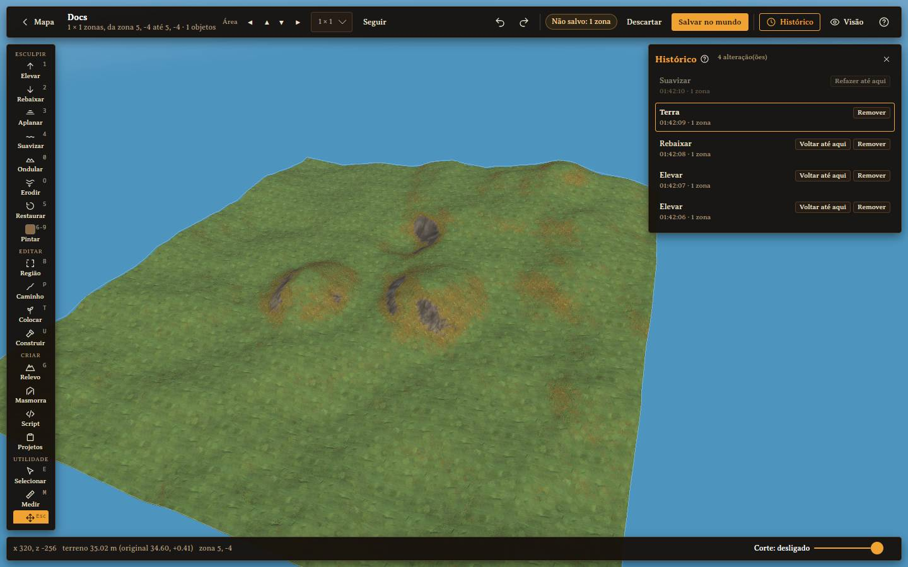

<!-- source: 752963cc -->
# Salvamento e histórico

Nada do que você faz no editor toca o mundo até você mandar. Suas alterações esperam como alterações **pendentes** e
depois vão para os arquivos do mundo quando você usa **Salvar no mundo**, ou para o jogo em execução quando você usa
**Aplicar ao vivo**. O **Histórico** guarda cada passo, mesmo depois que o editor fecha, para que você possa reverter
uma alteração mais tarde.

```text
  sua edição ──► pendente ──► Salvar no mundo ──► um novo salvamento na pasta do mundo   (fora do jogo)
                    │
                    └───────► Aplicar ao vivo ──► o jogo em execução, que o salva        (ao vivo)
```

## Alterações pendentes

Cada traço, clique, colagem ou execução de script é um **passo**, e ele fica pendente até ser salvo ou aplicado. A
barra superior conta o que está pendente, em âmbar ("Não salvo: 3 zonas, 1 excluído, 12 adicionados, 1 redefinida",
ou "Não aplicado: …" ao vivo), e mostra "Tudo salvo" ou "Tudo aplicado" em cinza quando nada está aguardando:

| Contagem | O que é |
|---|---|
| **zonas** | Zonas cujo terreno (altura ou pintura) realmente difere do salvamento. Elevar e depois rebaixar de volta à mesma altura não conta nada. |
| **excluídos** | Objetos do mundo que serão removidos. |
| **adicionados** | Objetos novos: colocados, colados, copiados ou criados por uma ferramenta. |
| **redefinidas** | Zonas marcadas para serem geradas de novo pelo jogo (veja [Redefinir zonas](areas-and-zones.md#redefinir-zonas)). |

Depois que você salva, as contagens são o que difere desse salvamento, então desfazer um passo salvo o torna pendente
de novo. Na visão 3D, cada objeto novo ainda não salvo leva um ponto verde (**Visão → Marcas não salvas** os oculta).

**As alterações pendentes pertencem ao mundo.** Elas ficam quando você move a área, volta ao mapa ou abre outro lugar,
e são todas salvas juntas (veja [A área](areas-and-zones.md#a-área)). Elas só se perdem quando você sai sem salvar
(o editor pergunta antes), quando você as joga fora, ou quando usa **Recarregar** num mundo ao vivo (ele também
pergunta antes).

**Descartar** joga fora o que não foi salvo ou aplicado: desfaz os passos não salvos no fim do histórico, dos mais
novos aos mais antigos, refaz os passos salvos ou aplicados que você desfez desde então e descarta o resto da lista de
refazer. Os passos salvos e aplicados ficam.

Algumas alterações pendentes não têm passo no histórico da área aberta (feitas em outra área, ou antes de o mundo ser
lido de novo). Essas só podem sair lendo o mundo inteiro de novo dos arquivos ou do jogo, o que descarta todas as
alterações pendentes, então o Descartar pergunta uma segunda vez antes de fazer isso.

Lido de novo, o histórico fica como o mundo o tem: dos arquivos, o histórico guardado no último salvamento; ao vivo
(**Descartar** ou **Recarregar**), todos os passos que o jogo tem, aplicados e ainda desfazíveis, enquanto os passos
não aplicados vão embora com as alterações deles.

## Salvar um mundo

O jogo guarda um mundo como uma pasta de **salvamentos numerados**: cada salvamento é um conjunto de arquivos
(`_main.<n>.chunks`, `.db2`, `.fwl2` e um pequeno marcador `.ok`) mais os arquivos de chunk que guardam os objetos e o
terreno. **Salvar no mundo** funciona como o jogo, então um mundo salvo por ele abre no jogo como qualquer outro:

1. **Ele grava um novo salvamento** com o número seguinte. Só os arquivos de chunk que mudaram são gravados de novo;
   os objetos intocados são copiados byte a byte. O marcador `.ok` vem por último, porque o jogo só confia num
   salvamento que o tenha, de modo que um salvamento interrompido nunca é tomado por um bom. Cada arquivo mantém o
   formato de salvamento em que foi lido, então tanto os mundos do Valheim 1.0.20 em diante quanto os de versões mais
   antigas são salvos e abrem no jogo que os criou.
2. **Ele relê o novo salvamento** e o compara com o que pretendia gravar: o terreno das zonas alteradas, o terreno de
   todas as outras zonas, o número de objetos, as zonas redefinidas. Se algo diferir ou falhar, os arquivos novos são
   removidos e a mensagem termina com "Nada mudou". O salvamento antigo não foi tocado nesse ponto.
3. **Ele faz a limpeza.** O salvamento a partir do qual você abriu o mundo é mantido enquanto o mundo está aberto,
   porque cada salvamento é feito a partir dele. Um salvamento que você fez antes na mesma sessão é removido quando
   você salva de novo. Quando você sai do mundo, só o salvamento mais novo fica.
4. **Ele grava o histórico** junto com o mundo (veja [Histórico](#histórico)).

**Feche o jogo antes.** Um jogo ou servidor em execução mantém o mundo na memória e grava por cima do seu salvamento da
próxima vez que salvar. Para alterar um mundo enquanto ele roda, use o [modo ao vivo](live-editing.md).

**O que não pode ser salvo** é listado com o motivo: edições numa zona perto da qual nenhum jogador esteve (o mundo
ainda não tem dados ali: veja [Zonas](areas-and-zones.md#zonas)), e terreno novo num mundo onde ninguém nunca cavou nem
nivelou no jogo (o editor faz as edições de terreno copiando uma que o jogo fez, então cave uma vez em qualquer lugar
no jogo antes).

### O jogo salvou depois que você o abriu

Se o jogo salvou o mundo depois que o editor o leu (você jogou entre dois salvamentos), salvar jogaria fora o que
aconteceu no jogo, então o editor não salva nada. Em vez disso, ele oferece **levar suas alterações** para o
salvamento do jogo: ele refaz cada uma das suas alterações pendentes nesse salvamento, encontrando os objetos pelo tipo
e pela posição, já que os ids deles mudam a cada salvamento (veja [O que é um objeto](objects.md#o-que-é-um-objeto)).

Onde o jogo alterou a mesma coisa, ele pergunta uma vez por tipo, **Manter o meu** ou **Manter o do jogo**:

| O que entra em conflito | Manter o meu |
|---|---|
| Zonas cujo terreno vocês dois alteraram | Seus pontos e sua pintura alterados vão por cima dos do jogo; o terreno do jogo fica em todo o resto dessas zonas. |
| Objetos que o jogo alterou (um baú usado, uma placa, uma planta crescendo) e que você excluiu, moveu ou editou | Eles são excluídos, movidos ou editados como você fez. |
| Objetos que o jogo removeu (pegos, destruídos, ou uma criatura ou um navio que se afastou) e que você moveu ou editou | Eles voltam para onde você os pôs. Um que só tinha se movido fica então duplicado. |

Nada é gravado ainda: o mundo agora é o salvamento do jogo com as suas alterações pendentes sobre ele. Confira-as e
salve. Os passos do Histórico que tocaram algo que você deixou com a versão do jogo não podem mais ser desfeitos, nem os
passos anteriores a eles; a mensagem diz quantos foram descartados.

## Aplicar ao vivo

No [modo ao vivo](live-editing.md), o mesmo botão é **Aplicar ao vivo**. Ele envia o terreno, os objetos e as
redefinições de zona pendentes ao jogo em execução, que os compartilha com todos os jogadores lá e os salva ele mesmo,
como tudo o que os jogadores constroem. Os passos enviados ganham a marca **aplicado** no Histórico; com **Auto**
ligado, cada passo é aplicado assim que você o termina.

Os passos aplicados ainda podem ser desfeitos: desfaça (ou use **Remover** no Histórico) e aplique de novo.

- Um objeto **excluído** volta como uma cópia do que ele era quando o mundo foi lido, com os dados dele (um baú com o
  conteúdo como estava). Para o jogo, é um objeto novo.
- Um objeto **colocado** é removido de novo, mesmo quando outro mod o recriou com um id novo nesse meio-tempo: o plugin
  o encontra pelo tipo e pela posição.
- Um objeto **movido** volta para trás.
- Uma **redefinição de zona** não pode ser desfeita depois de aplicada.

## Histórico

O **Histórico** (`L`) lista cada passo, dos mais novos aos mais antigos: o nome ("Elevar", "Colar ×3", "Removido:
Colocar"), a hora e o que ele afetou. As marcas dizem que um passo está **aplicado** (salvo ou enviado ao jogo), que foi
feito pelo **Claude**, ou que vem de uma **sessão anterior**. Por padrão ele guarda todos os passos, desde que ocupem
menos de 2 GB de memória (além disso, os mais antigos saem primeiro); **Configurações → Histórico → Passos mantidos**
faz com que ele guarde só esse número de passos.


*O último passo foi desfeito com **Voltar até aqui**: ele fica acinzentado e oferece **Refazer até aqui**.*

Há duas formas de voltar:

| | O que faz | Exemplo |
|---|---|---|
| **Voltar até aqui** | Desfaz todos os passos depois deste, como `Ctrl+Z` várias vezes. Os passos posteriores ficam acinzentados, para refazer. Uma alteração nova os descarta. | Você testou três coisas e quer o mundo como era antes delas. |
| **Remover** | Retira só este passo e mantém tudo o que foi feito depois dele: a mudança de altura dele sai dos pontos que ele tocou, a pintura dele sai de onde nada foi repintado desde então, os objetos dele saem e os que ele excluiu voltam, as redefinições dele são canceladas. A remoção é um passo novo, então `Ctrl+Z` o traz de volta. | Remover uma fileira de árvores plantada há uma hora sem perder o trabalho no terreno feito desde então. |

**Reverter as alterações do Claude** faz um **Remover** para cada passo que o Claude fez no histórico da área aberta e
mantém os seus. Os passos do Claude feitos em outras áreas ficam guardados à parte (veja abaixo): abra essas áreas para
revertê-los também.

### O histórico pertence ao mundo

O histórico vem junto quando você move ou redimensiona a área, quando Seguir a aumenta, e pelo mapa. Um passo feito
inteiramente em outra área fica guardado à parte enquanto esta está aberta ("N passo(s) feito(s) em outras áreas são
mantidos"); ele volta, pronto para desfazer, quando você abre uma área que o contém. Um passo só em parte na área aberta
não pode ser desfeito daqui, nem os passos anteriores a ele. Salvar ou aplicar a partir de qualquer área marca como
salvos os passos de todas as áreas.

### Guardado depois que o editor fecha

Depois de cada **Salvar no mundo** ou **Aplicar ao vivo**, o histórico é gravado na pasta de dados do editor
(`history/`, um arquivo por pasta de mundo; ao vivo, um por conexão e mundo). Abra o mundo de novo, mesmo dias depois,
e os passos voltam, com a marca **sessão anterior**. Desfazer põe o terreno de volta, um objeto excluído de volta com o
conteúdo dele, e tira um objeto colocado. As alterações que você não salvou nem aplicou não são guardadas.

O mundo pode ter mudado desde então (jogadores construíram e cavaram, ou o jogo o salvou de novo), então o editor
pergunta uma vez antes de o primeiro passo de uma sessão anterior ser desfeito ou refeito: fazer isso põe as coisas de
volta como eram, por cima do que mudou desde então. Para um mundo que só o editor salvou desde então, ele não pergunta.

### O que um passo não consegue reverter

O histórico é guardado através de cada salvamento e aplicação, inclusive redefinições de zona e terreno
[Sem limite](ground-limits.md#sem-limite) transformado em discos de terreno. Algumas coisas ficam fora do alcance dele:

- **Uma redefinição de zona, depois de salva ou aplicada.** O jogo gera a zona de novo: o que os passos fizeram ali
  sai deles (um passo que estava todo ali vai embora), assim como o passo que marcou a redefinição. Os passos em outros
  lugares ficam.
- **Árvores e rochas retiradas sob terreno Sem limite**, depois de aplicado ao vivo ou depois que o mundo é aberto de
  novo: desfazer não as traz de volta. Use [Regenerar a natureza](../area.md#regenerar-a-natureza).
- **Terreno que jogadores alteraram desde então.** Aberto de novo, o terreno Sem limite de uma zona salva como discos
  de terreno volta com o histórico, então desfazer devolve todo o terreno que ele alterou, inclusive em volta dos
  discos. Onde jogadores cavaram nessa zona desde então, a zona mantém o que o jogo tem: desfazer devolve só o terreno
  do próprio passo.

## Backups

O editor não cria uma pasta de backup própria: ele nunca toca o salvamento antigo até o novo ter sido relido
corretamente, e o salvamento a partir do qual você abriu fica até você sair do mundo. Isso protege você de um
salvamento que dá errado, não de uma edição da qual você se arrepende depois de sair. Para isso, guarde sua própria
cópia de qualquer mundo que seja importante para você (veja
[Fazer backup de um mundo antes de editar](../guides/back-up-a-world.md)).

O jogo guarda os próprios backups ao lado da pasta do mundo (`<World>_backup_auto-<date>`), e as versões anteriores do
editor guardavam os delas como `<World>_backup_terraineditor-<date>`. **Voltar a um backup**, da ferramenta Região, põe
uma seleção de volta como estava numa dessas cópias, sem voltar o mundo inteiro (veja
[Restaurar uma área a partir de um backup](../guides/restore-from-backup.md)). Ele compara os objetos assim:

- Um objeto que está na seleção agora e no backup, do mesmo tipo, na mesma posição (com até 1 cm de diferença) e
  voltado para a mesma direção, fica como está.
- Todos os outros objetos dos tipos escolhidos que estão na seleção agora são removidos, mesmo quando o tipo deles
  está oculto em Visão.
- Todos os objetos do backup sem correspondência voltam, com todos os dados: um baú com o conteúdo, uma placa com o
  texto.
- As pedras rúnicas nunca são tocadas.

O terreno volta exatamente como no backup, inclusive o terreno Sem limite. Uma cópia de outro mundo (outra semente) é
recusada.
