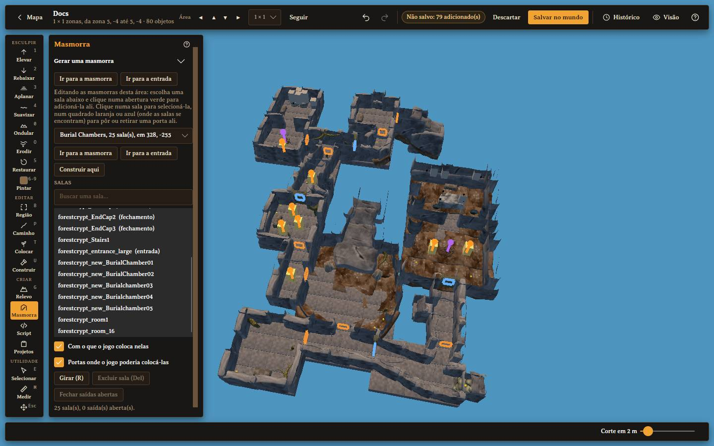
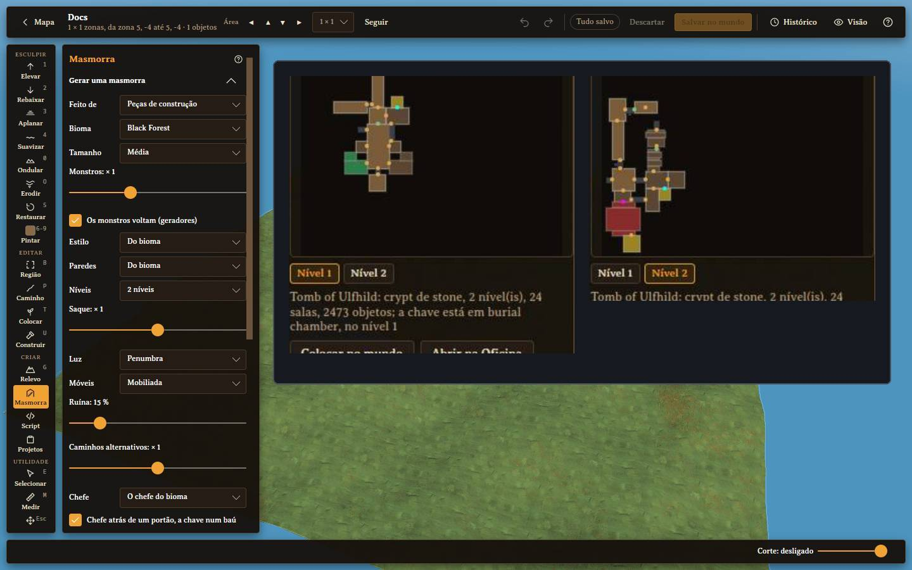
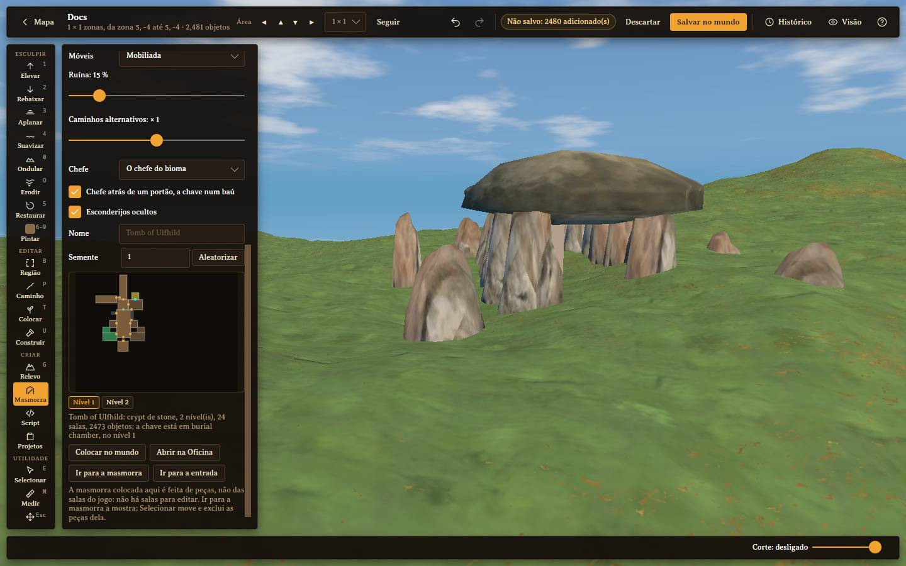
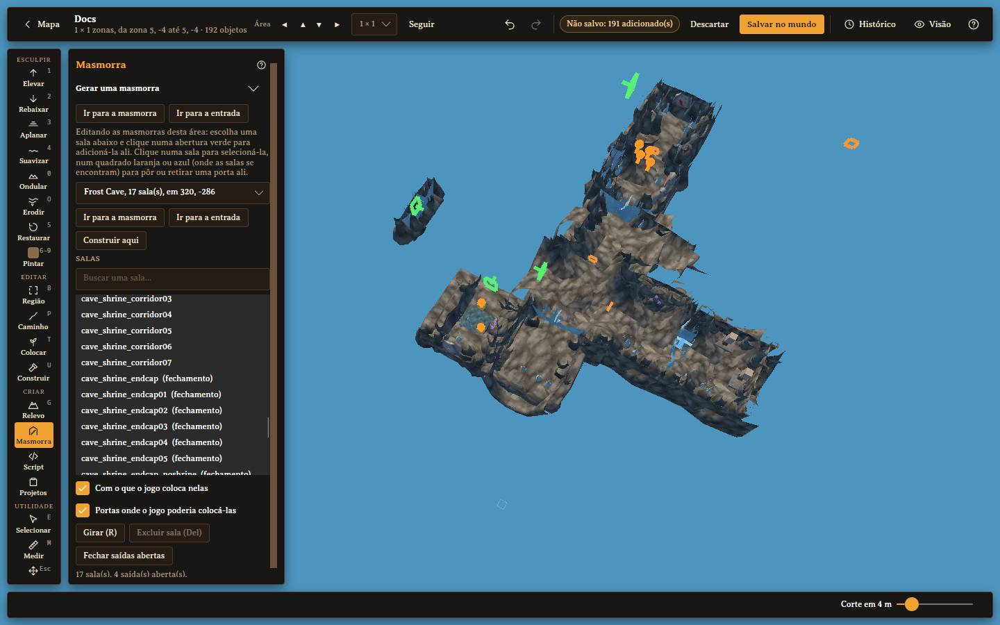
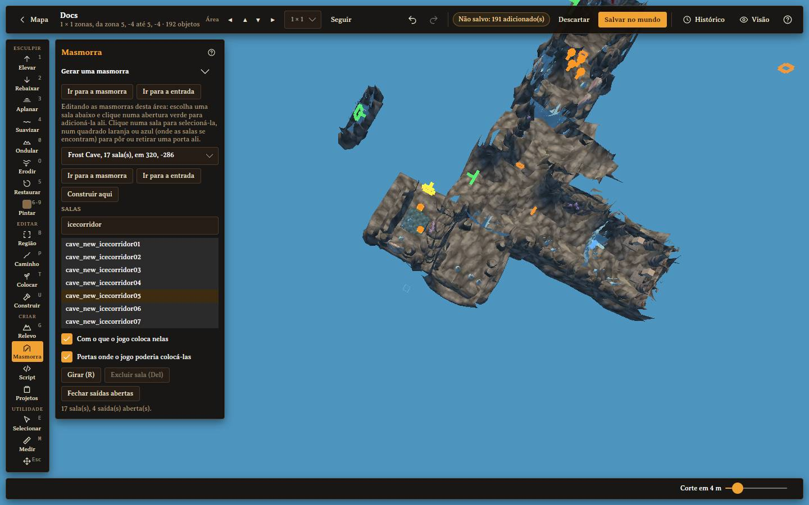
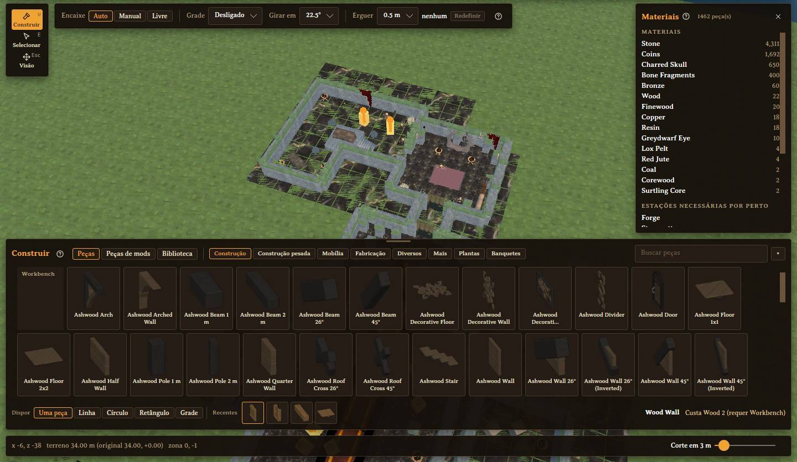

<!-- source: 16125394 -->
# Masmorra

Gere masmorras inteiras e ponha-as no seu mundo atrás de uma entrada, edite as masmorras do próprio jogo sala por sala
e construa dentro delas.

**Onde:** barra de ferramentas, seção **CRIAR** · **Tecla:** nenhuma · **Funciona em:** mundos salvos, ao vivo; o
gerador também na Oficina (**Biblioteca** → **Gerar masmorra…**)

*Uma masmorra das salas do próprio jogo (Burial Chambers, 25 salas), 5000 m acima e cortada 2 m acima do piso.
Quadrados laranja e azuis marcam onde as salas se encontram. **Excluir sala (Del)** fica acinzentado até uma sala ser
selecionada.*

Uma masmorra do Valheim é um local no chão (um monte, a boca de uma caverna) cuja porta leva a salas guardadas 5000 m
acima dele. Veja [Como o jogo guarda as masmorras](concepts/dungeons.md#como-o-jogo-guarda-as-masmorras).

## Como usar

Para gerar uma masmorra e pô-la no mundo:

1. Abra uma área de um mundo e clique em **Masmorra** na barra de ferramentas.
2. Em **Gerar uma masmorra**, escolha o **Bioma**, o **Tamanho** e os **Níveis**. O plano é desenhado de novo um
   instante depois de cada alteração.
3. Opcional: clique em **Aleatorizar** até gostar do plano; confira cada nível com os botões **Nível 1**, **Nível
   2**... embaixo dele.
4. Gire a visão para ficar de frente para o ponto onde a entrada deve ir, centralizada nele.
5. Clique em **Colocar no mundo**.
6. Clique em **Ir para a masmorra** para olhar dentro; **Ir para a entrada** traz a visão de volta para baixo.
7. Clique em **Salvar no mundo** (ou **Aplicar ao vivo**).

A colocação inteira é um só passo de desfazer: `Ctrl+Z` reverte tudo. As mesmas escolhas e a mesma semente sempre
geram a mesma masmorra de peças de construção; uma feita [das salas do próprio jogo](#feita-das-salas-do-próprio-jogo)
também depende de onde fica a entrada e para onde ela está voltada. Para o passo a passo completo, veja
[Gerar uma masmorra e colocá-la no mundo](guides/make-a-dungeon.md).

***Gerar uma masmorra** para uma masmorra da Floresta Negra, Média, 2 níveis, chefe atrás de um portão. Ao lado do
painel, o plano desenhado maior, um nível em cada: a sala verde da chave no nível 1, a arena vermelha com o ponto
magenta do portão e a sala do tesouro dourada no nível 2, e o resumo embaixo deles.*

## Configurações

### Gerar uma masmorra

**Gerar uma masmorra** fica no topo do painel Masmorra: aberto quando a área não tem masmorra, recolhido quando tem.

| Configuração | O que faz |
|---|---|
| **Feito de** | **Peças de construção**: salas construídas como um jogador as construiria, mobiliadas de acordo com o que são. **As salas do próprio jogo**: as salas de masmorra do bioma, juntadas como o jogo as junta (veja [Feita das salas do próprio jogo](#feita-das-salas-do-próprio-jogo)). Não aparece na Oficina, que só aceita peças de construção. |
| **Bioma** | **Prados**, **Floresta Negra** (o padrão), **Pântano**, **Montanha**, **Planícies**, **Terras Nebulosas**, **Terras Cinzentas**, **Extremo Norte**. Define os monstros, o saque, as luzes, a entrada no chão, e o estilo e as paredes, a menos que você os escolha. |
| **Tamanho** | **Pequena**, **Média** (o padrão), **Grande**, **Enorme**: cerca de 5, 8, 12 ou 17 salas em cada nível. |
| **Monstros: × 1** | De **nenhum** a 3 vezes o normal, em passos de 0.25. |
| **Os monstros voltam (geradores)** | Ligado: os geradores do jogo, cujos monstros voltam um tempo depois de mortos. Desligado: os próprios monstros, colocados uma vez. O chefe é sempre colocado uma vez. |
| **Estilo** | **Do bioma**, ou **Crypt**, **Catacombs**, **Temple**, **Fortress**, **Prison**, **Dvergr hold**, **Goblin warren**, **Ruins**: que salas ela tem e como estão dispostas. |
| **Paredes** | **Do bioma**, ou **Stone**, **Marble**, **Wood**, **Stave**, **Grausten**, **Dvergr**, **Goblin**. |
| **Níveis** | De **1 nível** a **16 níveis** (2 por padrão), ligados por escadas. O chefe espera no último. |
| **Saque: × 1** | Baús e tesouros: de **nenhum** ao dobro do normal. Os níveis mais fundos guardam mais. Com as salas do próprio jogo, ele mantém ou dobra os baús das salas. |
| **Luz** | **Escura**, **Penumbra** (o padrão) ou **Clara**: quantas tochas e braseiros. |
| **Móveis** | **Vazia**, **Mobiliada** (o padrão) ou **Rica**. |
| **Ruína: 15 %** | O quanto ela está em ruínas, de 0 a 100 % em passos de 5: entulho, pilares caídos, tochas apagadas. Escolher um estilo define o valor próprio dele, e escolher um bioma também, enquanto **Estilo** estiver em **Do bioma**. |
| **Caminhos alternativos: × 1** | Com que frequência salas distantes ao longo do percurso são ligadas, para haver mais de um caminho: de **nenhum (uma árvore)** ao dobro do normal. |
| **Chefe** | **O chefe do bioma**, **Sem chefe**, ou o chefe ou a elite de qualquer bioma pelo nome (`Troll`, `Draugr_Elite`, `StoneGolem`...). |
| **Chefe atrás de um portão, a chave num baú** | O portão da arena abre com a chave da cripta, num baú longe dele (jogadores que têm a chave do Elder também o abrem). Desligado: grandes portões duplos, abertos a todos. |
| **Esconderijos ocultos** | Pequenas salas de tesouro atrás de uma parede rachada a quebrar ou de uma tapeçaria. |
| **Nome** | Escrito numa placa no salão de entrada. Vazio: um nome criado a partir da semente, mostrado em cinza (`Barrow of Sigrun`). |
| **Semente** e **Aleatorizar** | O número próprio da masmorra; qualquer número inteiro gera outra masmorra com as mesmas escolhas. |

Alterar **Luz** ou **Ruína** não muda mais nada na masmorra. Com **As salas do próprio jogo**, só **Bioma**,
**Tamanho**, **Monstros**, **Saque** e a semente são usados; as outras linhas, e o plano, ficam ocultos. O que o
gerador põe e onde está em
[Como o gerador dispõe uma masmorra](concepts/dungeons.md#como-o-gerador-monta-uma-masmorra) e
[Móveis, luz e guardas](concepts/dungeons.md#mobília-luz-e-guardas).

O que cada bioma traz quando nada mais é escolhido:

| Bioma | Estilo | Paredes | Chefe | Entrada no chão |
|---|---|---|---|---|
| Prados | Crypt | Stone | `Skeleton_Hildir` | O monte de uma burial chamber |
| Floresta Negra | Crypt | Stone | `Troll` | O monte de uma burial chamber |
| Pântano | Crypt | Stone | `Draugr_Elite` | A porta de uma sunken crypt |
| Montanha | Fortress | Stone | `StoneGolem` | A boca de uma Frost Cave |
| Planícies | Goblin warren | Goblin | `GoblinBrute` | Nenhuma própria: um par de portais ligados |
| Terras Nebulosas | Dvergr hold | Dvergr | `SeekerBrute` | A entrada de uma infested mine |
| Terras Cinzentas | Fortress | Grausten | `Charred_Melee_Dyrnwyn` | Uma toca de Morgen |
| Extremo Norte | Temple | Stave | `JotunWarrior` | A boca de uma Frost Cave |

**O plano** desenha o nível mostrado visto de cima: as salas do percurso principal em marrom-claro, as salas laterais
em marrom mais escuro, os corredores em cinza-escuro; a arena do chefe em vermelho, a sala do tesouro e os esconderijos
ocultos em dourado, a sala da chave em verde. As passagens são pontos: o portão trancado em magenta, as passagens
ocultas em ciano, os arcos abertos em verde, as portas e os portões em laranja. Aponte para uma sala para ver o nome
dela. O resumo embaixo diz o que foi gerado (`Barrow of Sigrun: crypt of stone, 2 level(s), 15 rooms, 2140 objects; the
key is in the ossuary on level 2`) e o que não pôde ser (`no room for stairs down from level 3; the levels below are
left out`).

| Botão | O que faz |
|---|---|
| **Colocar no mundo** | Põe a entrada no chão, no centro da visão, com a porta voltada para você, e a masmorra 5000 m acima dela. |
| **Abrir na Oficina** | Grava a masmorra (de peças de construção) como projeto e a abre na [Oficina](workshop.md) para alterá-la: veja [Abrir na Oficina](#abrir-na-oficina). Não aparece com **As salas do próprio jogo**. |
| **Ir para a masmorra** / **Ir para a entrada** | Aparecem depois que a masmorra é colocada (e até `Ctrl+Z` revertê-la): levam a visão para cima, até o primeiro nível com os tetos cortados, e de volta para baixo. |

*O monte de uma burial chamber colocado por **Colocar no mundo**, com a porta voltada para a câmera. Embaixo do resumo,
**Ir para a masmorra** e **Ir para a entrada** agora aparecem.*

### Salas de uma masmorra

Abaixo do gerador, com uma masmorra na área, o painel lista as masmorras dela e edita as salas delas.

| Configuração | O que faz |
|---|---|
| Lista de masmorras | As masmorras da área, cada uma com o tipo, as salas e a posição (`Frost Cave, 34 room(s), at 1520, -2240`). Vilas fuling e fazendas dos Prados, dispostas da mesma forma no chão, também aparecem. |
| **Ir para a masmorra** | Leva a visão até o meio das salas da masmorra e corta os tetos delas (a 4 m acima do piso quando o corte estava desligado). |
| **Ir para a entrada** | Traz a visão de volta para baixo, até a entrada no chão, sem nada cortado. |
| **Construir aqui** | Liga [Construir](build.md) sobre a masmorra, com o painel dele na parte de baixo: veja [Construir dentro de uma masmorra](#construir-dentro-de-uma-masmorra). |
| **SALAS** + **Buscar uma sala…** | As salas que esse tipo de masmorra aceita; digite para filtrá-las pelo nome. Fechamentos e salas de entrada são marcados `(end cap)` e `(entrance)`. |
| **Com o que o jogo coloca nelas** | Ligado (o padrão): uma sala adicionada vem com o que o jogo teria gerado nela ali (baús, geradores, tochas, decorações). Desligado: salas vazias. |
| **Portas onde o jogo poderia colocá-las** | Ligado (o padrão): uma sala adicionada ganha uma porta onde se junta, com a mesma chance que o jogo usa. |
| **Girar (R)** | Junta a sala mostrada pela próxima abertura do mesmo tipo. |
| **Excluir sala (Del)** | Remove a sala selecionada. |
| **Fechar saídas abertas** | Põe o fechamento do jogo em cada saída aberta, para que nada leve para fora. A mensagem diz quantas saídas abertas não têm fechamento do seu tipo. |

Os tetos são cortados com o controle deslizante **Corte** na barra de status, o mesmo de um mundo e da Oficina.
Enquanto a ferramenta Masmorra (ou **Construir aqui**) está em uso com uma masmorra aberta, os metros dele contam a
partir de mais ou menos o piso da entrada da masmorra, de 0 a 29 m: a ponta esquerda corta no piso, a ponta direita
(**Corte: desligado**) mostra os tetos. Sair da ferramenta traz de volta o corte do próprio mundo, e o da masmorra
fica guardado para quando você voltar. Veja [Corte](editor-basics.md#corte).

A linha na parte de baixo conta as salas, as saídas abertas e os pares sobrepostos (`24 room(s), 3 open end(s). 1 overlapping
pair(s).`).

## Abrir uma masmorra

1. Abra a área sobre a entrada de uma masmorra (os marcadores de locais do mapa mostram as entradas).
2. Clique em **Masmorra** na barra de ferramentas: a lista mostra as masmorras da área.
3. Clique em **Ir para a masmorra**, embaixo da lista.
4. Opcional: mova o controle deslizante **Corte** na barra de status para ver mais ou menos das paredes.

Lá em cima a câmera não acompanha mais o chão: gire, deslize e voe em volta das salas como de costume. **Salas de
masmorra**, no [painel Visão](editor-basics.md), as mostra ou oculta.

Uma masmorra perto da qual ninguém esteve ainda não tem salas: o painel diz *O jogo ainda não montou esta masmorra
(ninguém esteve perto dela).* Visite-a no jogo e abra a área de novo.

*Uma Frost Cave depois de **Ir para a masmorra**, com os tetos cortados 4 m acima do piso: o painel a lista (`Frost Cave, 17 room(s), at
-640, -350`). Molduras verdes marcam saídas abertas (uma sala foi excluída); quadrados laranja, onde as salas se
encontram sem porta.*

## Adicionar salas

Cada sala tem **aberturas**, as passagens onde ela encontra a sala seguinte. O jogo só junta aberturas do mesmo tipo.

1. Encontre uma moldura verde: ela marca uma **saída aberta**, uma abertura que nenhuma sala encontra ainda.
2. Escolha uma sala na lista em **SALAS**.
3. Aponte para uma saída aberta (a até 1,5 m): a sala aparece ali, transparente, juntada como o jogo junta as salas.
4. Opcional: pressione `R` (**Girar (R)**) para juntá-la por outra das aberturas dela.
5. Clique para adicioná-la. Ela continua selecionada, então `Del` a retira de novo.

Uma sala que se sobreporia a outra, ou que passaria do espaço da masmorra (64 × 64 m em volta do centro da zona dela,
para a maioria dos tipos), fica vermelha e a linha avisa. O jogo monta a lista mesmo assim: é só um aviso.

*`cave_new_icecorridor01` escolhido em **SALAS** (filtrado com "icecorridor") e apontado para uma saída aberta: ele
aparece ali transparente, juntado do jeito do jogo. A linha na parte de baixo mostra `17 room(s), 4 open end(s).`*

## Portas

Um quadrado marca cada lugar onde duas salas se encontram e uma porta pode ficar: **azul** com porta, **laranja** sem.
Clique nele para pôr a porta da masmorra ali ou para retirá-la. Cada clique é um passo de desfazer.

## Excluir uma sala

Clique numa sala para selecioná-la (a caixa dela aparece) e clique em **Excluir sala (Del)**. O que está na sala
(baús, geradores...) vai junto, assim como as portas onde ela encontrava outras salas. As salas vizinhas voltam a ter
saídas abertas: **Fechar saídas abertas** as fecha.

## Construir dentro de uma masmorra

**Construir aqui** liga [Construir](build.md) sobre a masmorra, com o [painel](workshop.md#o-painel-construir) dele e a
barra de construção: só as abas **Peças** e **Peças de mods** (os projetos da **Biblioteca** vão para o lote da
Oficina), uma peça por vez (as linhas de **Dispor** são desenhadas no chão, bem embaixo): escolha uma peça e clique no
piso ou na parede de uma sala, ou numa peça que já está lá. As peças se encaixam como com o martelo, e o cursor
atravessa o que o corte oculta. Escolha outra ferramenta para parar de construir.

O piso e as paredes de uma sala contam como chão no jogo, então as peças apoiadas neles se sustentam. Peças soltas no
ar, longe das salas, quebram assim que um jogador chega perto.

## Feita das salas do próprio jogo

Com **Feito de** em **As salas do próprio jogo**, o editor junta as salas de masmorra do bioma do jeito do jogo: uma
burial chamber nos Prados e na Floresta Negra, uma sunken crypt no Pântano, uma Frost Cave na Montanha e no Extremo
Norte, uma infested mine nas Terras Nebulosas, e as próprias das Terras Cinzentas e das Planícies. Ele adiciona salas
até haver cerca de 8, 14, 20 ou 26 (conforme o **Tamanho**), sem sobreposições, fecha cada saída aberta, preenche cada
sala com o que o jogo poria ali e põe portas onde o jogo poria. **Monstros** copia cada gerador mais ou menos esse
número de vezes; **Saque** mantém cada baú com essa chance abaixo de × 1 e acrescenta um segundo ao lado com a chance
acima disso. Um tipo de masmorra sem salas para juntar (um acampamento, uma vila) vira uma Frost Cave, e o resumo avisa.

Colocada no mundo, ela é uma masmorra de salas, exatamente como o jogo guarda as próprias: aparece na lista de
masmorras, para editar sala por sala. As salas dela são dispostas de novo a partir da entrada, como o jogo dispõe as
próprias: a partir de onde a entrada põe a masmorra, mantidas dentro do espaço daquela zona. Por isso as salas
colocadas não são as do resumo, e colocá-la em outro lugar de uma zona, ou voltada para outra direção, gera outras
salas; o mesmo ponto e a mesma direção geram as mesmas de novo. Com os arquivos de salas e masmorras do Expand World
Data ativos, o gerador, a lista de salas e as salas desenhadas seguem esses arquivos: veja
[Editar um mundo criado com Expand World, Riverheim ou Tunnelheim](guides/use-mods-worlds.md).

## Abrir na Oficina

*Uma masmorra gerada (um nível) aberta no lote da Oficina e cortada a 3 m, com o painel Construir de volta na aba
**Peças**: no topo, o salão de entrada com o portal onde os jogadores chegam; abaixo dele, a arena do chefe.*

**Abrir na Oficina** grava a masmorra como projeto na pasta do Homestead e a abre para alterá-la: abra um baú, mova os
móveis, acrescente seus próprios toques e clique em **Salvar projeto**. A Oficina toma o lugar do mundo: com
alterações não salvas (ou não aplicadas), ela pergunta antes. Para pôr a masmorra num mundo depois, abra o mundo de
novo e cole o projeto (veja [Masmorras a partir de projetos](#masmorras-a-partir-de-projetos)). O projeto:

- guarda o que os objetos dele contêm (a chave no baú, as placas, o chefe e as estrelas dele) e o fato de ser uma
  ruína;
- tem as tags `dungeon` e `generated`, e a descrição dele traz a semente e o resumo;
- tem um **portal** no salão de entrada, onde os jogadores chegam.

Um projeto com esse nome que já exista é mantido; o novo recebe um número. Construído no jogo com o Homestead, ele é só
as peças: nada de chave no baú, nada de chefe.

## Masmorras a partir de projetos

Qualquer projeto pode ser uma masmorra: ligue **Uma masmorra** ao salvá-lo na Oficina (ou em **Detalhes**, no painel
Projetos). Colado num mundo a partir do painel Projetos, ele não vai para o chão:

- A entrada da masmorra do bioma vai onde você clica, voltada para você, e a construção 5000 m acima dela.
- O giro e o espelhamento da ferramenta de colar valem (`R`, `X`, `,` `.`); **Altura** e **Cópias** não, embora o
  painel os mostre.
- Ponha um **portal** (`portal_wood`) na construção onde os jogadores devem chegar, voltado para onde eles devem olhar:
  a porta da entrada abre ali, e esse portal fica de fora. Sem um portal, os jogadores chegam ao centro da construção,
  voltados para o norte.
- Nas Planícies, um par de portais ligados faz o papel da entrada.

As peças só se sustentam no céu sobre o que o jogo nunca verifica quanto ao suporte: faça os pisos de mármore negro
(`blackmarble_floor_large`) e apoie todo o resto sobre eles.

## Atalhos

| Tecla ou mouse | O que faz |
|---|---|
| Clicar numa moldura verde | Adiciona a sala mostrada ali. |
| Clicar numa sala | Seleciona a sala. |
| Clicar num quadrado | Põe uma porta ali ou a retira. |
| `R` | Junta a sala mostrada pela próxima abertura dela. |
| `Del` | Exclui a sala selecionada. |
| `Ctrl+Z` | Desfaz a última alteração (uma colocação, uma sala, uma porta). |

Todas as teclas do editor estão em [Atalhos](help/shortcuts.md).

## Dicas e limites

- **Recuperar:** cada colocação, sala ou porta é um passo de desfazer (`Ctrl+Z`). Perdeu um arranjo de que gostava?
  As mesmas escolhas e a mesma semente geram de novo a mesma masmorra de peças de construção (uma das salas do próprio
  jogo também precisa do mesmo ponto e da mesma direção). Nada é gravado até **Salvar no mundo** ou **Aplicar ao
  vivo**.
- **Uma masmorra por zona** (64 × 64 m): atrás da entrada do próprio jogo, quando já há algo lá em cima, o editor
  avisa e não coloca nada; ponha a entrada em outra zona. Nas Planícies (entrada por portal), ela vai mais para cima,
  veja abaixo.
- Uma masmorra de peças de construção é feita de objetos comuns, não é uma masmorra de salas: [Selecionar](select.md)
  move e exclui as peças dela, e a lista de masmorras não a mostra (o painel diz que ela é feita de peças, sem salas
  para editar). Use **Ir para a masmorra**.
- Tudo o que uma masmorra gerada coloca não tem construtor, como o que é do próprio jogo: os ataques o ignoram, ele
  não serve de base para fogueiras, e desmontá-lo devolve um terço dos materiais. Veja
  [Peças construídas por jogadores](concepts/objects.md#peças-construídas-por-jogadores).
- A entrada é o próprio local do jogo para o bioma: o jogo cria a porta e as pedras dela sempre que a zona carrega. A
  masmorra vai onde o jogo põe a da própria entrada (a de uma Frost Cave, acima do centro da zona), girada para que os
  jogadores que passam pela porta cheguem ao salão de entrada voltados para dentro. A visão fica na entrada.
- Nas Planícies, um portal no chão (a 3 m do ponto) leva para dentro, e o gêmeo dele no salão de entrada leva de
  volta, ligados por uma tag como `dg123`. Sem entrada no caminho, a masmorra sobe em passos de 50 m quando já há algo
  lá em cima.
- Parte do que o jogo põe nas salas (pingentes de gelo, cristais, peixes) se acomoda na superfície mais próxima no
  jogo, então pode ficar um pouco diferente de onde o editor o mostra.
- O jogo desenha as masmorras escuras; o editor as ilumina como o lado de fora, para que você veja o que edita.
- O **Claude** pode gerar masmorras e editar salas: veja [Claude](claude.md).

## Relacionados

- [Gerar uma masmorra e colocá-la no mundo](guides/make-a-dungeon.md)
- [Colar um projeto num mundo](guides/paste-a-blueprint.md)
- [Como o jogo guarda as masmorras](concepts/dungeons.md#como-o-jogo-guarda-as-masmorras)
- [Oficina](workshop.md) · [Selecionar](select.md)
