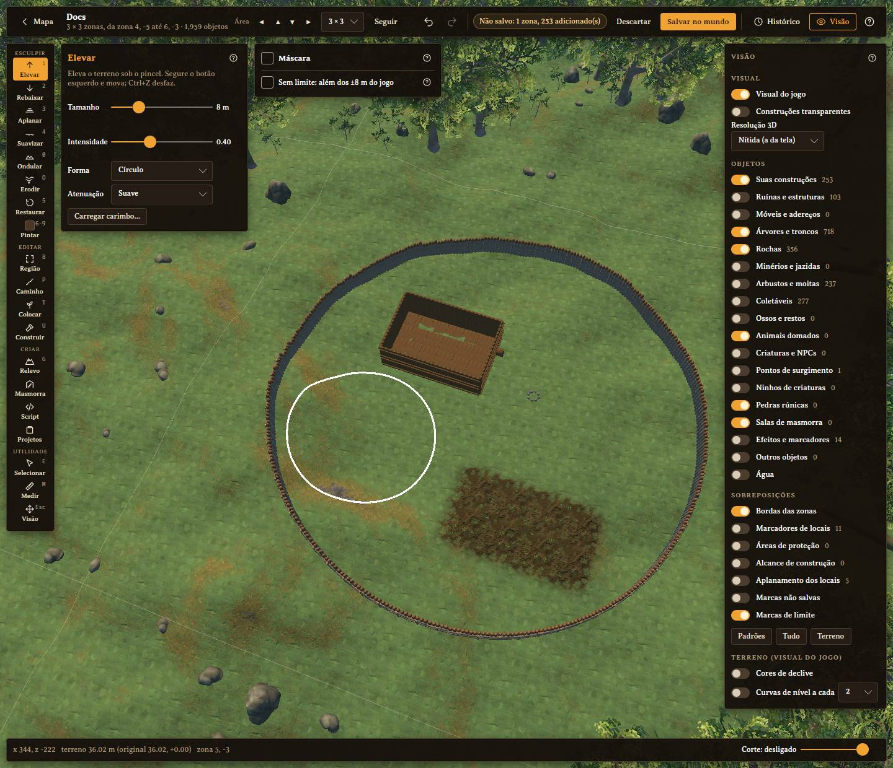
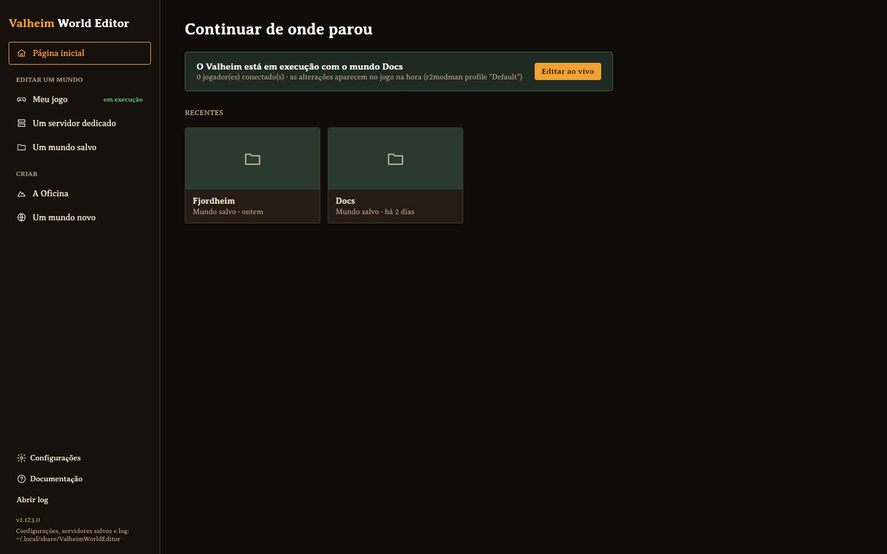
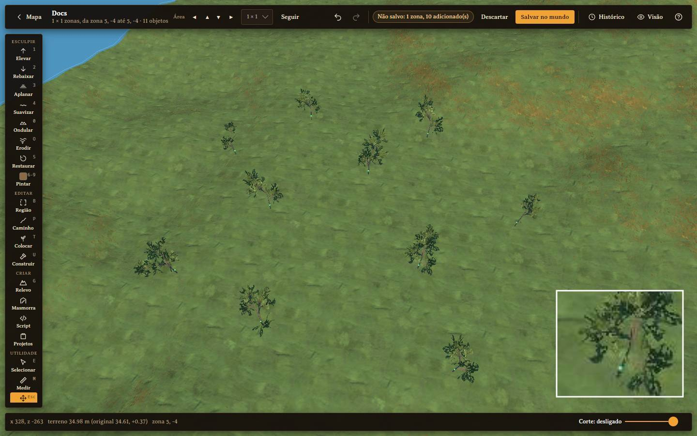
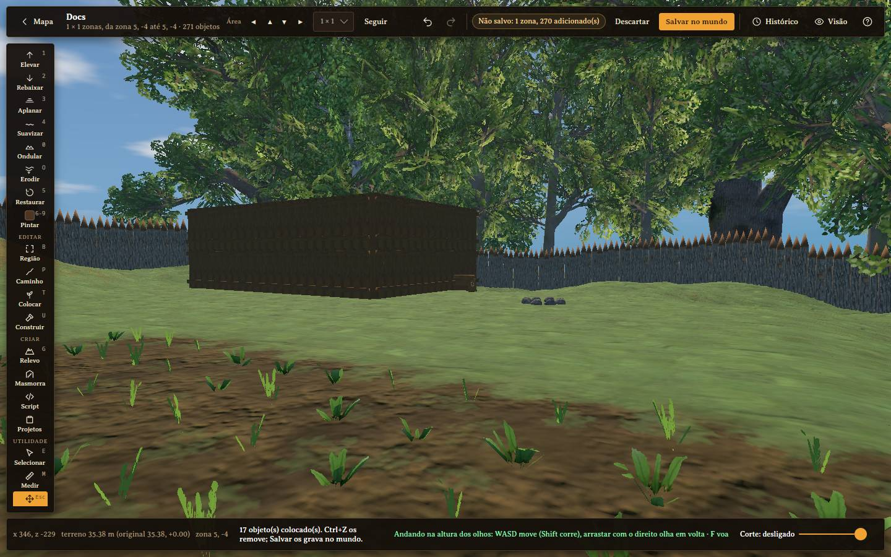
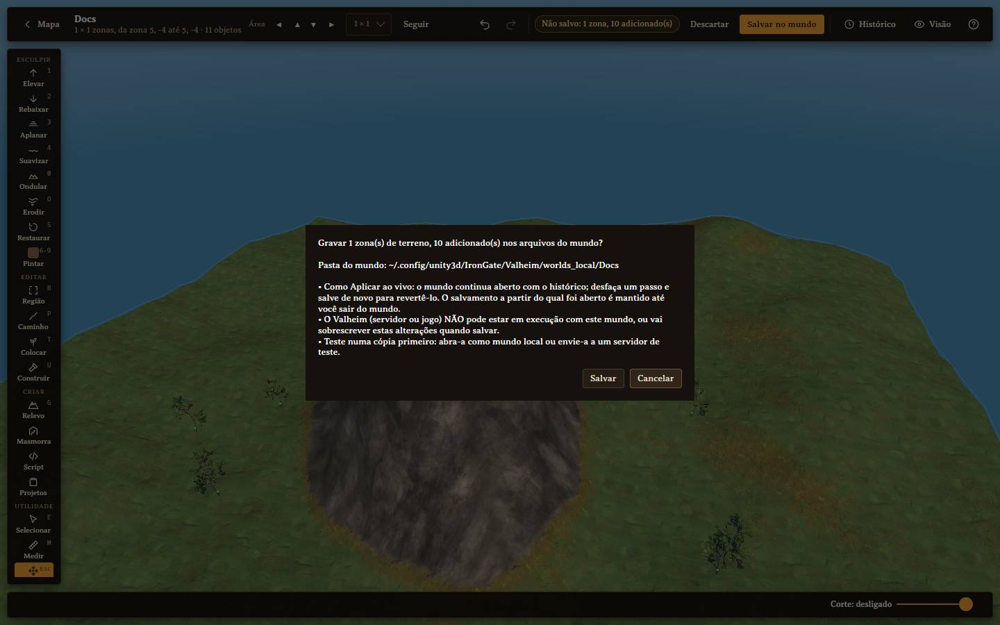
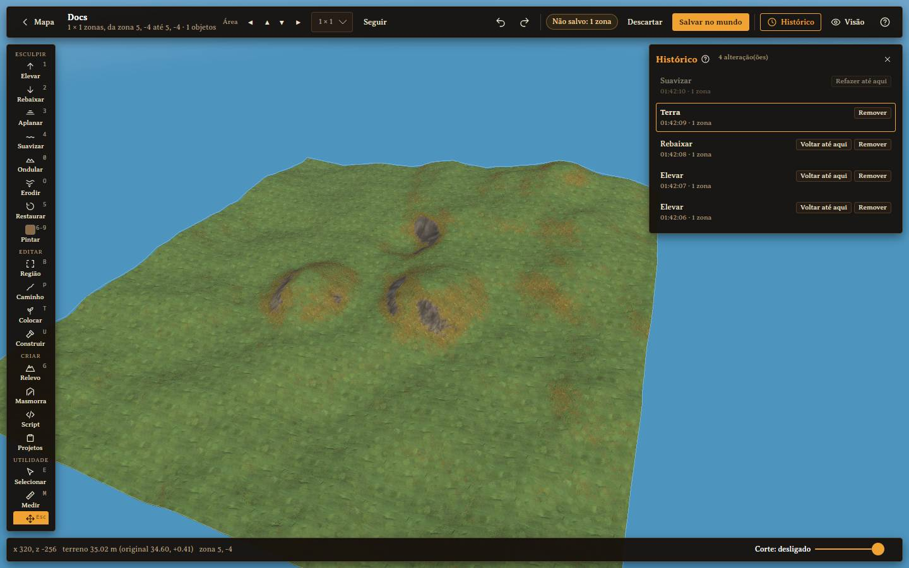
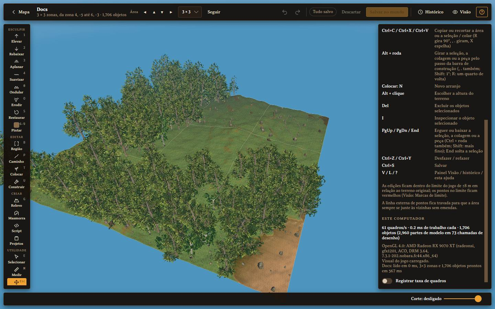
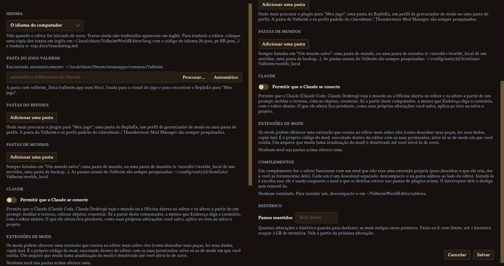

<!-- source: 1d85c1a0 -->
# A janela do editor

Oriente-se no editor: a página inicial, a janela 3D com a barra superior, a barra de ferramentas e os painéis, a
câmera, o salvamento, o Histórico e o painel Visão.

**Onde:** a página inicial abre primeiro; um mundo abre no [mapa](map.md) dele, depois **Editar em 3D** · **Tecla:**
`?` ou `F3` para o cartão de ajuda, `F1` para esta ajuda na ferramenta em uso · **Funciona em:** mundos salvos, ao
vivo, a Oficina

*Uma pequena base numa área de 3 × 3, com o pincel Elevar escolhido (o anel dele sobre a grama). À esquerda: a barra de
ferramentas e o painel da ferramenta. Em cima: a barra superior. À direita: o painel Visão. Embaixo: a barra de status,
que mostra o terreno sob o ponteiro.*

## Como usar

1. Na página inicial, escolha como editar: **Meu jogo**, **Um servidor dedicado** ou **Um mundo salvo** (ou **A
   Oficina** para construir sem um mundo).
2. Clique no seu mundo. Ele abre no [mapa](map.md).
3. No mapa, clique no lugar a editar, escolha o tamanho da área e clique em **Editar em 3D**.
4. Escolha uma ferramenta na barra, ajuste-a no painel dela e use-a na visão.
5. Confira o que está aguardando na linha de pendências da barra superior e clique em **Salvar no mundo** (ou
   **Aplicar ao vivo**).
6. Para reverter uma alteração, pressione `Ctrl+Z` ou abra o **Histórico** (`L`).

Cada alteração fica [pendente](concepts/saving-and-history.md#alterações-pendentes) até você salvá-la ou aplicá-la.

## A página inicial

*Página inicial: o cartão do jogo em execução com **Editar ao vivo**, depois os mundos e projetos abertos por último.*

O menu lateral tem **Página inicial** e depois duas seções, **Editar um mundo** e **Criar**. Você volta para cá a
partir do mapa de um mundo (**Mundos**) ou da Oficina (**Início**).

| Item | O que mostra |
|---|---|
| **Página inicial** | Onde você parou. Quando o Valheim está em execução com o plugin WorldEditorBridge, um cartão diz "O Valheim está em execução com o mundo …" e quantos jogadores estão conectados, com **Editar ao vivo**. Em **Recentes**: os mundos salvos e os projetos que você abriu ou salvou por último (os projetos com as imagens deles), dos mais novos aos mais antigos, e os servidores salvos que se conectam com um clique (senha salva ou arquivo de chave). |
| **Meu jogo** | O seu próprio jogo, ao vivo: o que falta (BepInEx, o plugin, uma primeira inicialização), ou o mundo com que ele está rodando e **Editar ao vivo**. *em execução* aparece ao lado enquanto o jogo roda; o editor verifica a cada poucos segundos. Veja [modo ao vivo](live-mode.md). |
| **Um servidor dedicado** | Os servidores salvos (**Conectar**, **editar**, **esquecer**) e o formulário para se conectar a outro. Veja [modo ao vivo](live-mode.md). |
| **Um mundo salvo** | Os mundos deste computador, para abrir com o jogo fechado. A lista acompanha, a cada poucos segundos, as pastas de mundos adicionadas ou removidas; **Atualizar** verifica na hora. Passe o mouse sobre um mundo para ver a pasta dele. **Outra pasta de mundo** abre qualquer pasta com arquivos `_main.<n>.chunks`. Veja [Abrir um mundo que não está na lista](guides/open-a-world.md). |
| **A Oficina** | **Abrir a Oficina**, se o Homestead está instalado, e todos os projetos, dos mais novos aos mais antigos: clique em um para abri-lo. Veja [a Oficina](workshop.md). |
| **Um mundo novo** | **Criar um mundo novo**: o mundo de uma semente antes de ele existir, e uma busca por um que combine com você. Veja [um mundo novo](new-world.md). |

Na parte de baixo do menu: **Configurações** (veja [Configurações](#configurações)), **Documentação** (esta ajuda, numa
janela própria), **Abrir log**, a versão e a pasta que guarda as configurações e o log do editor.

## A janela

A janela 3D tem cinco partes:

- **Barra superior**: o nome do mundo e a área, os controles da área, desfazer e refazer, o que está pendente,
  **Descartar**, **Salvar no mundo** ou **Aplicar ao vivo**, depois **Histórico**, **Visão** e **?**. Veja
  [A barra superior](#a-barra-superior).
- **Barra de ferramentas** (borda esquerda): todas as ferramentas, com a tecla de cada uma no canto. Veja
  [A barra de ferramentas](#a-barra-de-ferramentas).
- **Painel da ferramenta** (ao lado da barra): o nome da ferramenta escolhida, uma linha sobre como usá-la e as
  configurações dela. A [Máscara](masks.md) mostra o próprio cartão ao lado, para as ferramentas com que funciona (os
  pincéis, Caminho, Região, Relevo e Colocar). O mesmo cartão traz **Sem limite**, o outro interruptor compartilhado
  das ferramentas de terreno (veja [Sem limite](terrain.md#sem-limite)).
- **Painel da direita**: **Visão** (`V`), **Histórico** (`L`), o cartão de ajuda **Controles** (`?` ou `F3`) ou o
  [Inspetor](select.md) (`I`). Eles dividem o mesmo lugar, então só um aparece por vez; a mesma tecla ou o mesmo botão
  de novo o fecha.
- **Barra de status** (embaixo): onde o mouse está, a última mensagem, a seleção, Andar ou Voar, o controle deslizante
  **Corte** (veja [Corte](#corte)) e, numa janela com uns 1500 px de largura ou mais, um lembrete do mouse ("Arrastar
  com o direito gira · Roda dá zoom · Arrastar com o do meio desliza · ? ajuda"); numa janela mais estreita, o lugar
  dele vai para a mensagem.

A leitura do mouse fica assim: `x 1250, z -380   ground 32.40 m (original 30.10, +2.30)   zone 20, -6`: a posição em
metros, a altura atual do terreno, a altura dele antes de qualquer alteração e a diferença, e a zona. No limite do
jogo, ela acrescenta ", no limite de ±8 m". A seleção aparece como "Selecionados: 15 objetos (Beech ×12, Rock ×3)",
com os quatro tipos mais comuns.

Cada controle deslizante, interruptor e botão se explica quando você passa o mouse sobre ele. O editor lembra suas
escolhas entre uma execução e outra: o que a Visão mostra, as opções de visual, a forma e o decaimento do pincel, a
ação da Região, o tipo de Relevo, a predefinição de Fórmula dele e a sua própria fórmula, as opções de Selecionar,
quais categorias de Colocar estão abertas, as configurações da barra de construção e o tamanho do painel Construir, o
painel da direita que você deixou aberto, **Seguir**, **Auto**, a posição do mapa e a área de transferência. **Sem
limite** não: ele fica desligado toda vez que o editor inicia.

## A barra superior

| Controle | O que faz |
|---|---|
| **Mapa** | Volta ao mapa do mundo. O que não foi salvo ou aplicado continua pendente. Na Oficina, este botão é **Início**. |
| Nome e área | O nome do mundo; embaixo dele, o tamanho da área, a primeira e a última zona e quantos objetos ela contém. |
| **Área** ◀ ▲ ▼ ▶, lista de tamanhos, **Seguir** | Movem a área, mudam o tamanho dela, deixam-na crescer conforme você olha em volta. Veja [A área](#a-área). |
| Desfazer, refazer (as setas curvas) | Desfaz a última alteração (`Ctrl+Z`); refaz (`Ctrl+Y` ou `Ctrl+Shift+Z`). O texto ao passar o mouse nomeia o passo, por exemplo "Desfazer Elevar (Ctrl+Z)". Um passo de uma sessão anterior pode perguntar antes. |
| **AO VIVO** (ao vivo) | Mostra que você está conectado ao jogo em execução pelo plugin WorldEditorBridge. |
| Lista de jogadores, **Ir** (ao vivo) | Ao lado de **AO VIVO**, enquanto houver um jogador conectado: escolha um jogador conectado e clique em **Ir**. A câmera se vira para o jogador quando ele está na área; senão, a área vai até ele. Os jogadores aparecem na visão como postes azuis com os nomes deles. |
| **Recarregar** (ao vivo) | Carrega o mundo de novo a partir do jogo, depois de perguntar quando há alterações ainda não aplicadas (elas são perdidas, com os passos delas). Os passos que o jogo tem continuam no Histórico. Você fica onde está. |
| **Auto** (ao vivo) | Aplica cada alteração ao jogo assim que ela é feita: cada traço quando você solta o botão, cada ferramenta, desfazer e refazer. Ao ligá-lo, o que está aguardando é enviado na hora. Fica lembrado. |
| Linha de pendências | "Não salvo: 3 zonas, 1 excluído, 12 adicionados, 1 redefinida" (fora do jogo) ou "Não aplicado: …" (ao vivo), em âmbar; "Tudo salvo" ou "Tudo aplicado" em cinza quando nada está aguardando. O que ela conta: veja [Alterações pendentes](concepts/saving-and-history.md#alterações-pendentes). |
| **Descartar** | Joga fora o que ainda não foi salvo ou aplicado, depois de perguntar. Veja [Descartar](#descartar). |
| **Salvar no mundo** (fora do jogo) | Grava as alterações nos arquivos do mundo (`Ctrl+S`). Veja [Salvar no mundo](#salvar-no-mundo). |
| **Aplicar ao vivo** (ao vivo) | Envia as alterações ao jogo em execução (`Ctrl+S`): todos que estão lá as veem na hora. Veja [Aplicar ao vivo](#aplicar-ao-vivo). |
| **Histórico** | Todas as alterações da sessão (`L`). Veja [Histórico](#histórico). |
| **Visão** | O que é mostrado e como (`V`). Veja [Painel Visão](#painel-visão). |
| **?** | O cartão de ajuda **Controles** (`?` ou `F3`). Veja [O cartão de ajuda](#o-cartão-de-ajuda). Cada painel tem o próprio **?** pequeno no topo: a janela de Ajuda na página daquela ferramenta (`F1` faz o mesmo para a ferramenta em uso). |

Numa janela estreita, a linha do nome e da área termina em "…" (passe o mouse sobre ela para lê-la inteira) e, quando
nem isso basta, **Mapa**, **Recarregar**, **Histórico** e **Visão** mostram só os ícones.

Na visão, cada objeto novo ainda não salvo ou aplicado leva um **ponto verde**, exceto enquanto está selecionado (o
contorno o marca nesse caso). **Visão → Marcas não salvas** oculta os pontos; os objetos continuam.

*Árvores jovens recém-plantadas: cada uma leva um pequeno ponto verde ao pé até ser salva (uma ampliada no canto), e
a linha de pendências as conta: "Não salvo: 1 zona, 10 adicionados".*

## A barra de ferramentas

| Seção | Botão da barra (tecla) | O que abre |
|---|---|---|
| **ESCULPIR** | **Elevar** (`1`), **Rebaixar** (`2`), **Aplanar** (`3`), **Suavizar** (`4`), **Ondular** (`0`), **Erodir** (`O`), **Restaurar** (`5`), **Pintar** (`6` a `9`) | Os pincéis de terreno. **Pintar** é um só pincel para as quatro pinturas, escolhidas no painel dele ou com uma tecla: Terra (`6`), Cultivar (`7`), Pavimentado (`8`), Limpar pintura (`9`). Veja [Esculpir e pintar](terrain.md). |
| **EDITAR** | **Região** (`B`), **Caminho** (`P`), **Colocar** (`T`), **Construir** (`U`) | [Região](area.md) (ações de retângulo ou polígono, copiar e colar), [Caminho](path.md) (estradas, rampas, rios), [Colocar](place.md) (árvores, rochas, plantações, pontos de surgimento), [Construir](build.md) (as peças que os jogadores constroem, com o painel Construir e a barra de construção). |
| **CRIAR** | **Relevo** (`G`), **Masmorra**, **Script**, **Projetos** | [Relevo](landform.md) (um relevo inteiro num clique: a forma de uma fórmula, uma montanha ou uma imagem), [Masmorras](dungeons.md), [Script](scripting.md) e a biblioteca de projetos para colar um (veja [a Oficina](workshop.md)). Só Relevo tem tecla. |
| **UTILIDADES** | **Selecionar** (`E`), **Medir** (`M`), **Visão** (`Esc` ou `H`) | [Selecionar](select.md), [Medir](measure.md) e Visão: olhar em volta; arrastar com o esquerdo desliza a visão, um clique escolhe um objeto, um clique duplo num objeto passa para Selecionar com ele selecionado. |
| **MODS** | Um botão por ferramenta que a [extensão](modding.md) de um mod traz: o nome, a imagem ou a primeira letra dela; ao passar o mouse, o mod é nomeado | A ferramenta do mod: o cartão de configurações dela ao lado da barra, a ajuda dela na dica. As alterações dela entram no Histórico e são desfeitas, refeitas e salvas como as do próprio editor. Aparece só quando uma extensão em execução tem uma ferramenta. |

A barra rola quando a janela é baixa demais para ela (e termina acima do painel Construir enquanto ele está aberto).
Na Oficina, ela mantém só **Construir** (`U` ou `T`), **Selecionar** e **Visão**.

## Câmera

| Ação | Como |
|---|---|
| Girar a visão | Arrastar com o botão direito. |
| Zoom | Roda do mouse, de 3 m a 3 km do ponto para onde você olha. |
| Deslizar a visão | Arrastar com o botão do meio, `Space` + arrastar com o esquerdo ou `Shift` + arrastar com o direito (em qualquer ferramenta), ou arrastar com o esquerdo na ferramenta **Visão**. |
| Mover-se | `W` `A` `S` `D` ou as setas. Quanto mais afastado o zoom, mais rápido. O ponto para onde você olha fica no chão (ou na água). |
| Ver como um jogador | `F`: Andar, depois Voar, depois de volta à visão normal. |

### Andar e voar

*Modo Andar (`F`): a base como um jogador em pé ao lado da plantação a vê, com os olhos a 1,8 m do chão.*

`F` alterna entre três visões:

1. **Andar**: seus olhos ficam 1,8 m acima do chão (ou acima da água onde ela é mais funda). Você começa onde a visão
   normal estava olhando. `W` `A` `S` `D` movem para onde você olha a 6 m/s; `Shift` corre a 12 m/s. Arrastar com o
   direito olha em volta. Você acompanha o chão conforme ele sobe e desce, inclusive o terreno editado.
2. **Voar**: `F` de novo. `Space` sobe, `C` desce, a 15 m/s (`Shift`: 45 m/s). `C` também leva você através do chão,
   para dentro do que um mod cava embaixo dele (os túneis e porões do Tunnelheim); `Space` traz você de volta para
   cima.
3. **A visão normal**: `F` uma terceira vez. A visão gira em torno de um ponto no chão 20 m à frente de onde você
   estava.

A barra de status diz qual modo está ativo e as teclas dele. Andando ou voando, a roda não dá zoom e arrastar não
desliza a visão; todas as ferramentas continuam funcionando. Numa masmorra (5000 m acima, onde o jogo guarda as salas
de masmorra), a câmera não acompanha o chão.

## A área

A janela 3D mostra uma **área**: um bloco de zonas (uma zona tem 64 × 64 m) em volta do ponto que você abriu no mapa.
A linha externa de pontos do terreno fica travada; para trabalhar perto de uma borda, mova a área ou aumente-a. Por
que o editor funciona assim: veja [Áreas e zonas](concepts/areas-and-zones.md).

| Controle | O que faz |
|---|---|
| **◀ ▲ ▼ ▶** (depois de "Área") | Move a área uma zona (64 m) para oeste, norte, sul ou leste. A câmera fica onde está no mundo, e as alterações pendentes e o Histórico vêm junto. |
| Lista de tamanhos | Abre a área de novo em volta da mesma zona central com **3 × 3**, **5 × 5**, **7 × 7**, **9 × 9**, **13 × 13** ou **17 × 17** zonas. A visão, as alterações e o Histórico ficam. Uma área que Seguir aumentou (como 4 × 3) mostra o próprio tamanho. Áreas grandes (até 1088 m de lado) demoram para abrir e para desenhar. |
| **Seguir** | Quando o ponto para onde você olha chega a 12 m da borda da área, a área ganha uma fileira de zonas desse lado e mantém as zonas que tem, até 17 zonas em cada direção. Clique para ligar ou desligar; fica lembrado. Veja [Seguir](concepts/areas-and-zones.md#seguir). |

As setas, Seguir e a lista de tamanhos aguardam enquanto algo seria perdido, e a barra de status diz por quê: há
objetos selecionados (`Alt+A` em Selecionar os desmarca), um traço de pincel está em andamento, há um caminho desenhado
(aplique-o ou apague-o) ou ainda há alterações sendo enviadas ao jogo. Eles não aguardam por um retângulo ou polígono
de Região, uma linha, grade ou zona de Colocar, nem por uma medição: esses são descartados quando a área se move,
cresce ou muda de tamanho. Os controles da área não existem na Oficina.

## Salvar, aplicar e descartar

### Salvar no mundo

**Salvar no mundo** (`Ctrl+S`) primeiro pergunta, em **Salvar nos arquivos do mundo**, mostrando o que será gravado e
a pasta do mundo. Feche o Valheim (o jogo ou o servidor) antes de salvar: um jogo em execução grava por cima das suas
alterações da próxima vez que salvar.

*Nada é gravado até você clicar em **Salvar**: a pergunta conta o que entra, nomeia a **Pasta do mundo** e avisa para
fechar o Valheim antes.*

O resultado diz o que foi salvo ("4 zona(s), 2 objeto(s) excluído(s), 12 objeto(s) novo(s) salvo(s) no salvamento nº
37.") e lista o que não pôde ser salvo, com o motivo:

- uma zona, ou um objeto novo numa zona, **not generated yet** (ainda não gerada): nenhum jogador esteve lá, então o
  mundo não tem dados ali. Visite-a no jogo antes.
- terreno novo num mundo com **no terrain object to copy yet** (ainda sem objeto de terreno para copiar): ninguém
  nunca cavou nem nivelou o terreno no jogo. Edite o terreno uma vez em qualquer lugar no jogo antes.

Depois de salvar, a área e o Histórico ficam como estavam. Para reverter uma alteração salva, desfaça-a (ou use
**Remover** no Histórico) e salve de novo: o salvamento a tira do mundo. Quando não sobra nada do que você salvou, a
mensagem diz que o mundo está de novo como você o abriu. Como um salvamento é gravado e verificado: veja
[Salvar um mundo](concepts/saving-and-history.md#salvar-um-mundo).

**Quando o jogo salvou depois.** Se o jogo salvou o mundo depois que o editor o leu, nada é salvo: salvar jogaria
fora o que foi feito no jogo. A pergunta **O jogo salvou este mundo** oferece **Levar minhas alterações**: o editor
lê o salvamento do jogo e refaz nele cada uma das suas alterações não salvas. Onde o jogo alterou a mesma zona ou o
mesmo objeto, ele pergunta uma vez por tipo, **Manter o meu** ou **Manter o do jogo**. Nada é gravado até você salvar
de novo. **Agora não** deixa tudo como estava. Veja [Salvar um mundo](concepts/saving-and-history.md#salvar-um-mundo).

### Aplicar ao vivo

No modo ao vivo, o mesmo botão é **Aplicar ao vivo**. Ele envia o terreno, as alterações de objetos e as redefinições
de zona ao jogo em execução, e os passos enviados ganham a marca **aplicado** no Histórico. Eles ainda podem ser
desfeitos: a aplicação seguinte envia o desfazer. Quando jogadores alteraram o terreno de uma zona que você também
alterou, ele pergunta antes (**Aplicar** ou **Agora não**). Veja
[Aplicar ao vivo](concepts/saving-and-history.md#aplicar-ao-vivo) e [modo ao vivo](live-mode.md).

### Descartar

**Descartar** desfaz tudo o que ainda não foi salvo ou aplicado, depois de perguntar ("Os últimos N passo(s) do
Histórico são desfeitos"). Ele desfaz os passos não salvos no fim do Histórico, dos mais novos aos mais antigos, refaz
os passos salvos ou aplicados que você desfez desde então e descarta o resto da lista de refazer. As alterações salvas
e aplicadas ficam, assim como o resto do Histórico, a câmera e a ferramenta.

Algumas alterações pendentes podem não ter passo no Histórico desta área (feitas em outra área, ou antes de o mundo
ser lido de novo). O Descartar então pergunta uma segunda vez: **Ler de novo** lê o mundo dos arquivos dele (ou do
jogo, ao vivo) e descarta todas as alterações pendentes do mundo inteiro. O Histórico mantém o que o mundo tem: o
histórico guardado no último salvamento ou, ao vivo, todos os passos que o jogo tem.

### Sair e fechar

**Mapa**, as setas e a lista de tamanhos mantêm tudo o que está pendente. Sair do mundo para a página inicial
(**Mundos** no mapa) e fechar a janela perdem o que está pendente, então os dois perguntam antes: **Sair mesmo assim**
/ **Ficar**, e **Encerrar mesmo assim** / **Continuar editando**.

## Histórico

*A última alteração foi desfeita com **Voltar até aqui**: ela fica acinzentada e oferece **Refazer até aqui**.*

O **Histórico** (`L`) lista todas as alterações da sessão, das mais novas às mais antigas. Cada linha mostra o nome do
passo (a ferramenta ou a ação, por exemplo "Elevar", "Colar ×3", "Removido: Elevar"), a hora (com o dia, para as mais
antigas) e o que ele afetou, por exemplo "3 zonas · 12 novo(s) · 2 removido(s) · 1 redefinição(ões) de zona". O passo
atual, aquele que `Ctrl+Z` desfaz em seguida, tem contorno. O título conta os passos que você pode desfazer. O painel
mostra as 200 linhas mais novas; **Mostrar anteriores (N)**, embaixo, acrescenta mais 200.

| Controle | O que faz |
|---|---|
| **Voltar até aqui** | Desfaz todas as alterações feitas depois desta. As alterações posteriores continuam na lista, acinzentadas. |
| **Refazer até aqui** | Numa alteração acinzentada: refaz todas as alterações até ela, inclusive. |
| **Remover** | Retira só esta alteração e mantém tudo o que foi feito depois dela. A remoção é um passo novo ("Removido: …"), então `Ctrl+Z` traz a alteração de volta. A alteração removida aparece riscada. |
| **Reverter as alterações do Claude** | Aparece quando o Claude fez alterações no histórico desta área. Remove cada uma delas, como **Remover** faz, e mantém as suas, mesmo as feitas depois delas. As alterações do Claude feitas em outras áreas ficam, e a barra de status diz quantas: abra essas áreas para revertê-las lá. |

Marcas numa linha: **aplicado** (enviado ao jogo, ou salvo), **Claude** (feito pela
[conexão com o Claude](claude.md)), **sessão anterior** (guardado de uma execução anterior do editor). Uma alteração
nova feita depois de desfazer descarta os passos acinzentados. Quando o Histórico é gravado em disco, até onde ele vai
e o que acontece com os passos feitos em outras áreas: veja [Histórico](concepts/saving-and-history.md#histórico).

## Painel Visão

**Visão** (`V`) escolhe o que é desenhado e como. Cada interruptor mostra quantos há na área. Só o que é mostrado pode
ser escolhido ou selecionado, então ocultar um tipo também o protege de um clique.

| Seção | Controle | O que faz |
|---|---|---|
| VISUAL | **Visual do jogo** | Desenha o mundo com as texturas, os modelos, a água e o céu do próprio jogo. Desligado: cores simples e caixas, mais rápido. |
| | **Construções transparentes** | Desenha as construções dos jogadores meio transparentes, para ver o que há dentro ou atrás delas. Árvores e rochas continuam sólidas. |
| | **Resolução 3D** | **Nítida (a da tela)**, **Equilibrada** (um pixel por ponto da tela: menos numa tela de alta resolução com escala) ou **Rápida** (menos ainda). Menos pixels dão mais quadros por segundo num computador lento; a barra de status diz o tamanho. |
| OBJETOS | **Suas construções**, **Ruínas e estruturas**, **Móveis e adereços**, **Árvores e troncos**, **Rochas**, **Minérios e jazidas**, **Arbustos e moitas**, **Coletáveis**, **Ossos e restos**, **Animais domados**, **Criaturas e NPCs**, **Pontos de surgimento**, **Ninhos de criaturas**, **Pedras rúnicas**, **Salas de masmorra**, **Efeitos e marcadores**, **Outros objetos** | Mostram ou ocultam cada tipo. Só **Suas construções**, **Árvores e troncos**, **Rochas**, **Animais domados**, **Pedras rúnicas** e **Salas de masmorra** vêm ligados no início, para que o editor não estrague o que ainda está por descobrir. |
| | **Água** | A superfície do mar e dos lagos. |
| SOBREPOSIÇÕES | **Bordas das zonas** | As linhas das zonas de 64 m (ligado no início). |
| | **Marcadores de locais** | Um poste em cada local (vilas, o comerciante, entradas de masmorra…). |
| | **Áreas de proteção** | Anéis onde cada proteção protege (32 m). |
| | **Alcance de construção** | Anéis onde cada bancada, forja ou outra estação de criação deixa você construir (10–40 m, conforme o tipo). |
| | **Aplanamento dos locais** | Onde os locais aplanam o terreno: um anel para a parte plana, um mais claro onde ela se mistura. |
| | **Marcas não salvas** | O ponto verde sobre cada objeto novo ainda não salvo ou aplicado. |
| | **Marcas de limite** | Vermelho no terreno que atingiu o limite de ±8 m do jogo (em Visual do jogo). Veja [Marcas de limite](concepts/ground-limits.md#marcas-de-limite). |
| | **Padrões** / **Tudo** / **Terreno** | Os interruptores usuais / tudo ligado / só o terreno. Eles ajustam os objetos, a água e as sobreposições, não o visual. |
| TERRENO (visual do jogo) | **Cores de declive**, **Curvas de nível a cada** 1 / 2 / 5 / 10 **m** | Sobreposições do terreno, veja [Medir](measure.md). |

Duas coisas da visão não estão neste painel, porque são necessárias onde o painel não está: o controle deslizante
**Corte** fica na barra de status (veja [Corte](#corte)), e ir até um jogador conectado fica na barra superior, ao lado
de **AO VIVO**.

O que os tipos contêm:

- **Ruínas e estruturas** também mostra as partes dos locais do jogo que não são objetos do salvamento (as rochas da
  entrada de uma cripta, o acampamento do comerciante, o altar de um chefe). O jogo as recria cada vez que a zona
  carrega, então elas não podem ser escolhidas nem alteradas.
- Uma ruína em que você construiu conta como construção sua: as peças dela que tocam as suas, e as que tocam essas,
  ficam em **Suas construções**.
- **Animais domados** são as criaturas que os jogadores domaram; as selvagens ficam em **Criaturas e NPCs**.
- **Pontos de surgimento** são os pontos de surgimento invisíveis do jogo, mostrados com um marcador e o nome da
  criatura. **Ninhos de criaturas** são ninhos de greydwarf, pilhas de ossos e coisas do tipo.
- **Salas de masmorra** ficam bem acima das entradas (5000 m acima). Edite-as com a ferramenta
  [Masmorra](dungeons.md).
- O que os suportes de itens e os suportes de armadura seguram é desenhado com o suporte, em Visual do jogo, e é
  mostrado ou oculto com o tipo dele. Escudos e capas aparecem no primeiro estilo, um suporte de armadura na postura de
  descanso. Os itens não podem ser escolhidos: escolha o suporte.
- Colocar ou colar um tipo que está desligado o liga, para que o que você colocou continue visível (a mensagem avisa).

**Construído por**, o jogador registrado como construtor das peças que você constrói, cola ou substitui, fica na
[barra de construção](build.md#a-barra-de-construção), com Construir, Selecionar e Colar.

Quando uma área contém locais (ou tem algum a até 40 m), uma nota na parte de baixo da visão, ao lado do painel da
ferramenta, diz quantos e que o terreno já inclui o aplanamento que o jogo faz ao redor deles. Feche-a com o ×. Veja
[Os locais nivelam o terreno](concepts/ground-limits.md#os-locais-nivelam-o-terreno).

## Corte

O controle deslizante **Corte** na barra de status oculta tudo acima de uma altura, e o cursor atravessa o que está
oculto: olhe dentro de uma construção por cima, selecione o que há dentro dela ou construa ali. É um só controle para
todas as visões 3D; só muda a partir de onde os metros dele são contados.

| Onde | Os metros contam a partir de | Faixa |
|---|---|---|
| Um mundo | O chão (ou o mar) no centro da visão; andando ou voando, o chão sob a câmera. O corte acompanha a visão conforme ela se move. | 0 a 39 m |
| A [Oficina](workshop.md#corte) | O lote. | 0 a 39 m |
| Uma masmorra, com a ferramenta [Masmorra](dungeons.md) ou **Construir aqui** | Mais ou menos o piso da entrada da masmorra. | 0 a 29 m |

O controle se move 1 m por passo. A ponta esquerda corta no chão, no lote ou no piso; a ponta direita é desligado. Ao
lado dele, a barra mostra "Corte em N m" ou "Corte: desligado". Ele fica desligado toda vez que o editor inicia.

- **Só objetos.** O corte oculta o que está acima da altura (construções, árvores, rochas, salas de masmorra). O
  terreno e a água são desenhados inteiros.
- **Num mundo, o corte se move com a visão.** Numa encosta, gire a visão em torno de uma construção em vez de
  deslizá-la: a altura é contada a partir do chão no centro da visão.
- **Um mundo e uma masmorra guardam cada um o próprio corte.** Escolher a ferramenta Masmorra pega o corte da masmorra
  (desligado no início; **Ir para a masmorra** corta a 4 m), e sair dela traz de volta o do mundo. A Oficina começa
  sem nenhum.
- **Outras formas de ver por dentro**: **Visão → Construções transparentes**, e **Ocultar** e **Selecionar através**
  da ferramenta [Selecionar](select.md).

## O cartão de ajuda

*O cartão **Controles** (`F3`), rolado até o fim: as últimas teclas, depois **Este computador** com a taxa de quadros,
a placa de vídeo e **Registrar taxa de quadros**.*

**?**, `?` ou `F3` abre o cartão **Controles**: as principais ações do mouse e teclas, com um lembrete do limite de
±8 m e da borda travada. Todas as teclas estão em [Atalhos](help/shortcuts.md).

Abaixo delas, **Este computador** diz o que desenha a visão 3D (a placa de vídeo e a versão de OpenGL dela) e como a
área carregou e, enquanto a visão se move, a taxa de quadros com o trabalho do próprio editor por quadro e quantos
objetos, partes de modelos e chamadas de desenho existem. A visão só é desenhada em velocidade máxima enquanto algo
acontece; fora isso, algumas vezes por segundo.

**Registrar taxa de quadros** (desligado toda vez que o editor abre) grava a taxa de quadros em `perf-native.log`, na
pasta de dados do editor, uma linha a cada 0,2 s enquanto a visão é usada: se a câmera estava em movimento
(**moving**) ou parada (**still**) enquanto outra coisa acontecia, os quadros por segundo, o trabalho do editor por
quadro e o maior intervalo entre dois quadros. Uma linha de cabeçalho (`#`) traz a data, a versão, o tamanho da visão,
a placa de vídeo e o que está carregado. Momentos ociosos não são gravados.

## A barra superior da Oficina

Na [Oficina](workshop.md), a janela mostra um lote vazio em vez de um mundo, e a barra superior muda:

| Controle | O que faz |
|---|---|
| **Início** | Volta à página inicial, depois de perguntar quando a construção não está salva como projeto. |
| Nome e custo | O nome da construção e, embaixo dele, "Custo: …" (passe o mouse para ver cada material e as estações de criação de que ela precisa), ou "Um lote vazio: só a construção é guardada no projeto". |
| **Verificar suporte** | Ligado no início: cada peça de construção ganha a cor que o jogo dá ao suporte dela no modo de construção, e as peças que cairiam no jogo ficam vermelhas. Desligado: construa à vontade. Veja [A verificação de suporte](concepts/objects.md#a-verificação-de-suporte). |
| Pendências | "N peça(s)", quantas cairiam e "não salvo como projeto" ou "salvo"; "Nenhuma peça ainda" num lote vazio. |
| **Salvar projeto** | Salva as peças de construção do lote como um projeto do Homestead (`Ctrl+S`). Nada mais é guardado. |
| **Materiais** | Abre ou fecha o painel Materiais à direita: quanto a construção custa no jogo. Veja [Materiais](workshop.md#materiais). |
| **Histórico**, **?** | Como num mundo. |

O controle deslizante **Corte** fica na barra de status, como num mundo: na Oficina, os metros dele contam a partir do
lote (veja [Corte](#corte)).

A Oficina não tem controles de área, nem **Descartar**, nem o painel **Visão**: as construções são desenhadas
sólidas, e as bordas das zonas e os pontos verdes ficam desligados.

## Configurações

**Configurações**, na parte de baixo do menu da página inicial, define onde o editor procura as coisas neste
computador. O editor encontra sozinho os lugares usuais: o Valheim em todas as bibliotecas do Steam (inclusive o Steam
Flatpak e bibliotecas extras), o BepInEx na pasta do Valheim e nos perfis padrão do r2modman e do Thunderstore Mod
Manager, e os mundos nas próprias pastas de mundos do Valheim (inclusive as do Proton).

*As Configurações rolam: o topo à esquerda, o fim à direita, até **Histórico** e **Salvar**. **Desenho** só aparece no
Windows.*

| Configuração | O que faz |
|---|---|
| **Idioma** | O idioma do editor; no início, o do computador quando o editor o tem, senão inglês. Vale quando o editor inicia de novo. Veja [Traduzir](translating.md). |
| **Pasta do jogo Valheim** | A pasta com `valheim_Data` (`valheim.app` num Mac), para uma cópia fora do Steam ou uma segunda instalação. **Automático** volta a procurar nas bibliotecas do Steam. |
| **Pastas do BepInEx** | Mais lugares onde procurar o plugin para **Meu jogo**: uma pasta `BepInEx`, um perfil de gerenciador de mods ou uma pasta de perfis. |
| **Pastas de mundos** | Um mundo, ou uma pasta de mundos (uma cópia do `<savedir>/worlds_local` de um servidor, uma pasta de backup…), sempre listado em **Um mundo salvo**. |
| **Claude** | **Permitir que o Claude se conecte**, a porta e o token dele, **O Claude pode executar scripts** e as linhas a dar ao Claude Code ou ao Claude Desktop. Veja [Claude](claude.md). |
| **Extensões de mods** | Um interruptor por extensão que um mod das pastas acima oferece. Ligue só as de mods em que você confia. Veja [Para autores de mods](modding.md). |
| **Complementos** | Os complementos descompactados na pasta `addons` ao lado do editor, se cada um está em uso, e um interruptor para desligar um sem removê-lo. Um complemento é usado enquanto o mod dele está nas pastas de plugins acima. |
| **Histórico** | **Passos mantidos**: quantas alterações o Histórico guarda para desfazer. Vazio ou 0: sem limite, até o Histórico ocupar 2 GB de memória; os mais antigos saem primeiro. |
| **Desenho** (Windows) | **Desenhar com o OpenGL do driver de vídeo**. Desligado por padrão: o editor desenha pelo Direct3D, como os jogos fazem. Vale quando o editor inicia de novo. |

## Atalhos

| Tecla | Ação |
|---|---|
| `Ctrl+Z` / `Ctrl+Y` ou `Ctrl+Shift+Z` | Desfazer / refazer |
| `Ctrl+S` | Salvar no mundo, Aplicar ao vivo ou Salvar projeto |
| `V` / `L` / `?` ou `F3` | Painel Visão / Histórico / cartão de ajuda |
| `F1` | A janela de Ajuda na ferramenta em uso |
| `F` | Andar, Voar, de volta à visão normal |
| `W` `A` `S` `D` | Mover-se |
| `Esc` | Cancela o que a ferramenta está fazendo; senão, a ferramenta Visão |

Todas as teclas e ações do mouse, ferramenta por ferramenta: [Atalhos](help/shortcuts.md). Num Mac, `Cmd` funciona
onde estiver escrito `Ctrl`.

## Dicas e limites

- O terreno se move no máximo 8 m para cima ou para baixo a partir da altura original, o limite do próprio jogo; os
  pontos nesse limite ficam vermelhos. Veja [O limite de 8 m do jogo](concepts/ground-limits.md#o-limite-de-8-m-do-jogo).
- A linha externa de pontos da área fica travada, para que a área sempre se junte às vizinhas. Para editar ali, mova
  a área ou aumente-a. Veja [A borda travada](concepts/areas-and-zones.md#a-borda-travada).
- Zonas que nenhum jogador visitou não têm dados nos arquivos do mundo: as edições ali não podem ser salvas. Visite-as
  no jogo antes.
- Soltar um arquivo `.blueprint` ou `.vbuild` na visão 3D o adiciona à sua biblioteca de projetos; na Oficina, ele
  também é adicionado ao lote onde você o solta.
- Algo deu errado? `Ctrl+Z` desfaz, o **Histórico** reverte uma alteração, **Descartar** descarta tudo o que não foi
  salvo. Veja [Desfazer um passo, reverter uma alteração ou descartar tudo](guides/undo-changes.md).
- Para relatar um problema, anexe o log: **Abrir log**, na parte de baixo do menu da página inicial. Ele recomeça a
  cada execução, então anexe-o antes de iniciar o editor de novo.

## Relacionados

- [Sua primeira edição](start/first-edit.md)
- [Desfazer um passo, reverter uma alteração ou descartar tudo](guides/undo-changes.md)
- [Salvamento e histórico](concepts/saving-and-history.md)
- [Áreas e zonas](concepts/areas-and-zones.md)
- [Atalhos](help/shortcuts.md)
