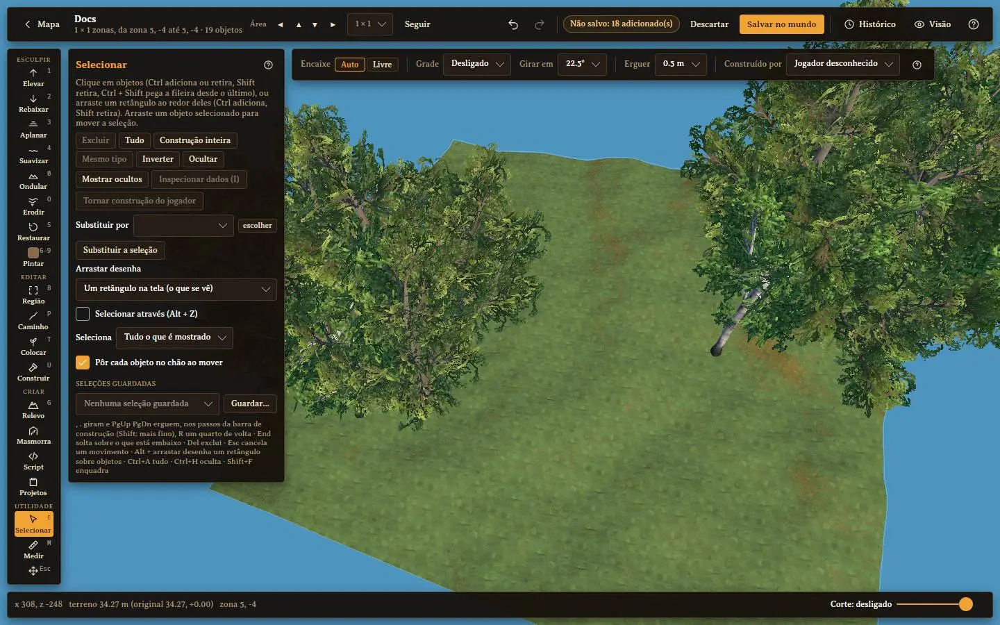

<!-- source: 133e1e92 -->
# Retirar árvores e rochas, aplanar um terreno para construir

Remova as árvores, rochas e arbustos de um lugar e aplane-o num terreno plano para construir.

**Você precisa de:** um mundo aberto em 3D, com o jogo fechado ou no [modo ao vivo](edit-your-game-live.md).

1. Pressione `B` ([Região](../area.md)). No alto do painel, escolha **Polígono**.
2. Clique nos cantos em volta do terreno, alguns metros além da construção, e dê um clique duplo para fechar.
3. Escolha **Objetos**.
4. Confira os chips de tipo: **Árvores e troncos**, **Rochas**, **Arbustos e moitas** e **Coletáveis** vêm ligados de
   início. Deixe **Suas construções** desligado.
5. Pressione **Selecionar os objetos (Enter)**. A ferramenta Selecionar abre com eles selecionados.
6. Pressione `Del`. Eles somem.
7. Pressione `B` para voltar à ferramenta Região: o polígono continua lá. Escolha **Terreno** e depois **Aplanar** em
   **Ação**.
8. Pressione **méd.** para a altura média dentro dele, ou digite uma **Altura**. Para combinar com uma porta que você já
   construiu, aponte para o chão na soleira dela e leia a altura na barra de status.
9. Defina a **Borda suave** (3 m para começar) para que o terreno se misture à encosta. A linha sob as configurações diz
   quanto terreno será cavado e aterrado, e o que fica fora do alcance de 8 m do jogo.
10. Pressione **Aplanar (Enter)**.
11. Opcional: em **Ação**, escolha **Pintar**, depois **Terra** ou **Pavimentado**, e pressione **Pintar (Enter)**.
12. Clique em **Salvar no mundo** (ou **Aplicar ao vivo**).

*Depois de **Selecionar os objetos (Enter)** e `Del`: as árvores dentro do polígono sumiram, as de fora continuam de pé.*

## Verificar se funcionou

- Pressione `M` ([Medir](../measure.md)) e meça de um lado ao outro do terreno: **Mais baixo / mais alto** devem
  coincidir.
- Ou ative **Cores de declive** no painel Visão: o terreno aparece verde.

## Desfazer

- Cada ação é um passo: `Ctrl+Z` desfaz o último. Depois de salvar, desfaça e salve de novo (veja
  [Desfazer um passo, reverter uma alteração ou descartar tudo](undo-changes.md)).
- Para fazer as árvores crescerem de volta mais tarde, selecione o lugar, escolha **Recuperar** e use **Regenerar a
  natureza** (veja [Região](../area.md#regenerar-a-natureza)).

## Relacionados

- [Região, copiar e colar](../area.md)
- [Máscara](../masks.md): aplanar só a base de uma encosta
- [Fazer uma estrada ou uma rampa subindo uma colina](make-a-road.md)
