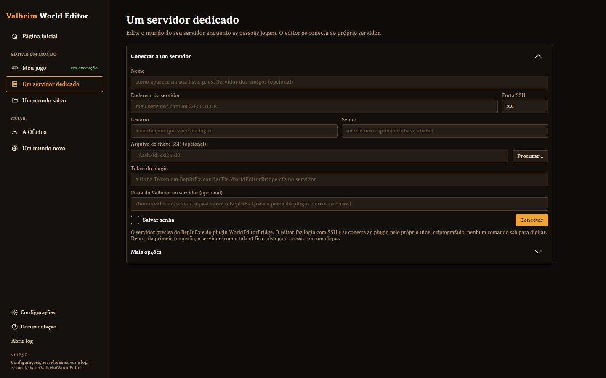

<!-- source: 52199907 -->
# Editar um servidor dedicado enquanto as pessoas jogam

Conecte o editor ao seu servidor dedicado e altere o mundo dele enquanto os jogadores continuam online.

**Você precisa de:** acesso SSH à máquina que roda o servidor (um login no shell, com senha ou arquivo de chave: SFTP ou
o gerenciador de arquivos de um painel web, sozinhos, não bastam), permissão para instalar ali o BepInEx e o plugin
WorldEditorBridge e para reiniciá-lo. Um servidor de jogo alugado de uma hospedagem (um painel web e FTP, sem SSH), ou
um que um painel de jogos como o Pterodactyl roda num contêiner: veja
[Editar um servidor alugado ou hospedado num painel](edit-a-rented-server.md).

*O formulário em **Um servidor dedicado**. Depois da primeira conexão, o servidor fica salvo acima dele, para acesso
com um clique.*

1. No servidor, instale o BepInEx ([BepInExPack for Valheim](https://thunderstore.io/c/valheim/p/denikson/BepInExPack_Valheim/),
   seguindo as instruções dele para servidores dedicados).
2. Copie `WorldEditorBridge.dll` (de `WorldEditorBridge-<version>.zip`, na
   [página de versões](https://github.com/Shuiei/valheim-world-editor/releases/latest)) para `BepInEx/plugins` do
   servidor, ou instale o WorldEditorBridge no perfil de servidor de um gerenciador de mods.
3. Reinicie o servidor com o BepInEx. O `BepInEx/LogOutput.log` dele agora diz `WorldEditorBridge <version> listening on
   http://127.0.0.1:5182/`.
4. No servidor, abra `BepInEx/config/Tie.WorldEditorBridge.cfg` e copie o valor da linha `Token`. O arquivo só existe
   depois que o servidor foi iniciado com o plugin.
5. Na página inicial do editor, escolha **Um servidor dedicado** e depois **Conectar a um servidor**.
6. Preencha **Endereço do servidor**, **Usuário** e **Senha** ou **Arquivo de chave SSH (opcional)**. Cole o token em
   **Token do plugin**.
7. Opcional: preencha **Pasta do Valheim no servidor (opcional)** (a pasta que contém `BepInEx`), para que o editor
   possa dizer exatamente o que está errado se o plugin não responder. Marque **Salvar senha** para não digitá-la de
   novo.
8. Pressione **Conectar**. O editor entra por SSH, abre um túnel criptografado próprio até o plugin e carrega o mundo.
9. No mapa, escolha um local, **Editar em 3D**, faça uma alteração e pressione **Aplicar ao vivo**.

## Verificar se funcionou

- A barra superior mostra **AO VIVO**; depois de aplicar, "Tudo aplicado" e "Aplicado ao jogo em execução: …" na barra
  de status.
- Os jogadores perto da alteração a veem na hora.
- O servidor agora aparece acima do formulário, e na seção **Página inicial**, para acesso com um clique da próxima vez.

Se aparecer uma mensagem sob o formulário em vez disso, veja [Um servidor não se conecta](../help/troubleshooting.md#um-servidor-não-se-conecta).

## Desfazer

Pressione `Ctrl+Z` (ou use **Remover** no passo, no Histórico) e depois **Aplicar ao vivo** de novo. As redefinições de
zonas não podem ser desfeitas depois de aplicadas.

## Os outros campos do formulário

| Campo | O que é |
|---|---|
| **Nome** | Como o servidor aparece na sua lista (opcional; caso contrário, o endereço). |
| **Endereço do servidor** | O nome ou o endereço IP do servidor. Você também pode digitar `user@address` aqui. |
| **Porta SSH** | 22, a menos que o SSH do servidor tenha sido alterado. |
| **Arquivo de chave SSH (opcional)** | A sua chave privada (**Procurar…** para escolhê-la). Vazio: as chaves usuais de `~/.ssh` (`id_ed25519`, `id_ecdsa`, `id_rsa`) são testadas; uma que o editor não consegue usar é pulada, e as outras e a senha continuam sendo testadas. |
| **Token do plugin** | Sempre digitado por você: o editor nunca o lê do servidor, então um login SSH sozinho não consegue alterar o mundo. |
| **Mais opções** → **Senha da chave** | A senha da chave, quando ela tem uma. Nunca é salva. |
| **Mais opções** → **Porta do plugin** | A porta do plugin no servidor, quando não é 5182 e nenhuma pasta foi informada. |
| **Mais opções** → **Criei meu próprio túnel** | **Endereço do bridge** e **Token**, depois **Conectar**: para um túnel que você criou com `ssh -L` ou com o PuTTY. |

## Servidores salvos

Depois da primeira conexão, o servidor fica listado acima do formulário, os mais recentes primeiro, com **Conectar**,
**editar** e **esquecer**; o formulário se recolhe em **Conectar a outro servidor**. Cada linha mostra `user@address`,
se ele usa um arquivo de chave, uma senha salva ou pede uma, e caixas para o que não está salvo.

- **editar** preenche o formulário com o servidor; mude o que precisar, e **Conectar** o atualiza.
- **esquecer** o remove, com a senha e o token dele.

Os servidores ficam guardados em `servers.cfg`, na pasta de dados do editor (o menu lateral da página inicial a mostra),
uma seção por servidor (`Host`, `SshPort`, `User`, `Password`, `KeyFile`, `Token`, `BridgePort`, `GameFolder`,
`HostKey`), então você também pode editá-lo à mão. Um servidor é uma conta num endereço e numa porta: conectar de novo
com os mesmos atualiza a seção dele.

`Password` só é preenchido quando **Salvar senha** foi marcado, em texto simples (no Linux, só você pode ler o
arquivo): prefira uma chave SSH.

`HostKey` é a identidade do servidor, lembrada na primeira conexão. Se ela mudar algum dia, o editor se recusa a se
conectar, porque alguém poderia estar se passando pelo seu servidor. Se você reinstalou o servidor, esvazie a linha
`HostKey` de cada servidor salvo com esse endereço para aceitar a nova identidade.

## Relacionados

- [Modo ao vivo](../live-mode.md): Aplicar ao vivo, Auto, acompanhar o jogo, jogadores
- [Editar um servidor alugado ou hospedado num painel](edit-a-rented-server.md): o servidor de jogo de uma hospedagem,
  Pterodactyl, Docker
- [Edição ao vivo](../concepts/live-editing.md#como-ele-se-conecta): o túnel SSH e o token
- [Editar o mundo em que você está jogando](edit-your-game-live.md)
- [Fazer backup de um mundo antes de editar](back-up-a-world.md)
